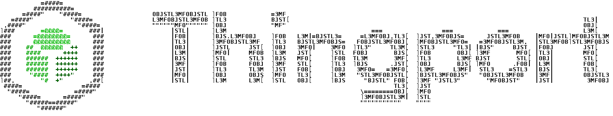

<picture><source media="(prefers-color-scheme: dark)" srcset="https://raw.githubusercontent.com/TautvydasDerzinskas/Thingport/develop/.github/assets/thingport-ascii-dark.gif"></picture>

## Description

<!-- The problem, not just the patch. For a bug: symptom, cause, fix. Link any issue: Closes #123 -->

## Screenshots

<!-- Before and after for anything visible, in light and dark. Delete this section if nothing changes on screen. -->

## Changes

- [ ] UI
- [ ] Backend
- [ ] Web
- [ ] Extension
- [ ] Bridge
- [ ] Tools or widgets
- [ ] Docs
- [ ] Tests

## Testing

<!-- What you ran or clicked. If you couldn't verify something end to end, say so. -->

## Checklist

- [ ] The base branch is `develop`
- [ ] The title is a [Conventional Commit](https://www.conventionalcommits.org/), as it can become the changelog entry
- [ ] New UI text has a key in every locale, and the change looks right in light and dark
