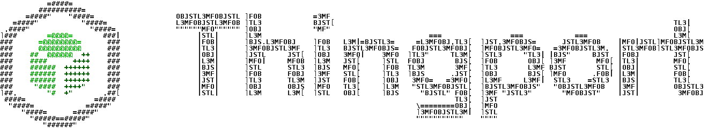
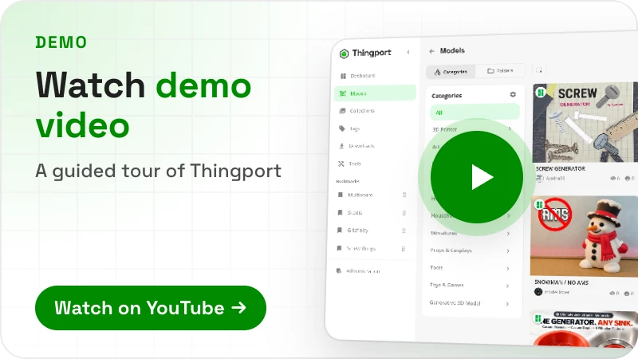
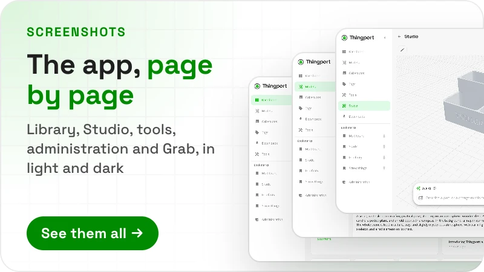
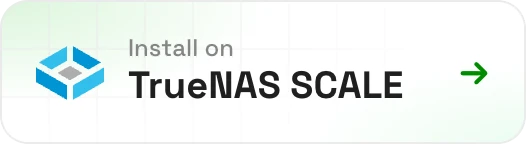
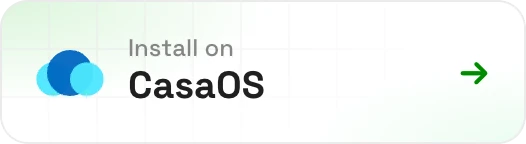
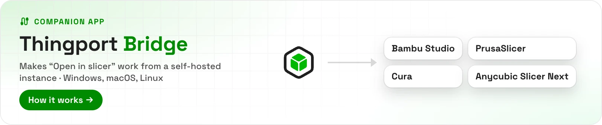
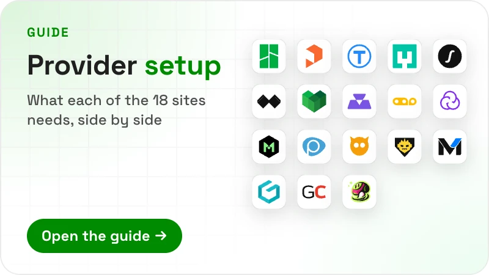
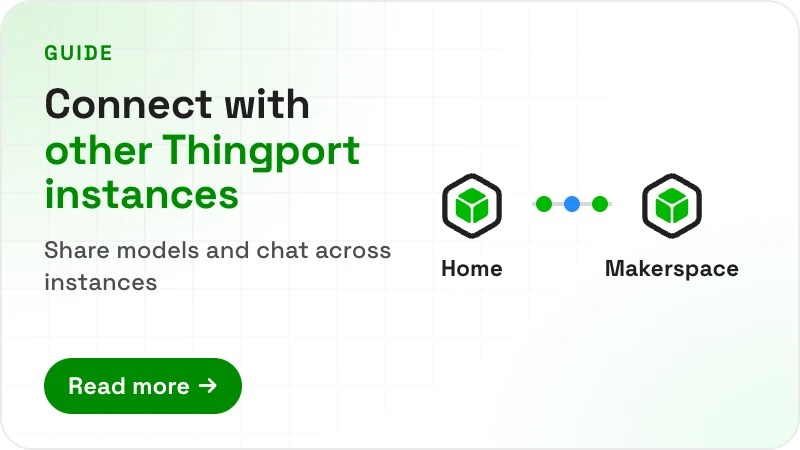

<div align="center">

<picture>
  <source media="(prefers-color-scheme: dark)" srcset=".github/assets/thingport-ascii-dark.gif">
  
</picture>

<h3>Keep every model that matters.</h3>

<p>
A self-hosted library that imports, organises, designs, and never loses your favourites 3d print models.
</p>

<p>
  <a href="https://thingport.net/"></a>
  <a href="https://thingport.net/docs/"></a>
  <a href="https://thingport.net/features/"></a>
  <a href="https://thingport.net/blog/"></a>
  <picture><source media="(prefers-color-scheme: dark)" srcset="docs/assets/readme/chip-divider-dark.svg"></picture>
  <a href="https://github.com/TautvydasDerzinskas/Thingport/actions/workflows/web-pages.yml"></a>
  <a href="https://github.com/TautvydasDerzinskas/Thingport/actions/workflows/frontend-image.yml"></a>
  <a href="https://github.com/TautvydasDerzinskas/Thingport/actions/workflows/backend-image.yml"></a>
  <a href="https://github.com/TautvydasDerzinskas/Thingport/actions/workflows/bridge-release.yml"></a>
  <a href="https://github.com/TautvydasDerzinskas/Thingport/actions/workflows/extension-release.yml"></a>
  <a href="https://github.com/TautvydasDerzinskas/Thingport/actions/workflows/regression.yml"></a>
</p>

</div>

## About

To put it simply, if you're into 3D printing, you probably hunt for models across MakerWorld, Printables, Thingiverse, MyMiniFactory and a bunch of other sites. And if you're anything like me, you've ended up with a scattered collection of bookmarks and downloads that lives everywhere and nowhere.

Then models disappear. Authors update them and the version you loved is gone. Or the internet just decides to take a day off.

Thingport is a self-hosted 3D model library that pulls everything into one place you actually own. It imports from a long list of providers, keeps your collections in sync, and makes sure new bookmarks land in your library automatically.

Beyond that, it’s a proper workshop: AI that can improve descriptions and categorize models, a built-in CAD studio that can generate parts from a single prompt (or let you design by hand), print-quality checks, OpenSCAD support, and a growing set of tools. You can also share models with your household or connect different Thingport instances.

Your collection stays yours — offline, organised, and ready whenever you need it.

## Demo

<p align="center">
  <a href="https://www.youtube.com/watch?v=8g-JoWckL2Y"><picture><source media="(prefers-color-scheme: dark)" srcset="docs/assets/readme/demo-video-dark.webp"></picture></a>
  <a href="docs/SCREENSHOTS.md"><picture><source media="(prefers-color-scheme: dark)" srcset="docs/assets/readme/screenshots-dark.webp"></picture></a>
</p>

## Installation

<p align="center">
  <a href="docs/install/unraid/README.md"><picture><source media="(prefers-color-scheme: dark)" srcset="docs/assets/readme/install-unraid-dark.webp"></picture></a>
  <a href="docs/install/truenas/README.md"><picture><source media="(prefers-color-scheme: dark)" srcset="docs/assets/readme/install-truenas-dark.webp"></picture></a>
  <a href="docs/install/casaos/README.md"><picture><source media="(prefers-color-scheme: dark)" srcset="docs/assets/readme/install-casaos-dark.webp"></picture></a>
</p>

These guides, and the one for Docker Compose below, are also on the **[Thingport website](https://thingport.net/docs/)**.

### Docker Compose

Runs entirely from the pre-built images on GHCR -- no local build, no git clone needed. Works on any Docker host, including a NAS (Synology, QNAP, Unraid, etc).

Create a folder for Thingport and add these two files to it:

<details>
<summary><code>docker-compose.yml</code></summary>

```yaml
services:
  db:
    image: postgres:16-alpine
    restart: unless-stopped
    environment:
      - POSTGRES_USER=${POSTGRES_USER:-thingport}
      - POSTGRES_PASSWORD=${POSTGRES_PASSWORD:-thingport}
      - POSTGRES_DB=${POSTGRES_DB:-thingport}
    volumes:
      - thingport_db:/var/lib/postgresql/data
    networks:
      - app-net
    healthcheck:
      test: ["CMD-SHELL", "pg_isready -U ${POSTGRES_USER:-thingport}"]
      interval: 5s
      timeout: 5s
      retries: 10

  flaresolverr:
    image: ghcr.io/flaresolverr/flaresolverr:latest
    restart: unless-stopped
    environment:
      - LOG_LEVEL=${FLARESOLVERR_LOG_LEVEL:-info}
      - TZ=${TZ:-UTC}
    networks:
      - app-net

  backend:
    image: ghcr.io/tautvydasderzinskas/thingport-backend:latest
    restart: unless-stopped
    environment:
      - PUID=${PUID:-1000}
      - PGID=${PGID:-1000}
      - AUTH_SECRET=${AUTH_SECRET:-changeme-secret}
      - AUTH_TOKEN_TTL=${AUTH_TOKEN_TTL:-43200}
      - PUBLIC_URL=${PUBLIC_URL:-}
      - SMTP_HOST=${SMTP_HOST:-}
      - SMTP_PORT=${SMTP_PORT:-587}
      - SMTP_SECURE=${SMTP_SECURE:-false}
      - SMTP_USER=${SMTP_USER:-}
      - SMTP_PASS=${SMTP_PASS:-}
      - SMTP_FROM=${SMTP_FROM:-Thingport <no-reply@localhost>}
      - FILE_STORAGE=/app/storage
      - DATABASE_URL=postgresql://${POSTGRES_USER:-thingport}:${POSTGRES_PASSWORD:-thingport}@db:5432/${POSTGRES_DB:-thingport}?schema=public
      - CORS_ORIGINS=${CORS_ORIGINS:-}
      - FLARESOLVERR_URL=${FLARESOLVERR_URL:-http://flaresolverr:8191/v1}
      - FLARESOLVERR_REQUIRE_HTTPS=${FLARESOLVERR_REQUIRE_HTTPS:-false}
    depends_on:
      db:
        condition: service_healthy
      flaresolverr:
        condition: service_started
    volumes:
      - thingport_storage:/app/storage
      # Optional consume folder: files and folders dropped in it are imported automatically
      # (Administration -> Storage -> Consume Folder). Uncomment and point it at a host folder.
      # - /path/to/consume:/app/consume
    networks:
      - app-net

  frontend:
    image: ghcr.io/tautvydasderzinskas/thingport-frontend:latest
    restart: unless-stopped
    ports:
      - "${WEB_PORT:-80}:80"
    depends_on:
      - backend
    networks:
      - app-net

volumes:
  thingport_storage:
  thingport_db:

networks:
  app-net:
    driver: bridge
```

</details>

<details>
<summary><code>.env</code></summary>

```env
# Required
# AUTH_SECRET signs login tokens -- use your own random value
AUTH_SECRET=b1193c7014e833a063f750d6e4644d615e90e6ee81dbde619e1818e9675a3374
POSTGRES_PASSWORD=change-this-password

# Optional (defaults shown)
PUID=1000
PGID=1000
WEB_PORT=80
POSTGRES_USER=thingport
POSTGRES_DB=thingport
# e.g. https://thingport.example.com -- needed for links in emails and for single sign-on (OIDC).
# Read on the first run only; after that it's managed in Administration -> Auth.
PUBLIC_URL=
# access token lifetime, in seconds; the browser renews it
AUTH_TOKEN_TTL=43200
# how long a browser stays signed in without being used, in seconds (0 = off); until set in Administration -> Auth
# REMEMBER_SESSION_TTL=2592000
SMTP_HOST=
SMTP_PORT=587
SMTP_SECURE=false
SMTP_USER=
SMTP_PASS=
SMTP_FROM=Thingport <no-reply@localhost>
# first-run default only; once Thingport has started, change it in Administration -> Connections -> FlareSolverr
FLARESOLVERR_URL=http://flaresolverr:8191/v1
# true refuses a plain HTTP FlareSolverr unless it runs locally (flaresolverr, localhost); System Health says when it's safe
FLARESOLVERR_REQUIRE_HTTPS=false
TZ=UTC
```

</details>

Then start it:

```bash
docker compose up -d
```

Thingport will be available at `http://<host>:<WEB_PORT>` (default port 80). The first
account you register becomes the admin account.

Then open **Administration → Overview → System Health** and click **Run full test**. Ideally everything is green:
anything marked **Required** or **Recommended** that isn't means Thingport, or part of it, won't work properly until
it's fixed, and each problem says how. It's also the first place to look whenever something stops working. See
[System Health](docs/guides/system-health.md).

> **Just want to try it?** On Linux or macOS, one command creates a `thingport` folder with the same two files,
> generates the secrets in `.env` and starts Thingport on port 80:
>
> ```bash
> curl -fsSL https://thingport.net/install.sh | sh
> ```
>
> Edit `.env` there and run `docker compose up -d` again to change settings. Pick the folder and port up front with
> `curl -fsSL https://thingport.net/install.sh | WEB_PORT=8080 sh -s -- ~/thingport`. The script is
> [install.sh](install.sh) in this repo.

<details>
<summary>Building from source instead</summary>

```bash
git clone https://github.com/TautvydasDerzinskas/Thingport.git
cd Thingport
cp .env.example .env
docker compose up -d
```

This builds the images locally rather than pulling from GHCR.

</details>

### Consume folder

To have Thingport import whatever you drop into a folder on the server, uncomment the consume volume in
`docker-compose.yml`. See the [consume folder guide](docs/guides/consume-folder.md).

## Features

- **[A library that keeps everything](docs/features/organize-and-search.md)**: models, files, print profiles, collections, tags, authors and [licences](docs/features/licenses.md), with 3D previews, search and bulk editing
- **[Imports from 21 sites](docs/features/importing.md)**: MakerWorld, Printables, Thingiverse, MyMiniFactory and 17 more, with [synced collections](docs/guides/synced-collections.md)
- **[AI that tidies up](docs/guides/ai.md)**: better descriptions and categories, on a local model or Claude
- **[Studio, a CAD of its own](docs/guides/studio.md)**: describe a part in one prompt and the AI builds it, or design it by hand
- **[Print quality checks](docs/features/print-quality.md)**: problems found before you slice
- **[Tools](docs/guides/tools.md) and [OpenSCAD](docs/features/supporting-files.md#models-you-can-generate-again)**: planners, generators and calculators, and models that come with an OpenSCAD script, customized in the library
- **[Share it](docs/features/multi-user.md)**: with your household, or with [other Thingport instances](docs/features/connected-instances.md) you connect to

**[More features…](docs/FEATURES.md)**

## Companion Apps

<p align="center">
  <a href="bridge/README.md"><picture><source media="(max-width: 600px) and (prefers-color-scheme: dark)" srcset="docs/assets/readme/bridge-compact-dark.webp"><source media="(max-width: 600px)" srcset="docs/assets/readme/bridge-compact-light.webp"><source media="(prefers-color-scheme: dark)" srcset="docs/assets/readme/bridge-dark.webp"></picture></a>
</p>

<p align="center">
  <a href="https://chromewebstore.google.com/detail/nmblahmglpbplmfcggghdgohohlaeiee"><picture><source media="(prefers-color-scheme: dark)" srcset="docs/assets/readme/grab-chrome-dark.webp"></picture></a>
  <a href="https://addons.mozilla.org/firefox/addon/thingport-grab/"><picture><source media="(prefers-color-scheme: dark)" srcset="docs/assets/readme/grab-firefox-dark.webp"></picture></a>
  <a href="https://microsoftedge.microsoft.com/addons/detail/kahfidpmojfocohinlmglnfoaimocbol"><picture><source media="(prefers-color-scheme: dark)" srcset="docs/assets/readme/grab-edge-dark.webp"></picture></a>
</p>

<p align="center"><a href="extension/README.md">Find out more about Thingport Grab…</a></p>

## Guides

<p align="center">
  <a href="docs/PROVIDER_SETUP.md"><picture><source media="(prefers-color-scheme: dark)" srcset="docs/assets/readme/provider-setup-dark.webp"></picture></a>
  <a href="docs/features/connected-instances.md"><picture><source media="(prefers-color-scheme: dark)" srcset="docs/assets/readme/connected-instances-dark.webp"></picture></a>
</p>

## Contributing

Bug reports and pull requests are welcome. See [CONTRIBUTING.md](CONTRIBUTING.md) for the branch,
commit and pull request workflow, and [docs/DEVELOPMENT.md](docs/DEVELOPMENT.md) for how to run
Thingport locally with hot reload. Adding a model site is in
[docs/PROVIDER_DEVELOPMENT.md](docs/PROVIDER_DEVELOPMENT.md), and writing a tool for the Tools page in
[docs/TOOL_DEVELOPMENT.md](docs/TOOL_DEVELOPMENT.md).

### Honourable contributors

<table>
  <tr>
    <td align="center" width="140">
      <a href="https://github.com/Ruivalim"></a><br>
      <sub><b>Ruivalim</b></sub><br>
      <a href="https://github.com/Ruivalim"></a>&nbsp;
      <a href="https://ruivalim.com.br"></a>&nbsp;
      <a href="https://www.linkedin.com/in/rui-valim/"></a>
    </td>
    <td align="center" width="140">
      <a href="https://github.com/kreativmonkey"></a><br>
      <sub><b>kreativmonkey</b></sub><br>
      <a href="https://github.com/kreativmonkey"></a>
    </td>
  </tr>
</table>

## Support

If Thingport is useful to you, consider supporting its development:

- [GitHub Sponsors](https://github.com/sponsors/TautvydasDerzinskas)
- [Buy Me a Coffee](https://buymeacoffee.com/TautvydasDerzinskas)

## License

Thingport is free software: you can redistribute it and/or modify it under the terms of the
[GNU Affero General Public License, version 3](LICENSE) (AGPL-3.0-only), as published by the Free
Software Foundation.
