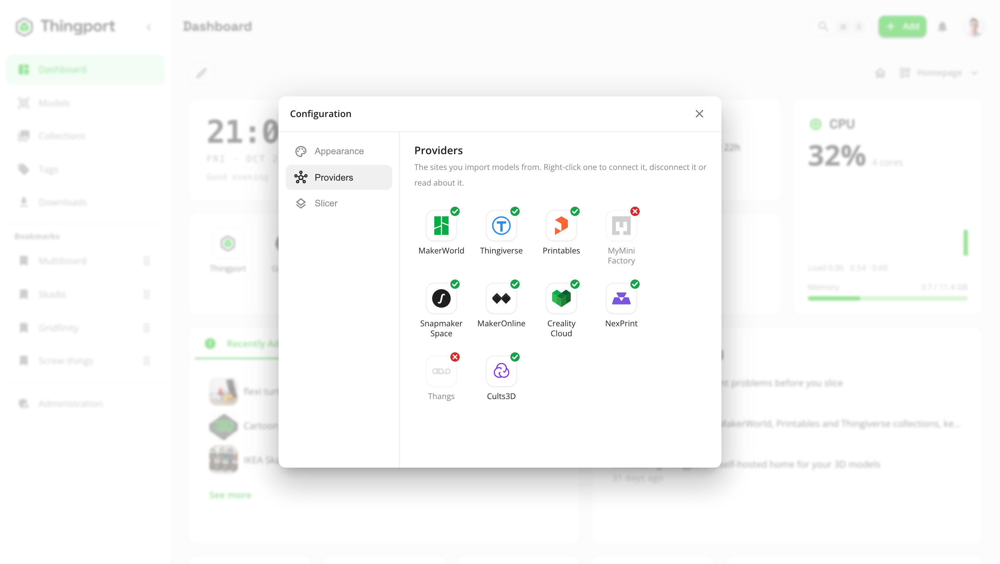

# Providers

Thingport imports from the model sites below. **MakerWorld**, **Printables** and **Thingiverse** are the main ones and
have been supported the longest; the rest came later. Each has a page of its own with what it imports, what it needs and
how to connect it:

<!-- providers:list -->
<!-- Written by scripts/sync-providers.mjs from providers/: change it there. -->

-  [MakerWorld](providers/makerworld.md) -- your own session cookie; Thingport Grab connects it for you.
-  [Printables](providers/printables.md) -- works out of the box.
-  [Thingiverse](providers/thingiverse.md) -- one App Token, set by an admin.
-  [MyMiniFactory](providers/myminifactory.md) -- one API key, set by an admin; your own sign-in for paid models.
-  [Snapmaker Space](providers/snapmaker-space.md) -- your own sign-in, which only Thingport Grab keeps alive.
-  [MakerOnline](providers/makeronline.md) -- its files come only through Thingport Grab.
-  [Creality Cloud](providers/creality-cloud.md) -- your own sign-in, for a week at a time.
-  [NexPrint](providers/nexprint.md) -- your own sign-in, renewed as you use the site.
-  [Thangs](providers/thangs.md) -- your own sign-in, which Thingport renews for about a year.
-  [Cults3D](providers/cults3d.md) -- your own API key, and your browser's sign-in for files.
-  [eufyMake](providers/eufymake.md) -- no sign-in to import; yours adds your likes.
-  [Pinshape](providers/pinshape.md) -- your own sign-in, for the files; collections and likes read without it.
-  [OwlCAD](providers/owlcad.md) -- no sign-in at all; its CAD projects need Thingport Grab.
-  [Toymakr3D](providers/toymakr3d.md) -- your own sign-in, for the files and your likes; its models read without one.
-  [Makerables](providers/makerables.md) -- no sign-in to import; yours adds your saved projects.
-  [CGTrader](providers/cgtrader.md) -- your own sign-in, for the files, your likes and your wishlist; Grab or FlareSolverr for its bot check.
-  [GrabCAD](providers/grabcad.md) -- your own sign-in, for the files; anyone's likes read without it.

<!-- /providers:list -->

Inside Thingport, **About** in a provider's menu under **Configuration → Providers**, or a click on a model's provider
badge, shows the same in short.

## At a glance

<!-- providers:table -->
<!-- Written by scripts/sync-providers.mjs from providers/: change it there. -->

| Provider                                                                                                                                         | Sign-in                         | Thingport Grab | FlareSolverr | Collections | Likes | Sync | Print profiles |
| ------------------------------------------------------------------------------------------------------------------------------------------------ | ------------------------------- | -------------- | ------------ | ----------- | ----- | ---- | -------------- |
|  [MakerWorld](providers/makerworld.md)                | Your cookie                     | Recommended    | Optional     | ✓           |       | ✓    | ✓              |
|  [Printables](providers/printables.md)                | None                            | Optional¹      | Recommended  | ✓           | ✓¹    | ✓    |                |
|  [Thingiverse](providers/thingiverse.md)             | Admin's App Token               | Optional       | Recommended  | ✓           | ✓     | ✓    |                |
|  [MyMiniFactory](providers/myminifactory.md)       | Admin's API key, yours for paid | Optional       | Recommended  | ✓           |       | ✓    |                |
|  [Snapmaker Space](providers/snapmaker-space.md) | Yours, for a day                | Recommended²   |              | Bookmarks   | ✓     | ✓    | ✓              |
|  [MakerOnline](providers/makeronline.md)             | Yours, for likes only           | **Required**   |              | ✓           | ✓     | ✓    | ✓              |
|  [Creality Cloud](providers/creality-cloud.md)    | Yours, for a week               | Recommended    |              | ✓           | ✓     | ✓    | ✓              |
|  [NexPrint](providers/nexprint.md)                      | Yours                           | Recommended    |              | ✓           |       | ✓    | ✓              |
|  [Thangs](providers/thangs.md)                            | Yours, renewed for a year       | Recommended    | Optional     | ✓           | ✓     | ✓    |                |
|  [Cults3D](providers/cults3d.md)                         | Your API key + browser sign-in  | Recommended³   |              | Printlists  | ✓     | ✓    |                |
|  [eufyMake](providers/eufymake.md)                      | Yours, for likes only           | Recommended    |              |             | ✓     | ✓    |                |
|  [Pinshape](providers/pinshape.md)                      | Yours, for the files            | Recommended    |              | ✓           | ✓     | ✓    |                |
|  [OwlCAD](providers/owlcad.md)                            | None                            | Recommended⁴   |              |             |       |      |                |
|  [Toymakr3D](providers/toymakr3d.md)                   | Yours, for the files            | Recommended    |              |             | ✓⁵    | ✓    |                |
|  [Makerables](providers/makerables.md)                | Yours, for saved projects only  | Recommended    |              | Saved       |       | ✓    |                |
|  [CGTrader](providers/cgtrader.md)                      | Yours, for the files            | Recommended⁶   | Recommended  | Wishlist    | ✓⁶    | ✓    |                |
|  [GrabCAD](providers/grabcad.md)                         | Yours, for the files            | Recommended    |              |             | ✓     | ✓    |                |

1. Your private Printables collections and your likes are read by Grab, while you're on Printables.
2. Snapmaker's sign-in lasts a day and only Grab renews it; without Grab you paste a new one every day.
3. Cults3D's files need your browser's Cloudflare clearance, and Thingport on the same IP address as that browser.
4. A gallery item that is a CAD project, rather than a library part, has no stored mesh: OwlCAD's editor builds its file, so Thingport Grab exports it on owlcad.com.
5. Toymakr3D hands a model's files to signed-in users only, the free ones included, and shows your likes to you alone.
6. CGTrader shows your likes and wishlist to you alone, and its downloads sit behind AWS's bot check, which Thingport passes with Grab's token from your browser or FlareSolverr's own.

<!-- /providers:table -->

**Sign-in** is what Thingport needs before it can import; "yours" means each user connects their own account.

## Dependencies

### Thingport Grab

[Thingport Grab](../extension/README.md) is Thingport's browser extension for Chrome, Edge and Firefox. Besides
importing straight from a model's page, it hands your browser's sign-in to Thingport, so the sites that need one connect
by just being visited, and stay connected. On MakerOnline it does the downloading itself, so there it's required, and
on OwlCAD it exports CAD projects from OwlCAD's own editor. Install it from the **Downloads** page and connect it with
**Pair with Thingport** in its popup: that opens your Thingport in a tab, where you approve that browser, so no password
is kept in Grab (see [its setup](../extension/README.md#setup)). Sites after MakerWorld, Printables and Thingiverse
need one click first, on the site in Grab's popup (a + marks one that's off) or on **Enable all**.
If a reverse proxy upgrades your instance's `http://` address to `https://` on the same host, Grab follows that
upgrade. It never sends your sign-in along any other redirect: then enter the final address in Grab instead. Grab spots
the upgrade with a GET request, so a proxy that redirects only other methods, such as POST, needs the final address too.
A connection made before this upgrade was followed may need connecting once more, so Grab may reach the `https://`
address.

### FlareSolverr

[FlareSolverr](https://github.com/FlareSolverr/FlareSolverr) uses a real browser to solve Cloudflare challenges.
It's part of the standard Docker Compose stack. Set its global URL under **Administration → Connections →
FlareSolverr** to enable fallback for all declared provider routes. [System Health](guides/system-health.md) checks
the service. Clearing the URL disables all fallbacks, including when a previous request warmed the proxy cache.
CGTrader's downloads sit behind AWS's bot check instead: FlareSolverr gets Thingport a token for it whenever the last
one is turned down, and without FlareSolverr only the token Grab sends from your browser will do.

Prefer HTTPS for a solver on another machine: provider cookies and API tokens travel to it. Plain HTTP keeps
working, and System Health shows a warning for it. Once the URL is HTTPS, or one of the local endpoints
`flaresolverr` (the Compose service), `localhost`, `127.0.0.1` or `[::1]`, set `FLARESOLVERR_REQUIRE_HTTPS=true` to
refuse plaintext remote solvers from then on, saved and environment URLs included.

Thingport doesn't follow a redirect from the solver's address, since credentials would go along. A reverse proxy in
front of the solver has to answer `/v1` itself: one that redirects it, even just to `/v1/`, needs changing, because
until then the URL can't be saved and solver requests fail.

Thingiverse and MyMiniFactory API requests first use guarded direct transport with a Chrome-like TLS handshake.
Only a 429 or Cloudflare challenge retries through the enabled solver, including the Thingiverse `access_token` or
MyMiniFactory `key` in the URL. A 401 rejects the credential, and so does a JSON 403 from Thingiverse. MyMiniFactory
also answers 403 for models that aren't public, so there it only means the model can't be reached. MakerWorld,
Printables and Thangs support selected page/API fallbacks; Cults3D supports public pages only. Binary downloads,
authenticated Cults3D calls and MakerWorld's separate Bambu cloud API do not support solver fallback.

**Use a private, isolated solver.** It receives provider cookies and URL API tokens, and its logs may record them.
Thingport checks the initial HTTPS host, path and query against each provider's declarations, but the solver's
browser navigation, redirects and third-party requests are outside Thingport's per-hop destination guard. Isolate
its network access from private services and restrict access to the solver and its logs.

## Connecting a provider

Connect them under **Configuration → Providers**: open the user menu (your avatar, top right) and choose
**Configuration**, or click one of the provider chips at the bottom of that menu. Right-click a provider to connect or
disconnect it, or double-click one that isn't connected yet. A green tick means it's connected; a red cross, that it
isn't or not fully, and hovering it says why. A provider your admin has [turned off](#turning-a-provider-off) isn't
listed.

<picture>
  <source media="(prefers-color-scheme: dark)" srcset="../frontend/src/assets/screenshots/dark/03_dashboard_configuration.png">
  
</picture>

## Turning a provider off

Admins choose which providers this Thingport imports from, under **Administration → Providers**. All are on by
default. Turn one off and nothing new comes from it for anyone: links to it, Thingport Grab and the import queue are
refused, its synced collections pause, and background jobs skip it. It also disappears from everyone's
**Configuration → Providers**. Models already imported from it stay as they are, and turning it back on picks up where
it left off. The Thingiverse App Token and the MyMiniFactory API key are set on the same page.
