# Screenshots

These follow your GitHub theme: switch it to see the other one. Thingport has a light and a dark theme, or follows your
system's. Click a screenshot to open it full size.

## Library

<table>
  <tr>
    <td width="33%"><a href="../frontend/src/assets/screenshots/light/01_dashboard.png" target="_blank"><picture><source media="(prefers-color-scheme: dark)" srcset="../frontend/src/assets/screenshots/dark/01_dashboard.png">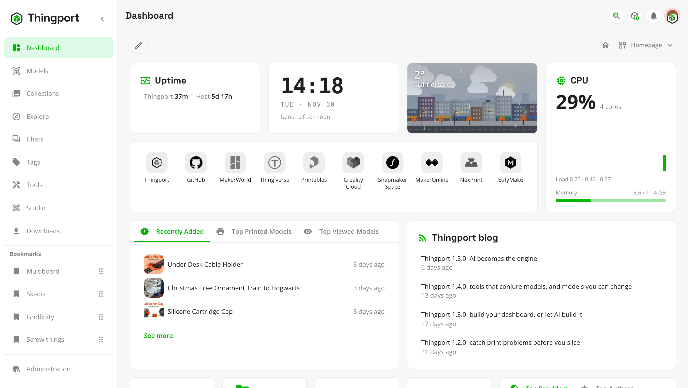</picture></a> <b>Dashboard</b></td>
    <td width="33%"><a href="../frontend/src/assets/screenshots/light/02_dashboard_customize.png" target="_blank"><picture><source media="(prefers-color-scheme: dark)" srcset="../frontend/src/assets/screenshots/dark/02_dashboard_customize.png">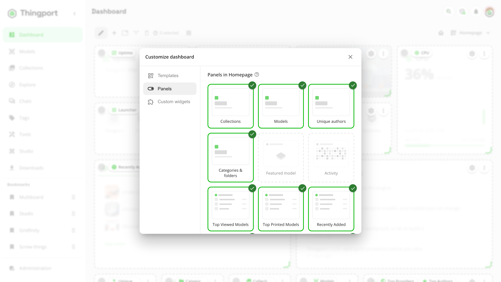</picture></a> <b>Customize Dashboard</b></td>
    <td width="33%"><a href="../frontend/src/assets/screenshots/light/04_models.png" target="_blank"><picture><source media="(prefers-color-scheme: dark)" srcset="../frontend/src/assets/screenshots/dark/04_models.png">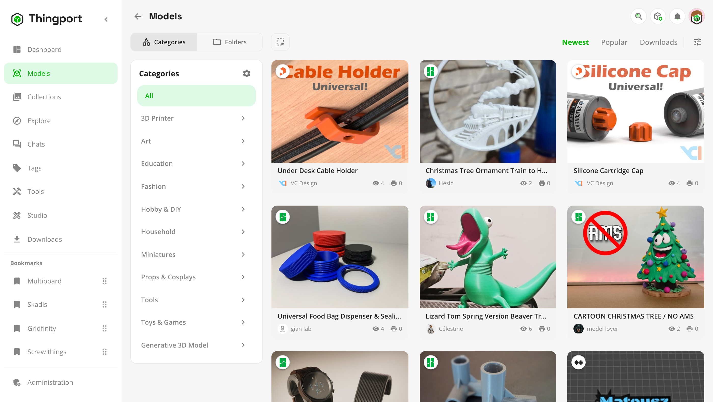</picture></a> <b>Models</b></td>
  </tr>
  <tr>
    <td width="33%"><a href="../frontend/src/assets/screenshots/light/34_models_filters.png" target="_blank"><picture><source media="(prefers-color-scheme: dark)" srcset="../frontend/src/assets/screenshots/dark/34_models_filters.png">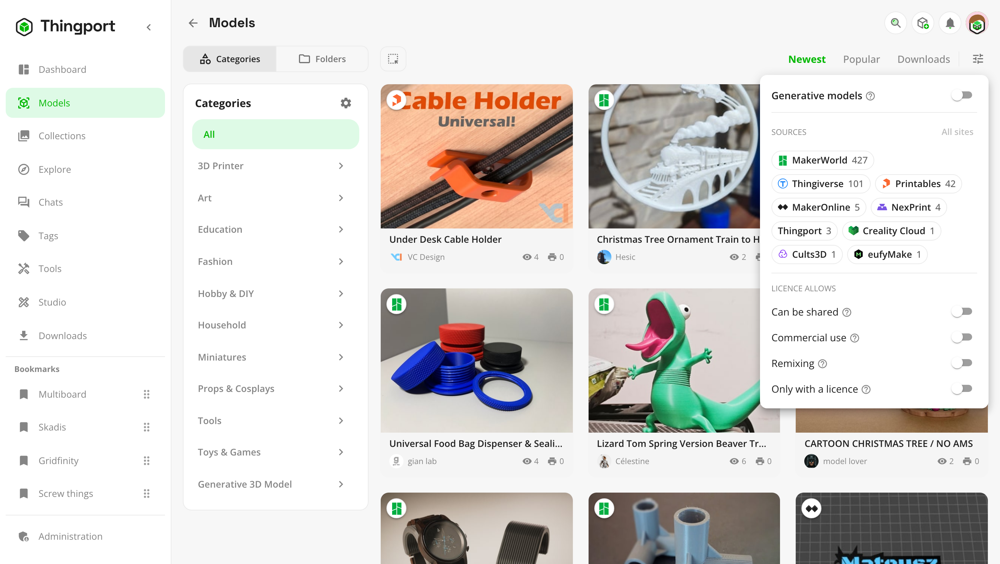</picture></a> <b>Model Filters</b></td>
    <td width="33%"><a href="../frontend/src/assets/screenshots/light/05_models_download.png" target="_blank"><picture><source media="(prefers-color-scheme: dark)" srcset="../frontend/src/assets/screenshots/dark/05_models_download.png">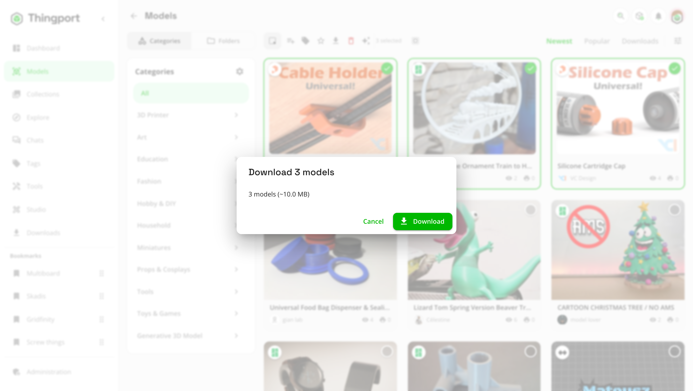</picture></a> <b>Download Models</b></td>
    <td width="33%"><a href="../frontend/src/assets/screenshots/light/06_model_details.png" target="_blank"><picture><source media="(prefers-color-scheme: dark)" srcset="../frontend/src/assets/screenshots/dark/06_model_details.png">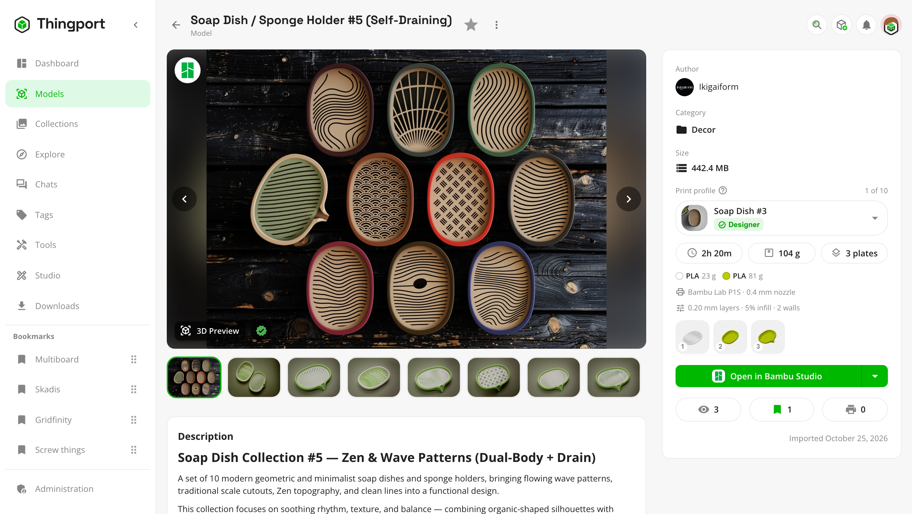</picture></a> <b>Model Details</b></td>
  </tr>
  <tr>
    <td width="33%"><a href="../frontend/src/assets/screenshots/light/07_model_3d_preview.png" target="_blank"><picture><source media="(prefers-color-scheme: dark)" srcset="../frontend/src/assets/screenshots/dark/07_model_3d_preview.png">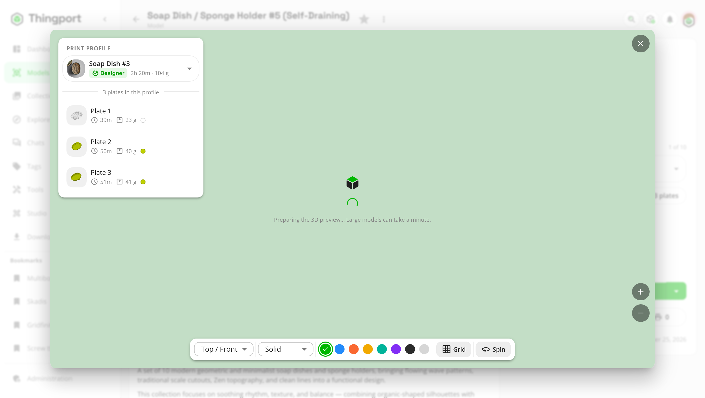</picture></a> <b>3D Preview</b></td>
    <td width="33%"><a href="../frontend/src/assets/screenshots/light/08_model_print_quality.png" target="_blank"><picture><source media="(prefers-color-scheme: dark)" srcset="../frontend/src/assets/screenshots/dark/08_model_print_quality.png">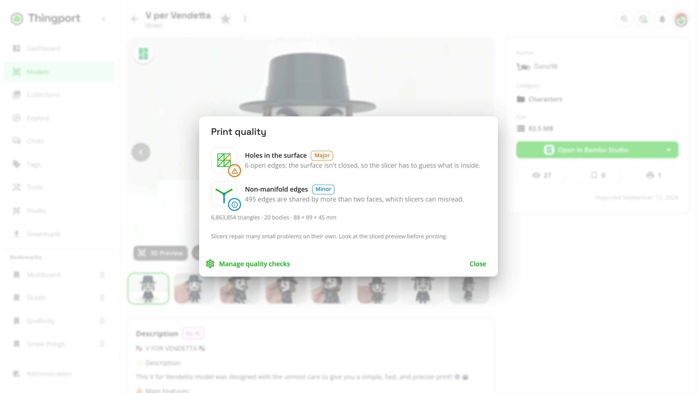</picture></a> <b>Print Quality Checks</b></td>
    <td width="33%"><a href="../frontend/src/assets/screenshots/light/35_model_customize.png" target="_blank"><picture><source media="(prefers-color-scheme: dark)" srcset="../frontend/src/assets/screenshots/dark/35_model_customize.png">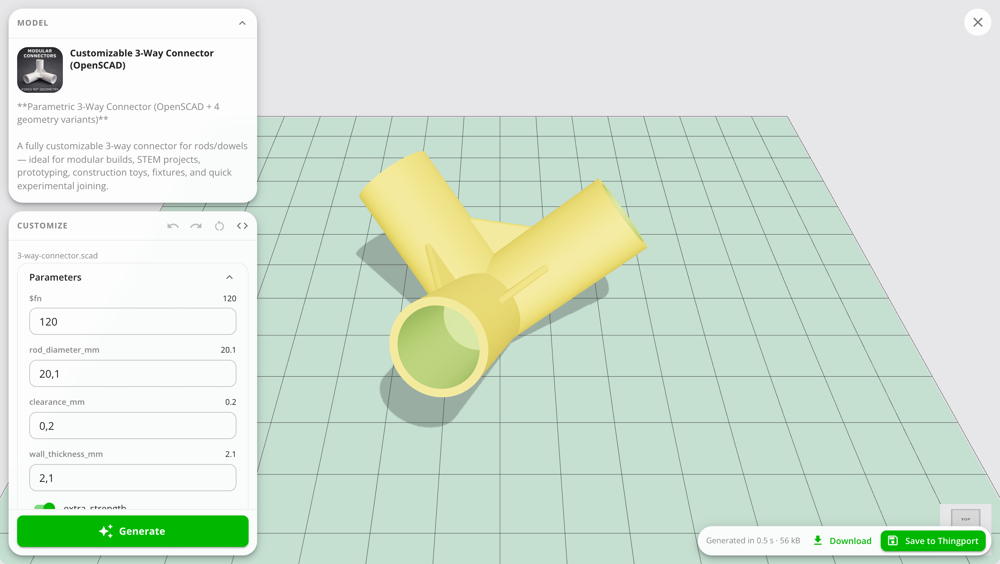</picture></a> <b>Customize a Model</b></td>
  </tr>
  <tr>
    <td width="33%"><a href="../frontend/src/assets/screenshots/light/50_model_print_profiles.png" target="_blank"><picture><source media="(prefers-color-scheme: dark)" srcset="../frontend/src/assets/screenshots/dark/50_model_print_profiles.png">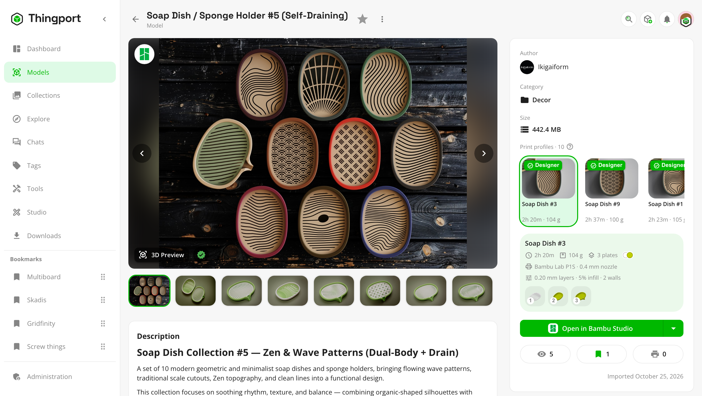</picture></a> <b>Print Profiles</b></td>
    <td width="33%"><a href="../frontend/src/assets/screenshots/light/51_model_license.png" target="_blank"><picture><source media="(prefers-color-scheme: dark)" srcset="../frontend/src/assets/screenshots/dark/51_model_license.png">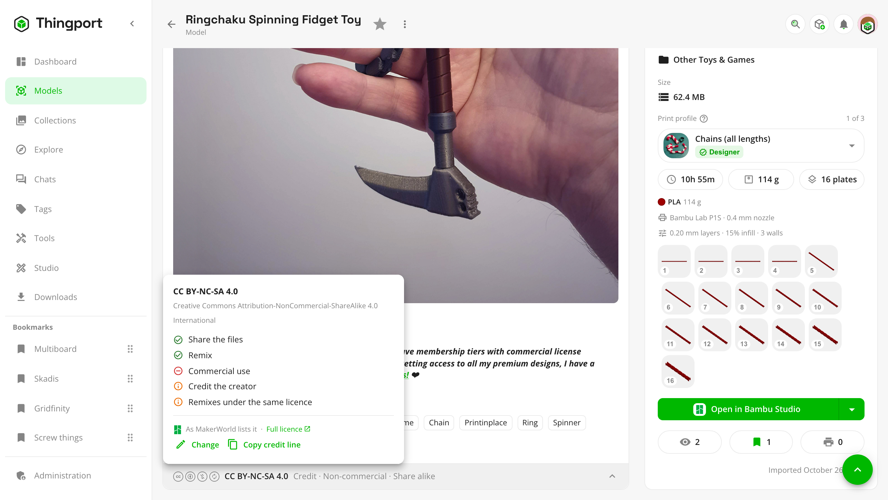</picture></a> <b>Licence</b></td>
    <td width="33%"><a href="../frontend/src/assets/screenshots/light/52_collection_sharing.png" target="_blank"><picture><source media="(prefers-color-scheme: dark)" srcset="../frontend/src/assets/screenshots/dark/52_collection_sharing.png">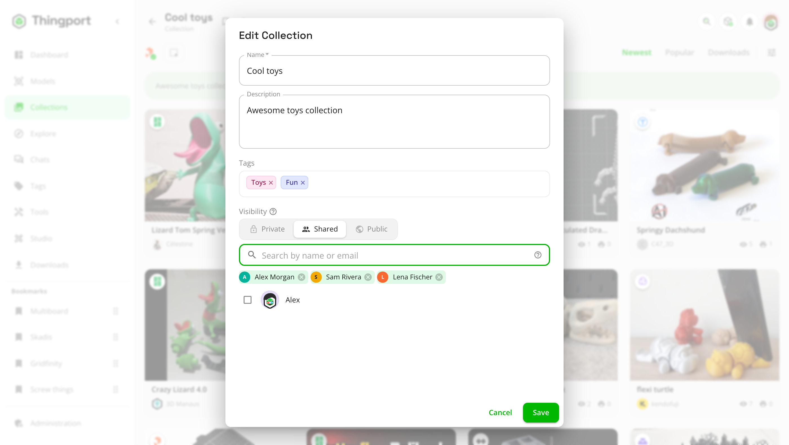</picture></a> <b>Share a Collection</b></td>
  </tr>
  <tr>
    <td width="33%"><a href="../frontend/src/assets/screenshots/light/09_collections.png" target="_blank"><picture><source media="(prefers-color-scheme: dark)" srcset="../frontend/src/assets/screenshots/dark/09_collections.png">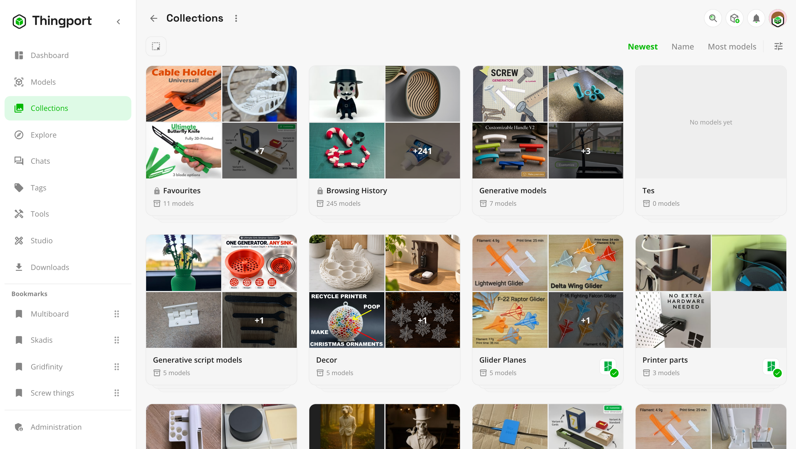</picture></a> <b>Collections</b></td>
    <td width="33%"><a href="../frontend/src/assets/screenshots/light/10_collections_merge.png" target="_blank"><picture><source media="(prefers-color-scheme: dark)" srcset="../frontend/src/assets/screenshots/dark/10_collections_merge.png">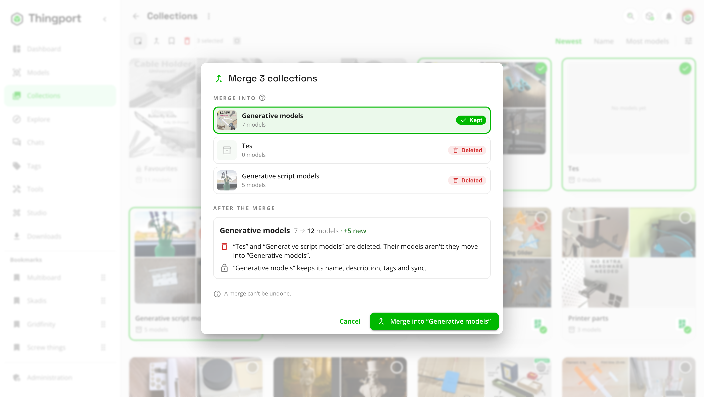</picture></a> <b>Merge Collections</b></td>
    <td width="33%"><a href="../frontend/src/assets/screenshots/light/36_collection_sync.png" target="_blank"><picture><source media="(prefers-color-scheme: dark)" srcset="../frontend/src/assets/screenshots/dark/36_collection_sync.png">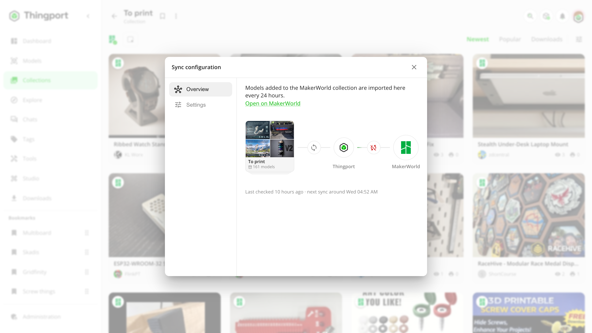</picture></a> <b>Synced Collection</b></td>
  </tr>
  <tr>
    <td width="33%"><a href="../frontend/src/assets/screenshots/light/11_tags.png" target="_blank"><picture><source media="(prefers-color-scheme: dark)" srcset="../frontend/src/assets/screenshots/dark/11_tags.png">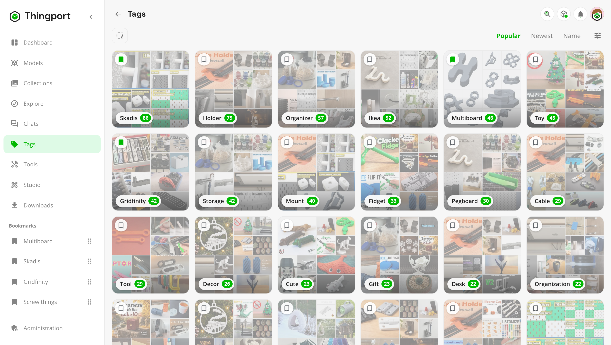</picture></a> <b>Tags</b></td>
    <td width="33%"><a href="../frontend/src/assets/screenshots/light/12_tags_select.png" target="_blank"><picture><source media="(prefers-color-scheme: dark)" srcset="../frontend/src/assets/screenshots/dark/12_tags_select.png">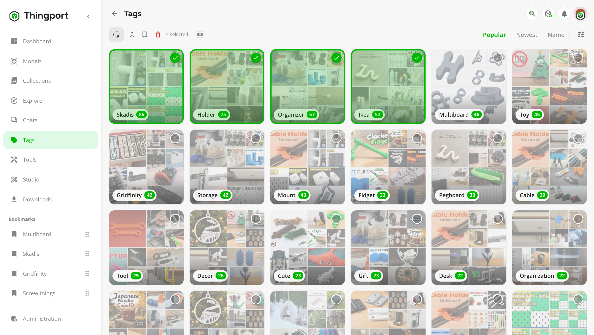</picture></a> <b>Select Tags</b></td>
    <td width="33%"><a href="../frontend/src/assets/screenshots/light/13_downloads.png" target="_blank"><picture><source media="(prefers-color-scheme: dark)" srcset="../frontend/src/assets/screenshots/dark/13_downloads.png">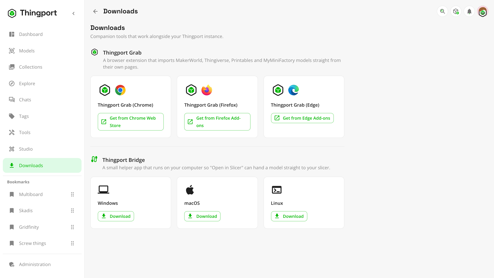</picture></a> <b>Downloads</b></td>
  </tr>
  <tr>
    <td width="33%"><a href="../frontend/src/assets/screenshots/light/14_profile.png" target="_blank"><picture><source media="(prefers-color-scheme: dark)" srcset="../frontend/src/assets/screenshots/dark/14_profile.png">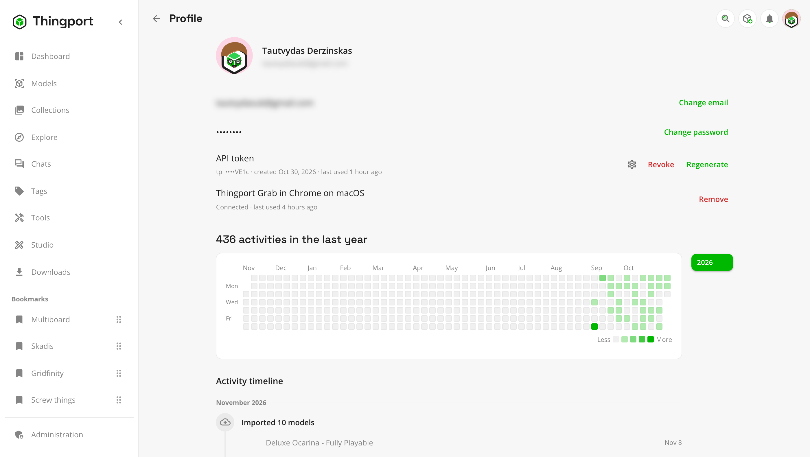</picture></a> <b>Profile &amp; Activity</b></td>
    <td width="33%"><a href="../frontend/src/assets/screenshots/light/03_dashboard_configuration.png" target="_blank"><picture><source media="(prefers-color-scheme: dark)" srcset="../frontend/src/assets/screenshots/dark/03_dashboard_configuration.png">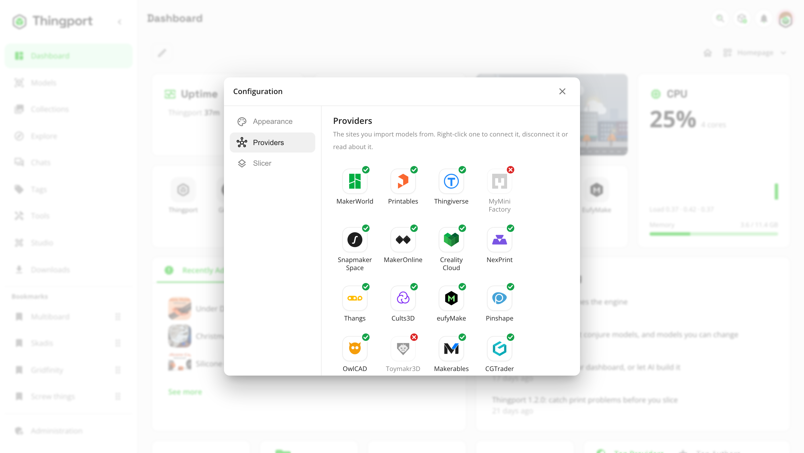</picture></a> <b>Configuration — Providers</b></td>
    <td width="33%"><a href="../frontend/src/assets/screenshots/light/15_profile_configuration.png" target="_blank"><picture><source media="(prefers-color-scheme: dark)" srcset="../frontend/src/assets/screenshots/dark/15_profile_configuration.png">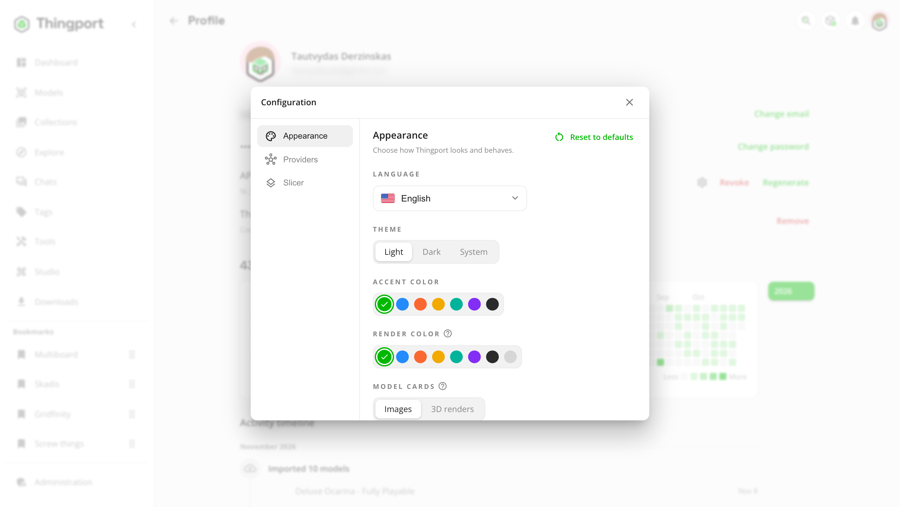</picture></a> <b>Configuration</b></td>
  </tr>
</table>

## Studio, AI and tools

<table>
  <tr>
    <td width="33%"><a href="../frontend/src/assets/screenshots/light/41_studio.png" target="_blank"><picture><source media="(prefers-color-scheme: dark)" srcset="../frontend/src/assets/screenshots/dark/41_studio.png">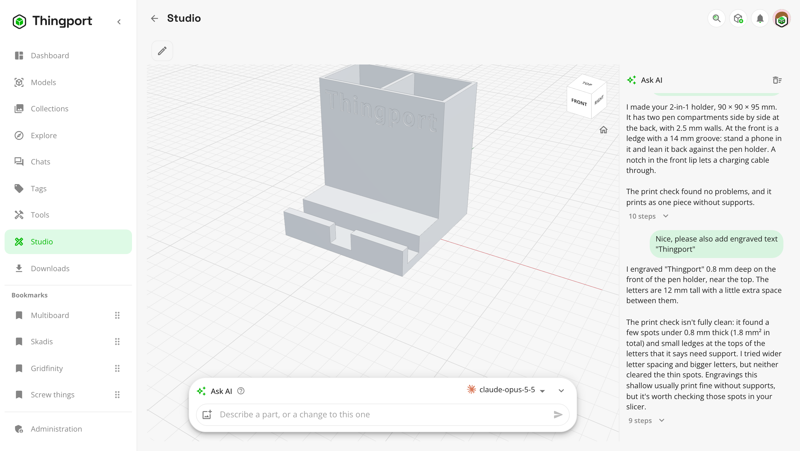</picture></a> <b>Studio</b></td>
    <td width="33%"><a href="../frontend/src/assets/screenshots/light/39_ai_description_compare.png" target="_blank"><picture><source media="(prefers-color-scheme: dark)" srcset="../frontend/src/assets/screenshots/dark/39_ai_description_compare.png">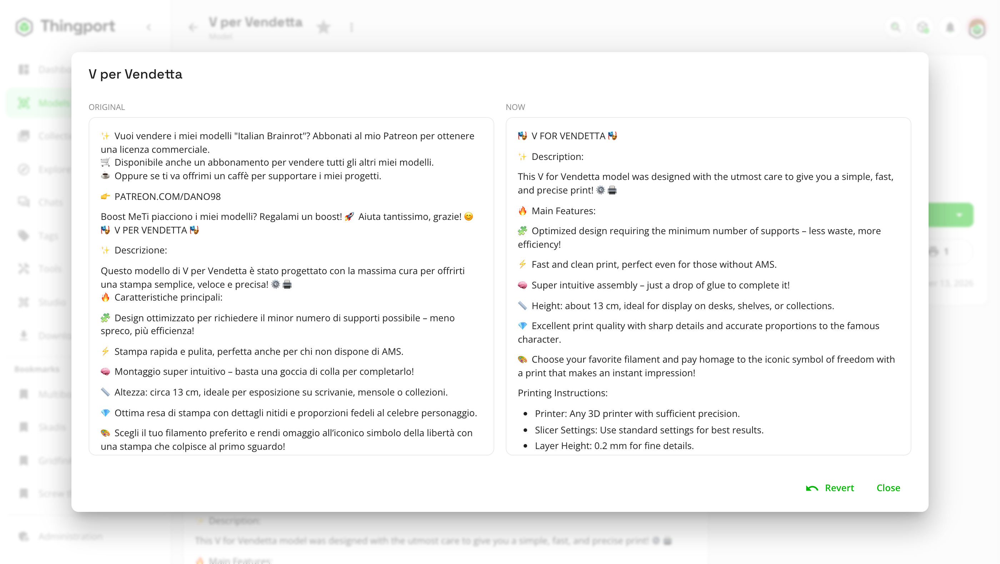</picture></a> <b>AI Descriptions</b></td>
    <td width="33%"><a href="../frontend/src/assets/screenshots/light/38_ai_categorization.png" target="_blank"><picture><source media="(prefers-color-scheme: dark)" srcset="../frontend/src/assets/screenshots/dark/38_ai_categorization.png">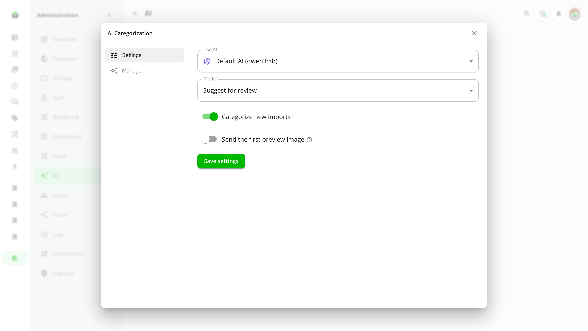</picture></a> <b>AI Categorization</b></td>
  </tr>
  <tr>
    <td width="33%"><a href="../frontend/src/assets/screenshots/light/37_ai_model.png" target="_blank"><picture><source media="(prefers-color-scheme: dark)" srcset="../frontend/src/assets/screenshots/dark/37_ai_model.png">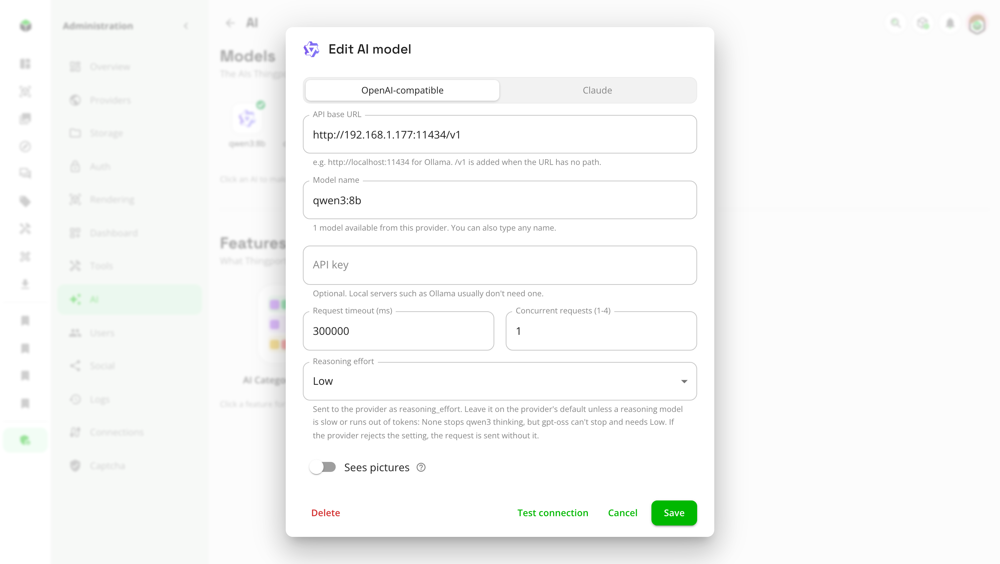</picture></a> <b>AI Model</b></td>
    <td width="33%"><a href="../frontend/src/assets/screenshots/light/31_tools.png" target="_blank"><picture><source media="(prefers-color-scheme: dark)" srcset="../frontend/src/assets/screenshots/dark/31_tools.png">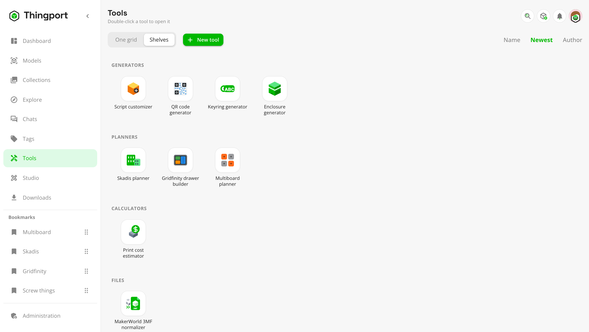</picture></a> <b>Tools</b></td>
    <td width="33%"><a href="../frontend/src/assets/screenshots/light/32_tool_window.png" target="_blank"><picture><source media="(prefers-color-scheme: dark)" srcset="../frontend/src/assets/screenshots/dark/32_tool_window.png">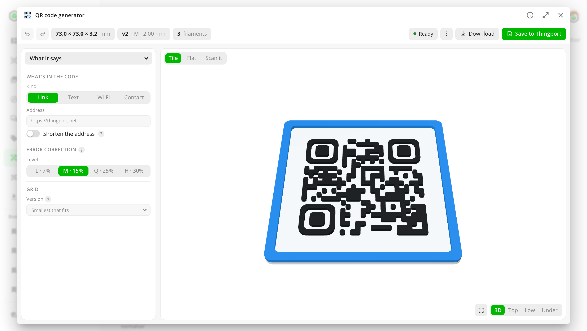</picture></a> <b>Tools — QR Code Generator</b></td>
  </tr>
</table>

## Social and connected instances

<table>
  <tr>
    <td width="33%"><a href="../frontend/src/assets/screenshots/light/42_explore.png" target="_blank"><picture><source media="(prefers-color-scheme: dark)" srcset="../frontend/src/assets/screenshots/dark/42_explore.png">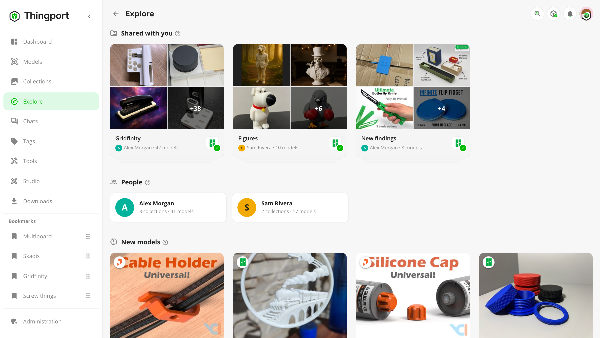</picture></a> <b>Explore</b></td>
    <td width="33%"><a href="../frontend/src/assets/screenshots/light/33_my_models.png" target="_blank"><picture><source media="(prefers-color-scheme: dark)" srcset="../frontend/src/assets/screenshots/dark/33_my_models.png">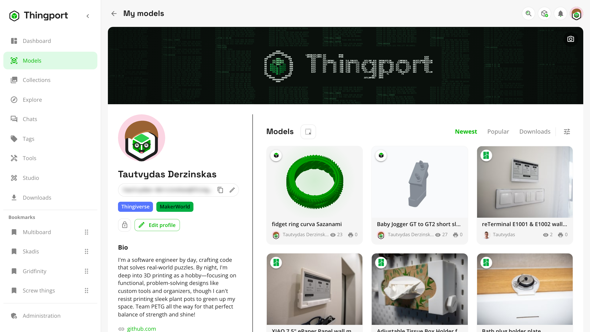</picture></a> <b>Public Profile</b></td>
    <td width="33%"><a href="../frontend/src/assets/screenshots/light/43_explore_everywhere.png" target="_blank"><picture><source media="(prefers-color-scheme: dark)" srcset="../frontend/src/assets/screenshots/dark/43_explore_everywhere.png">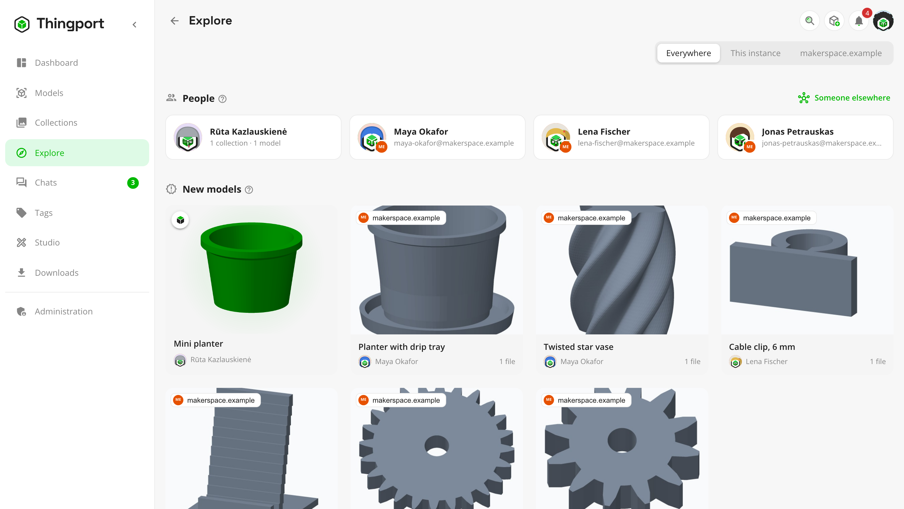</picture></a> <b>Explore — Everywhere</b></td>
  </tr>
  <tr>
    <td width="33%"><a href="../frontend/src/assets/screenshots/light/44_partner_model.png" target="_blank"><picture><source media="(prefers-color-scheme: dark)" srcset="../frontend/src/assets/screenshots/dark/44_partner_model.png">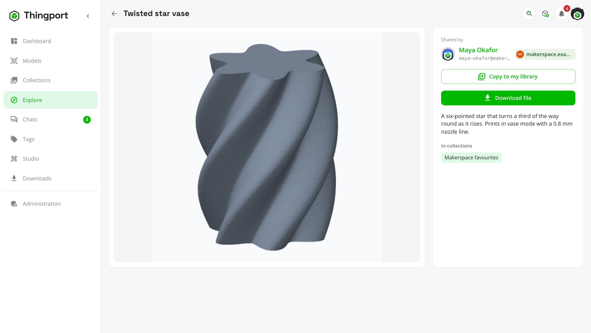</picture></a> <b>A Partner's Model</b></td>
    <td width="33%"><a href="../frontend/src/assets/screenshots/light/45_partner_profile.png" target="_blank"><picture><source media="(prefers-color-scheme: dark)" srcset="../frontend/src/assets/screenshots/dark/45_partner_profile.png">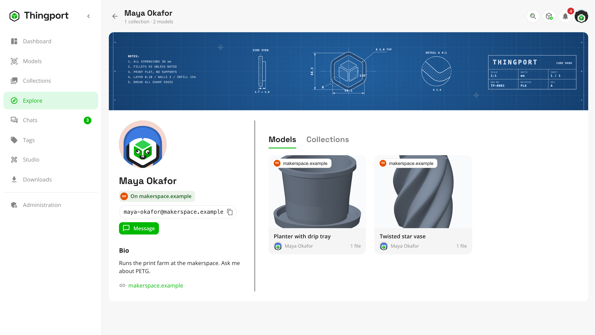</picture></a> <b>A Partner's Profile</b></td>
    <td width="33%"><a href="../frontend/src/assets/screenshots/light/46_chat_partner.png" target="_blank"><picture><source media="(prefers-color-scheme: dark)" srcset="../frontend/src/assets/screenshots/dark/46_chat_partner.png">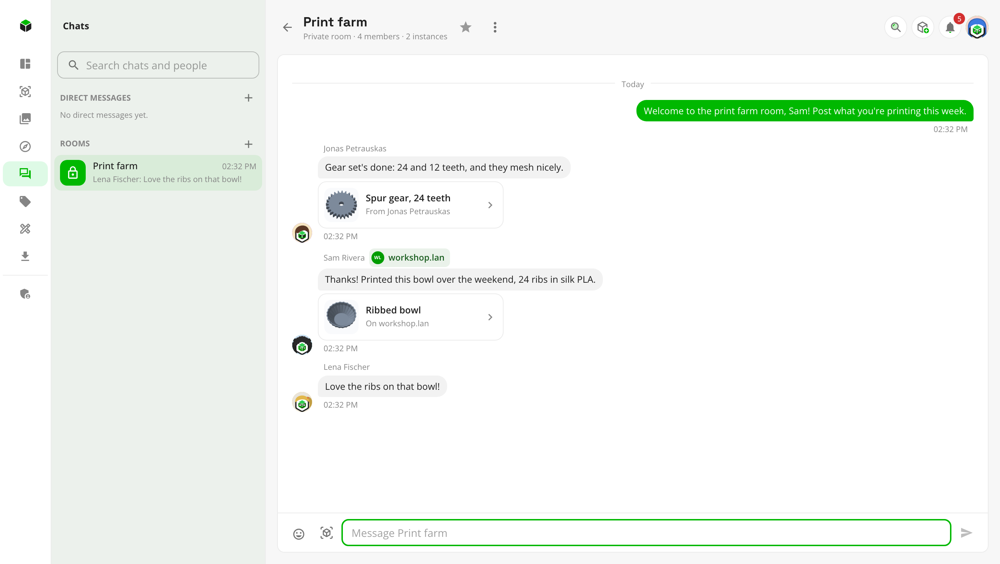</picture></a> <b>Chats Across Instances</b></td>
  </tr>
  <tr>
    <td width="33%"><a href="../frontend/src/assets/screenshots/light/48_connect_link.png" target="_blank"><picture><source media="(prefers-color-scheme: dark)" srcset="../frontend/src/assets/screenshots/dark/48_connect_link.png">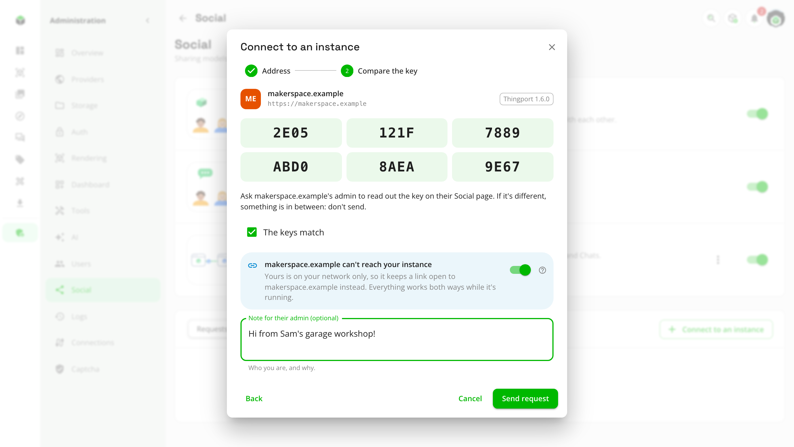</picture></a> <b>Connect From Home</b></td>
    <td width="33%"><a href="../frontend/src/assets/screenshots/light/49_request_link.png" target="_blank"><picture><source media="(prefers-color-scheme: dark)" srcset="../frontend/src/assets/screenshots/dark/49_request_link.png">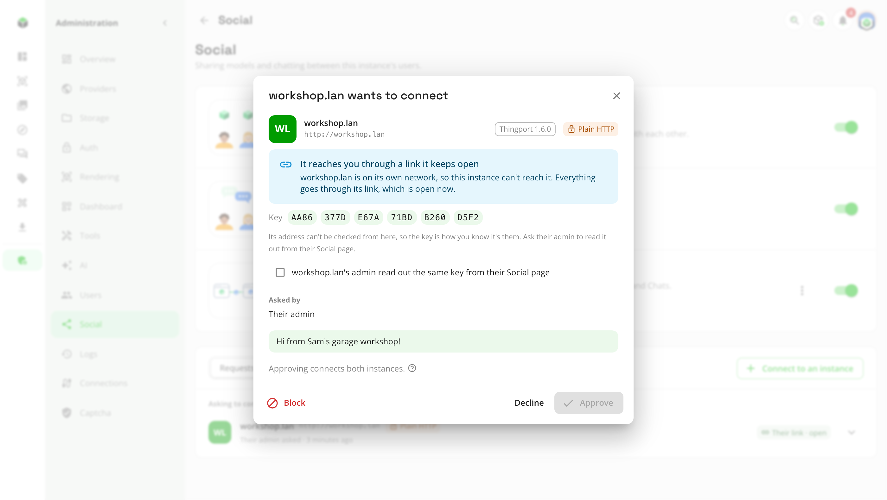</picture></a> <b>Answer a Request</b></td>
    <td width="33%"><a href="../frontend/src/assets/screenshots/light/47_admin_partners.png" target="_blank"><picture><source media="(prefers-color-scheme: dark)" srcset="../frontend/src/assets/screenshots/dark/47_admin_partners.png">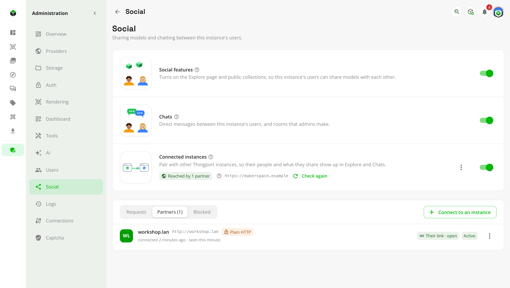</picture></a> <b>Administration — Partners</b></td>
  </tr>
</table>

## Administration

<table>
  <tr>
    <td width="33%"><a href="../frontend/src/assets/screenshots/light/16_admin_overview.png" target="_blank"><picture><source media="(prefers-color-scheme: dark)" srcset="../frontend/src/assets/screenshots/dark/16_admin_overview.png">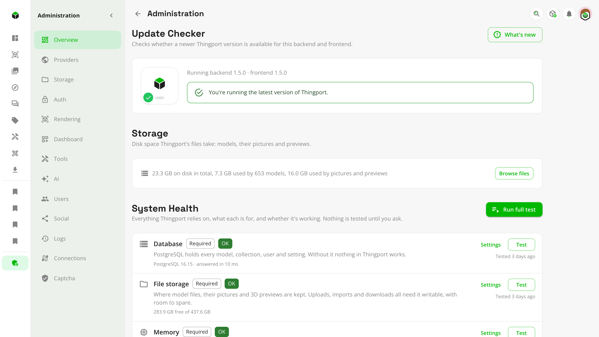</picture></a> <b>Administration</b></td>
    <td width="33%"><a href="../frontend/src/assets/screenshots/light/40_system_health.png" target="_blank"><picture><source media="(prefers-color-scheme: dark)" srcset="../frontend/src/assets/screenshots/dark/40_system_health.png">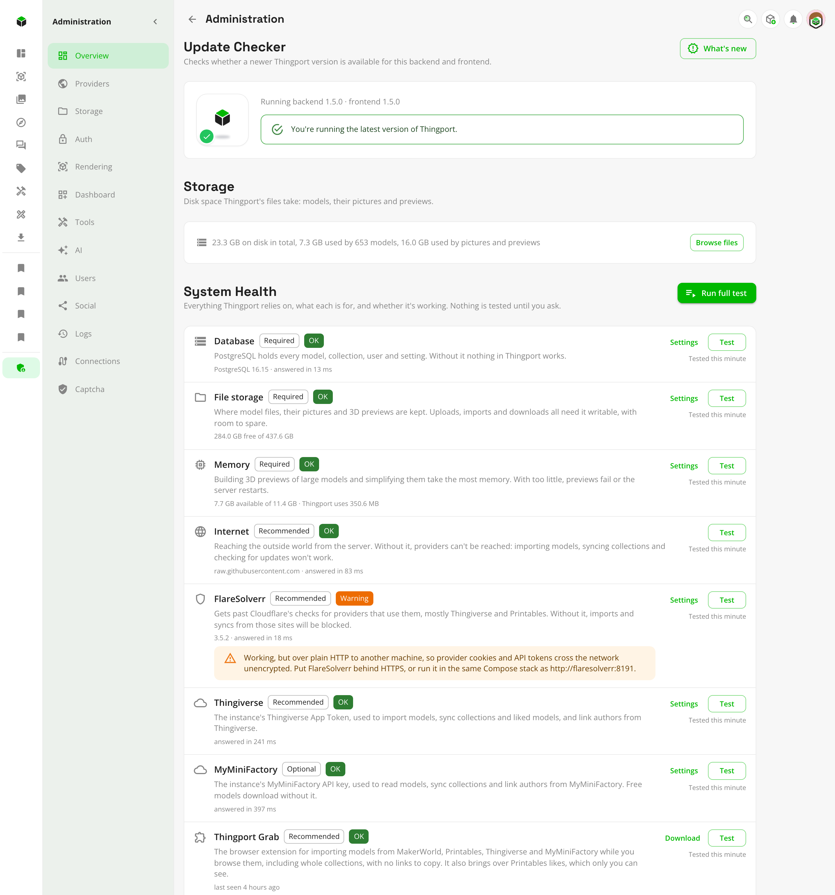</picture></a> <b>System Health</b></td>
    <td width="33%"><a href="../frontend/src/assets/screenshots/light/17_admin_providers.png" target="_blank"><picture><source media="(prefers-color-scheme: dark)" srcset="../frontend/src/assets/screenshots/dark/17_admin_providers.png">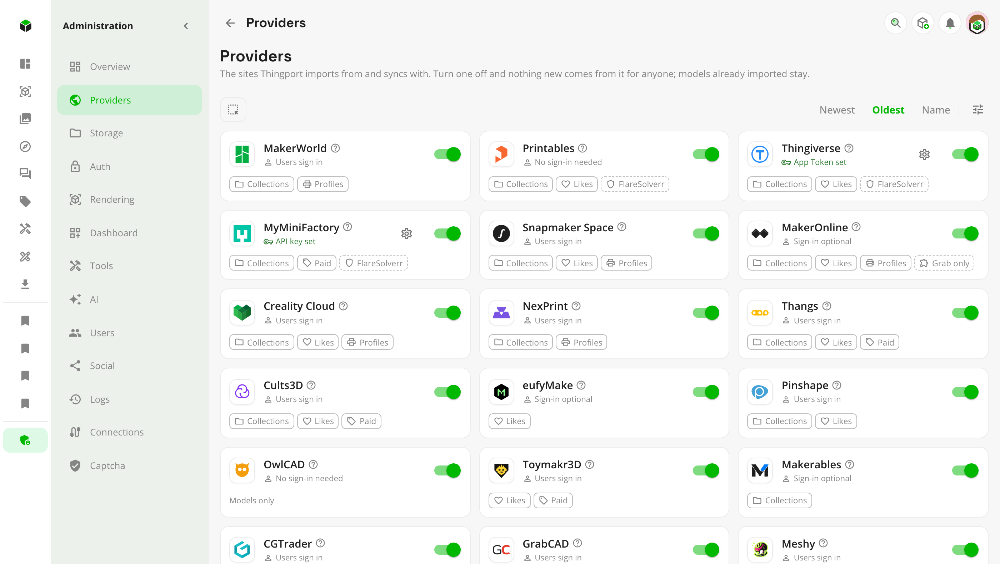</picture></a> <b>Administration — Providers</b></td>
  </tr>
  <tr>
    <td width="33%"><a href="../frontend/src/assets/screenshots/light/18_admin_storage.png" target="_blank"><picture><source media="(prefers-color-scheme: dark)" srcset="../frontend/src/assets/screenshots/dark/18_admin_storage.png">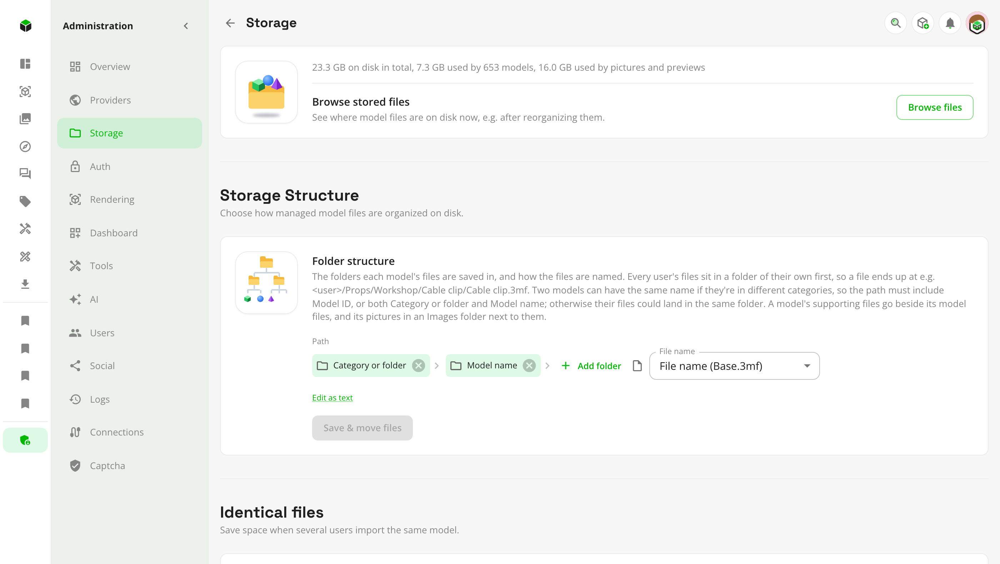</picture></a> <b>Administration — Storage</b></td>
    <td width="33%"><a href="../frontend/src/assets/screenshots/light/19_admin_dashboard.png" target="_blank"><picture><source media="(prefers-color-scheme: dark)" srcset="../frontend/src/assets/screenshots/dark/19_admin_dashboard.png">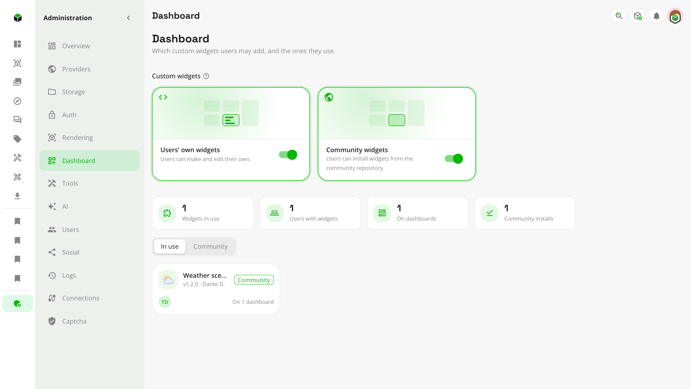</picture></a> <b>Administration — Dashboard</b></td>
    <td width="33%"><a href="../frontend/src/assets/screenshots/light/20_admin_ai.png" target="_blank"><picture><source media="(prefers-color-scheme: dark)" srcset="../frontend/src/assets/screenshots/dark/20_admin_ai.png">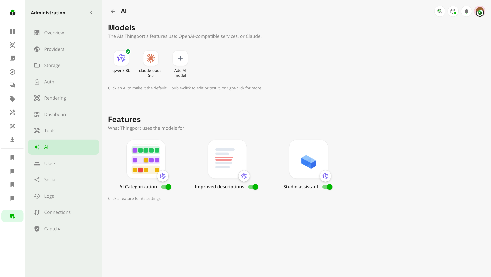</picture></a> <b>Administration — AI</b></td>
  </tr>
  <tr>
    <td width="33%"><a href="../frontend/src/assets/screenshots/light/22_admin_auth.png" target="_blank"><picture><source media="(prefers-color-scheme: dark)" srcset="../frontend/src/assets/screenshots/dark/22_admin_auth.png">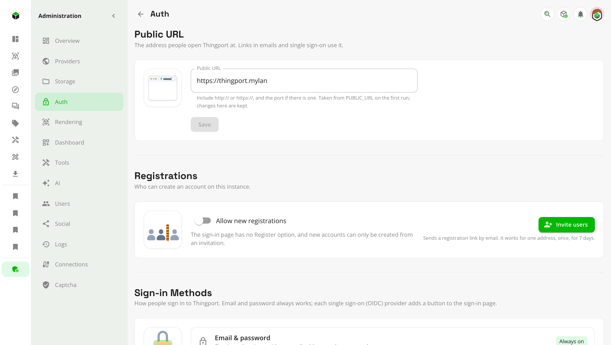</picture></a> <b>Administration — Auth</b></td>
    <td width="33%"><a href="../frontend/src/assets/screenshots/light/30_admin_tools.png" target="_blank"><picture><source media="(prefers-color-scheme: dark)" srcset="../frontend/src/assets/screenshots/dark/30_admin_tools.png">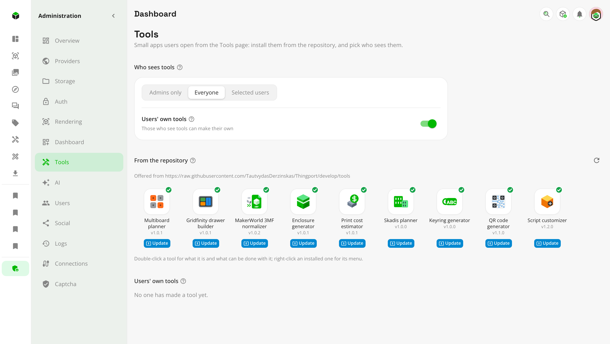</picture></a> <b>Administration — Tools</b></td>
    <td width="33%"><a href="../frontend/src/assets/screenshots/dark/21_admin_captcha_search.png" target="_blank"><picture><source media="(prefers-color-scheme: dark)" srcset="../frontend/src/assets/screenshots/light/21_admin_captcha_search.png">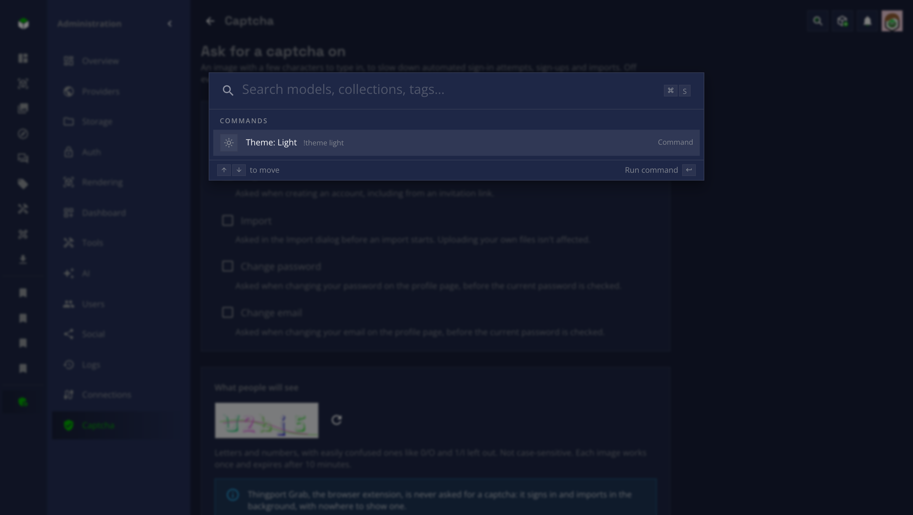</picture></a> <b>Search</b> — in the other theme</td>
  </tr>
  <tr>
    <td width="33%"><a href="../frontend/src/assets/screenshots/light/53_admin_social.png" target="_blank"><picture><source media="(prefers-color-scheme: dark)" srcset="../frontend/src/assets/screenshots/dark/53_admin_social.png">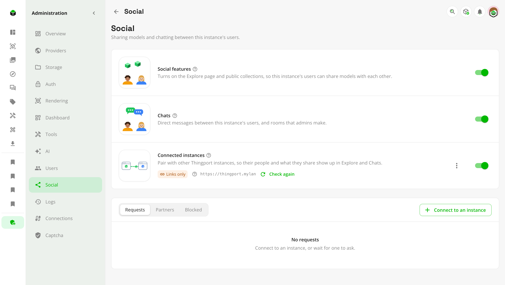</picture></a> <b>Administration — Social</b></td>
  </tr>
</table>

## Thingport Grab

The [browser extension](../extension/README.md) on the sites it imports from, and its popup.

<table>
  <tr>
    <td width="33%"><a href="../extension/docs/screenshots/collection-printables.jpg" target="_blank"><picture><source media="(prefers-color-scheme: dark)" srcset="../extension/docs/screenshots/collection-printables-dark.jpg">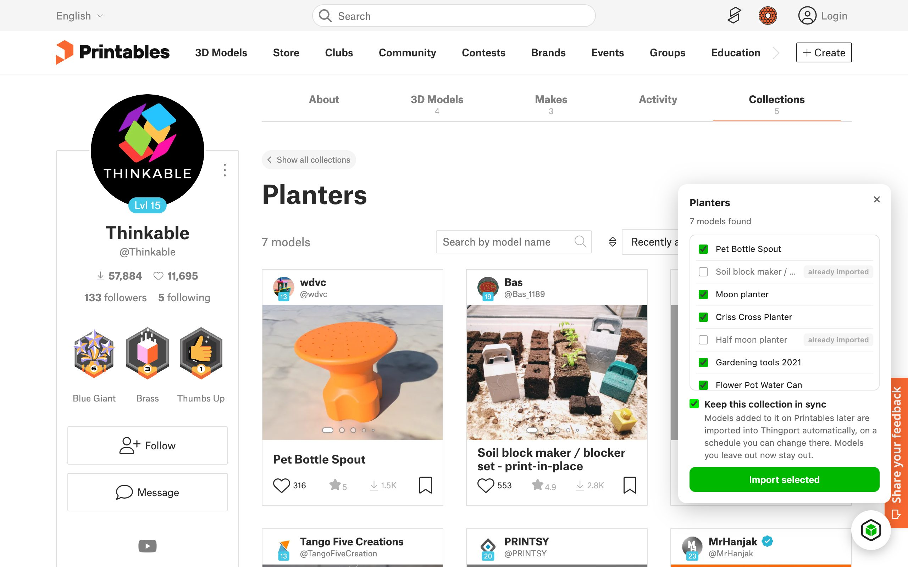</picture></a> <b>Collections</b></td>
    <td width="33%"><a href="../extension/docs/screenshots/panel-printables.jpg" target="_blank"><picture><source media="(prefers-color-scheme: dark)" srcset="../extension/docs/screenshots/panel-printables-dark.jpg">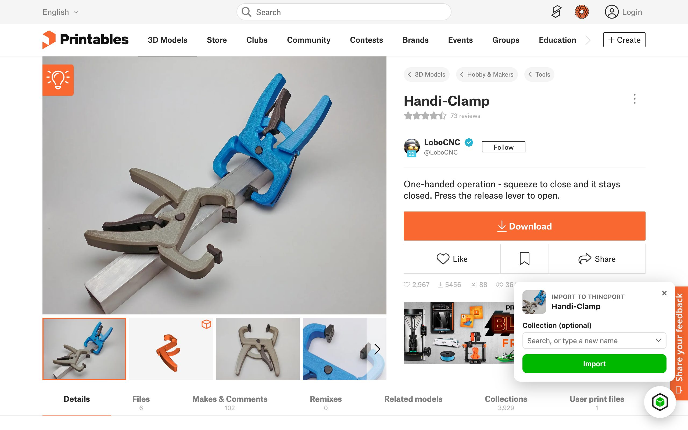</picture></a> <b>Printables</b></td>
    <td width="33%"><a href="../extension/docs/screenshots/panel-thingiverse.jpg" target="_blank">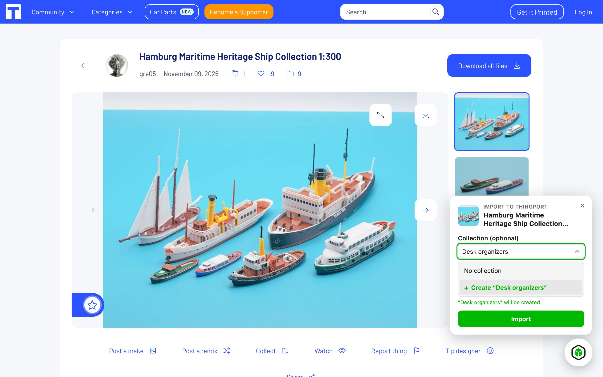</a> <b>Thingiverse</b></td>
  </tr>
  <tr>
    <td width="33%"><a href="../extension/docs/screenshots/panel-makerworld.jpg" target="_blank"><picture><source media="(prefers-color-scheme: dark)" srcset="../extension/docs/screenshots/panel-makerworld-dark.jpg">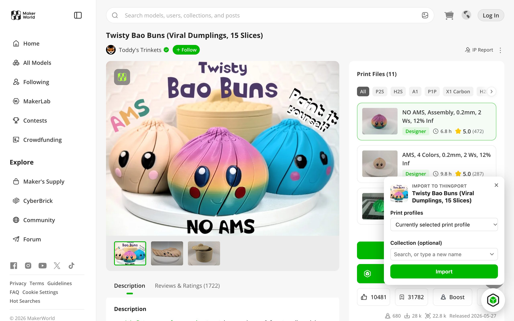</picture></a> <b>MakerWorld</b></td>
    <td width="33%"><a href="../extension/docs/screenshots/collection-makerworld.jpg" target="_blank"><picture><source media="(prefers-color-scheme: dark)" srcset="../extension/docs/screenshots/collection-makerworld-dark.jpg"></picture></a> <b>Sync a Collection</b></td>
    <td width="33%"><a href="../extension/docs/screenshots/panel-crealitycloud.jpg" target="_blank"><picture><source media="(prefers-color-scheme: dark)" srcset="../extension/docs/screenshots/panel-crealitycloud-dark.jpg"></picture></a> <b>Creality Cloud</b></td>
  </tr>
</table>

<table>
  <tr>
    <td align="center"><picture><source media="(prefers-color-scheme: dark)" srcset="../extension/docs/screenshots/popup-setup-dark.png"></picture> <b>Setup</b></td>
    <td align="center"><picture><source media="(prefers-color-scheme: dark)" srcset="../extension/docs/screenshots/popup-connected-dark.png"></picture> <b>Connected</b></td>
    <td align="center"><picture><source media="(prefers-color-scheme: dark)" srcset="../extension/docs/screenshots/popup-appearance-dark.png"></picture> <b>Appearance</b></td>
  </tr>
</table>
