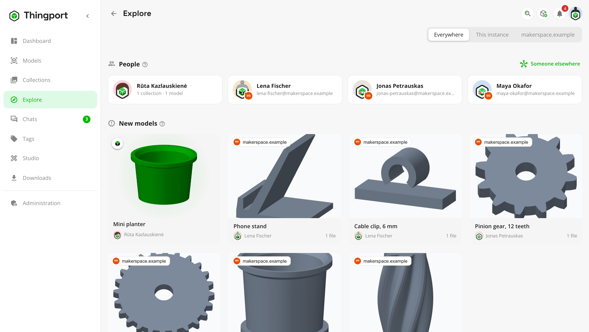
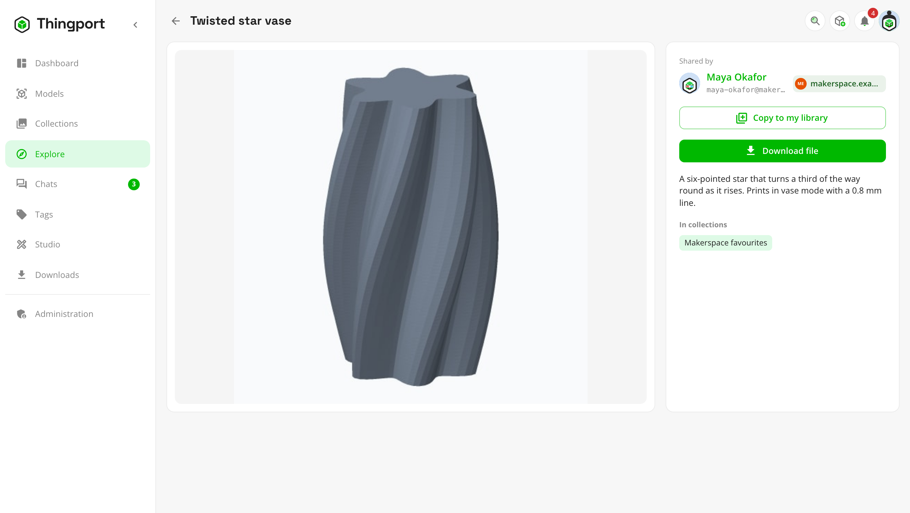
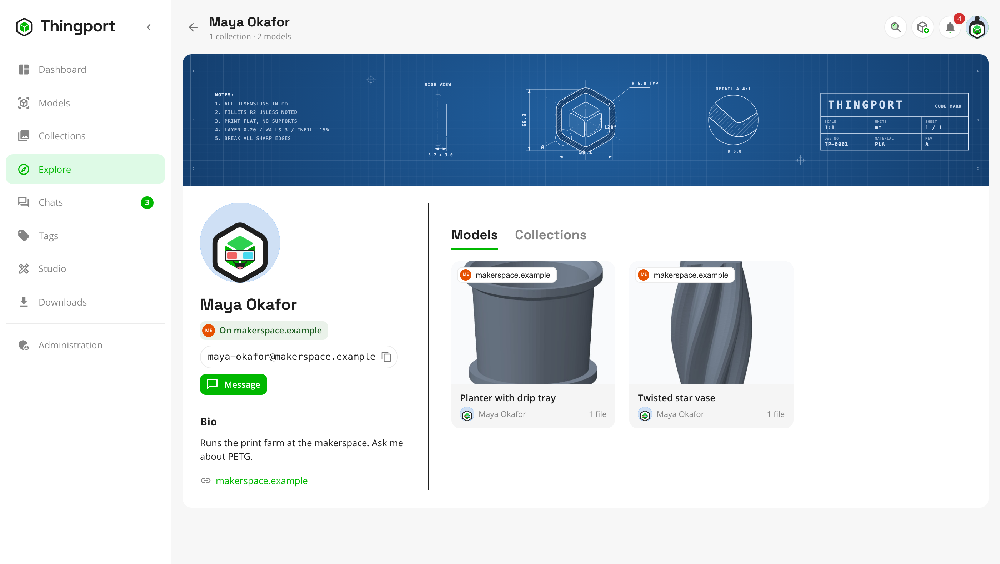
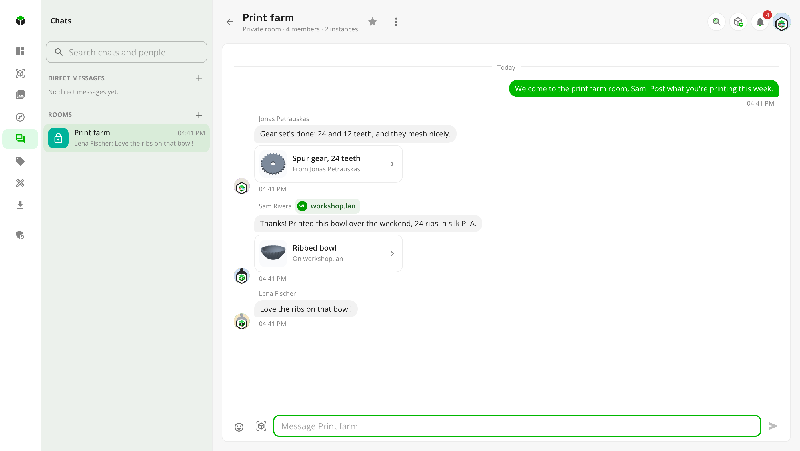
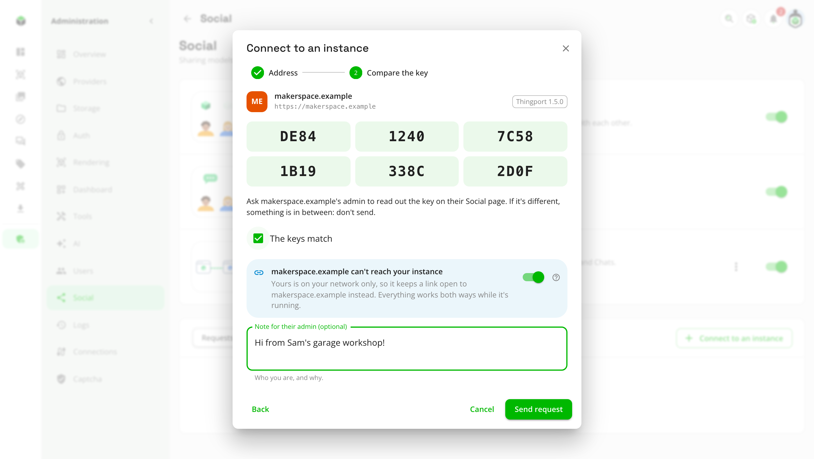
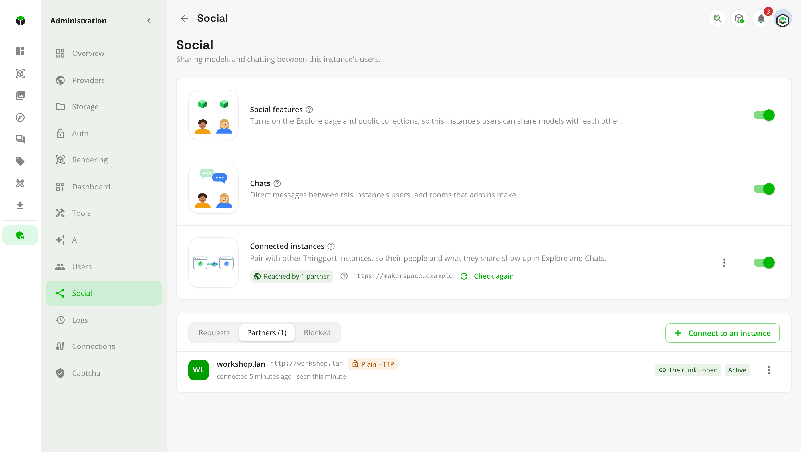
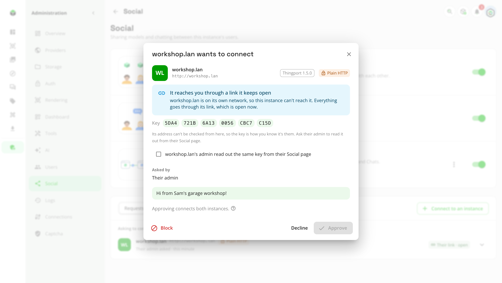

# Connected instances

Thingport instances can connect with each other, so the people on them can find, open and copy each other's models,
and write to each other, as if they were all on one instance. Connect your home instance with a friend's, with your
makerspace's, or with the one at work. Your instance doesn't need to be on the internet to do it: one at home can
connect with an instance that is, and works just as well.

<picture>
  <source media="(prefers-color-scheme: dark)" srcset="../../frontend/src/assets/screenshots/dark/43_explore_everywhere.png">
  
</picture>

Two connected instances are **partners**. An admin approves every partner, nothing private ever leaves an instance, and
it's off until an admin turns it on. This page explains what connecting gives your people and how it works. To set it
up, see the [connected instances guide](../guides/connected-instances.md).

## What your people get

- **One Explore for everyone.** Partners' people who share something, their public collections and their newest models
  show up on Explore beside your own, each marked with the instance it's on. **Everywhere**, **This instance** or a
  single partner narrows it down.
- **Their models, as if they were here.** A partner's model opens with its pictures, description, files and the
  collections it's in. Download it file by file or as a ZIP, open it straight in your slicer, or **Copy to my library**
  to keep your own copy, which stays even if they change or delete theirs. The copy is the same model as theirs, with
  its tags, print profiles and the site it came from, in your own category of the same name when you have one. If you
  already have the model from that site, it opens yours instead.
- **Their profiles.** A partner's person has a profile page like anyone here, with their cover, bio, links, shared
  models and public collections.
- **Chats across instances.** Write to a partner's person directly, or add them to a private room. Messages arrive on
  both instances, and stay there.
- **Ask to reach someone elsewhere.** Anyone can ask to reach a person on an instance that isn't a partner yet, with
  their handle, `name@their.instance`. The request goes to the admins here, who can connect the two instances.

<table>
  <tr>
    <td width="33%"><picture><source media="(prefers-color-scheme: dark)" srcset="../../frontend/src/assets/screenshots/dark/44_partner_model.png"></picture> <b>A partner's model</b>, to download or copy</td>
    <td width="33%"><picture><source media="(prefers-color-scheme: dark)" srcset="../../frontend/src/assets/screenshots/dark/45_partner_profile.png"></picture> <b>A partner's profile</b>, with their handle</td>
    <td width="33%"><picture><source media="(prefers-color-scheme: dark)" srcset="../../frontend/src/assets/screenshots/dark/46_chat_partner.png"></picture> <b>A room</b> across two instances</td>
  </tr>
</table>

## Your home instance can connect too

Most home instances can't be reached from the internet. The router in front of them takes what's sent out, and turns
away whatever's sent in that nobody asked for. Another instance usually has to reach yours to connect, so a home
instance would be left out: no port forwarding means no partners.

Thingport gets around that with a **link**. Your instance reaches out to its partner on the internet and keeps a
connection open to it. Whatever the partner would send yours, or fetch from it, comes back down that connection instead.
Your router sees only an answer to something your instance asked for, so it lets it through.

<picture>
  <source media="(prefers-color-scheme: dark)" srcset="../assets/connected-instances-link-dark.svg">
  
</picture>

- **No port forwarding, domain or certificate.** A Thingport instance on a Raspberry Pi, a NAS or an old laptop at home
  is enough. Only the instance on the internet needs an address others can reach.
- **The same as two instances that reach each other.** Explore, pictures, downloads, copies and chats work both ways:
  the partner's people browse your shared models, download their files and write to your people, all through the link.
- **One switch.** When you connect to an instance on the internet from one that's on your network only, or from one
  nothing can reach at all, Thingport turns on **Keep a link open** by itself, and says why.
- **Off at night, back in the morning.** While your instance is off, what's said to your people waits on the partner's
  side, for up to about three days, and your shared models stay on its Explore as you last shared them. Once your
  instance is back and its link opens again, everything that waited arrives.
- **Your address is never tried.** Your instance's address means nothing from the other side of the internet, and might
  even belong to another machine there, so the partner never sends anything to it. Even saying goodbye goes down the
  link.

<table>
  <tr>
    <td width="50%"><picture><source media="(prefers-color-scheme: dark)" srcset="../../frontend/src/assets/screenshots/dark/48_connect_link.png"></picture> <b>Connecting from home</b>, with <b>Keep a link open</b> on</td>
    <td width="50%"><picture><source media="(prefers-color-scheme: dark)" srcset="../../frontend/src/assets/screenshots/dark/47_admin_partners.png"></picture> <b>Partners</b>, with the link and whether it's open</td>
  </tr>
</table>

> [!TIP]
> Two instances that are both at home can't connect this way, since neither can reach the other. Put them on one VPN,
> such as Tailscale or WireGuard, and they connect as two instances on one network.

|                                 | Both instances reachable  | One at home, one on the internet                              |
| ------------------------------- | ------------------------- | ------------------------------------------------------------- |
| **Who connects**                | Either admin              | The one at home                                               |
| **Explore, profiles, pictures** | Both ways                 | Both ways, through the link                                   |
| **Downloads and copies**        | Both ways                 | Both ways, through the link                                   |
| **Chats**                       | Both ways                 | Both ways; messages for the home instance wait while it's off |
| **Needs**                       | An address each can reach | An address only the one on the internet needs                 |

## How it works

### Connecting: the key

Every instance has a key of its own, shown as six groups of four characters. When one admin connects to another
instance, Thingport looks it up and shows its key; the other admin reads theirs out on the phone or side by side, and
only if they match is the request sent. The other admin then reviews the request, with the same key, and approves it.

From then on, everything the two instances send each other is signed with those keys. A partner whose key changes (its
database was reset, or something in between swapped it) is no longer believed until the admins compare again, and
**Check connection** says so.

<picture>
  <source media="(prefers-color-scheme: dark)" srcset="../../frontend/src/assets/screenshots/dark/49_request_link.png">
  
</picture>

A request through a link can name any address, so its key is all that tells you who sent it. When it names an address
on the internet and a different instance answers there, the review shows that one too, with its key.

### What crosses, and what stays

Partners see exactly what anyone signed in on your instance could see of someone else, and nothing more.

| Crosses to partners                                                          | Stays on your instance                                  |
| ---------------------------------------------------------------------------- | ------------------------------------------------------- |
| Display names, avatars, covers, bios and links of people who share something | Email addresses, passwords and sign-ins                 |
| Public collections, and the models in them                                   | Private collections, and the rest of everyone's library |
| Models made public under **My models**                                       | Settings, API tokens, provider sign-ins                 |
| Messages in chats with partners' people                                      | Chats with nobody from that partner in them             |
| Collections shared with partners' people, to their instance only             | Who else a collection is shared with, elsewhere         |
| Handles, `name@this-instance`                                                | Your instance's users list, logs and stats              |

### Each instance keeps a copy

Explore never waits on a partner. Each instance keeps a copy of what its partners share: who shares, and their public
collections and models. It's read when they connect, every 15 minutes after, and when someone opens Explore and it's a
couple of minutes old; **Check connection** reads it right away. A model a partner makes private is gone by the next
read. Pictures are fetched the first time they're shown, and kept.

A partner's files aren't copied: they're fetched when someone downloads one or opens it in a slicer, and kept only if
someone copies the model to their library.

### Pictures and files come through your instance

A viewer's browser never talks to a partner. Pictures and files come through your own instance, which fetches them for
the people on it. A partner doesn't learn who looked at what, and your people need nothing more than your instance's
own address, even when the partner is at home behind its link. For the same reason, images inside a partner's model
descriptions aren't shown.

### Chats

A message to a partner's person is queued, signed and sent to their instance, and kept on both. A room an admin makes
with partners' people in it stays on the instance that made it, and each partner keeps a copy that gets its messages
and sends theirs back. What's queued for one chat goes in order, so a message never overtakes the change before it,
such as someone being taken out of the room. What's for a paused partner waits until it's resumed; anything else a
partner can't take right now (its link is closed, or its admin has connected instances off for a while) is tried
again for about three days.

### Links

A home instance keeps asking its partner whether there's anything for it. The partner answers as soon as there is, or
after ten seconds with nothing, and the home instance asks again straight away, so whatever's for it goes at once. The
home instance runs each request on its own Thingport, exactly as if it had arrived from the partner directly, and sends
the answer back up, a file as it's read. The link is opened with a secret only the two instances know, sent with the
request to connect.

### Safety

- **Admins decide.** Nothing connects until an admin approves it, and only admins can connect, pause, disconnect or
  block a partner.
- **Strangers can't make your instance do anything.** A request to connect is kept as it came and checked only when an
  admin opens it. Until then, your instance contacts nobody because of it, and nothing it says changes how your instance
  reaches anyone.
- **Signed, every time.** Everything a partner sends must be signed with the key you compared. Anything else is dropped.
- **Off means absent.** With connected instances off, nothing about them answers on the network, so nothing tells a
  visitor your instance could connect at all.
- **Plain HTTP works**, which is what most home networks use. Requests are signed, so nobody can pretend to be a partner
  or change what's sent, but what's sent can be read on the way. Over the internet, put HTTPS in front of Thingport.

## Questions

**Is this the fediverse?** It's built the same way: connected instances talk ActivityPub, the protocol behind the
fediverse, signing each request. But a Thingport instance talks only to other Thingport instances its admin approved.
Other ActivityPub software can't follow it, and it doesn't follow them.

**Does my instance need a domain or HTTPS?** No. On one network or VPN, two instances connect over plain HTTP by their
local addresses. Over the internet, only one of them needs an address others can reach, and that one should have HTTPS.

**What happens when we disconnect?** Each instance forgets what came from the other: its people, collections and models
disappear from Explore, and copies of its rooms go. Copies your people made of its models stay theirs, and so do direct
messages with its people.

**Can a partner see my whole library?** No. Only what you'd show anyone signed in on your instance: public collections,
the models in them, and models you made public.

**What if my instance changes its address?** Partners know it by its address, so they can't follow it to a new one:
disconnect, and connect again from the new address. The key stays the same, so comparing it again is quick.

## Set it up

1. An admin turns on **Social features**, then **Connected instances**, in **Administration → Social**.
2. **Connect to an instance**, compare keys with its admin, and send the request.
3. Their admin approves it, and the two instances are partners.

The [connected instances guide](../guides/connected-instances.md) goes through every step, what each status means, and
what to do when something doesn't connect.
