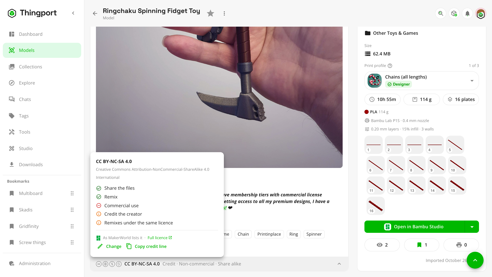

# Licences

What you may do with each model: share its files, remix it, sell prints of it. Thingport keeps the licence a model was
published under, shows it on the model page, filters by it and writes it beside the files.

## On the model page

<picture>
  <source media="(prefers-color-scheme: dark)" srcset="../../frontend/src/assets/screenshots/dark/51_model_license.png">
  
</picture>

A strip closes the description box: the licence's marks, its name and what it comes to in a few words, such as
"Credit · Non-commercial · Share alike". Click it for the rest:

- what the licence lets you do: share the files, remix, use it commercially, and whether it asks you to credit the
  creator or to share remixes under the same licence;
- the terms the site or the creator added, such as a site licence's own wording or "don't share these files elsewhere";
- a link to the licence itself;
- **Copy credit line**, for crediting the model where you post a print or a remix:
  `“Articulated Dragon” by Mara Voss (https://makerworld.com/…) is licensed under CC BY-NC-SA 4.0.`

A model whose site says nothing shows **Not stated by** the site. One whose site couldn't be read says so, with
**Retry**. A model you added yourself shows no strip until you pick a licence.

## Where it comes from

Every site Thingport imports from says what licence a model has, and the import keeps it: Creative Commons licences, CC0,
open-source licences such as GPL and MIT, and each site's own, such as the Standard Digital File License, Cults' Private
Use or CGTrader's Royalty Free. PIXUP, Fab365, GrabCAD and Meshy's community have one licence for everything on them,
from their terms. 3DExport's goes by the price: Royalty Free for a free model, Basic for a bought one, as its page
doesn't say whether you paid for the Extended one. A Thangs model's licence is the file its designer uploaded, shown as
written.

A model imported before Thingport kept licences reads its licence the first time you open it.
[Linking a model](importing.md#link-a-model-you-already-have) to its page brings the page's licence too.

## Pick one yourself

**Edit** on the model page has a **Licence** field: the licence its site lists, or one you pick, such as for a model you
designed and uploaded, or one you've changed so much it's your own. A licence you pick stays: the site's isn't read over
it. Pick **As the site lists it** to go back to the site's.

## Filter by what it allows

The filter button on any list of models has **Licence allows**:

- **Can be shared:** you may pass the files on to others, unchanged. Most sites' own personal-use licences don't allow
  it.
- **Commercial use:** you may use it commercially, selling prints included.
- **Remixing:** you may change it.
- **Only with a licence:** leaves out the models whose site doesn't say.

They combine: on together, they list only models whose licence allows all of them. A model whose licence Thingport
doesn't recognise never matches a switch, as it can't tell what the licence allows.

## LICENSE.txt

Each model with a licence gets a `LICENSE.txt` in its folder, beside its files: its name, creator and source, the licence
with its link, what it allows, the terms added to it, and the credit line. It's rewritten when the licence, the name or
the creator changes, and moves and goes with the model. It shows in **Browse files**, over a network share and in any
copy of the folder. Admins can turn it off under **Administration → Storage → Licence files**, which removes them all;
turning it on again writes them back.

Every [ZIP download](downloads.md) carries each model's `LICENSE.txt` in its folder, whether or not the files are
written on disk.

## Elsewhere

- Copies keep the licence, from your own instance's Explore and from [connected instances](connected-instances.md).
  Sharing a model is up to you: Thingport doesn't stop or warn about sharing a model whose licence doesn't allow it.
- The [MCP](../guides/mcp.md) tool `get_model` gives a model's licence, `list_models` filters by what it allows, and
  `edit_model` picks one.
