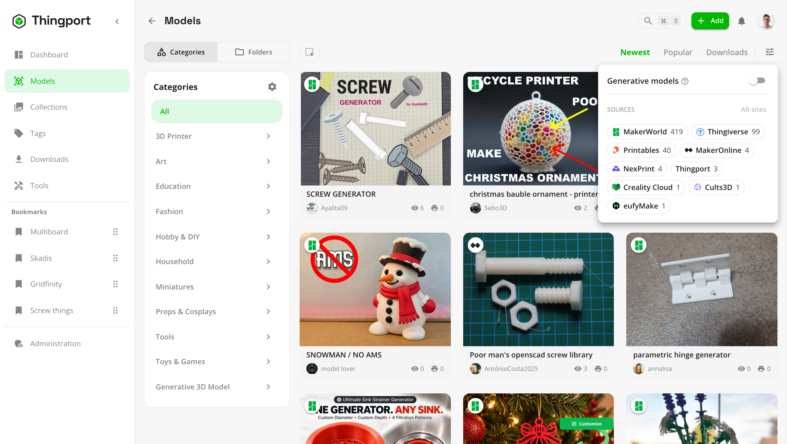

# Organize and search

However you think about your collection, there's a way to file it, and a way to find it again.

## Categories and folders

Each model can sit in one **category** or one **folder**, both nested as deep as you like. Switch between them at the
top of the Models page. On a phone, the tree folds away behind a button above the grid that names the one you're in.

- **Categories** sort models by what they are, such as Tools > Measuring or Toys & Games > Puzzles. Imported models are
  placed by the source site's own category: each of your categories lists, per site, which of that site's categories
  land in it. Change them from a category's details, with **Manage** next to each site, by picking the site's
  categories by name. The optional [AI categorization](../guides/ai.md) can sort the rest.
- **Folders** are your own tree, the way you'd lay it out on disk. [Uploading a folder](../guides/upload-folders.md)
  keeps its structure as folders.

Manage both from **Manage categories & folders** on the Models page. Deleting one never deletes its models.
**Reset to defaults** in the category manager puts the starter category tree back. It first shows exactly what changes:
the categories added, restored and deleted, and how many models move or lose their category. Folders aren't touched.

## Filters

The filter button at the top of the Models page, after the sort order, narrows the list:

- **Generative models** shows only the models that came with the script they were generated from, which you can
  [customise and generate again](supporting-files.md#models-you-can-generate-again).
- **Sources** has a chip for every site your library has models from, with its logo and how many, and **Thingport** for
  the ones you added yourself. Click a chip to hide that site's models, and again to bring them back; **All sites**
  shows every one again.

A badge on the button counts the filters in use. Filters are kept in the page's address, so a filtered list can be
bookmarked. What's kept is the sites you hid, so models from a site new to your library still show.

<picture>
  <source media="(prefers-color-scheme: dark)" srcset="../../frontend/src/assets/screenshots/dark/34_models_filters.png">
  
</picture>

## Collections and tags

- **Collections** group models however you like, and a model can be in as many as you want. Give a collection a
  description and tags, or [sync it](../guides/synced-collections.md) with a collection or a list of likes on one of the
  sites Thingport imports from.
- **Tags** come with imported models, and you can add your own. Browse every tag with a picture made from its models,
  hide tags used only once, or delete a tag from every model at once.
- **Favourites** and your **Browsing history** are kept as collections of their own.
- A [tool](../guides/tools.md) that brings models keeps them in a collection of its own, such as **Tool: Multiboard
  models**, listed after your own. They open, download and go to a slicer like any other model, but stay off the Models
  page, and neither they nor the collection can be changed or deleted.
- **Bookmark** the collections and tags you use most to pin them to the sidebar, and drag them into order.

Collections sort by newest, name or most models, and tags by popularity, newest or name.

## Work on several at once

The select button at the top of Models, Collections and Tags turns on selection mode: tick items, or select them
all at once, and act on them together.

- **Models:** add them to collections, edit their tags, add them to favourites, [download them](downloads.md) as one
  ZIP, delete them, or run the [AI features](../guides/ai.md) on them.
- **Collections and tags:** bookmark, delete or merge them.

<picture>
  <source media="(prefers-color-scheme: dark)" srcset="../../frontend/src/assets/screenshots/dark/10_collections_merge.png">
  
</picture>

A **merge** moves every model into one collection or tag you pick, and deletes the others. Nothing is merged until
you've seen what changes: which one is kept, which are deleted, how many models it ends up with, and which synced
collections stop syncing. A kept collection keeps its name, description, tags and sync; keep a synced one to carry on
syncing it.
A merge can't be undone, but merging collections or tags never deletes a model.

In the **Folders** view, two more actions help tidy up your own uploads. Models imported from a site are left out of
both, and the dialog says how many were skipped.

- **Merge models** is for a model whose parts each arrived as a model of their own. Pick the main model, and the
  others' files, pictures and descriptions move into it, each description under its model's name. Tags and collections
  are combined; the main model keeps its name and its category or folder. The other models are then deleted, along
  with their thumbnails, and this can't be undone.
- **Assign category** gives every selected model one category, replacing any it already has. Type to filter the
  categories, or open a top-level one to pick from what's under it. A model with a category isn't in any folder, so
  this takes it out of the folder structure. If the category already holds a model of that name, the incoming one is
  renamed, like `Name (2)`.

## Search

The search bar at the top (<kbd>⌘</kbd>/<kbd>Ctrl</kbd> + <kbd>S</kbd>) searches model names, tags, notes and
authors, plus collections and tags, as you type. Model lists can be sorted by relevance, newest, popularity or
downloads.

Type <kbd>!</kbd> for commands, such as switching theme or language, opening Configuration, or opening a
[tool](../guides/tools.md) with `!tool`. Paste a model link and it offers to import it.
