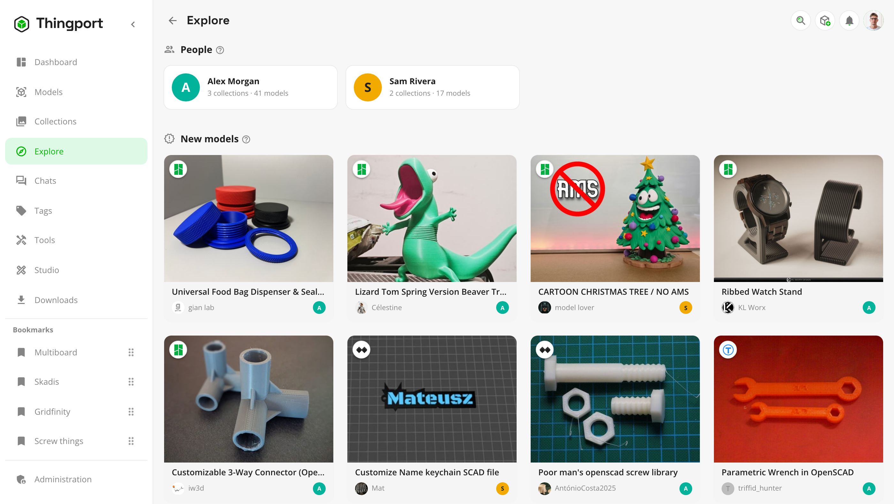
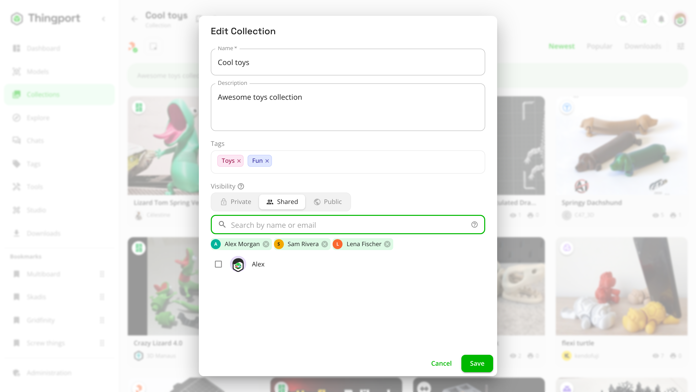
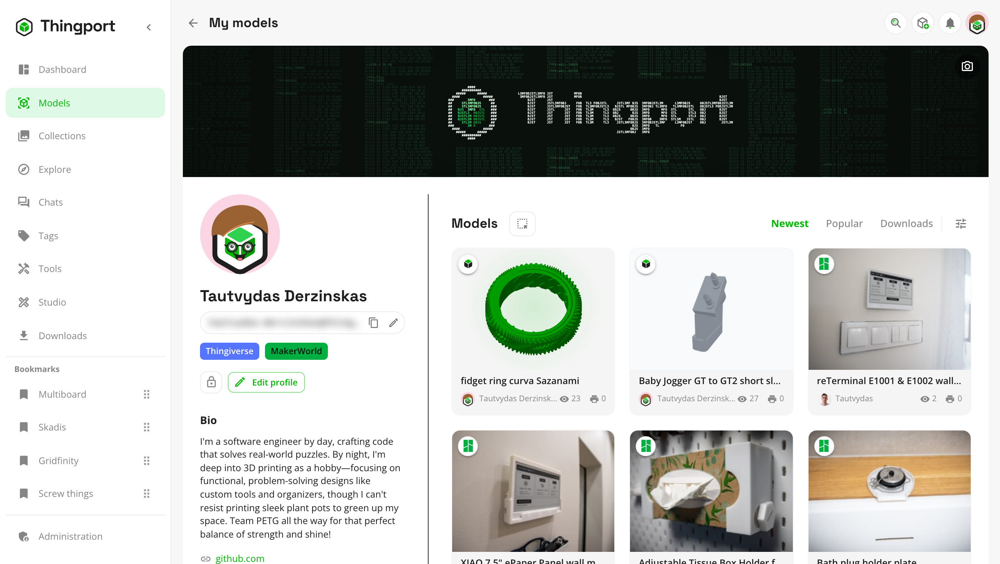
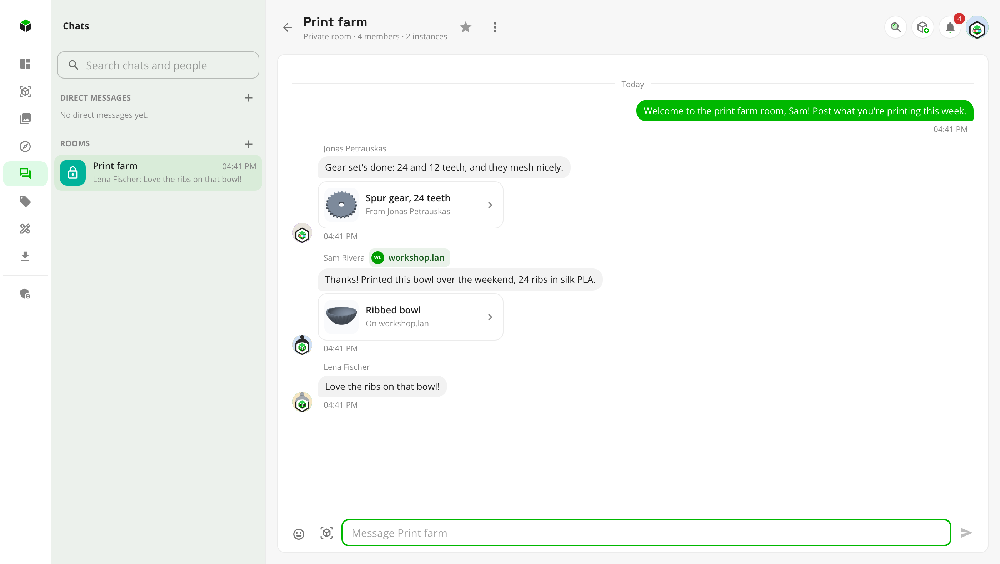

# Social features

Thingport starts as a private library for each person on it. Social features let them share some of it: public
collections and models, found by everyone on **Explore**, collections shared with only the people picked, profiles to
show them on, and chats to talk about them. With [connected instances](connected-instances.md), all of it reaches the
people on partner instances too: a shared collection only the people picked there, through their own instance.

<picture>
  <source media="(prefers-color-scheme: dark)" srcset="../../frontend/src/assets/screenshots/dark/42_explore.png">
  
</picture>

Social features are off by default. An admin turns them on under **Administration → Social → Social features**, and
chats with the switch under them. Until then, every library is private and nothing on this page appears.

## Share what you choose

<picture>
  <source media="(prefers-color-scheme: dark)" srcset="../../frontend/src/assets/screenshots/dark/52_collection_sharing.png">
  
</picture>

- **A collection can be shared or public.** Its form offers **Private**, **Shared** or **Public**, and new
  collections start private. A public collection shows its models to everyone on the instance. A shared one shows them
  only to the people you pick there, by any part of their name or their whole email: they see it as they would a
  public one, and nobody else sees it, on Explore or anywhere. **Share…** in a collection's ⋮ menu opens the form on
  who sees it.
- **People on [connected instances](connected-instances.md) too.** Find them by name, or type someone's whole handle,
  `name@their-instance`, if they share nothing yet. Their instance is told and shows the collection to them alone, so
  its admins could see it too.
- **Who it's shared with is yours to change.** Add or take people off at any time; someone taken off loses it at once.
  Someone on a connected instance loses it once their instance is told, usually a moment later. Until then they can
  still fetch its files if someone else there is still on the list, as this instance lets their instance fetch them,
  not each person. A download already under way may finish, and what they downloaded or copied stays theirs. If this instance has theirs paused, it can't be told yet: the
  collection stays in their list, with the pictures it already showed them, until it's resumed. If theirs has this
  one paused, it's hidden there meanwhile. Making it private or public keeps the list, so making it shared again shares it with
  the same people. A shared collection shows who on its cover and beside its name, to you; the people it's shared with
  don't see who else is on the list. At most 100 people a collection.
- **So can your own models**: the ones under **My models**, with the lock beside **Edit profile** there. Models you
  collected from someone else aren't listed as yours.
- **Everything else stays yours.** Only public collections, shared ones (by the people they're shared with), the
  models in them, and public models can be seen by anyone else. Others see your display name and avatar, never your
  email.

## Explore

**Explore** is in the sidebar once the instance has more than one person on it, or connected instances are on. It
gathers what everyone shares:

- **People who share**, with how many collections and models each one shares. A card opens their profile.
- **New models**, the newest ones shared, and **recently updated collections**.
- **Most copied**, the models people here copy most.
- **Shared with you**, at the top: collections someone shared with you, the latest first. You're told with a
  notification when one is shared with you.

Your own shares aren't listed, since they're not news to you. With [connected instances](connected-instances.md),
partners' people, collections and models show up too, each marked with the instance it's on, and **Everywhere**,
**This instance** or a single partner narrows it down.

## Profiles

Everyone's **My models** page is their profile, as the others see it: their cover, bio and links, their public models
with when they made them public, and a **Collections** tab with their public collections. Choose **Edit profile** for
the bio, up to five links and a cover, and click your avatar to design one or upload a picture. See
[profile and activity](profile-and-activity.md#your-profile).

<picture>
  <source media="(prefers-color-scheme: dark)" srcset="../../frontend/src/assets/screenshots/dark/33_my_models.png">
  
</picture>

While connected instances are on, a profile also shows its **handle**, `username@this-instance`: what people on other
instances use to reach that person.

## Use what others share

- **Someone else's model** opens with whose it is. Download it, open it in your slicer or in
  [Studio](../guides/studio.md), and customize it, but not change it.
- **Copy to my library**, or adding it to one of your collections, makes a copy of your own: its files, pictures,
  description, tags, print profiles and the site it came from. It goes in your category of the same name, when it's in
  one of the starter categories and you have that one; otherwise AI categorization sorts it, when that's on. The copy
  stays when the original is changed, made private or deleted. Adding the same model again finds the copy you already
  have rather than making another.

## Chats

With chats on, **Chats** is in everyone's sidebar, with a count of unread messages, and opens the list of chats beside
it.

<picture>
  <source media="(prefers-color-scheme: dark)" srcset="../../frontend/src/assets/screenshots/dark/46_chat_partner.png">
  
</picture>

- **Direct messages**: find someone by any part of their name, or by their whole email, which is never shown, and write
  to them.
- **Rooms** are made by admins. Anyone can read a public room and join it to write there; a private room is only for the
  people the admin picks. Admins can rename a room, change who's in it, or delete it with everything said in it.
- **Messages** take emoji and up to five of your own models, with text or without. Everyone who can read the chat can
  open, download and copy a model sent in it, for as long as the message stays. Anyone can delete their own messages,
  and an admin anyone's in a room.
- **Favourite** a chat to keep it at the top, or **mute** it to leave it out of the unread count and notifications.
- **New messages** arrive within a few seconds. Someone who isn't reading the chat sees them in the sidebar's count, as a
  toast with **Open**, and as one bell notification per chat. People who have Thingport open show as online.

Everything stays on your instance: messages, models and emoji, with nothing fetched from outside it. With connected
instances, partners' people can be written to and put in private rooms too, marked with their instance, and what's said
with them is kept on both instances.

## Across instances

[Connected instances](connected-instances.md) carry all of this between Thingport instances an admin approved:

- Partners' people, public collections and models on **Explore**, with their profiles.
- Their models to download, open in a slicer or copy, fetched through your instance.
- Chats with their people, directly or in rooms.
- **Explore → Someone elsewhere**, to ask the admins to connect with an instance where someone you'd like to reach is,
  by their handle, `name@their.instance`.

## For admins

Both switches are in **Administration → Social**: **Social features**, and **Chats** under it. Turning social features
off hides everything shared again; each collection keeps its Public or Private setting for when it's back on, and copies
people made stay theirs. Turning chats off hides every chat, and nothing is deleted. Apps reading the REST API with an
[API token](../guides/api-token.md) need its **Chats** permission to read chats, which a new token doesn't have.
