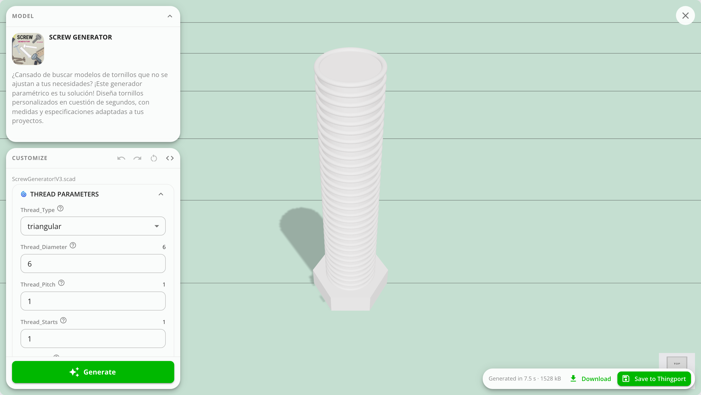

# Everything to print it

A model is more than its STL. Thingport keeps everything you need to print it in one place.

- **Model files:** every printable file, with a 3D preview each, and a thumbnail per plate for multi-plate projects.
- **Photos:** a gallery of their own, separate from the files.
- **Supporting files:** assembly instructions, notes, manuals and other documentation, attached to the model.
- **Prepared print:** keep a sliced, ready-to-print file next to the source files, labelled with the printer it was
  prepared for. Clear it when you re-slice.
- **Notes and description:** edit the model's description, and search finds text in your notes.
- **The script it was generated from:** where a model was published with its OpenSCAD source, that comes in too,
  so the model can be generated again rather than only printed as its creator set it up.

Add supporting files or a prepared print from the model page. When you
[upload a folder](../guides/upload-folders.md) with one model per folder, its images become photos and its manuals
and notes are attached automatically.

## Models you can generate again

Some sites let a creator publish the script a model is built from rather than only the finished mesh —
MakerWorld's Parametric Model Maker is one, and Thingiverse's customizable models are another. Any `.scad`
that comes with a model is kept beside it, however it arrived: imported from any site, uploaded in the same
folder as the model, dropped in the consume folder with it, or attached to a model you already have.

A script on its own isn't a model — it describes one but holds no shape until something runs it — so it can't
be uploaded by itself. Upload it with the model it belongs to, or attach it to one from the model's page.

Such a model leads with **Customize** where it would otherwise lead with **Open**: generating it again is the
thing to do with it, and what you'd slice or download is only one of the shapes it can make. Opening it in a
slicer and the downloads move under the arrow beside it, and **Customize…** is in the ⋮ menu as well.

It opens the customizer: the same sliders, choices and text boxes the creator set up, read from the script by
OpenSCAD itself. A model that came with several scripts asks which one first, and you can switch between them
without leaving.

Scripts written for MakerWorld get what its customizer offers and OpenSCAD's own doesn't: parameters declared
further down a script than OpenSCAD looks, and its colour, typeface and file pickers. A typeface Thingport doesn't
carry comes out in PT Sans, and its field says so. A file starts on a plain stand-in until you choose one, and what
you choose stays in your browser like everything else here.

A script can include other `.scad` files, and any that came with the model are found, whatever folder the script
expects them in. One that didn't come with it can't be: older scripts often rely on a library their author had
installed, and the Thing or model page never held it. The customizer names what's missing and still generates what it
can, so the result may lack parts.

The **Model** pane keeps the model's picture, title and description in view, and folds away when you want the
room. Under it, **Customize** holds the script's own parameters, grouped as the creator grouped them, with
**Generate** at the foot. Every change can be undone and redone — with the buttons, or Ctrl/Cmd+Z — and the
`<>` button shows the script itself.

<picture>
  <source media="(prefers-color-scheme: dark)" srcset="../../frontend/src/assets/screenshots/dark/35_model_customize.png">
  
</picture>

What comes out can be downloaded as a 3MF or an STL, or saved back into your library as a model of its own.
A saved one keeps a copy of the script beside it, so it can be customised again in turn, and a script that
colours what it builds is saved in those colours and opens again in them.

The 3MF carries those colours two ways over, because slicers disagree about where to look: as the colours
themselves, which Bambu Studio and OrcaSlicer offer to put on filaments when the file is opened, and as
per-face painting, which Bambu Studio, OrcaSlicer and PrusaSlicer apply to filament slots straight away. The
mesh stays in one piece either way, so nothing is split into open shells on the way to the plate. An STL has
nowhere to keep a colour at all, which is why that download says so.

The engine runs in your browser, so generating sends nothing anywhere: the script, the values you choose and
the result stay in the tab. Downloading writes the file straight to your disk, and saving uploads it to your
own instance like any other model — neither goes anywhere else. There is nothing to install.

**Generative models**, behind the models list's filter button, narrows the library to the models that have one.

A creator can choose not to share the script, and many don't. MakerWorld says when one didn't: that model still
imports, and is marked **Script not shared** so it's clear why there's nothing to customise rather than leaving it
looking like a model that never had one — only its creator can change that.

The [Script customizer](../../tools/openscad-customizer) tool does the same for a script that isn't a model's
— one opened from a file on your disk, say. An admin installs it from **Administration → Tools**, like any
other tool.
