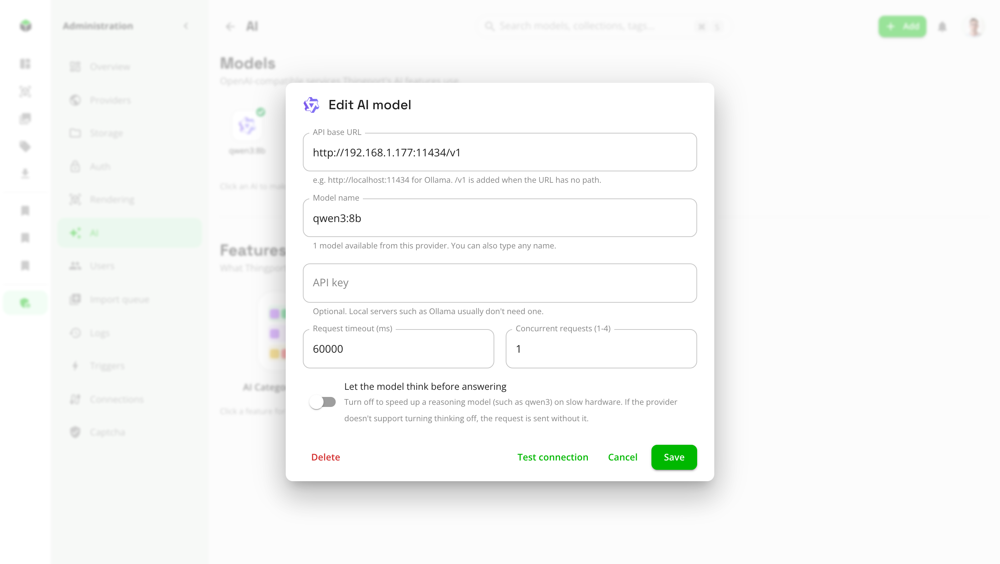
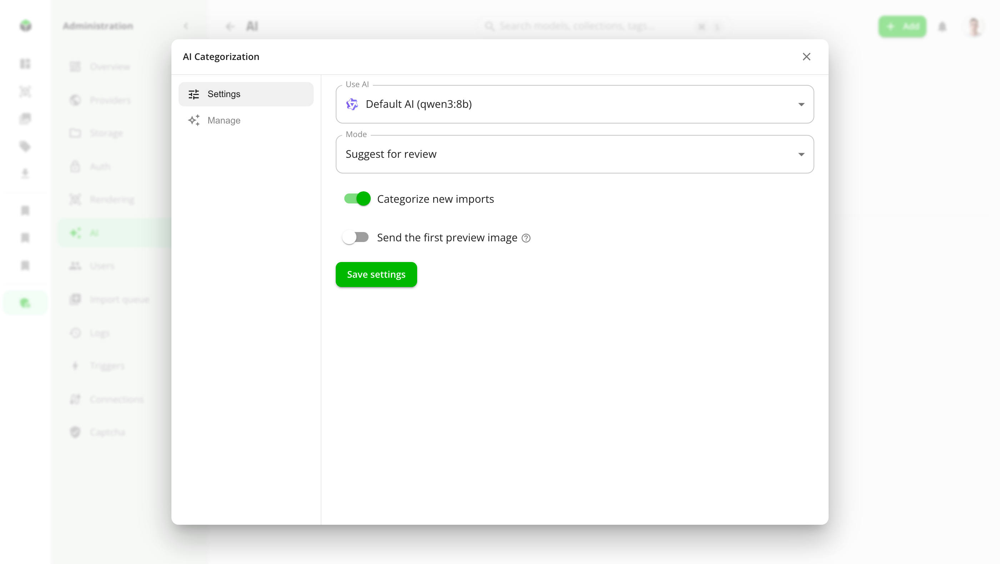

# AI categorization and descriptions

Thingport can use an AI model to sort models into your categories and to clean up their descriptions. Both features
are optional and off until an admin adds a model. Everything else in Thingport works without them.

The model can run on your own hardware, with [Ollama](https://ollama.com), LM Studio or vLLM, so nothing leaves your
network. A cloud API such as OpenAI, OpenRouter or Google Gemini works too.

## AI categorization

Imported models arrive with whatever category the source site gave them, and uploads arrive with none. AI
categorization reads a model's title, description and tags, and optionally its first photo, and picks the best fit
from **your own categories**. It never makes up a new one.

- **Suggest for review** (the default): the AI's pick waits on the model page, marked as an AI suggestion, for you to
  accept or reject. Every pending suggestion is also listed in one place, to accept or reject in bulk.
- **Apply automatically**: picks the AI is confident enough about are applied straight away, and the rest are left as
  suggestions. You set how confident it has to be.

It runs at three moments:

- **On import**, when **Categorize new imports** is on. The import never waits for the AI: the category follows a
  moment later.
- **On one model**, from its **⋮ → Categorize with AI** menu. The result comes as a notification.
- **Over your library**, from **Models → Manage categories & folders → AI Categorization**. Choose which models it
  looks at: uncategorized ones, ones filed in folders, ones the AI categorized before (for example after you've added
  categories), ones categorized on import, and ones you categorized by hand. Progress shows at the bottom of the page,
  and the run can be stopped there.

A category you picked yourself is left alone unless you include **Manual** in a run, or confirm it on one model.

## Improved descriptions

Descriptions copied from model sites are often full of links to the designer's other models, requests for boosts, or
written in another language. Improved descriptions tidies them up. Choose what the AI may do:

- Remove self-promotion, such as links to author pages or other models
- Remove other unrelated info, such as boost requests
- Translate descriptions in other languages to English
- Write a description for models that have none (needs the photo to be sent)
- Fix obvious spelling mistakes
- Improve formatting

As with categorization, a new description is either **suggested for review**, shown next to the current one to keep
or not, or **applied automatically**. The original is always kept, so a description changed by the AI can be compared
with it and reverted at any time, from the model page or from the feature's **Manage** tab.

It runs on import when **Improve descriptions for every new import** is on, on one model from its
**⋮ → Improve description with AI** menu, or over the whole library from the feature's **Manage** tab. A run skips
models with nothing new since their last check.

## Set up an AI model

Admins add models under **Administration → AI → Models → Add AI model**.

- **API base URL**: where the provider's OpenAI-compatible API is. `/v1` is added when the URL has no path.
- **Model name**: the models the provider offers are listed as you type, and any other name can be typed in.
- **API key**: needed by cloud APIs. Local servers such as Ollama usually don't need one.
- **Concurrent requests** (1 to 4) and **Request timeout**: how many models are sent at once, and how long to wait for
  each answer. Raise the timeout for a slow local model.
- **Let the model think before answering**: turn it off to speed up a reasoning model, such as qwen3, on slow hardware.

**Test connection** asks the model to categorize a calibration cube, and saving tests it too, so a wrong URL, key or
model name shows up straight away.

| Provider      | API base URL                                               | API key |
| ------------- | ---------------------------------------------------------- | ------- |
| Ollama        | `http://<server>:11434`                                    | No      |
| LM Studio     | `http://<server>:1234`                                     | No      |
| vLLM          | `http://<server>:8000`                                     | Usually |
| OpenAI        | `https://api.openai.com/v1`                                | Yes     |
| OpenRouter    | `https://openrouter.ai/api/v1`                             | Yes     |
| Google Gemini | `https://generativelanguage.googleapis.com/v1beta/openai/` | Yes     |

Any other service with an OpenAI-compatible chat completions API that supports structured (JSON schema) output should
work as well.

> **Running the model on the same machine as Thingport?** The backend runs in a container, where `localhost` means
> the container itself. Use the machine's LAN address, such as `http://192.168.1.20:11434`, or the service name if
> Ollama runs in the same Compose file (`http://ollama:11434`). Ollama only listens on `localhost` by default: set
> `OLLAMA_HOST=0.0.0.0` so the container can reach it.

### More than one model

Add as many models as you like. Click one to make it the **default**, which every feature uses unless it's set to
another one with **Use AI** in its settings. That way, for example, categorization can run on a small local model while
descriptions use a bigger one.

### Choosing a model

- Small local models (7 to 8 billion parameters, such as `qwen2.5:7b` or `llama3.1:8b`) categorize well enough to make
  suggestions worth reviewing. Bigger ones are more reliable, and better at writing descriptions.
- Small models are often sure of themselves even when they're wrong, so start with **Suggest for review**. Switch to
  **Apply automatically** once you trust the model's picks, and keep the confidence threshold high.
- **Send the first preview image** only helps with a model that can see images, such as `qwen2.5vl` or `llava`, or most
  cloud models.

## Turn the features on

Under **Administration → AI → Features**, switch **AI Categorization** and **Improved descriptions** on. Click a feature
for its settings: which AI it uses, its mode, whether it runs on import, and whether the photo is sent. Its **Manage**
tab starts a run over your library and lists what's waiting for review.

Once a feature is on, it's there for everyone on this Thingport, and each person's runs and suggestions cover their own
library.

## Privacy

With a model on your own hardware, nothing leaves your network. With a third-party API, a model's title, description
and tags are sent to that provider, and its first photo too when **Send the first preview image** is on. Files are never
sent.

## Troubleshooting

[System Health](system-health.md), under **Administration → Overview**, checks the default AI model with the rest of
Thingport and says what's wrong:

- **Not answering**: check that the provider is running and reachable from the backend container (see above), and that
  the API base URL and key are right.
- **Model missing**: the provider answered but doesn't list the model. Check its name, or pull it first
  (`ollama pull qwen2.5:7b`).
- **Timed out**: a local model may still be loading. Try again, or raise the request timeout.

Every run is recorded in **Administration → Logs**, with how many models were checked, suggested, applied and failed.
