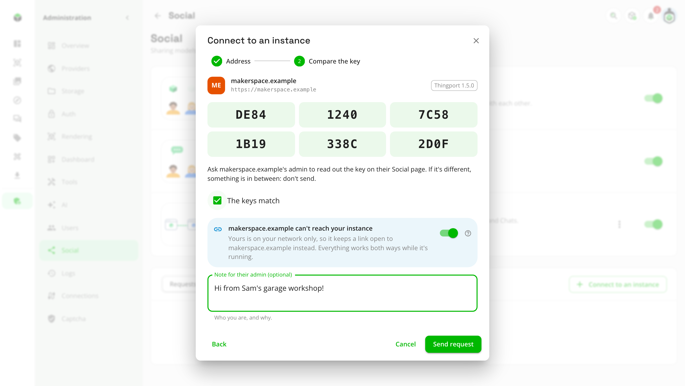
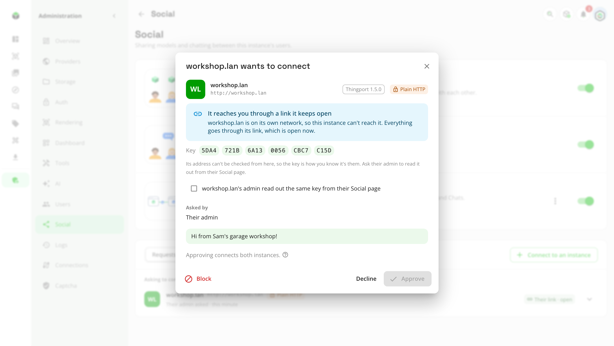
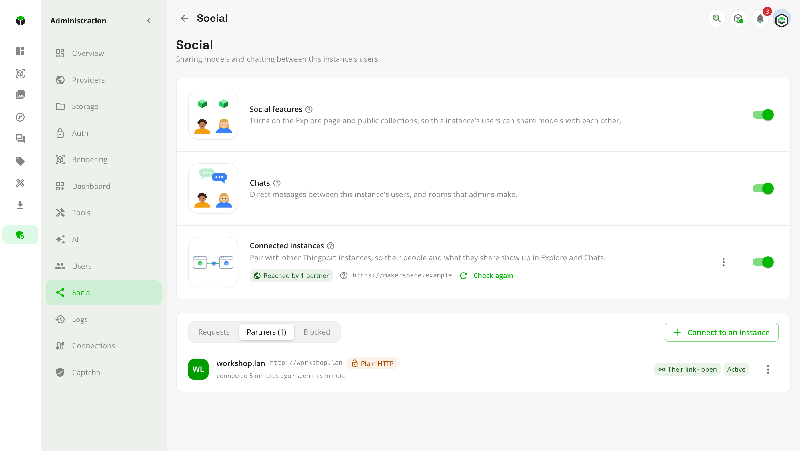

# Set up connected instances

Thingport instances can connect with each other. Two connected instances are partners: their people, public
collections and models show up on each other's Explore, and their people can write to each other, as if everyone were
on one instance. You approve every
instance before it connects, and nothing private ever leaves: libraries, private collections and settings stay where
they are.

It's off by default, and most instances never need it. While it's off nothing about it answers on the network, so
nothing tells a visitor this instance could connect at all.

This guide is the admin's step by step. For what connecting gives the people on your instance, and how it works, see
[connected instances](../features/connected-instances.md).

## Before you start

- **Social features on.** Connected instances build on them: **Administration → Social → Social features**.
- **A Public URL**, the address other instances know this one by. It's set under **Administration → Auth → Public
  URL**, for example `http://192.168.1.20:8080` or `https://things.example.org`. The instances must be able to reach
  each other there, or at least one the other (see
  [When one instance can't be reached](#when-one-instance-cant-be-reached)):
  - **On one network or VPN** (a home LAN, Tailscale, WireGuard), that just works, over plain HTTP too.
  - **Over the internet**, the instance needs a public address: a port forwarded on your router, a reverse proxy or a
    tunnel. Everything goes to paths under `/api/`, which every Thingport setup already sends to the backend, so a
    proxy needs no new rules. Bot protection in front of it (Cloudflare's, for one) must let `/api/ap/` through.

## Turn it on

Open **Administration → Social** and switch on **Connected instances**. Thingport first checks whether other instances
could reach it, without asking anyone outside:

- **The Public URL is set**, and **it leads back to this instance**: it fetches a one-time code from its own Public URL
  and checks the answer is signed with this instance's secret.
- **Its address**: on your local network (private ranges, VPNs like Tailscale, names like `.lan` or `.home.arpa`) or
  public.

The result is one of:

| Result                                  | Meaning                                                                                                                                                                                                        |
| --------------------------------------- | -------------------------------------------------------------------------------------------------------------------------------------------------------------------------------------------------------------- |
| **Local network only**                  | Instances on your network or VPN can connect. Instances on the internet can't reach it, but it can still connect to them through a link.                                                                       |
| **Reachable, not confirmed yet**        | A public address that answered. Instances on the internet should reach it, if your router or proxy lets them in. The first partner that reaches it confirms it, and the status then says so.                   |
| **Public, but it didn't answer itself** | A public address that didn't answer from inside. Some routers can't reach their own public address; outside instances may still reach it. The first connection will tell.                                      |
| **Links only**                          | Nothing answered at the Public URL, or something else did. Other instances can't connect to this one, but it can still connect to the ones it reaches, keeping a link open to each.                            |
| **Not reachable**                       | There's no Public URL, or it's this machine (`localhost`, `127.0.0.1`) or a reserved range such as link-local `169.254.x.x`, which other instances never connect to. It can't be turned on until that's fixed. |

When the Public URL didn't lead back here, the check says what it found: nothing answering within 8 seconds, a name
this instance can't look up, a refused connection, a certificate it doesn't trust, a redirect (instances don't follow
them), or what something else answered with.

> [!NOTE]
> **A certificate of your own**, a self-signed one say, isn't trusted by other instances, or by this one checking
> itself, so the check finds **Links only**. Links don't need it. For instances on your network to connect to this one
> too, each of them has to trust it, this one included: point the `NODE_EXTRA_CA_CERTS` environment variable at the
> certificate inside the container. Or use plain HTTP on your network.

**Check again** on the page runs the check whenever you change something.

## Connect to another instance

1. In **Administration → Social**, open **Connect to an instance** and enter the other instance's Public URL.
2. Thingport looks it up and shows its name, version and **key**: six groups of four characters.
3. Ask the other instance's admin to read out the key shown on their own Social page (⋮ beside **Connected
   instances** → **Show this instance's key**), on the phone or side by side. If it matches, tick **The keys match**.
   If it doesn't, something is in between: don't send.
4. Add a note if you like, and **Send request**. It waits under **Requests → Waiting for them** until their admin
   answers, and you get a notification when they do.

<picture>
  <source media="(prefers-color-scheme: dark)" srcset="../../frontend/src/assets/screenshots/dark/48_connect_link.png">
  
</picture>

The key is how the two instances know each other. Comparing it matters most over plain HTTP, where someone in between
could otherwise swap it.

## When one instance can't be reached

An instance on a home network usually can't be reached from the internet, but it can reach out. It can still connect
with an instance on the internet: it keeps a **link** open to it, and whatever the other instance would send it or
fetch from it comes down that link. Explore, pictures, downloads, copies and chats work both ways, as between two
instances that reach each other.

- **The one that can't be reached connects.** The other can't look it up: looking it up there says to answer your
  request instead. **Connect to an instance** turns on **Keep a link open** by itself when this instance is on your
  network only and the other is on the internet, and for every instance while this one is **Links only**; switch it on
  yourself if theirs can't reach yours for another reason.
- **The key is how they know it's you.** Their admin can't check your address from there, so compare the key as usual.
  Your request shows there as reaching them through a link.
- **While your instance is off**, what's said to your people waits on their side and arrives once it's back, and their
  Explore keeps showing what you last shared. Downloading your files there says your instance isn't connected.
- **Partners** shows **Your link** or **Their link** beside the instance, open or not.
- **Two instances that both can't be reached** can't connect this way: put them on one VPN (Tailscale, WireGuard)
  instead.
- **Two instances with the same address** (both at `http://192.168.1.20:8080`, on different networks) can't both
  connect to the same instance: give yours an address of its own.
- **A reverse proxy** in front of the instance on the internet should pass uploads to `/api/ap/link/replies/` on as
  they come, whatever their size (in nginx, `proxy_request_buffering off` and `client_max_body_size 0`). Thingport's own
  nginx does.

## Answer a request

When another instance asks to connect, every admin here gets a notification. It opens the request with the instance's
key, who asked and their note. You can also open it in place under **Requests → Asking to connect**.

- **Approve** connects the two instances. Compare the key with their admin first, as above.
- **Decline** tells them no; they can ask again.
- **Block** declines it without telling them, and drops whatever that instance sends later.

<picture>
  <source media="(prefers-color-scheme: dark)" srcset="../../frontend/src/assets/screenshots/dark/49_request_link.png">
  
</picture>

A request is only checked once you open it: until then Thingport doesn't contact the instance that sent it. Opening
it checks that it's signed with the key you see, and that the instance still stands by it: one it withdrew meanwhile
says so and disappears. A request through a link can name any address, so when it names one on the internet and a
different instance answers there, the review shows that one and its key too: approve only if the request's key is the
one their admin read out.

## When your users ask

Anyone on the instance can ask to reach someone on another one: **Explore → Someone elsewhere**, with that person's
handle (`name@their.instance`) and a note. Nothing goes to that instance yet. Every admin here gets a notification,
and the request waits under **Requests → From your users**:

- **Connect…** opens [Connect to an instance](#connect-to-an-instance) with the address guessed from the handle (plain
  HTTP for a local address or name like `.lan`, HTTPS otherwise; change it if it's wrong). The note their admin sees
  says who asked, and whom they want to reach: everyone here waiting to reach someone on that instance goes in the
  same request. Each person who asked is told once the instances connect, or if the other admin declines.
- **Decline** tells only the person who asked.

A person can have up to ten requests waiting, and make twenty a day, withdrawn ones included; they can withdraw one
from the same dialog while it waits for you. Asking for
someone on an instance that's already a partner, already asked or blocked says so straight away.

## Handles

While connected instances are on, everyone has a handle, `username@this-instance`, shown under their name on their
profile: that's what people on other instances ask for. Usernames are made from display names (`Rūta K.` becomes
`ruta-k`), and anyone can change theirs with the pencil beside it, or under **Edit profile**: up to 30 lowercase
letters, digits, dots, dashes and underscores, unique on the instance. The host part is the
[Public URL](#before-you-start)'s.

## What partners see

Once two instances are connected, each one's **Explore** shows the other's people who share something, their public
collections and their models, beside its own, each with the instance they're on. **Everywhere**, **This instance** and
each partner at the top narrow it down. A partner's person opens their profile; a model shows its pictures, description
and which of its owner's collections it's in, and can be opened in a slicer, downloaded file by file or as a ZIP, and
copied to your library.

- **What goes across is what's shared**: what anyone signed in here could see of someone else, and nothing else.
  Libraries, private collections, settings and emails stay where they are.
- **Each instance keeps a copy** of what its partners share, read when they connect and every 15 minutes after, and
  again when someone opens Explore and it's a couple of minutes old. **Check connection** reads it right away. A model
  made private there is gone here by the next read.
- **Pictures and files come through this instance**: a viewer's browser never talks to a partner. Pictures are
  kept; files are fetched each time, and never kept unless someone copies the model. For the same reason, images
  inside a partner's descriptions aren't shown.
- **A copy is yours**: **Copy to my library** fetches the files, pictures and description into a model of your own,
  file by file, and carries on if you leave the page. It says where it came from, with a link to the original while
  it's still shared; it stays when the partner changes it, stops sharing it or disconnects. A copy is made only once
  every file has arrived, no file may be bigger than an upload here, and all of them together no bigger than one.
- **Chats reach partners' people**, with chats on at both instances. They're in **New message** with their instance,
  and a partner's profile has **Message**. An admin can put partners' people in a private room: the room stays on
  this instance, and their instance keeps a copy that gets its messages and sends theirs back. A room a partner hosts
  shows with **Hosted on** and its admin manages it. Only models you share on Explore can be sent elsewhere. Messages
  are kept on both instances, and stay when a partner disconnects. While it's paused, you can't write to its people
  directly or in the rooms it hosts. While connected instances are off here, you can't write to partners' people,
  but you can still delete your messages and join or leave rooms, and an admin can change or delete them: partners
  hear of it once it's on again.
- **Paused** partners are hidden from Explore until **Resume**; what's said meanwhile in rooms hosted here waits for
  them and arrives once they're resumed. **Disconnect** and **Block** remove everything of theirs, the copies of rooms they
  host with what was said in them included; direct messages with their people and rooms hosted here stay.

## Partners

<picture>
  <source media="(prefers-color-scheme: dark)" srcset="../../frontend/src/assets/screenshots/dark/47_admin_partners.png">
  
</picture>

Connected instances are under **Partners**, with when they connected and when they were last heard from. Each one's ⋮
menu (or a right-click) has:

- **Check connection**: looks it up again, warns if its key changed since you connected, and reads what it shares
  again.
- **Show key**: the key it had when you connected.
- **Pause**: stops talking to it for now. What this instance has for it waits until **Resume**; what the partner
  sends meanwhile is turned away to be retried, for about three days, so after a longer pause some of it is lost. If
  the partner disconnected meanwhile, it may still be listed here after **Resume**: disconnect it then.
- **Disconnect**: ends it, and it's told. What came from it disappears here; copies people made stay.
- **Block**: disconnects it (it's told it was disconnected, not that it's blocked) and drops whatever it sends later.
  Unblock it under **Blocked**.

Turning **Connected instances** off keeps everything as it is, keys included: partners can't reach this instance
meanwhile, and it's all back when it's on again, as the same instance.

Everything a partner sends must be signed with the key you compared when connecting. If it ever signs with another
one (its database was reset, say, or something in between swapped it), what it sends is dropped, and **Check
connection** says its key changed. Compare the new key with its admin, then disconnect and connect again.

## Plain HTTP

Connecting works over plain HTTP, which is what most home networks use. Requests are signed, so no one can pretend to
be a partner or change what's sent, but what's sent can be read on the way. Instances on plain HTTP are marked
**Plain HTTP**; over the internet, put HTTPS in front of Thingport.
