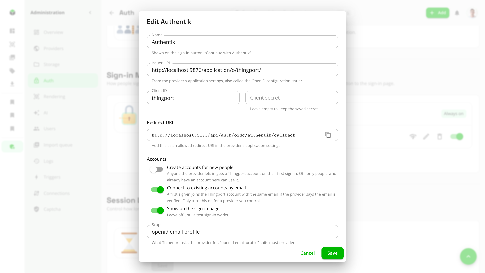
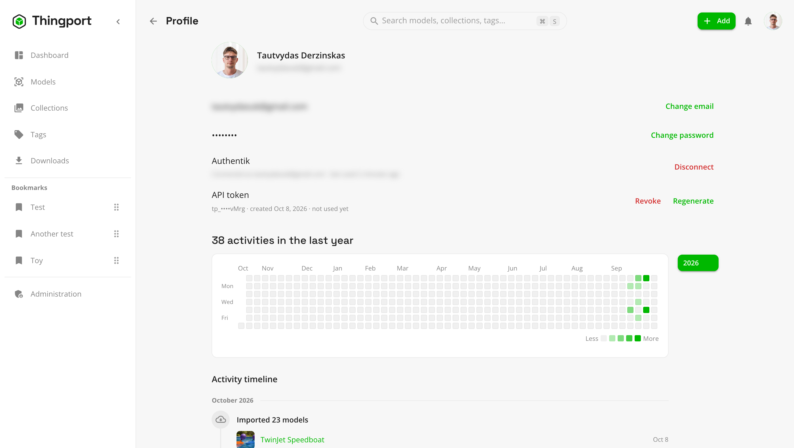

# Single sign-on (OIDC)

If you already run an identity provider for your self-hosted apps, such as Authentik, Pocket ID, Keycloak, Authelia or
Zitadel, people can sign in to Thingport with it too. Each provider you add puts a **Continue with …** button on the
sign-in page.

Single sign-on is optional and sits next to email and password, which always keep working. With no provider added,
the sign-in page, registration and profile look exactly as they always have.

## Before you start

Thingport has to know the address people open it at, so the provider knows where to send them back. Set it under
**Administration → Auth → Public URL**, for example `https://thingport.example.com`, with the port if there is one.
On the first run it's taken from `PUBLIC_URL` in `.env`; after that it's managed on that page.

## Add a provider

1. In your identity provider, create an application (often called a client) for Thingport, of the OpenID Connect /
   OAuth2 kind. Leave its redirect URI for step 4.
2. In Thingport, open **Administration → Auth → Sign-in Methods** and click **Add OIDC provider**.
3. Fill in:
   - **Name**: shown on the button, as in "Continue with Authentik".
   - **Issuer URL**: from the provider's application settings, also called the OpenID configuration issuer. Thingport
     checks it as you type and says when it has found the provider.
   - **Client ID** and **Client secret**: from the application you created.
4. Copy the **Redirect URI** Thingport shows and add it to the application's allowed redirect URIs. It looks like
   `https://thingport.example.com/api/auth/oidc/authentik/callback`. The part before `/callback` is the
   **Name in the address**, which can't be changed once the provider is added.
5. Choose who can use it (see [Accounts](#accounts)) and click **Add provider**.
6. Click **Test sign-in**. It signs in with the provider in a new window, changes nothing in Thingport, and says what
   would happen: which account it would sign in to, connect or create, or why the person would be turned away. It also
   shows everything the provider sent, which helps when something's off.
7. Once the test works, switch the provider on to show its button on the sign-in page.

**Scopes** are what Thingport asks the provider for. `openid email profile` suits most providers, and `openid` is
always needed.

### Issuer URLs for common providers

| Provider  | Issuer URL                                           |
| --------- | ---------------------------------------------------- |
| Authentik | `https://auth.example.com/application/o/<app-slug>/` |
| Pocket ID | `https://id.example.com`                             |
| Keycloak  | `https://keycloak.example.com/realms/<realm>`        |
| Authelia  | `https://auth.example.com`                           |
| Zitadel   | `https://<instance>.zitadel.cloud`                   |
| Google    | `https://accounts.google.com`                        |

## Accounts

Thingport matches each person by their account at the provider, so changing their email there later doesn't matter.
The first time someone signs in, two switches decide what happens:

- **Create accounts for new people**: anyone the provider lets in gets a Thingport account on their first sign-in.
  Leave it off and only people who already have a Thingport account can use the provider. Use your identity provider's
  own access rules to decide who's let in.
- **Connect to existing accounts by email**: a first sign-in joins the Thingport account with the same email, when the
  provider says that email is verified. Only turn this on for a provider you control, since whoever controls an email
  address there gets into the Thingport account with it.

Without the second switch, someone whose email already has a Thingport account is asked to sign in with their password
instead, and can connect the provider from their profile.

An invitation link (**Administration → Auth → Registrations → Invite users**) can be accepted with single sign-on too, as long as the provider signs the person
in with the invited address.

Roles work the same as for everyone else: the first account is the admin, and admins are made on the **Users** page.
Thingport doesn't read groups from the provider.

## For each person

On their **Profile** page, under the password, anyone can connect a provider to their account, to sign in with one click from then on,
or disconnect it again.

Someone whose account was created through single sign-on has no password. They can set one from the same place, to
also sign in with their email, and to use [Thingport Grab](../../extension/README.md), which signs in with a password.

## Hiding or removing a provider

Switching a provider off hides its button. Deleting it removes it altogether. Either way, people who signed in with it
keep their accounts and models, but those without a password can't sign in until it's back. Thingport warns how many
people that affects before you go ahead, and the **Users** page shows how each person signs in, flagging anyone left
with no way in.

## Troubleshooting

- **"Single sign-on needs Thingport's public URL set"**: set it under **Administration → Auth → Public URL**.
- **The provider says the redirect URI is invalid**: the URI registered with it must match the one Thingport shows
  exactly, including `http`/`https`, the port and the trailing `/callback`.
- **You're using Thingport at another address than the public URL**: the provider always sends people back to the
  public URL, so test and sign in from there.
- **"…didn't share an email address"**: a new account needs one. Make sure the `email` scope is allowed for the
  application.

Connecting and disconnecting providers are recorded in **Administration → Logs**.
