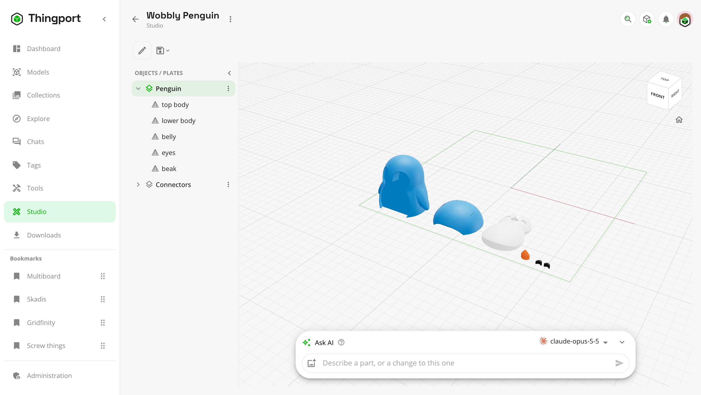
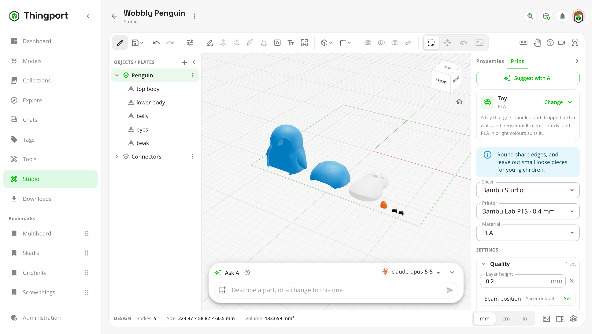

# Studio

Studio is a CAD page for designing printable parts, built for an AI to drive. Describe a part, or a change to a model
you have, in its [Ask AI](#ask-ai) box or to an assistant connected over [MCP](mcp.md), and watch it designed step by
step. Everything an AI does there you can do yourself too, from shapes and sketches, and every change you can make is
a tool an AI can use, though a small local model on the [compact tool set](ai.md#studio-assistant) gets only the basic
ones.

**Studio** is in the sidebar, under **Tools**, for everyone on the instance.

## Designing

Use the **⋮** menu next to the design name to create, open, rename, export, or delete a design, or open it in a slicer.
Its **Recent** list jumps to the three designs you edited last.
The toolbar's **Save** menu is available in both modes. The **Edit** button (the pencil) shows the editing tools,
**Properties**, and the status bar. You can turn the view and use the undo and redo shortcuts in either mode.
The **Objects / Plates** and **Properties** panels fold away with the arrows in their headers. Reopen them from
their tabs or from the panels button at the right of the status bar, beside the print check and **Studio settings**.

### Plates, colors, and export

<picture>
  <source media="(prefers-color-scheme: dark)" srcset="../../frontend/src/assets/screenshots/dark/60_studio_plates.png">
  
</picture>

The **Objects / Plates** panel lists each plate with its objects nested underneath. Click a plate name to show it in
the viewport. In Edit mode, use **Add plate** in the panel header or the actions menu on a plate to rename it or
delete it when empty. Expand an object to see the features it was built from. For multi-plate designs, the panel
also lets you switch plates outside Edit mode.

Select a body and use **Move to plate** in Properties to change its plate while keeping its position and orientation.
You can select several bodies to move or color them together. Set **Body color** and choose **Apply** to use that
color in the viewport and the 3MF. Each plate with visible bodies gets a thumbnail in the 3MF. Hidden bodies and
empty plates are skipped during export.

Use **Export** in the design menu to download a single **3MF** for all populated plates, or choose **STL** to
download a ZIP with one STL per populated plate. From a plate's menu, **Export as STL** downloads that plate's STL directly.

**Save design** downloads STL for one uncolored body on one plate and 3MF for designs with colors, multiple
bodies, or multiple plates. **Save to Thingport** saves a 3MF in the library. **Open with slicer** prepares a 3MF for your selected
slicer and compatible saved printer and nozzle, without adding a model to your library. For slicers that take one
plate at a time, choose which plate to open. Studio prepares unopened plates as needed for export, subject to the
design's export limits. For Bambu-compatible slicers, open all imported plates to see every color under **Filament
assignments**. Choose the slot and material you loaded and save the assignments before opening or downloading the
3MF. Studio marks unassigned colors and assigns those to free slots automatically. This handoff supports up to 16
colors. When the slicer has a preset for the design's checked printer and nozzle, Studio selects that preset by default.

Use **Arrange plate** from a plate's menu to preview where visible bodies will go before committing the move. It uses
the chosen printer's bed and the spacing you set, keeping each body's orientation. Use **Lock position for arrangement**
on a body to keep its place. Allow overflow if you want bodies that need more room to go to additional plates.

A design is a list of features, built in order:

- **Shapes**: box, cylinder, cone, sphere, torus and thread, from the toolbar. Each starts at the middle of the bed,
  standing on it. A thread is ISO metric (an M8 has a 1.25 mm pitch unless you change it): **External** is a threaded
  rod, **Internal** the solid to subtract for a nut's thread, a little larger by its clearance so a printed rod fits.
- **Sketches**: pick **Sketch** and a plane (top, front or right) or **On a face** of a body, then draw on it. **Line**
  and **Arc** draw one outline between them, as in other CAD: click from point to point, switch to Arc for a curve
  (click where it ends, then a point it passes through) and back to Line, and close it on its first point, by
  double-click or with <kbd>Enter</kbd>; <kbd>Backspace</kbd> takes back the last click. An outline of only lines is a
  polygon, so its corners can be rounded. Rectangles, circles and polygons draw in one go; a rectangle or polygon can
  have rounded corners. A shape marked as a **hole** is cut out of the others. **Extrude** pulls the sketch into a
  solid: a distance, both ways or from an offset, with sides that taper and ends rounded or bevelled. **Revolve** turns
  it round one of the sketch's axes, all the way or part of it. Either can make a new body, or join, cut or intersect
  one you click. **Add path** puts an SVG path among a sketch's shapes, pasted from a drawing program or typed, in the
  sketch's millimetres with y up.
- **Loft** and **Sweep**: select two sketches or more and **Loft** makes the solid that passes through their outlines in
  the order you selected them, as a bottle from a square base to a round neck. **Sweep** pulls a sketch's outline along
  a path of points (a pipe, a handle, a rail). As in other CAD, the profile stays where you drew it: the path starts on
  the sketch's plane, square to it, and a new sweep's path starts out of the middle of the profile for you to edit.
- **Text**: the **Text** tool writes words as a solid in one step: raised letters on a plane, or on a body's flat face
  embossed (raised from it) or engraved (cut into it). Letter height is a capital's height; 6 mm or more prints well.
  The fonts are the 21 bold faces Thingport carries for tools, each shown in its own face in the list. The words, font
  and size stay editable on the text's sketch, and **Add text** in a sketch puts text among its other shapes. A font
  without a letter you typed (some lack Lithuanian or Polish letters) says so, and names the fonts that have it.
- **Trace picture**: turns a picture's shapes into an outline to make solid: a logo, a silhouette, lettering, a
  drawing. Drop, paste or choose a picture and see what it traces to beside it: dark shapes on a light ground, or
  light on dark with **Invert**; see-through counts as light. The threshold is found for you, or set it yourself; less
  detail smooths away specks and jags. Holes stay holes, and what's inside them stays solid. Make it a solid of a
  height straight away, or only the sketch, to extrude, revolve or cut with. Its size, threshold and detail can be
  changed later in the properties panel, which traces it again.
- **Library models**: **Open…** in the design's menu has a **Library** tab with your models' STL, 3MF, STEP, OBJ and
  GLB files. **Open** makes a new design from one; **Insert** brings it into the design that's open. **Open in
  Thingport Studio**, on a model's page and on its right-click menu in any grid of models, takes you straight to Studio
  after you choose the file. For a new 3MF design, Studio prepares the first build plate and shows its progress. Click
  any other plate in **Objects / Plates** to prepare its bodies. Studio keeps its own copy at the source dimensions.
  Each printable object comes in as a body, keeping its plate placement and any uniform object color. When inserting
  into an existing design, Studio imports all the plates, with the first populated one going into the active plate.
  Studio uses a single color per body, so face painting and slicer modifiers stay in the original file. A mesh with
  gaps can be moved, scaled and exported. Use **Separate** to turn loose pieces within a single body into individual
  bodies.
- **Combining**: select two bodies or more and pick **Union**, **Subtract** or **Intersect**. The first one you selected
  is the one the others are joined to, cut from or overlapped with. **Hull** wraps one body or more in the tightest
  convex body around them, as a rounded slot from two cylinders.

Designs stay editable: change a box's width, or a sketch's circle, and everything built from it follows. The bodies a
boolean was made from are folded under it in the feature list, and deleting the boolean gives them back.

**Parameters**, the sliders icon beside **Undo** and **Redo** in the **Edit** toolbar, lets you name the numbers a
design depends on. A parameter can be a length (mm, cm or in, such as `wall = 2 mm`), an angle (°), or a count
without a unit. Enter a formula such as `=wall * 2 + 10` in a size field in **Properties**. Studio marks the linked
field with **ƒx** and updates it whenever the parameter changes. A formula takes `+ - * / % ^`, brackets, `pi`,
functions such as `min`, `max`, `round` and `sqrt`, and numbers with units (`2 in + 5 mm`, `45°`). A length
field takes only a length and a count only a plain number, so `wall * wall` in a width is refused. A bare number
added to a length is in the design's units, and is kept with that unit written in (`wall + 1` in an inch design
is kept as `wall + 1 in`), so switching units never changes a size.
Typing a plain number into the field lets its formula go.

## Units

As in other CAD, each design has its own units, **mm**, **cm** or **in**, switched in the status bar along the bottom or
in **Studio settings** (the gear at the right of the status bar), and undone like any change. Every size field shows and
takes them: a bare number is in the design's units, and one typed with its own (`2 in`, `5 mm`, `3"`) is converted. The
status bar, Measure and the print check read out in them, and the grid steps in them. Switching units changes no size: a
design is kept in millimetres, and so are its commands and what an assistant reads, which then talks to you in your
units. **Studio settings** also sets the units new designs start in, kept on your account.

## The grid

The grid behind a design works as in other CAD. **Adaptive** (the default), it follows the zoom: finer lines fade in as
you zoom in and out as you zoom out, stepping by tens (1 mm, 1 cm, 10 cm) or, in inches, by fours (1/16, 1/4, 1 in),
with every tenth (fourth) line darker; it fades away towards the horizon. **Fixed**, it keeps the spacing you set: major
lines so far apart, divided into 2, 4, 5 or 10. Sketch points and moved bodies snap to the finest lines that show, so
zooming in snaps finer. The **Grid** section of **Studio settings** turns the grid and snapping on or off, and sets the
spacing and how dense an adaptive grid is; it's kept on your account.

## Changing a body

**Hole** and the **Modify** menu work on a body you have. Each opens a small panel over the view: click what it works
on, set its numbers, watch the preview, then **OK** (or <kbd>Esc</kbd> to cancel). If it can't be done, the panel says
why, and OK waits until it can.

- **Press/pull**: click a flat face and move it out or in, the body growing or shrinking with it.
- **Fillet** and **Chamfer**: click straight edges to round or bevel; click one again to let it go. Two edges meeting at
  a corner meet in a mitre, three at a square corner (as on a box) in a ball. A rounding too big for its faces, or a
  corner it can't blend, is refused rather than made wrong. A cylinder's or an extrude's own rim has its own setting in
  the properties panel.
- **Hole**: click where to drill, into the surface: a depth or right through, plain, counterbored or countersunk.
- **Shell**: hollows the body with walls of a thickness, and clicked flat faces are left open, as a tray's top. Flat
  walls come out exactly that thick. Bodies over 20,000 triangles are refused, so shell parts before combining them.
- **Split** cuts a body in two by a plane, a flat face or another body. A planar split can make matching pins and
  sockets with adjustable depth, diameter, position, and radial clearance. Choose whether to put the second half
  on a new plate. Select a half to edit the connectors on both halves in Properties.
- **Fit test** in a split connector's properties makes a plate with a cropped pin and sockets from the joint. Each
  socket has its clearance engraved in millimetres. After trying them, open **Fit test** on the original joint to
  apply the clearance that fits. Give the clearance a parameter name to keep both halves linked to that value.
- **Separate parts**: makes each loose piece of a body its own body, shown in its own colour before you press OK. A
  hollow inside a piece stays with it, and pieces that overlap without being joined come apart too: union them
  afterwards to join them properly. Each part moves, turns and scales about the middle of its base. Deleting all the
  parts gives the body back. Also on a body's right-click menu, and on an imported model's properties.
- **Scale**: makes a body bigger or smaller about its own middle.
- **Pattern**: repeats a body in a row, a grid, or round an axis, evenly or over an angle, as one body: subtract a
  pattern of cylinders for a ring of bolt holes. Change the body and every copy follows.
- **Mirror**: reflects a body across a plane, keeping the original as well (half a part made whole) or not.
- **Align**: lines a body up with another, or with the bed: before, at the start, centre or end of, or after it, on
  each axis, with a gap. On top of another body, centred on it, is two clicks.
- **Lay flat**: click a flat face and the body turns so that face is on the bed, as you'd turn a part for printing.
- **Hole** can be **tapped**: threaded for an ISO bolt of that diameter to screw into.

Studio opens in **Hand** mode. Drag with the left mouse button or one finger anywhere on the model or grid to
pan the view. Drag with the right mouse button or two fingers to rotate. Pinch or scroll to zoom. In Edit mode,
use the hand icon to pause viewport selection and editing while you navigate. Tap it again to resume. Sketch, Measure,
and other editing tools temporarily suspend Hand so you can pick geometry.

With **Hand** off in Edit mode:

- **Left button** selects. Click a body, or drag a box over empty space: from left to right it takes what's wholly
  inside, from right to left also what it touches. <kbd>Shift</kbd> adds to the selection. Right-click a body for its
  menu.
- **Right button** turns the view, the **middle button** (or <kbd>Shift</kbd> with the right) moves it, and the
  **wheel** zooms.
- The **cube** in the corner turns with the view: click a face, an edge or a corner to look from there, or drag it. The
  house below it goes back to the starting view.

**Select** only picks; **Move**, **Rotate** and **Scale** put a gizmo on the body selected. You can also type exact
values in the panel on the right. Units are millimetres, and Z is up, as on a printer's bed.

| Key                                                              | Does                                                                               |
| ---------------------------------------------------------------- | ---------------------------------------------------------------------------------- |
| <kbd>Q</kbd> <kbd>W</kbd> <kbd>E</kbd> <kbd>R</kbd>              | Select, move, rotate, scale                                                        |
| <kbd>L</kbd> <kbd>A</kbd> <kbd>R</kbd> <kbd>C</kbd> <kbd>P</kbd> | In a sketch: line, arc, rectangle, circle, polygon                                 |
| <kbd>⌘</kbd><kbd>Z</kbd> / <kbd>⇧</kbd><kbd>⌘</kbd><kbd>Z</kbd>  | Undo / redo (Ctrl on Windows)                                                      |
| <kbd>Delete</kbd>                                                | Delete what's selected                                                             |
| <kbd>F</kbd>                                                     | Fit the view to the design                                                         |
| <kbd>I</kbd>                                                     | Measure                                                                            |
| <kbd>Esc</kbd>                                                   | Drop a shape half drawn or a selection box, finish the sketch, clear the selection |

While editing, the **status bar** along the bottom gives how many bodies there are, how big they are together and how
much they hold: the selected bodies, or the whole design when nothing is selected. Its **mm / cm / in** switch sets
the design's [units](#units).

**Measure** (the ruler in the toolbar, or <kbd>I</kbd>) works as in other CAD: choose what to pick (points, edges,
faces or bodies) and click. One pick shows its own size: a point's position, an edge's length, a face's area, a body's
size and volume. A second shows the shortest distance between them, drawn as a dashed line, how far apart that is
along X, Y and Z, and the angle between edges or faces; between two bodies, the gap or how much they overlap. A third
click starts again. Measuring changes nothing in the design.

**Check for printing** (the checklist at the right of the status bar) checks each visible body where it is placed: on
the bed and within it, in one piece, not overlapping another, no overhang that needs support and no wall too thin to
print. Pick one of your saved printers to show its bed outline in the viewport and use its build height and nozzle
for the check. You can also enter custom dimensions. Select a warning to jump to its object and plate. Overhangs
and thin walls show markers at the affected areas. Use **Onto bed** to lower a floating body or **Lay flat** to pick
a face to print on. **Measure** gives the gap or overlap between two bodies. Ask AI and MCP use the same printer setup.
Open all imported 3MF plates before running the whole-design check.
As in other CAD, a thread is judged as the plain cylinder it's cut on, so its ridges don't count as overhang or thin walls.

**Save to Thingport** saves the design as a **New model**, named after the design unless you change it, or with **Add
to a model** as one more print profile of a model you already have: search your library and pick it, and you see how
many profiles it has. A new model gets the design's 3MF, a picture of the view, and what you asked Ask AI about the
design as its description. If the design has no print profile yet, the dialog asks for one first: **Choose myself**
(the presets), **Suggest with AI**, or, for a new model, **Save without**. Name the profile as it should read on the
model's page. An assistant can save it too when you ask.

### Print profile

<picture>
  <source media="(prefers-color-scheme: dark)" srcset="../../frontend/src/assets/screenshots/dark/61_studio_print_profile.png">
  
</picture>

The **Print** tab beside **Properties** (while editing) sets the design's print profile. **Choose a preset** offers
Standard, Fine detail, Quick draft, Strong, Outdoor, Water contact, Toy, Flexible, Heat-resistant, Vase and Smooth top,
with the ones that fit the design's name and requests marked **Suggested**; **Suggest with AI** asks Studio's assistant
to choose, and it says why. A new profile is for your main slicer and the printer you use with it; change either, and
the material, below the preset. **Settings** are sorted as Bambu Studio sorts them, into **Quality**, **Strength**,
**Speed**, **Support** and **Others**, each a section you open or fold; each shows how many settings the profile sets
there. In a section, a setting the profile sets is a field (put it back to the slicer's own with ×), and one it
doesn't shows as **Slicer default** with **Set** beside it. Only settings your slicer reads from a 3MF are offered:
speeds reach Bambu Studio and the slicers built on it, not PrusaSlicer or Cura. One the profile already sets stays
listed when you switch to a slicer that doesn't read it, marked as one to set in that slicer. Choices with a look, such as the infill
and top patterns, support type, brim, seam, wall order, ironing and fuzzy skin, show a small picture of each option.
Hover a setting to see its name in your slicer. Notes under the preset warn about a material that doesn't suit it, or settings your slicer won't take. A dot
on the tab means the assistant changed the profile. Fold the panel with its arrow: **Properties** and **Print** then
wait as two tabs on the right edge.

A design can carry a **print profile**: the slicer settings it's meant to print with, started from a preset such as
Standard, Strong, Outdoor, Water contact or Toy, for your slicer and printer. It goes into every 3MF the design is
saved, downloaded or opened as, so Bambu Studio and the slicers built on it open it with those settings, and
PrusaSlicer and Cura take the ones they can read through **Open adapted**. Saved to Thingport, it shows on the model's
page as a print profile, like one imported from a model site. An assistant can choose one from what the design is
for, and it says why; it can also add the design to a model you already have as one more print profile.

## Working with an AI assistant

Connect an assistant as [the MCP guide](mcp.md) describes, then turn on **Studio designs** in your API token's MCP
permissions (**Profile → API token**). The assistant can then list, read, make and change your designs, and look at
them from any side. Ask it, say, to "make a 60 × 40 × 20 mm box with a 4 mm wall and open top in Studio" and watch the
design build up on the page.

Every change, yours or the assistant's, can be undone, and the assistant can see what you changed meanwhile.

### Ask AI

The **Ask AI** box at the bottom of the page does the same from inside Thingport, once an admin turns on the **Studio
assistant** and picks the AIs it offers (see [AI](ai.md#studio-assistant)). Describe a part, or a change to the design
that's open, and press <kbd>Enter</kbd> (<kbd>Shift</kbd>+<kbd>Enter</kbd> starts a new line).

- The assistant works through the same steps as the toolbar, and each one shows in the view as it lands, listed under
  your request while it works. **Stop** ends the run after the step it's on, and <kbd>Ctrl</kbd>/<kbd>⌘</kbd>+<kbd>Z</kbd>
  takes its steps back one at a time.
- What's selected in the view goes along with your request, so "round the top edges of this" knows what "this" is.
- Each design keeps its own conversation, so "make it taller" follows on from "make a box". The conversation header has
  a **Clear conversation** button.
- **Pictures**: with an AI that sees pictures (an admin says which, in [AI](ai.md#seeing-pictures)), the box takes up
  to four: the picture button, paste, or drop them on it. A photo or a drawing with sizes on it is something to build
  from; a logo or a silhouette the AI traces into an outline exactly, as **Trace picture** does. The pictures stay
  with the design's conversation.
- A run can work for up to 10 minutes. Some small local models lack tool support, and the box tells you when a model
  can't use tools. An admin can give a small local model the compact tool set, which covers shapes, text, tracing,
  moving, combining and holes.

In View mode, the conversation appears beside the viewport and the prompt stays below the design. In Edit mode, the
compact bar shows the current step or last answer. Open the full conversation from the bar's header.
