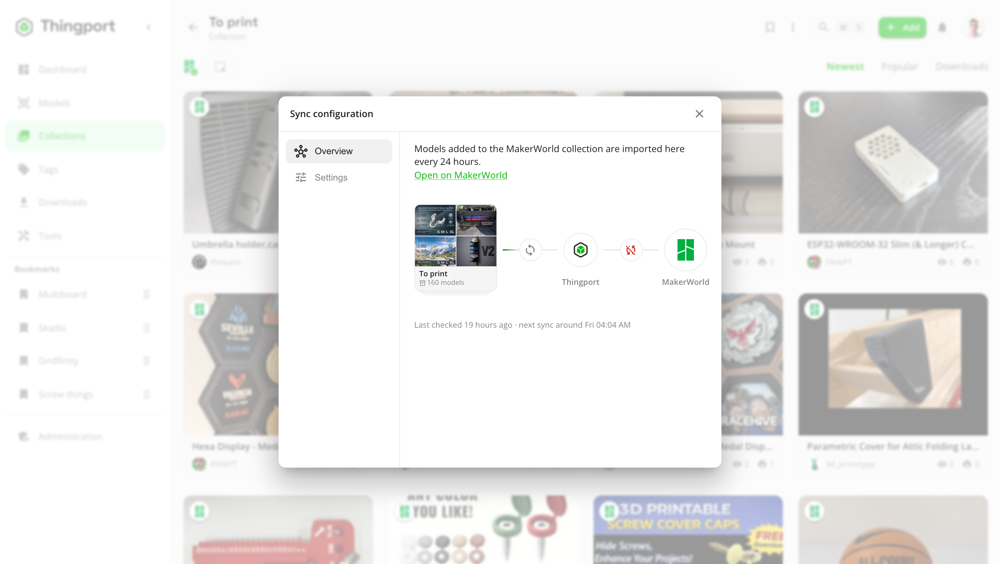

# Synced collections

A synced collection follows a list on a model site -- a collection, someone's likes, or your bookmarks, wishlist or
saved projects. When a model is added to it there, Thingport imports that model into the matching Thingport collection
on its own, without you visiting the page again. Every site Thingport imports from can be synced except OwlCAD, which
has no collections or likes; [what each one syncs](#what-each-site-syncs) is below.

<picture>
  <source media="(prefers-color-scheme: dark)" srcset="../assets/collection-sync-dark.gif">
  
</picture>

## Why sync a collection

- **Keep collecting where you already do.** Save or like models on the site as you browse, even from your phone, and
  they turn up in your library later.
- **Follow other people's collections.** Sync a designer's or a friend's public collection, or their likes where the
  site shows them to anyone, and get each model they add to it.
- **A real copy of everything.** Each new model is imported with its files, photos, description, tags and author, so
  it's still yours if the original page goes away.
- **Nothing to remember.** Thingport checks the collection on a schedule and sends a notification saying what came in.
- **Nothing is ever deleted.** Sync only adds. Removing a model from the provider's collection doesn't remove it from
  Thingport.

## Before you start

- Sync can be turned on from Thingport itself, or with [Thingport Grab](../../extension/README.md), the browser
  extension, on the list's own page.
- Connect the provider under **Configuration → Providers** where it needs it (see
  [provider setup](../PROVIDER_SETUP.md)). The table says what each one needs.

### What each site syncs

| Site            | What syncs                                    | What it needs                                                                                             |
| --------------- | --------------------------------------------- | --------------------------------------------------------------------------------------------------------- |
| MakerWorld      | Collections, private ones too                 | Your session cookie, to import models and to read a private collection                                    |
| Printables      | Collections; your private ones and likes too  | Nothing; [Grab for the private ones and likes](#private-printables-collections-and-your-printables-likes) |
| Thingiverse     | Collections, and anyone's likes               | The admin's App Token                                                                                     |
| MyMiniFactory   | Collections, less their paid models           | The admin's API key                                                                                       |
| Snapmaker Space | Your likes and bookmarks                      | Your sign-in, which only Grab keeps fresh                                                                 |
| MakerOnline     | Collections, and your likes                   | Your sign-in for likes and private collections; [Grab for the files](#makeronline)                        |
| Creality Cloud  | Collections, private ones too, and your likes | Your sign-in, for the files and your likes                                                                |
| NexPrint        | Collections, private ones too                 | Your sign-in, for the files                                                                               |
| Thangs          | Collections, and your likes                   | Your sign-in, for every sync; Thingport keeps it renewed                                                  |
| Cults3D         | Your printlists, and anyone's likes           | Your API key, and the browser sign-in Grab sends for the files                                            |
| eufyMake        | Your likes                                    | Your sign-in                                                                                              |
| Pinshape        | Anyone's collections and likes                | Your sign-in, for the files                                                                               |
| Toymakr3D       | Your liked products                           | Your sign-in, for the list and the files                                                                  |
| Makerables      | Your saved projects                           | Your sign-in, for the list; the files need none                                                           |
| CGTrader        | Your liked models and your wishlist           | Your sign-in, and Grab's token or FlareSolverr for its bot check                                          |
| GrabCAD         | Anyone's likes                                | Your sign-in, for the files                                                                               |

A few have more to know:

- **Sign-ins that run out.** Snapmaker's lasts a day and only Grab renews it, so if Grab's browser stays closed that
  long, Snapmaker syncs wait until your next visit there. Creality Cloud's lasts a week from when you signed in there,
  and Grab sends the new one on your next visit. GrabCAD's lasts two days from its last use, and visiting grabcad.com
  with Grab now and then keeps it alive; without one, a GrabCAD sync waits rather than fail every model.
- **Left out.** A MyMiniFactory collection's paid models; on Thangs and Cults3D the paid ones you don't own, and on
  Thangs the print-only ones too. CGTrader's paid ones aren't left out: one you haven't bought is refused when the sync
  reaches it, and counts as failed.
- **Limits.** Once your Thangs account's daily downloads are used up, the rest come in on a later check. If Cults3D's
  Cloudflare turns Thingport away, the rest come in after your next visit to cults3d.com with Grab.
- **Pinshape likes.** Its profiles show only 12 of someone's likes, so a likes sync brings new ones as they show up
  there.

## Turn sync on in Thingport

1. Open the Thingport collection that should follow a list on a provider, or create it first.
2. Choose **⋮ → Sync configuration**. A collection that isn't synced yet opens on **Browse**.
3. Pick the provider. Your own lists there are listed: on Printables, Thingiverse and MyMiniFactory, the public ones of
   the username you give the first time; everywhere else, those of the account you connected, as the table says (on
   Pinshape, the collections you subscribed to as well). Or paste the link of any list the site lets Thingport read,
   yours or someone else's.
4. Pick one and click **Sync**. **Settings** sets how often it's checked, and for MakerWorld, Snapmaker Space,
   MakerOnline, Creality Cloud and NexPrint which print profiles each new model brings, before you do.

The models already in the list are imported now, one at a time; MakerOnline's wait for Grab, as below. MakerWorld
rate-limits bulk imports quickly, so there only models added from now on come in. Ones already in your library are
added to the collection either way. A provider's list syncs with one Thingport collection at most, so one that's taken
shows which collection follows it.

### MakerOnline

MakerOnline gives its files only to its own pages, so Thingport can see what's new on a schedule but not download it.
New models wait for Thingport Grab, and you get a notification saying how many; the next time you open makeronline.com
in a browser with Grab, it imports them there and files them into the synced collection.

### Private Printables collections and your Printables likes

Printables shows these to you alone, so Thingport can't read them on its own. With Thingport Grab installed in a browser
where you're signed in to Printables, Grab reads them while you're on Printables, at most once an hour, and sends them to
your Thingport. They then show up in **Browse** too, your likes as **Liked models**, and sync like any other collection,
except that new models come in after your next visit to Printables rather than on a schedule. Sync one before Grab has
read it, and its models come in on that next visit.

## Turn sync on with Thingport Grab

1. Open the list's page on the site, with the site switched on in Grab's popup:
   - a collection page on MakerWorld, Printables, Thingiverse, MyMiniFactory, MakerOnline, Creality Cloud, Thangs or
     Pinshape, or on NexPrint one open on its owner's page;
   - anyone's likes page on Thingiverse, Cults3D, Pinshape (its **Likes** tab) or GrabCAD, or your own on MakerOnline,
     Creality Cloud, Thangs (**Liked**), eufyMake or Toymakr3D;
   - one of your own printlists on Cults3D, your liked models or wishlist on CGTrader, or your **Interactions** tab on
     Snapmaker Space, where the panel's switch picks your likes or bookmarks.

   Makerables' **Saved** tab has no address of its own, so sync it from Thingport instead.

2. Click the Thingport Grab button in the bottom-right corner. The panel lists the models in it.
3. Tick **Keep this collection in sync** (**Keep these likes in sync** on a likes page). It's off by default.
4. Pick the models to import now and click **Import selected** (**Start import** on MakerWorld).

<picture>
  <source media="(prefers-color-scheme: dark)" srcset="../../extension/docs/screenshots/collection-printables-dark.jpg">
  
</picture>

The models already in the collection are imported now, as with any collection import. The ones you leave unticked stay
out: sync only picks up models added **after** you turn it on.

Already imported the collection before? Open its page again, open the panel and tick the box. The panel says
everything is already in your library, and **Save** turns sync on.

Thingport sends a notification once sync is on, naming the collection it follows and its settings.

## Find it in Thingport

A synced collection's tile on the **Collections** page shows the provider's logo with a green tick.

<picture>
  <source media="(prefers-color-scheme: dark)" srcset="../../frontend/src/assets/screenshots/dark/09_collections.png">
  
</picture>

Open the collection and click the same logo above its models, or choose **⋮ → Sync configuration**, to see how it's
linked:

<picture>
  <source media="(prefers-color-scheme: dark)" srcset="../../frontend/src/assets/screenshots/dark/36_collection_sync.png">
  
</picture>

- **Overview** shows the chain from the provider's collection to yours, when it was last checked and when the next
  check is due, and a link to the collection on the provider's site. **Sync now** checks it right away. **Stop
  syncing** unlinks it.
- **Settings** sets how often it's checked: every hour, 6 hours or 24 hours (the default). For MakerWorld, Snapmaker
  Space, MakerOnline, Creality Cloud and NexPrint it also sets which print profiles each new model brings: the default one, the
  designer's (the default), or all of them, community ones included.

## How it works

- **On a schedule.** Each synced collection is checked on its own interval, once a day unless you change it. A check
  compares the provider's collection with the models Thingport has already seen there.
- **New models only.** A model that's already in your library is just added to the collection. The rest are imported
  one at a time, a minute apart, so the provider isn't flooded with requests. You get a notification when they're in.
- **A lane of its own.** Synced collections don't wait in the [import queue](../features/importing.md#the-import-queue)'s
  line or hold it up: they run beside it. A sync gives way while an import from the same provider is running, since both
  reach the provider from the same server, and carries on by itself afterwards.
- **In your import queue.** A running sync is listed under **Importing** with a **SYNC** tag. The top bar's ring and
  number are only for imports you started. With only a sync going, the icon's tooltip says a synced collection is
  updating, and a sync reaches its badge only when it fails or stops.
- **Seen once, decided once.** A model Thingport has seen in the collection is never brought back by the sync, whether
  you left it unticked or deleted it from your library later.
- **Renames are fine.** The link follows the provider's collection id, so renaming the collection on either side keeps
  it synced.
- **One to one.** A provider collection syncs with one Thingport collection, and the other way round. If a collection
  with the same name already follows another source, the new one gets its own name, such as "Things (MakerWorld)".
- **Rate limits pause it.** If the provider stops the imports, for example with a MakerWorld CAPTCHA or daily download
  limit, the remaining models wait, on hold, in your [import queue](../features/importing.md#the-import-queue) until
  you start them again. They then go back to this lane, not the line.
- **Restarts don't lose it.** A sync a server restart cut off carries on by itself. With scheduled checks off (below),
  it stays on hold until you start it or click **Sync now**.
- **Deleted collections.** If the provider's collection can't be found on two checks in a row, the Thingport collection
  is unsynced and you get a notification. Its models stay. Deleting the Thingport collection removes the sync with it.
- **Sync now** is available again 5 minutes after the last check. Its notification also tells you when there was
  nothing new. While an import from the same provider is running, it waits for that first.

## Turn sync off

Either untick the box in Thingport Grab on the collection's page and save, or use **Stop syncing** in the collection's
sync configuration. The collection and its models stay in Thingport. You can turn sync on again at any time, in Thingport or from Grab.

## For admins

Two optional settings, added to the `backend` service's `environment` in `docker-compose.yml`:

- `COLLECTION_SYNC_ENABLED=false` turns off the scheduled checks for every user. **Sync now** still works, and a sync
  that someone started again from the import queue, or that gave way to an import, still finishes by itself.
- `COLLECTION_SYNC_ITEM_DELAY_MS` sets the pause between the models a sync imports, in milliseconds. The default is
  `60000`, one minute.

Checks run one collection at a time across all users, since they all reach the providers from the same server. One that
has to give way hands its turn to the next, so syncs from other providers carry on.

Turning a provider off under **Administration → Providers** pauses every collection synced from it, for every user.
They pick up again once it's back on.
