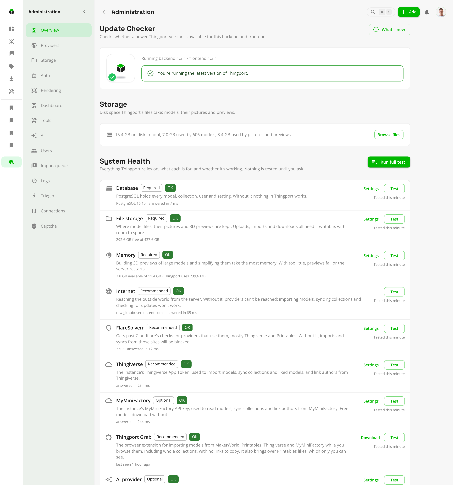

# System Health

**Administration → Overview → System Health** checks everything Thingport relies on and says, in plain words, what's
wrong and how to fix it. It's the first place to look when something doesn't work: an import fails, previews don't
appear, invitations don't arrive or the AI features stay quiet.

Click **Run full test** after installing Thingport, after changing its setup, and whenever something seems off. Each
part also has its own **Test** button, and a **Settings** link to the page where it's set up (**Download** for Grab;
Internet, the server's own network, has none). Nothing is tested until you ask, so the results show when each part was
last checked.

**Ideally, everything is green.** Anything marked **Required** or **Recommended** that isn't green means Thingport, or
part of it, won't work properly until it's fixed. Optional parts can stay unconfigured if you don't use what they're
for.

<picture>
  <source media="(prefers-color-scheme: dark)" srcset="../../frontend/src/assets/screenshots/dark/40_system_health.png">
  
</picture>

## What's checked

| Part           | Needed      | What it's for, and what breaks without it                                                                                                                                                                                                                                                                                                                                                 |
| -------------- | ----------- | ----------------------------------------------------------------------------------------------------------------------------------------------------------------------------------------------------------------------------------------------------------------------------------------------------------------------------------------------------------------------------------------- |
| Database       | Required    | Holds every model, collection, user and setting. Without it nothing in Thingport works.                                                                                                                                                                                                                                                                                                   |
| File storage   | Required    | Where model files, pictures and 3D previews are kept. Uploads, imports and downloads fail if it isn't writable or runs out of space.                                                                                                                                                                                                                                                      |
| Memory         | Required    | Building 3D previews of large models takes the most. With too little, previews fail or the server restarts.                                                                                                                                                                                                                                                                               |
| Internet       | Recommended | The server reaching the outside world, checked with a request to where system notifications come from (GitHub, unless `SYSTEM_NOTIFICATIONS_URL` says otherwise). Without it no site can be reached: imports, synced collections and the update check stop.                                                                                                                               |
| FlareSolverr   | Recommended | Gets past Cloudflare's checks, mostly on Printables, Thingiverse and MyMiniFactory (MakerWorld and Thangs use it only as a fallback), and gets Thingport a token for the AWS bot check in front of CGTrader's downloads. Without it, imports and syncs from those three are blocked whenever Cloudflare challenges the server.                                                            |
| Thingiverse    | Recommended | The instance's Thingiverse App Token, used for every Thingiverse import, synced collection and author lookup. Not checked while Thingiverse is [turned off](../PROVIDER_SETUP.md#turning-a-provider-off).                                                                                                                                                                                 |
| MyMiniFactory  | Optional    | The instance's MyMiniFactory API key, used to read models, synced collections and authors from MyMiniFactory. Not checked while MyMiniFactory is [turned off](../PROVIDER_SETUP.md#turning-a-provider-off).                                                                                                                                                                               |
| Thingport Grab | Recommended | The [browser extension](../../extension/README.md) for importing from a model's or a collection's own page as you browse, and for handing Thingport your sign-ins to the sites that need one. Some things come only through it: MakerOnline's files, OwlCAD's CAD projects, and your Printables likes and private collections. Shown as seen once any browser uses it with this instance. |
| AI provider    | Optional    | The default AI model behind [AI categorization and improved descriptions](ai.md). Everything else works without it.                                                                                                                                                                                                                                                                       |
| Email (SMTP)   | Optional    | Sends invitations, email confirmations and password resets. Without it, invitation links are shown to copy instead, and new accounts don't confirm their address.                                                                                                                                                                                                                         |

## What the colours mean

- **OK** (green): checked and working.
- **Warning** (orange): working, but close to trouble, such as storage or memory running low. Fix it before it becomes
  an error.
- **Error** (red): not working. For a Required or Recommended part, Thingport or the features that depend on it are
  broken until it's fixed.
- **Not configured** (grey): not set up. Fine for an optional part you don't use. For FlareSolverr, Thingiverse or
  MyMiniFactory, imports from those sites will fail sooner or later. Thingport can't look into anyone's browser, so Grab
  stays grey until it's first used with this instance; get it from the **Downloads** page.
- **Not tested**: hasn't been checked yet. Click **Test** or **Run full test**.

Every problem comes with what to do about it, for example: check that the database container is running, make sure
`PUID`/`PGID` can write to the storage folder, fix the FlareSolverr URL and port, generate a new Thingiverse token, or
pull the AI model on Ollama.

## Common fixes

- **File storage not writable**: the storage volume isn't mounted, is read-only, or belongs to another user. Set
  `PUID` and `PGID` in `.env` to the folder's owner and run `docker compose up -d` again.
- **Memory low**: give the container more memory, or turn on **Simplify previews** under **Administration →
  Rendering** so heavy models need less.
- **Internet offline**: check the server's network, DNS and any proxy or firewall in front of it; Docker containers
  need outbound access too. Uploading and browsing your library still work meanwhile.
- **FlareSolverr not answering**: check that its container is running and that the URL under **Administration →
  Connections → FlareSolverr** is right, port included (usually `http://flaresolverr:8191`).
- **Thingiverse token rejected**: generate a new one at [thingiverse.com/apps/create](https://www.thingiverse.com/apps/create)
  and save it under **Administration → Providers** (see [Thingiverse setup](../providers/thingiverse.md#setup)).
- **MyMiniFactory key rejected**: check that you copied the application's API key, not its client ID, under
  [myminifactory.com/settings/developer](https://www.myminifactory.com/settings/developer), and save it under
  **Administration → Providers** (see [MyMiniFactory setup](../providers/myminifactory.md#setup-the-api-key)).
- **AI provider not answering or model missing**: see [troubleshooting the AI features](ai.md#troubleshooting).
- **Email not connecting**: check the host, port, security setting and login under **Administration → Connections →
  SMTP**.
