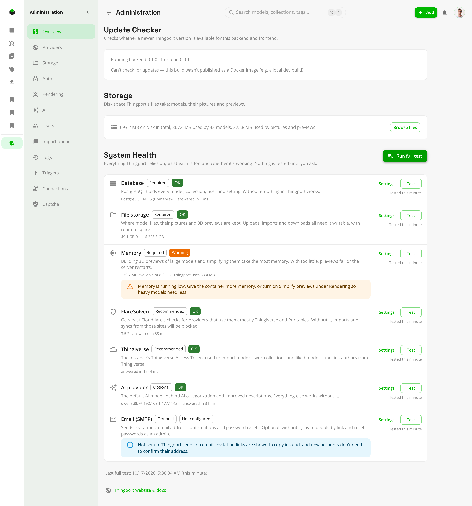

# System Health

**Administration → Overview → System Health** checks everything Thingport relies on and says, in plain words, what's
wrong and how to fix it. It's the first place to look when something doesn't work: an import fails, previews don't
appear, invitations don't arrive or the AI features stay quiet.

Click **Run full test** after installing Thingport, after changing its setup, and whenever something seems off. Each
part also has its own **Test** button, and a **Settings** link to the page where it's set up. Nothing is tested until you
ask, so the results show when each part was last checked.

**Ideally, everything is green.** Anything marked **Required** or **Recommended** that isn't green means Thingport, or
part of it, won't work properly until it's fixed. Optional parts can stay unconfigured if you don't use what they're
for.

## What's checked

| Part         | Needed      | What it's for, and what breaks without it                                                                                                                                                                    |
| ------------ | ----------- | ------------------------------------------------------------------------------------------------------------------------------------------------------------------------------------------------------------ |
| Database     | Required    | Holds every model, collection, user and setting. Without it nothing in Thingport works.                                                                                                                      |
| File storage | Required    | Where model files, pictures and 3D previews are kept. Uploads, imports and downloads fail if it isn't writable or runs out of space.                                                                         |
| Memory       | Required    | Building 3D previews of large models takes the most. With too little, previews fail or the server restarts.                                                                                                  |
| FlareSolverr | Recommended | Gets past Cloudflare's checks, mostly on Thingiverse and Printables. Without it, imports and syncs from those sites are blocked whenever Cloudflare challenges the server.                                   |
| Thingiverse  | Recommended | The instance's Thingiverse Access Token, used for every Thingiverse import, synced collection and author lookup. Not checked while Thingiverse is [turned off](../PROVIDER_SETUP.md#turning-a-provider-off). |
| AI provider  | Optional    | The default AI model behind [AI categorization and improved descriptions](ai.md). Everything else works without it.                                                                                          |
| Email (SMTP) | Optional    | Sends invitations, email confirmations and password resets. Without it, invitation links are shown to copy instead, and new accounts don't confirm their address.                                            |

## What the colours mean

- **OK** (green): checked and working.
- **Warning** (orange): working, but close to trouble, such as storage or memory running low. Fix it before it becomes
  an error.
- **Error** (red): not working. For a Required or Recommended part, Thingport or the features that depend on it are
  broken until it's fixed.
- **Not configured** (grey): not set up. Fine for an optional part you don't use. For FlareSolverr or Thingiverse,
  imports from those sites will fail sooner or later.
- **Not tested**: hasn't been checked yet. Click **Test** or **Run full test**.

Every problem comes with what to do about it, for example: check that the database container is running, make sure
`PUID`/`PGID` can write to the storage folder, fix the FlareSolverr URL and port, generate a new Thingiverse token, or
pull the AI model on Ollama.

## Common fixes

- **File storage not writable**: the storage volume isn't mounted, is read-only, or belongs to another user. Set
  `PUID` and `PGID` in `.env` to the folder's owner and run `docker compose up -d` again.
- **Memory low**: give the container more memory, or turn on **Simplify previews** under **Administration →
  Rendering** so heavy models need less.
- **FlareSolverr not answering**: check that its container is running and that the URL under **Administration →
  Connections → FlareSolverr** is right, port included (usually `http://flaresolverr:8191`).
- **Thingiverse token rejected**: generate a new one at [thingiverse.com/apps/create](https://www.thingiverse.com/apps/create)
  and save it under **Administration → Providers** (see [provider setup](../PROVIDER_SETUP.md#thingiverse-access-token)).
- **AI provider not answering or model missing**: see [troubleshooting the AI features](ai.md#troubleshooting).
- **Email not connecting**: check the host, port, security setting and login under **Administration → Connections →
  SMTP**.
