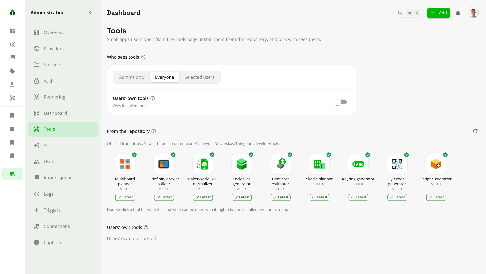

# Tools

A tool is a small app that opens in a window of its own from the **Tools** page: a planner, a generator, a calculator.
It's a short JavaScript module with some HTML and CSS, like a [custom dashboard widget](custom-widgets.md), and it works
with your library: it can browse and make collections, find models, read their files, and save the models it makes.

<picture>
  <source media="(prefers-color-scheme: dark)" srcset="../../frontend/src/assets/screenshots/dark/31_tools.png">
  
</picture>

Open **Tools** in the sidebar. Double-click a tool to open it, or press <kbd>Enter</kbd> on it; right-click it, or press
the context menu key, for **About**, **Its models** and, on your own tools, **Edit** and **Delete** (an admin also gets
**Uninstall** on an installed one). From anywhere, <kbd>⌘</kbd><kbd>S</kbd> (<kbd>Ctrl</kbd><kbd>S</kbd>) opens search,
where `!tool` lists them: every tool you can open is there by name, and picking one opens its window. An admin can open
an installed tool from **Administration → Tools** as well, with **Open** in its right-click menu or in its details.

### Arranging them

The row above the icons sets the page up, and what you choose is kept on your account, so it opens the same way on
every device:

- **Show as** — **Shelves**, which the page starts on, splits the tools into Generators, Planners, Calculators, Files,
  Library and Other, with a heading each and empty shelves left out; **One grid** puts the installed tools first and
  then your own.
- The order, on the right: by **Name**, **Newest** — where the page starts — or **Author**, as the models page orders
  its grid.
- Where each tool sits: drag its icon onto another shelf, or right-click it and pick one under **Move to**. While a
  tool is in the air the empty shelves appear too, so it can be dropped on one. A tool starts on the shelf its own
  metadata names, and moving it is yours alone — an update to the tool won't move it back.

> [!WARNING]
> A tool's script runs in your browser with your access to Thingport, like code you paste into the browser console. The
> tools in the repository are read before they're merged; only make or keep your own tools if you trust their code.

## The tools in the repository

Nine come with Thingport, for an admin to install:

| Tool                      | Shelf       | What it does                                                                                                                                                       |
| ------------------------- | ----------- | ------------------------------------------------------------------------------------------------------------------------------------------------------------------ |
| Multiboard planner        | Planners    | Plans a Multiboard wall and every tile and mount to print it. It draws the plates itself and brings the 13 joints.                                                 |
| Gridfinity drawer builder | Planners    | Fits a Gridfinity baseplate and bins to a drawer, cut to your printer's bed, and saves the set as one model.                                                       |
| Skadis planner            | Planners    | Plans a wall of 3D-printed IKEA Skadis boards sized to your bed, with the mounts and the print order. It brings its 21 boards, mounts and spacers from MakerWorld. |
| Enclosure generator       | Generators  | A case for electronics: box and lid with screws or snaps, PCB standoffs, port cutouts, vents and text.                                                             |
| QR code generator         | Generators  | A printable QR code for a link, text, a Wi-Fi network or a contact, as a 3MF with a part per filament.                                                             |
| Keyring generator         | Generators  | Your text as a keyring, with key rings and magnet pockets, in a 3MF that gives each piece its filament.                                                            |
| Script customizer         | Generators  | Generates a model again from an OpenSCAD script: the one a model in your library came with, or a `.scad` file.                                                     |
| Print cost estimator      | Calculators | A model's print time, filament and real cost, and the price to charge for the margin you want.                                                                     |
| MakerWorld 3MF normalizer | Files       | Makes Bambu Studio and MakerWorld 3MFs open in other slicers with their colours, plates and print settings.                                                        |

A model that came with its script doesn't need the Script customizer: **Customize…** on its own page opens its
parameters whether the tool is installed or not.

<picture>
  <source media="(prefers-color-scheme: dark)" srcset="../../frontend/src/assets/screenshots/dark/32_tool_window.png">
  
</picture>

## For admins

**Administration → Tools** has three parts.

<picture>
  <source media="(prefers-color-scheme: dark)" srcset="../../frontend/src/assets/screenshots/dark/30_admin_tools.png">
  
</picture>

- **Who sees tools**: admins only, everyone, or admins and the users you pick; a new Thingport starts on everyone. Only
  they see **Tools** in the sidebar and get the models tools bring. **Users' own tools** lets them also make their own,
  in the editor below; it's off at first.
- **From the repository**: the tools in the Thingport repository's [`tools`](../../tools) folder, none of them installed
  until you install it. Double-click one, or press <kbd>Enter</kbd> on it, for its details: what it does, how many
  models it brings, and screenshots to look through first (click one to see them large, and the arrow keys move between
  them). **Install** there makes it available to everyone who sees tools. Under each installed tool, a blue **Update**
  chip means the repository has a newer version, which one click takes, and a green **Latest** that it hasn't; neither
  shows while the repository can't be read. Right-click an installed tool to **Open** it, **Fetch missing models** when
  some haven't come in, or **Uninstall** it.
- **Users' own tools**: the tools users made, and whose they are.

### Tools that bring models

A tool may need models: a wall planner its mounts, for example. They come in a collection of their own, named **Tool:**
and what the tool calls it, such as **Tool: Multiboard models**, in the library of everyone who sees tools, listed after
their own collections. They open, download and go to a slicer like any other, but neither they nor the collection can be
edited or deleted; they go, from every library, when you uninstall the tool. A user who loses access to tools loses
them too, and gets them back with it.

The collection is where they are and the only place they are listed: a planner with two hundred parts would otherwise
bury your own models under it, so they stay out of the models page and its categories. Search still finds them.
Favourite one and it shows in Favourites, as anything you favourite does.

An admin may install a tool without them -- they can run to gigabytes -- by switching off **Import its models** as
they install it, and import them later with **Import its models** in its details. An update, from its chip or its
details, brings them only where this Thingport already has them, so a tool installed without them stays that way.
Meanwhile a tool can fetch just the few that a piece of work needs, through `fetchToolModels`: one from a model page is
imported then through this Thingport's first admin account, with its connection to that site, while the tool's own
files come only with **Import its models**.

The files behind them are the tool's, and are kept once for the instance however many people use the tool -- parts
that take a gigabyte take a gigabyte, not a gigabyte per person. Each user still has their own model, in their own
collection and language; what they share is the bytes on disk.

A tool's models are either files in its repository folder, such as the Multiboard planner's joints, or model pages
Thingport imports when you install it, **as you**: for designs that may be downloaded but not passed on, such as the
Skadis planner's boards from MakerWorld. For those, connect the provider first (**Configuration → Providers**). The
tool's details show how many have come in; a provider that limits daily downloads, or a sign-in that's missing, stops
the fetch, and **Fetch missing models** tries the rest again later.

## Have an AI write one

With **Users' own tools** on, the quickest way to get a tool is to describe it to an AI assistant connected to
Thingport.

1. [Connect your assistant over MCP](mcp.md) with your API token.
2. A new token already allows **Save a tool** (`save_tool`) and **Upload an icon** (`upload_icon`). For the tool's
   icon, the assistant searches Thingport's own icons with `list_icons`, and uploads an SVG of its own when none fits.
3. Ask for what you want, e.g. _"Make me a Thingport tool that turns a few words into a printable label and saves it
   to my library."_ The assistant reads the `tool_guide` tool first, which teaches it the format below, then saves the
   tool.
4. Open it from **Tools** in the sidebar. To change it, ask again: `list_tools` lets the assistant read back the
   script, the HTML and the labels it wrote before.

**Use AI**, beside the parts of the **New tool** editor, shows these steps as well, with three example prompts to copy.
Its **Connect an AI** gives the command or settings for Claude Code, Claude, ChatGPT, Codex CLI, Cursor and VS Code.

A tool an assistant saves is one of your own, so the same warning applies: its script runs in your browser with your
access to Thingport. Read what it wrote in the editor if you're unsure, and remember that it can't bring models of its
own — only a tool from the repository does that.

## Making your own

With **Users' own tools** on, **New tool** on the Tools page opens the editor:

- **Details**: its name, folder name, description, icon, version, author, category, the size its window opens at, and
  the hosts it may reach. Saving one with the same folder name replaces it. The category is the shelf the Tools page
  starts it on; anyone using it can move it themselves.
- **Script**: an ES module. The editor starts with a working tool, _Cube maker_, that uses most of what a tool can do;
  the **SDK reference** beside it lists the rest.
- **HTML & CSS**: markup and a `<style>` block, put into the window before the script runs. Scope the styles to a class
  of your own so they stay in the tool. The theme is already on the window as CSS variables — `--tp-accent`,
  `--tp-accent-ink`, `--tp-background`, `--tp-paper`, `--tp-text`, `--tp-text-muted`, `--tp-divider`, `--tp-error`,
  `--tp-warning`, `--tp-success` and `--tp-font` — so a stylesheet can use them without the script copying anything.
  Text and icons on an accent-filled button take `--tp-accent-ink`, never the paper colour, which is dark in the dark
  theme. Watch the specificity while you're at it: a reset written `.yours button { color: inherit }` outranks
  `.yours-button { color: … }` and quietly wins, so wrap such a reset in `:where()`.
- **Labels**: the words the tool shows, one file per language, so they aren't buried in the script. The script asks
  for them by key with `t("key")`. English is the fallback, key by key, so a half-finished translation shows its own
  words where it has them and English where it doesn't. **＋** adds a language, starting from English's keys with the
  words blanked.
- **Preview**: the tool running alone, as its window will show it. Until it's saved, what it keeps lasts only as long as
  the preview, and it can't reach other hosts.

A tool you make is yours alone: other users don't see it.

## What a tool's script gets

The default export is called with `thingport` when the window opens, and the function it returns is called when the
window closes:

```js
export default async function mount(thingport) {
  const { root, theme, storage, models, collections, ui } = thingport;
  root.querySelector("#save").addEventListener("click", async () => {
    const collection = await ui.pickCollection({ title: "Save the bin to" });
    if (!collection) return;
    await models.create({ name: "Bin 2×3", collectionId: collection.id, files: [{ name: "bin.stl", data: stl }] });
    ui.toast("Saved", "success");
  });
  return () => {}; // stop timers and remove window listeners here
}
```

| `thingport.`                                                                                                                      | What it is                                                                                                                                                                                                                                                                                                                |
| --------------------------------------------------------------------------------------------------------------------------------- | ------------------------------------------------------------------------------------------------------------------------------------------------------------------------------------------------------------------------------------------------------------------------------------------------------------------------- |
| `root`, `selector`                                                                                                                | The window's element, with the tool's HTML in it, and a CSS selector for it                                                                                                                                                                                                                                               |
| `theme`                                                                                                                           | `{ mode, primary, primaryContrast, background, paper, text, textSecondary, divider, error, warning, success, fontFamily }`                                                                                                                                                                                                |
| `size`, `onResize(fn)`                                                                                                            | The window's size in pixels, and a way to hear when it changes                                                                                                                                                                                                                                                            |
| `tool`                                                                                                                            | `{ id, slug, name, version, source }`                                                                                                                                                                                                                                                                                     |
| `storage.get(key)`, `set(key, value)`, `remove(key)`, `keys()`                                                                    | JSON kept for the user, by key: up to 1 MB a value and 20 MB a tool                                                                                                                                                                                                                                                       |
| `collections.list()`, `get(id)`, `create({ name, description, tags })`                                                            | The user's collections                                                                                                                                                                                                                                                                                                    |
| `collections.models(id)`, `add(id, modelIds)`, `remove(id, modelIds)`                                                             | A collection's models                                                                                                                                                                                                                                                                                                     |
| `collections.pick({ title })`                                                                                                     | Asks the user for one of their collections, or a new one; `null` when they cancel                                                                                                                                                                                                                                         |
| `models.list({ q, tags, collectionId, limit, offset })`, `search(q)`, `get(id)`                                                   | Models in the library                                                                                                                                                                                                                                                                                                     |
| `models.file(id, fileId?)`                                                                                                        | One of a model's files, as an `ArrayBuffer`                                                                                                                                                                                                                                                                               |
| `models.relatedFiles(id)`, `relatedText(id, fileId)`                                                                              | The files kept beside a model that aren't plates -- the script it was generated from, a readme -- and one of them as text                                                                                                                                                                                                 |
| `models.create({ name, description, tags, collectionId, files })`                                                                 | A new model; each file `{ name, data }`, data a `Blob`, `ArrayBuffer` or string                                                                                                                                                                                                                                           |
| `models.addFiles(id, files)`, `addImages(id, images)`, `replaceFile(id, fileId, file)`, `update(id, { name, description, tags })` | Changing a model the user owns: its files, gallery pictures (the first is its cover), name, description and tags                                                                                                                                                                                                          |
| `models.open(id)`                                                                                                                 | Closes the tool and opens the model's page                                                                                                                                                                                                                                                                                |
| `context`                                                                                                                         | What the tool was opened on: `{ modelId }` when it was opened from a model's own menu, empty from the Tools page                                                                                                                                                                                                          |
| `toolModels()`                                                                                                                    | The models a repository tool brings: `{ key, name, source, printId }`, `printId` null until it's come in                                                                                                                                                                                                                  |
| `fetchToolModels(keys)`                                                                                                           | Fetches those of the tool's models that aren't here yet and gives the user their copies: `{ ready, failed }`, each `failed` carrying the provider's own reason, a daily download limit included                                                                                                                           |
| `library(name)`, `libraries`                                                                                                      | A library Thingport carries, so a tool needn't: `"three"` to build or draw geometry, `"opentype"` for a font's real outlines, `"manifold"` for watertight solid modelling, `"fonts"` for the typefaces it ships, `"openscad"` to generate a model from a script. Loaded when the first tool asks and shared with the rest |
| `fetch(url, init)`                                                                                                                | A request through Thingport to one of the tool's declared hosts, answered like `fetch`                                                                                                                                                                                                                                    |
| `api(path, init)`                                                                                                                 | Thingport's own API, as the user                                                                                                                                                                                                                                                                                          |
| `download({ name, data })`                                                                                                        | Hands the user a file                                                                                                                                                                                                                                                                                                     |
| `ui.toast(message, severity)`, `ui.confirm({ title, message })`, `ui.close()`                                                     | Thingport's own toast, confirmation and closing the window                                                                                                                                                                                                                                                                |
| `t(key, vars)`                                                                                                                    | The tool's own words, in the user's language: `t("rings.ring", { n: 2 })`                                                                                                                                                                                                                                                 |
| `labels(where?)`                                                                                                                  | Fills in every `data-t` under `where` (the window by default) from the labels, so the markup carries the keys                                                                                                                                                                                                             |
| `language`, `languages`                                                                                                           | The language Thingport is in (`"lt"`), and every language it has: `{ code, label, englishName }`                                                                                                                                                                                                                          |

A model's files are `{ id, name, size, url }`; a model a tool brought has `toolOwned: true` and can't be changed.

### The words a tool shows

A tool's labels don't belong in its script. Buried there they can't be read as text, handed to a translator, or
added to without touching the logic. So they sit beside it, one file per language:

```
tools/bin-planner/
  tool.json          "locales": ["en", "lt"]
  tool.js            t("save.title")
  locales/en.json    { "save.title": "Save to Thingport", "rings.ring": "Ring {n}" }
  locales/lt.json    { "save.title": "Įrašyti į Thingport", "rings.ring": "Žiedas {n}" }
```

Each file is a flat map of key to sentence — flat, because a tool looks a label up by its whole key, and because
nesting invites a file that is really a program. `{name}` in a sentence is filled in from what `t` is given.
Thingport reads the file matching the user's language, and hands the tool `t`:

```js
export default async function mount({ t, labels }) {
  labels(); // every data-t in tool.html, filled in
  badge.textContent = t("rings.ring", { n: 2 }); // "Žiedas 2"
}
```

The markup carries the key where the sentence would be, so a panel's words need no script at all:

```html
<h2 data-t="wall.title">Wall size</h2>
<button data-t="parts.copy" data-t-title="parts.copyHint">Copy</button>
```

`data-t` sets the text; `data-t-title`, `data-t-aria` and `data-t-placeholder` fill those attributes. The English
left in the markup is what a reviewer reads, and what shows if the labels never arrive. Call `labels()` again after
adding more markup.

- The metadata's `locales` lists the languages the folder has; a language it names without a file is an error, not
  a shrug, so a missing translation can't install quietly.
- **English is the fallback, key by key**: a language that is half done shows its own words where it has them and
  English where it doesn't. A tool with labels needs `en`.
- A key with no words anywhere comes back as itself, so a label nobody wrote shows up in the window.
- The user changing language runs the tool again, as changing the theme does, so `t` is read once at the top of
  `mount` rather than watched.
- A table of labels a tool builds up front — the sections of a settings dialog, the names of the parts it makes —
  holds keys, and whatever shows them says them. A `t()` at the top of the file would run before there is a `t`.
- A language Thingport doesn't have is simply never asked for; a language the tool doesn't have falls back to
  English. `languages` lists what Thingport has, if a tool wants to say so itself.
- At most 128 KB a language and 1 MB in all.

### The libraries a tool can borrow

A tool is one script with a size limit, and a reviewer reads it before it's merged, so the big machinery lives in
Thingport rather than in the tool: a font parser or a solid modelling kernel is most of a tool's budget on its own,
and one of them is a WebAssembly binary nobody could read. `library(name)` hands over Thingport's own copy. Nothing
is fetched until a tool asks, and every tool after that gets the same instance from the same promise, so two tools
open at once share one download.

| `library(…)` | What comes back                                                                                                     |
| ------------ | ------------------------------------------------------------------------------------------------------------------- |
| `"three"`    | Three.js, the one Thingport draws models with, plus `mergeGeometries` and `mergeVertices`                           |
| `"opentype"` | opentype.js: a glyph's real outline, counters and all                                                               |
| `"manifold"` | Manifold, started and ready: watertight booleans, and the 2D cross-sections and offsetting that go with them        |
| `"fonts"`    | `{ list, bytes(id), load(id) }` — the typefaces Thingport ships, `load` giving one parsed by the opentype above     |
| `"openscad"` | `{ parameters, render, libraries, concurrency, writeThreeMf, layoutRow, meshBounds }` — OpenSCAD and its 3MF writer |

```js
const [{ CrossSection }, fonts] = await Promise.all([thingport.library("manifold"), thingport.library("fonts")]);
const font = await fonts.load(fonts.list[0].id); // or fonts.bytes(id) for the file itself
```

`library("openscad")` is OpenSCAD itself, built for the browser. `parameters(source)` gives what the script
offers -- its groups, ranges, captions and the choices behind `// [a, b, c]` -- read by OpenSCAD rather than by
anything of Thingport's, so it is the same list the script's author saw. `render(source, { parameters, format,
name, signal })` gives the model back as a 3MF by default, or as `stl`, `obj`, `off` or `amf`; `format: "mesh"`
hands back the geometry without building a 3MF from it, which is seconds of held thread on a big model and wasted
on a tool that writes its own file. The libraries a script may include are in
[`frontend/src/assets/scadLibraries`](../../frontend/src/assets/scadLibraries) and are mounted only when the
script mentions one.

```js
const openscad = await thingport.library("openscad");
const { parameters } = await openscad.parameters(source);
const { bytes, log, seconds } = await openscad.render(source, { parameters: { TEXT: "Hello", size: 40 } });
```

A render runs in a worker, so the window keeps drawing while it works, and `signal` really stops one: the worker
running it is let go there and then rather than the call being left to finish into nothing. `concurrency` says how
many a tool may have in flight at once -- one fewer than the machine has cores, at least one and at most four --
so a planner whose parts don't depend on each other can draw that many at a time instead of one.

`writeThreeMf(mesh | parts, { name })` writes one mesh, or a list of `{ mesh, name }` parts, into a single 3MF,
with `layoutRow(parts)` to stand them side by side and `meshBounds(mesh)` for one's extents. A 3MF holds one copy
of a shape however many are wanted, so a part's name is where its count belongs: `"8x8 Core Tile x4"`.

Generating happens entirely in the browser: the script, the parameters and the result go nowhere on their own.
Saving the result is a separate step — `models.create` uploads it to the instance like any other model.

The fonts are all static faces, under the Open Font License, listed in
[`frontend/src/assets/toolFonts`](../../frontend/src/assets/toolFonts). A variable font is deliberately not among
them: its outlines are only right once its deltas have been applied, which the parser doesn't do, so letters come
back collapsed and a counter that has lost its winding fills in when it's made solid.

## Sharing a tool

A tool in the repository is a folder under [`tools/`](../../tools), listed in its `index.json`.
[Tool development](../TOOL_DEVELOPMENT.md) covers all of it — the fields and their limits, the models, the
screenshots and the checks — and this is the shape of it:

- `tool.json` (or `tool.yml`): the metadata, as the editor's **Details** make it, plus `author`, and the models it
  brings, if any:

  ```json
  {
    "name": "Bin planner",
    "version": "1.0.0",
    "author": "Your Name",
    "window": { "width": 1100, "height": 720 },
    "hosts": [],
    "category": "planners",
    "locales": ["en", "lt"],
    "collection": {
      "name": "Bin parts",
      "models": [
        { "key": "baseplate", "name": "Baseplate 1×1", "files": ["models/baseplate.stl"] },
        { "key": "tile-8x8", "name": "8×8 tile", "source": "https://thangs.com/m/974214" }
      ]
    }
  }
  ```

  Each model has a `key` the tool finds it by, a `name`, and either `files` from the tool's folder, which the
  repository may carry only when the design's licence allows it, or a `source` page Thingport imports when an admin
  installs the tool. `screenshots` lists up to eight PNG, JPEG or WebP pictures in its folder, each `{ "file",
"caption" }`, which admins look through before installing it. The `iconUrl` may also be an SVG as a `data:image/svg+xml` address, so the icon comes with the tool.

- `tool.js` and, optionally, `tool.html`.
- `locales/<code>.json`: the words it shows, for each language its metadata's `locales` names. See
  [the words a tool shows](#the-words-a-tool-shows).
- `README.md`: what it does, what it reaches, and where its models come from.

Open a pull request; a check validates the folder (`npx tsx scripts/validateTools.ts` in `backend/` runs it locally), and
a maintainer reads the code. The [tools README](../../tools/README.md) lists what reviewers look for.

### Where the tools come from

**Administration → Tools** says which of these it's reading:

| Thingport running                                                 | Offers the tools from                                                        |
| ----------------------------------------------------------------- | ---------------------------------------------------------------------------- |
| From a checkout: `npm run dev` ([development](../DEVELOPMENT.md)) | The checkout's own `tools` folder, read afresh each time: edit, then refresh |
| The local `docker-compose.yml`, which builds from the checkout    | The checkout's `tools` folder, mounted into the backend                      |
| The `:dev` image                                                  | The repository's `develop` branch on GitHub                                  |
| The `:latest` image, or a version's                               | The repository's `main` branch on GitHub                                     |

`TOOLS_DIR` points the backend at any folder instead, and `TOOLS_URL` at another repository's `tools` folder as raw
files, such as a fork's (`https://raw.githubusercontent.com/<you>/Thingport/<branch>/tools`). From GitHub, the list is
read again at most hourly; installing or updating a tool always reads it afresh.
