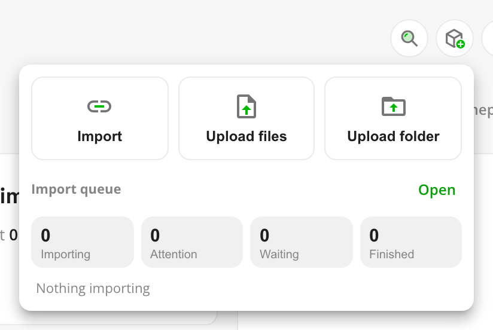
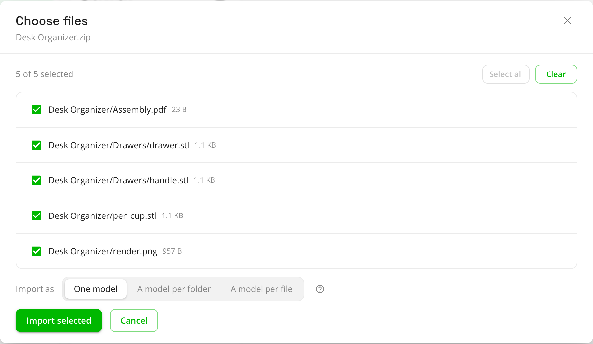

# Upload files and ZIPs

The quickest way to add a few models you already have. Everything happens in the browser, and your original files are
left where they are.

**Supported files:** STL, 3MF, STEP/STP, OBJ, glTF (`.glb`, or `.gltf` with its files), F3D and LightBurn (`.lbrn`,
`.lbrn2`) models, images (PNG, JPG, WebP, BMP, GIF, SVG), and ZIP archives. Each file can be up to 512 MB by default.

## Upload one file

1. Click **Add** at the top right, then **Upload files**.
2. Pick the file.

The model is named after the file (`Benchy.stl` becomes "Benchy") and opens straight in its edit dialog, so you can
fix the title, add tags and notes, and choose a category or folder before you move on. A 3MF that carries a thumbnail, as most
slicer projects do, uses it right away. For an STL, OBJ, STEP or glTF file, Thingport renders a thumbnail the first time
the model is shown.

To put new models straight into an existing folder, open that folder on the **Models** page before you upload.

## Upload several files at once

Select several files in the picker. Thingport asks how to import them:

- **Import as separate prints** makes each file its own model, named after the file.
- **Import as one model with several files** puts them all in a single new model, for when the files belong together,
  like the parts of one print. STL, 3MF, STEP, OBJ and glTF files are added in the order you picked them, photos
  become the model's photos (with no model file among them, the pictures are the model's files instead), and anything
  else, such as a PDF, is attached to the model.

A document picked on its own, like a PDF or notes, can't be a model by itself: Thingport says so rather than uploading
it. Pick it together with the model's files and choose one model.

Close the dialog to cancel without uploading anything.

## Upload a glTF model

A `.glb` is one file and uploads like any other. A `.gltf` is the scene alone: its shape sits in a `.bin` file and its
textures in images beside it, which is how sites such as Sketchfab hand them out. Pick the `.gltf` together with those
files, or upload the folder they came in. Thingport packs the scene and the files it points at into one `.glb`, so they
become a single model rather than a model and a pile of textures. Files the scene doesn't use, such as a licence, are
attached to it as usual.

A `.gltf` uploaded without its `.bin` is refused, with the name of the file it needs. A missing texture isn't: the
model comes in without it. glTF is measured in metres, so Thingport shows and checks it in millimetres, a thousand times
its number, as it does a print file. Files compressed with Draco don't preview yet.

## Upload a ZIP

Pick a `.zip` in **Upload files**, on its own or alongside other files. For each ZIP, Thingport asks what to do with it:

- **Import as zip** keeps the archive whole, as one model named after it. Use this when the ZIP is the thing you want to
  keep, for example a designer's release you might download again.
- **Import and unzip** opens the archive and lists everything in it, all ticked.

Untick what you don't want, or use **Clear** and tick just the files you need, then click **Import selected**.

Under the list, **Import as** says how the files become models:

- **One model** (the default) puts every file you ticked into one model named after the ZIP: its model files are the
  model's files, its pictures its photos (or its files, when no model file is ticked), and anything else, like a PDF
  manual, is attached. Folders inside the ZIP stay as folders within the model, below the folder every ticked file
  shares: `Kit/body.stl` and `Kit/docs/guide.pdf` give `body.stl` at the top and `guide.pdf` in `docs`. Use this for a
  model downloaded from a site.
- **A model per folder** works like [Each folder is one model](upload-folders.md#each-folder-is-one-model) for a
  folder: each folder with model files becomes a model, with its documents and pictures. Use this for a library kept
  as one model per folder. It's offered when the ZIP has such folders.
- **A model per file** makes each model file its own model, and each image its own model too. Folders inside the ZIP
  become folders in Thingport. Files that can't be a model on their own, like PDFs, aren't uploaded, and Thingport says
  which ones.

Junk that macOS adds to archives (`__MACOSX`, `.DS_Store`) is left out of the list. If you pick several ZIPs,
Thingport asks about each in turn. Files you picked alongside them upload first.

## When something goes wrong

- **"Unable to read zip contents"** means the archive is damaged or isn't really a ZIP. You can still choose
  **Import as zip** to keep it as is.
- **Very large ZIPs** are unpacked in your browser's memory, which can be slow or fail for multi-gigabyte archives. Put
  those in the [consume folder](consume-folder.md) instead, which unpacks them on the server.

Next: [upload a whole folder](upload-folders.md), or go back to the
[overview of ways to bring in your library](existing-library.md).
