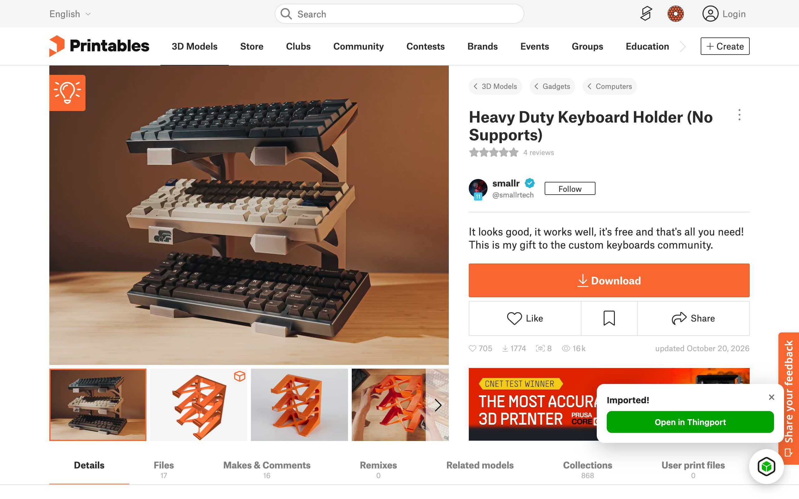
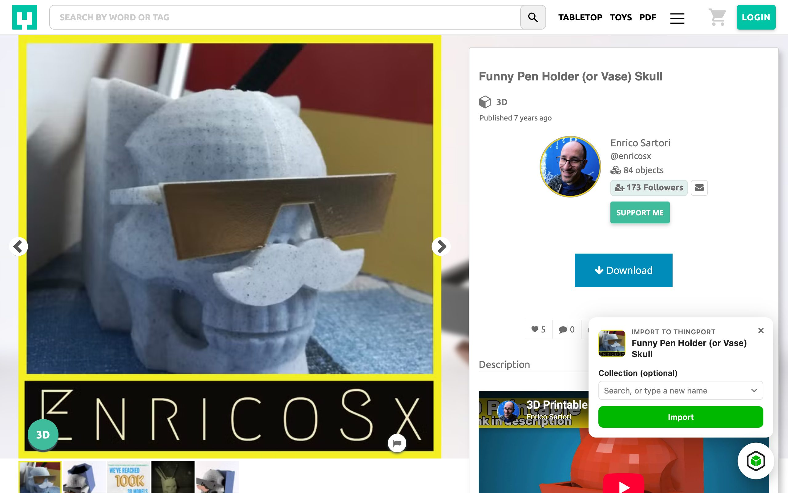
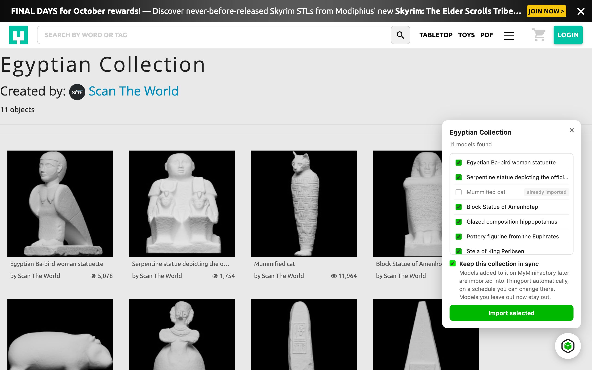
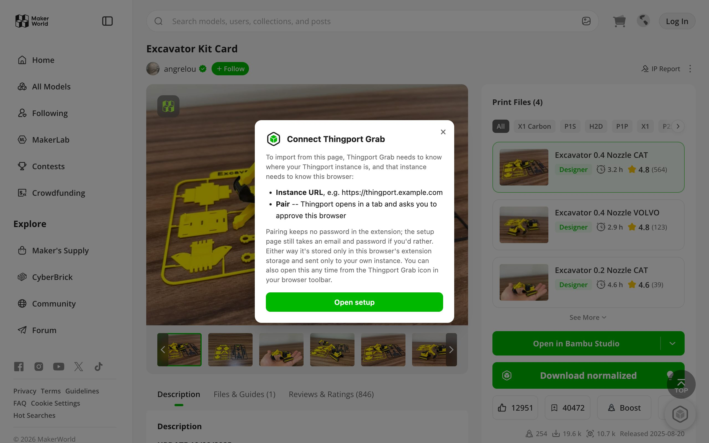
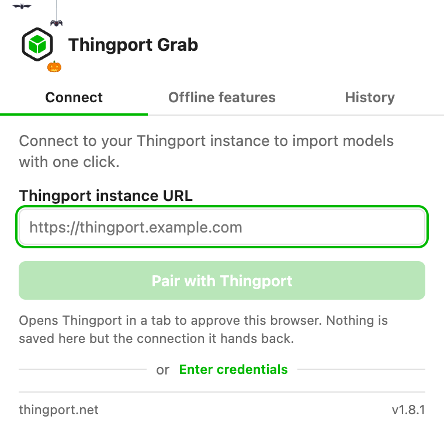
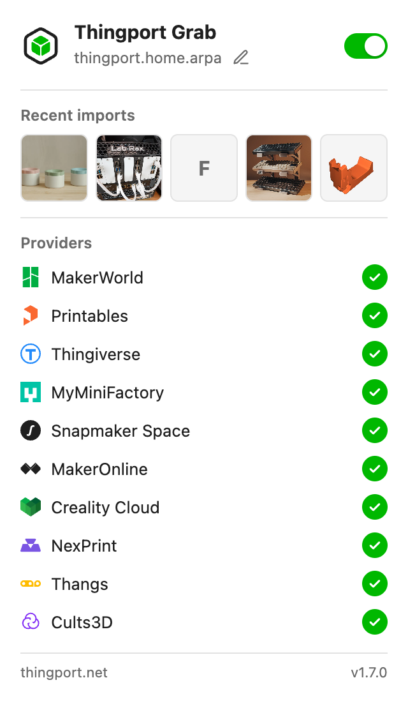
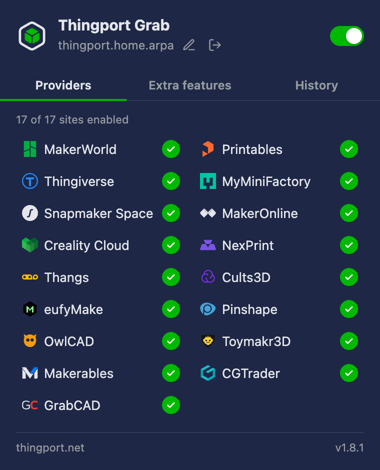

# Thingport Grab

A browser extension for Chrome, Edge and Firefox that imports MakerWorld, Printables, Thingiverse,
MyMiniFactory, Snapmaker Space, MakerOnline, Creality Cloud, NexPrint, Thangs and Cults3D models into your self-hosted Thingport instance without leaving the provider's site.
Visiting a model, collection, or Thingiverse Likes page shows a floating Thingport icon; clicking it
opens a small panel to pick what to import (and, for a single model, an optional destination
collection), then imports it the same way Thingport's own "+ Add > Import" does.

It's useful without Thingport too: on MakerWorld model pages it adds a **Download normalized**
button that turns the Bambu Studio project into a 3MF that PrusaSlicer, Cura and other slicers open
with its colors and print settings intact. See [Download normalized](#download-normalized-no-thingport-needed).
It can also give Thingiverse a [dark theme and hide its ads](#thingiverse-dark-mode-and-hidden-ads-no-thingport-needed).

**Get it from the [Chrome Web Store](https://chromewebstore.google.com/detail/nmblahmglpbplmfcggghdgohohlaeiee),
[Firefox Add-ons](https://addons.mozilla.org/firefox/addon/thingport-grab/) or
[Microsoft Edge Add-ons](https://microsoftedge.microsoft.com/addons/detail/kahfidpmojfocohinlmglnfoaimocbol).**

It talks directly to your Thingport instance's API from the extension's background script -- no
separate server, no data sent anywhere else -- and converts files in your browser. See the [privacy policy](PRIVACY.md) for exactly what
it stores and sends.

## Screenshots

<table>
  <tr>
    <td width="50%"> <b>Printables</b> -- import panel on a model page</td>
    <td width="50%"> <b>Imported</b> -- with a link straight to the model in Thingport</td>
  </tr>
  <tr>
    <td width="50%"> <b>MakerWorld</b> -- import panel on a model page</td>
    <td width="50%"> <b>Thingiverse</b> -- import panel, filing into a new collection</td>
  </tr>
  <tr>
    <td width="50%"> <b>Printables collection</b> -- pick which models to import</td>
    <td width="50%"> <b>MakerWorld collection</b> -- guided import, paced between models</td>
  </tr>
  <tr>
    <td width="50%"> <b>MyMiniFactory</b> -- import panel on a free model's page</td>
    <td width="50%"> <b>MyMiniFactory collection</b> -- pick models, keep it in sync</td>
  </tr>
  <tr>
    <td width="50%"> <b>Not set up yet</b> -- the grayed-out icon's setup dialog</td>
    <td width="50%"></td>
  </tr>
</table>

<table>
  <tr>
    <td width="33%"> <b>Popup</b> -- before setup</td>
    <td width="33%"> <b>Popup</b> -- connected, with recent imports</td>
    <td width="33%"> <b>Popup</b> -- dark mode</td>
  </tr>
</table>

## Install

### Chrome / other Chromium browsers

Install **[Thingport Grab from the Chrome Web Store](https://chromewebstore.google.com/detail/nmblahmglpbplmfcggghdgohohlaeiee)**
-- click **Add to Chrome**, then click the new Thingport icon in your toolbar (it may be under the
puzzle-piece Extensions button) and enter your instance's URL and your Thingport login. Chrome
keeps it up to date from then on. Other Chromium browsers that install from the Chrome Web Store
(Brave, Vivaldi, Opera with its Chrome extensions add-on) work the same way.

Alternative: install the Chrome build by hand

Only needed if you can't use the store, e.g. to get a release before the store's review lets it through:

1. Download `thingport-grab-chrome.zip` from the
   [`extension-latest` release](https://github.com/TautvydasDerzinskas/Thingport/releases/tag/extension-latest)
   and unzip it somewhere permanent (the browser loads the extension from that folder every time it
   starts, so don't delete it).
2. Open `chrome://extensions` and turn on **Developer mode** (top right).
3. Click **Load unpacked** and select the unzipped folder.

A hand-installed copy doesn't update itself -- repeat these steps for a newer version.

### Firefox

Install **[Thingport Grab from Firefox Add-ons](https://addons.mozilla.org/firefox/addon/thingport-grab/)**
-- click **Add to Firefox**, then click the new Thingport icon in your toolbar (it may be under the
puzzle-piece Extensions button) and enter your instance's URL and your Thingport login. Firefox
keeps it up to date from then on.

Alternative: install the Firefox build by hand

Only needed if you can't use the store, e.g. to get a release before the store's review lets it through.
Firefox refuses to install _any_ unsigned extension outside of Developer Edition/Nightly, so this
is a Mozilla-signed `.xpi` rather than a zip -- CI signs one for self-distribution (the "unlisted"
channel) with every release (see [Releases](CONTRIBUTING.md#releases-ci) in the development
guide):

1. Download `thingport-grab-firefox.xpi` from the
   [`extension-latest` release](https://github.com/TautvydasDerzinskas/Thingport/releases/tag/extension-latest).
2. Open it directly (double-click, or `File > Open File` in Firefox) -- or drag it onto a Firefox
   window -- and confirm the install prompt.

### Microsoft Edge

Install **[Thingport Grab from Microsoft Edge Add-ons](https://microsoftedge.microsoft.com/addons/detail/kahfidpmojfocohinlmglnfoaimocbol)**
-- click **Get**, then click the new Thingport icon in your toolbar (it may be under the
puzzle-piece Extensions button) and enter your instance's URL and your Thingport login. Edge keeps
it up to date from then on.

Alternative: install the Edge build by hand

Only needed if you can't use the store, e.g. to get a release before the store's review lets it through:

1. Download `thingport-grab-edge.zip` from the
   [`extension-latest` release](https://github.com/TautvydasDerzinskas/Thingport/releases/tag/extension-latest)
   and unzip it somewhere permanent (Edge loads the extension from that folder every time it
   starts, so don't delete it).
2. Open `edge://extensions` and turn on **Developer mode** (in the left sidebar).
3. Click **Load unpacked** and select the unzipped folder.

A hand-installed copy doesn't update itself -- repeat these steps for a newer version.

## Download normalized (no Thingport needed)

MakerWorld's files are Bambu Studio projects, which PrusaSlicer, Cura, Anycubic Slicer Next,
Creality Print, Elegoo Slicer, Snapmaker Orca and eufyMake Studio often open without their colors or print settings.
On a MakerWorld model page, the extension adds a **Download normalized** button under MakerWorld's
own "Open in Bambu Studio" (or Download) button. Clicking it downloads the selected print profile's file, converts it, and saves
a `<name>-normalized.3mf` that keeps painted colors, filament colors, plates and the designer's
settings (walls, layer height, infill, supports). Multi-part objects may be merged into one,
per-object overrides and layer color changes are dropped, and you pick your own printer profile.
Hover the bulb on the button for the same summary.

- **Who sees it:** everyone, whether or not the extension is connected to a Thingport instance. The
  switch in the popup is the only thing that decides: turn off **Normalize MakerWorld 3MFs** under **Offline
  features** (**Extra features** once connected) to hide it. With Bambu Studio or OrcaSlicer, MakerWorld's own
  file is already the right one, so you probably want it off.
- **Where it runs:** entirely in your browser, the same conversion Thingport's "Open normalized"
  does on the server. The file goes nowhere but your downloads folder.
- **Limits:** you need to be signed in to MakerWorld, as for its own Download button, and files over
  50 MB are too big to convert in the browser -- the button says so. MakerWorld's button is found by
  its label, so it only appears while MakerWorld is in English.

## Thingiverse dark mode and hidden ads (no Thingport needed)

Thingiverse has no dark theme, so the extension gives it one: **Thingiverse dark mode** under
**Offline features** in the toolbar popup. It's on from the start and follows your system theme: Thingiverse turns
dark when your browser or OS does, and stays as it is in light mode. Switching it off (or on again) applies to open
Thingiverse tabs straight away. It recolors Thingiverse's own pages (browsing, search, models with their files, comments, makes and
remixes, profiles and collections, sign-in, challenges); ads and embedded videos come from other sites and keep their
own colors.

**Hide Thingiverse ads**, also under **Offline features** and also on from the start, hides the ad banners, the ad
cards in model grids, the ads injected into pages, the sticky bar along the bottom, the video ads, and the ad in the
download dialog. It only hides them on the page: the ads still load, nothing about your Thingiverse account or
membership is touched, and the download dialog keeps its countdown. If you'd like to support Thingiverse, its own
supporter membership removes ads for real.

## Setup

The popup asks for your instance URL (e.g. `https://thingport.example.com`), then **Pair with
Thingport**: it opens that instance in a tab, where you approve this browser while signed in there,
and it hands the extension a connection of its own. No password is kept in the extension, and you can
remove the connection from your Thingport profile at any time. Under the Pair button, **Enter
credentials** opens the older email/password form, for instances too old to pair and anyone who'd
rather save a password. Until one of those is done, importable pages show a grayed-out Thingport icon;
clicking it explains what's needed and opens that same setup form (the toolbar popup, or the same form
in a tab where the browser won't let the extension open its popup itself). Either way, connecting
requests permission to reach that one origin first, and no password or connection is saved until the
instance accepts -- a pairing on its way keeps only the one-time secret it needs to finish, dropped
the moment it does or the approval is cancelled. After that, the toolbar icon
turns from the dark/inactive icon to the color/active one, and the floating icon becomes the normal
import button. Reopen the popup any time to change the instance (the pencil next to its address), disconnect from it
(the button beside the pencil, after a confirmation; offline features and recently viewed models stay), or flip
**Extension enabled** off, after a confirmation too, to pause it everywhere without losing the saved setup. Disconnecting signs Grab out on the instance and,
for a connection approved in Thingport, removes it from your Thingport profile too.

Once connected, the popup's tabs are **Providers** (the sites Grab runs on), **Extra features** (the
[ones that need no Thingport](#download-normalized-no-thingport-needed)) and **History**: your last imports, and the
last 10 models you opened on any of those sites, each with its site's logo. Recently viewed models are listed before
you connect too, and they stay in this browser.

The extension re-authenticates automatically as its session token nears expiry -- there's nothing
to keep re-entering day to day. A paired connection keeps working until you remove it in Thingport,
and the popup says so when you do. If you connected with a password instead and it changes, or a
session gets revoked server-side, the next import attempt will silently re-login with the stored
credentials, or surface a clear error if those no longer work.

### MakerWorld: no separate cookie setup needed

Importing from MakerWorld normally requires pasting a session cookie into Thingport's
Configuration > Providers by hand (MakerWorld's own site sets it `HttpOnly`, which blocks a normal web page from
reading it -- that's the whole reason for the manual copy/paste). This extension reads that same
cookie directly from your browser instead, using the `cookies` API -- a privileged, extension-only
capability explicitly allowed to read `HttpOnly` cookies, unlike a regular page's own JavaScript.
It's sent only to your own Thingport instance, as part of the same import request that needs it,
exactly like the cookie you'd otherwise paste in by hand -- never anywhere else. If your Thingport
account doesn't already have a MakerWorld cookie saved, the extension also connects MakerWorld in
Configuration > Providers for you, so the plain web app's own imports benefit too, not just ones started
from the extension.

### MyMiniFactory and newer sites: allow them once

Sites added after MakerWorld, Printables and Thingiverse, starting with MyMiniFactory, need one click first. The
popup lists every site Grab supports on its **Providers** tab: a green tick means it already runs there, and **Enable** next to a
newer site asks your browser for access to that site alone. (An update that added each site to the extension itself
would have the browser switch the extension off for everyone until they approved it, every time.) The button comes
back only if you take the access back in your browser's extension settings.

Opening MyMiniFactory while signed in also connects your MyMiniFactory account to Thingport, so the models you
bought, and free ones that only download when signed in, import from your library. On a paid model you haven't
bought, the panel says so instead of offering an import.

### Snapmaker Space: a sign-in Grab keeps fresh

Snapmaker gives its files only to signed-in users, and its sign-in lasts a day. Opening space.snapmaker.com while
signed in connects your account to Thingport, and from then on Grab renews the sign-in every few hours while the
browser is open -- for the browser and Thingport together, writing the new one back into the site's own cookies. Only
Grab may renew it: a Snapmaker sign-in can be renewed once, and renewing it twice would sign the browser out. On your
own profile's **Interactions** tab, the panel imports your likes or bookmarks (a switch picks which), and can keep
either in sync.

### MakerOnline: files only through Grab

MakerOnline gives its files only to its own pages: its download call needs a token its in-page security script makes.
So Grab gets each file's link signed from the page itself, the way its Download button does, and hands the links to
Thingport. A MakerOnline import started anywhere else -- a link pasted in Thingport, a collection imported there, a
synced collection's new models -- waits on your instance, and Grab imports it on the next makeronline.com page you open.
Opening MakerOnline signed in also connects your account, for your likes and private collections. Firefox needs
version 128 or newer for this.

### Creality Cloud: a week-long sign-in

Creality Cloud gives its files and your likes only to a signed-in user, and its sign-in lasts a week from when you
signed in there; the site never renews it. Opening crealitycloud.com signed in connects your account to Thingport, and
sends the new sign-in each time you sign in there again. On your own **Likes** page, or any collection page, the panel
imports the listed models and can keep them in sync.

### NexPrint: a sign-in the site keeps fresh

NexPrint gives its files only to a signed-in user. Opening nexprint.com signed in connects your account to Thingport,
and sends the new token whenever the site renews it. On a collection, open on its owner's page, the panel imports the
listed models and can keep them in sync; NexPrint has no page of liked models, so there are no likes to import.

### Thangs: a sign-in Thingport keeps renewed

Thangs gives its files only to a signed-in user. Opening thangs.com signed in connects your account to Thingport, which
renews the sign-in itself for about a year. On a model page the panel first asks Thangs whether your account may
download it, which costs none of your daily downloads, and says so up front for a model sold only as a print, or a paid
one you don't own. On your own **Liked** page, or any collection page, the panel imports the listed models and can keep
them in sync.

### Cults3D: your API key, and the browser's sign-in

Thingport reads Cults3D with your own API key, which you enter once in **Configuration > Providers**. Its files sit
behind a Cloudflare check only your browser passes, so opening cults3d.com signed in sends Thingport the sign-in and
the clearance Cloudflare gave this browser; your instance then downloads as this browser would. That only works while
your instance reaches the internet from the same address as the browser, as it does at home. A free model you haven't
downloaded yet is added to your Cults3D downloads first, as its own Download button does; on a paid one you don't own,
the panel says so up front. On anyone's likes page, or one of your own printlists, the panel imports the listed
models and can keep them in sync.

## What counts as "importable"

- A single model page (MakerWorld, a Thingiverse Thing, a Printables Model, a MyMiniFactory object, a Snapmaker Space,
  MakerOnline, Creality Cloud, NexPrint, Thangs or Cults3D model) -- hidden automatically once you've already imported that exact page.
- A MakerWorld collection, a Thingiverse Collection or Likes page, a Printables, MyMiniFactory, MakerOnline, Creality
  Cloud, NexPrint, Thangs or Cults3D collection, your MakerOnline, Creality Cloud or Thangs likes, anyone's Cults3D likes,
  or your own Snapmaker Space likes and bookmarks -- lets you import the listed designs in one go.

Picking a destination collection is only offered for a single-model import; a batch import instead
lands in Thingport's own auto-named collection for that batch (e.g. "Thingiverse likes (@username)"), matching
how the web app's own batch imports already work.

A batch import keeps running on the server even if you close the panel or the tab -- closing it
just stops showing progress, it doesn't cancel anything.

### Synced collections

On a MakerWorld, Printables, Thingiverse or MyMiniFactory collection page, the panel's **Keep this collection in
sync** box (off by default) links the collection to its Thingport counterpart. A Thingiverse user's
Likes page works the same way (**Keep these likes in sync**), filing into "Thingiverse likes
(@username)" and picking up models they like later. Thingport then checks
it once a day (or every hour or 6 hours, picked per collection) and imports models added to it later, pausing a minute between models, and sends a
notification saying what came in. Models already on the page when you turn sync on, including any
you leave unticked, aren't imported by the sync.

It works for collections you imported before, too: open the collection page, click the icon, and
tick the box -- the panel says everything is already imported, and **Save** turns sync on. Sync can
also be turned on in Thingport, from the collection's **Sync configuration**.

- Sync only ever adds. A model removed from the provider's collection stays in the Thingport
  collection and your library, and nothing is deleted on either side.
- A synced collection's tile in Thingport shows the provider's logo with a green sync bubble.
  Clicking it, or **... > Sync configuration**, opens the collection's sync configuration: when it
  was last checked and when the next sync is due, **Sync now** and **Stop syncing**, and under
  Settings how often it's checked and, for MakerWorld, which print profiles each new model brings
  (the default one, all of the designer's, or all of them).
- The link follows the provider's collection id, so renaming the Thingport collection, or the
  provider's, keeps it synced. A provider collection syncs with one Thingport collection at most,
  and the other way round: if a collection of the same name already follows another source, the
  new one gets its own, named after the provider (e.g. "Things (MakerWorld)").
- If the provider rate-limits the imports (a MakerWorld CAPTCHA or daily download limit, say), the
  rest wait, paused, in the import queue until it's started again from Administration > Import queue.
- If the provider's collection is deleted, the Thingport collection is unsynced (its models stay)
  and you get a notification. Deleting the Thingport collection removes the sync with it.
- **Sync now** checks the collection right away instead of waiting for the next check, and a notification
  says how it went, "up to date" included. It's available again 5 minutes after the last check.
- To turn sync off, untick the box on the collection page, or use **Stop syncing** in the
  collection's sync configuration.

The [synced collections guide](../docs/guides/synced-collections.md) walks through it end to end.

## Privacy

Thingport Grab has no servers of its own and sends nothing to its developer or any third party --
only to your own Thingport instance and the provider site you're on. The
**[privacy policy](PRIVACY.md)** lists exactly what it stores, what it sends and where.

## Contributing

The extension is TypeScript and SCSS, built per browser with esbuild. See
**[CONTRIBUTING.md](CONTRIBUTING.md)** for the development setup, the code layout, building and
packaging for the Chrome Web Store, Edge Add-ons and addons.mozilla.org, and how the screenshots
above are generated.
