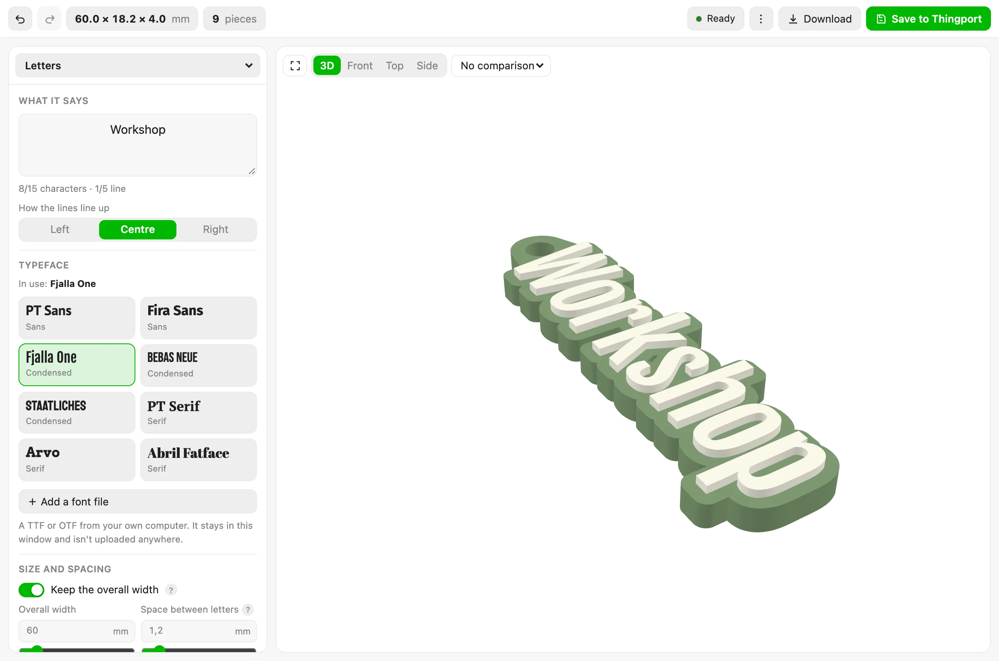

# Keyring generator

Type a word, pick a typeface, get a keyring you can print. The letters are the font's real outlines — counters and
all — a border is grown around them and bridged where the shape would otherwise fall into pieces, key rings and
magnet pockets go where you drag them, and the 3MF that comes out opens in a slicer with every piece already
assigned its filament.



## What it does

- **Up to five lines, fifteen characters**, aligned left, centred or right, in any of the twenty-one typefaces
  Thingport carries — or one of your own: **Add a font file** takes a TTF or OTF from your computer, and it stays
  in the window.
- **Holds the width you ask for**, solving for the letter size so the border, the spacing and the rings all fit
  inside it. Turn that off and the letters keep their size while the width follows.
- **Thickens thin strokes** by a set amount per side, so a light typeface still survives printing.
- **Rounds and chamfers** the top of the letters, the top of the border and the bottom edge. A radius that won't
  fit a narrow part is held back for that part alone rather than refused outright.
- **Key rings** with a collar round each hole, tied into the nearest letter so they can't snap off. Drag one on the
  picture; one pushed past the edge slides back to where it still has material around it.
- **Magnet pockets** for shop-bought magnets up to 8 mm across, open at the back or closed over for dropping in
  mid-print, with gaps you can tune and optional ribs to grip them. The base thickens itself to suit.
- **One colour or several**: the whole thing in one filament, or one for the border and base and another for the
  letters, plus two more you can send to particular characters or particular positions — so `BAY 7` can have its 7
  in orange. Only the filaments actually used go into the file.
- **One piece or two**: the keyring joined, ready for a two-colour print, or the shell and the letters apart with a
  press-fit gap, to print separately and push together.

It all runs in your browser. The tool declares no hosts, fetches nothing, and works offline.

## What comes out

|                 |                                                                                                                                                                                                                |
| --------------- | -------------------------------------------------------------------------------------------------------------------------------------------------------------------------------------------------------------- |
| **3MF**         | Every piece its own object in one assembly, the colours as a material list, and a Bambu-style settings part naming the extruder for each. No printer profile and no G-code: those belong to whoever slices it. |
| **OBJ**         | Each piece a named object. No colours.                                                                                                                                                                         |
| **STL**         | Everything in one mesh, for anything that reads nothing else.                                                                                                                                                  |
| **Print notes** | Which filament goes where, what to print, and the magnets and rings, as plain text.                                                                                                                            |

**Save to Thingport** puts the 3MF into a collection you pick, with the picture as its cover and what to print as
its description. Whether it comes out joined, apart, or both is asked at that point rather than kept as a setting,
since it's a question about the file rather than about the keyring.

## The words it uses

Its labels aren't in the script: they're in [`locales/`](locales), one flat JSON file per language, which
Thingport reads itself and hands over as `t()`. English, Lithuanian, Spanish and French are there, and English is
the fallback key by key. Adding a language is a file — no code to touch. See
[the words a tool shows](../../docs/guides/tools.md#the-words-a-tool-shows).

## Where it came from

The heavy lifting is borrowed rather than carried: [opentype.js](https://github.com/opentypejs/opentype.js) (MIT)
reads the glyphs, [Manifold](https://github.com/elalish/manifold) (Apache-2.0) does the solid modelling, and
[Three.js](https://threejs.org) (MIT) draws the preview — all three through Thingport's
[`library()`](../../docs/guides/tools.md#the-libraries-a-tool-can-borrow), so the tool carries none of them.

The typefaces are the ones Thingport ships, under the SIL Open Font License; the notices are in
[`frontend/src/assets/toolFonts`](../../frontend/src/assets/toolFonts).

## Working on it

`tool.js` is built from `source/`; edit those and run the build, then the tests:

```sh
node source/build.mjs
node source/test_keyring.mjs
```

The tests check the geometry, the colour and magnet rules, the files and the labels on their own, and always run —
including that every language says everything English does and nothing it doesn't, that a translation fills in the
same blanks, and that no label is shown without words or translated without being shown. The engine's
own tests need a real font parser and solid modeller, which live in the frontend rather than the backend, so they
run when `frontend/node_modules` is there and say they were skipped when it isn't. Those are the ones that prove a
letter's counter is a hole right through the solid — by `genus`, which is what `o` being a ring rather than a disc
actually means — and that every typeface Thingport ships still letters correctly.
