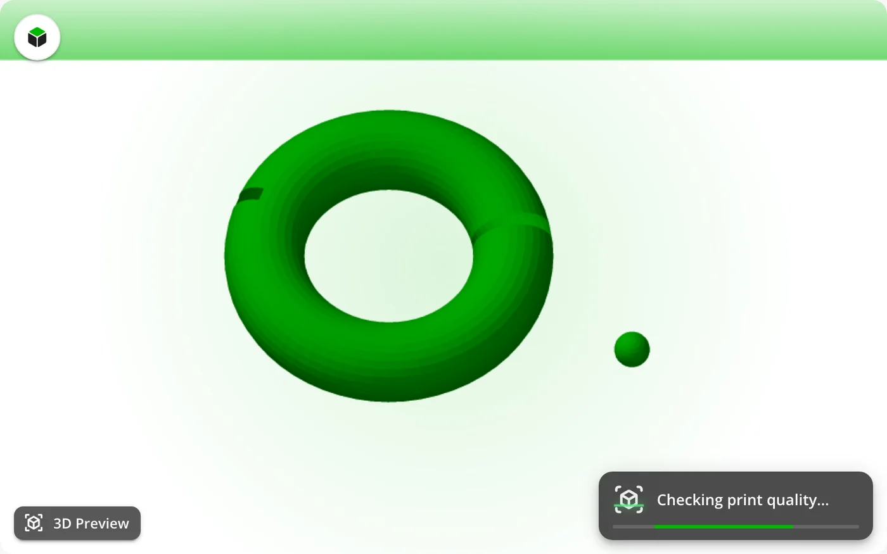
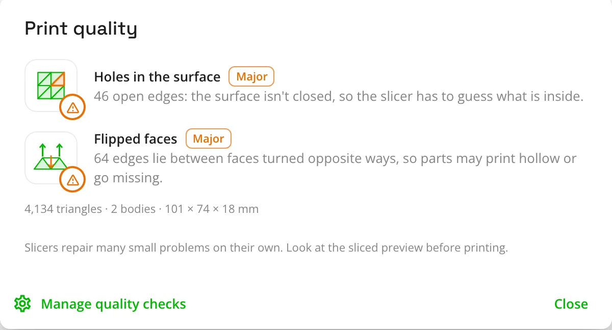
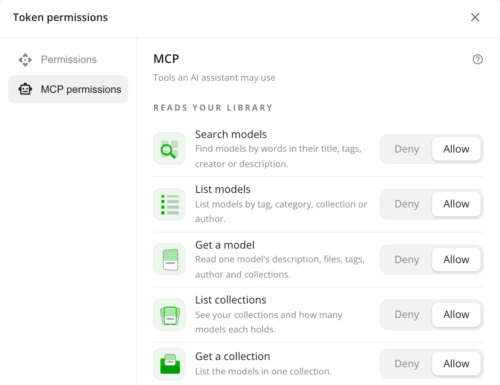
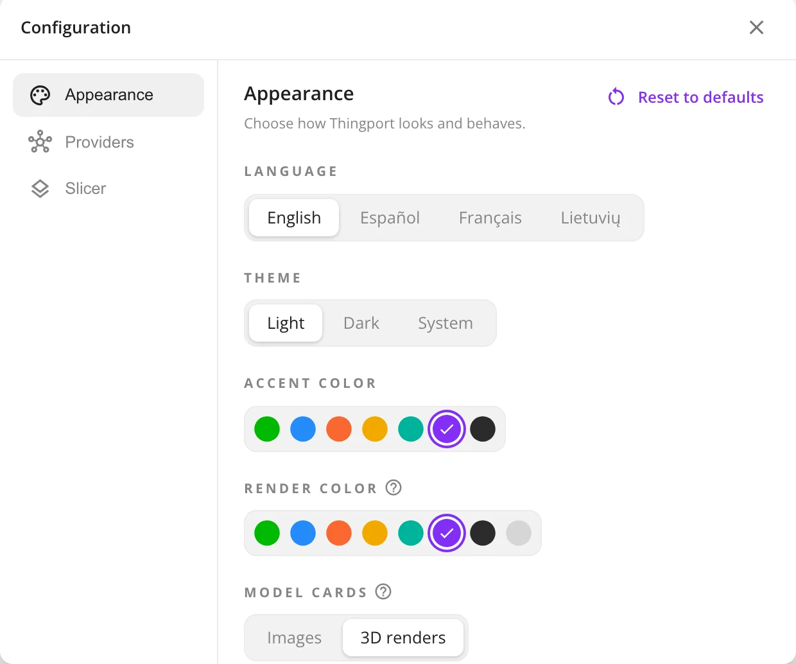
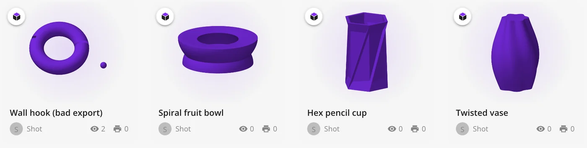
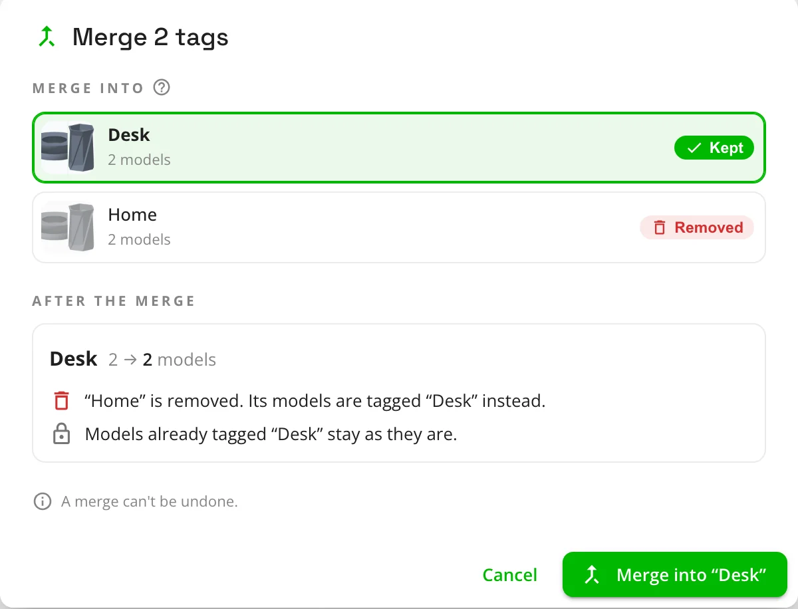

You find a model, slice it, start the print, and an hour later it's spaghetti, or a wall comes out hollow. More often than
you'd think, the model was at fault: an export with holes in the surface, faces turned the wrong way, or a part that
went missing from the 3MF.

**Thingport 1.2.0 checks for those problems before you slice.** It also lets an AI assistant work with your library,
gives Thingport your own colours (now in Spanish and French too), and makes collections and tags easier to tidy.

## Print quality checks

The first time you open a model, Thingport checks each of its STL, OBJ and 3MF files on the server. It looks for:

- **Holes in the surface**, where the slicer has to guess what's inside
- **Non-manifold edges**, shared by more than two faces, which slicers can misread
- **Flipped or inside-out faces**, which can make parts print hollow or not at all
- **Loose fragments** floating apart from the model, which print as blobs
- **Missing 3MF parts** and **damaged files**
- **An unlikely size**, under 1 mm or over 2 m across, usually a sign it was exported in the wrong unit

While the check runs, a scan sweeps over the 3D preview. When it's done, a tick or a warning appears next to
**3D Preview**.



Click the warning for a report that explains each problem in plain words and how serious it is. It also shows the
model's triangle count, how many separate bodies it has and its size.



A model is checked once and the result is saved, so opening it again costs nothing. Slicers repair many small problems
on their own, so treat a warning as a reason to look at the sliced preview, not to throw the model away. Admins can turn
the checks off, all at once or one problem at a time, under **Administration → Rendering**.

## Ask an AI assistant about your library

Thingport now speaks the [Model Context Protocol](https://modelcontextprotocol.io). Claude and other AI assistants can
search and read your library: _"which of my models are articulated dragons?"_, _"what's in my Printer upgrades
collection?"_. If you let them, they can also import models and file them into collections: _"import this Printables link
into my Benchies collection"_.

There's nothing extra to install. Generate an [API token](/docs/guides/api-token/) on your profile, choose its tools
under **Token permissions**, and connect. For Claude Code it's one line, and your profile shows it with your address and
token already filled in:

```bash
claude mcp add --transport http thingport https://thingport.example.com/api/mcp --header "Authorization: Bearer tp_your_token"
```



You decide what each token can do. A new token can only read. The tools that change your library stay off until you
turn them on, and none of them deletes or overwrites anything. Admins choose whether MCP is off, read-only, or read and
change for the whole instance. The [MCP guide](https://github.com/TautvydasDerzinskas/Thingport/blob/main/docs/guides/mcp.md)
lists every tool.

The same dialog now sets what a token can read over the REST API, so a dashboard such as Homarr gets only the parts of
your library you allow. Existing tokens keep full access, so nothing that already uses one stops working.

## Your colours

Thingport green is no longer the only option. In **Configuration → Appearance**, pick an accent: a new graphite, or a
colour borrowed from a provider's brand. It recolours the whole app and its logo.



Model renders are tinted to match, and so are the dashboard lists, the tag tiles and the 3D preview. Renders can also
have a colour of their own. Prefer a uniform grid to a mix of photos? Model cards can show a 3D render of each model
instead.



The language picker is at the top of the same panel, and it has two new languages: **Spanish** and **French**, alongside
English and Lithuanian. More about the panel is in [Appearance](/docs/features/appearance/).

## Tidier collections and tags

Collections now sort by newest, name or most models, and tags can sort by newest. Both pages have a select mode for
bookmarking, deleting or merging several at once. Before a merge, you see exactly what will happen: which one is kept,
how many models it ends up with, what is removed, and which syncs stop.



## Also new

- **Pictures and files stay with their model.** A model's pictures, renders and supporting files now go in an Images
  folder next to its model files. They follow your storage template and move with the model. Existing libraries are
  moved over on the first start.
- **MakerWorld models with only STL/CAD files.** Listings with no print profiles, only the files behind "Download
  STL/CAD files", now import instead of failing.
- **Reset to defaults.** Restore your appearance settings in one click, or reset categories to the starter tree after
  previewing what changes.
- **What's new after every update.** After you update, Thingport tells you what's new, starting with this release.
  Admins can open it again from **Update Checker** in [Administration](/docs/features/administration/).
- **Faster model listings**, and provider logos in the dashboard's top providers.

## Fixes

- Names with accents or non-Latin letters stay readable in zip downloads, and when the zip is imported back.
- Reasoning AI models no longer use up their budget thinking and cut their answer short.
- AI description suggestions for imported models are no longer lost while the import is still adding pictures.
- A theme or accent that fails to save goes back to your saved one.
- Editing tags from two places at the same time no longer loses changes.
- Many missing Spanish and French translations are filled in.

## Get it

Pull the new images and restart:

```bash
docker compose pull && docker compose up -d
```

The first start after the update moves existing pictures next to their models. For a large library, the move can take
a few minutes, and Administration shows its progress. Everyone on your instance then gets a notification that opens the
release notes in the app.
