Every self-hosted app decides for you what its front page shows. You get the panels someone else thought were
important, in the order they thought was right, and if you want your printer's progress or your filament stock next to
your library, bad luck.

**Thingport 1.3.0 hands the dashboard over to you.** It's a grid you arrange yourself, a panel can be anything a web
page can show, and you don't have to write one: describe it to your AI assistant and it builds it for you. There are
also two new sites to import from, shared disk space for identical files, 17 new tools for AI assistants, bulk tag and
collection editing, and every slicer on your computer in one menu.

## A dashboard you arrange yourself

Click the pencil to drag panels around, resize them from the corner, merge several into tabs and change each one's
settings.

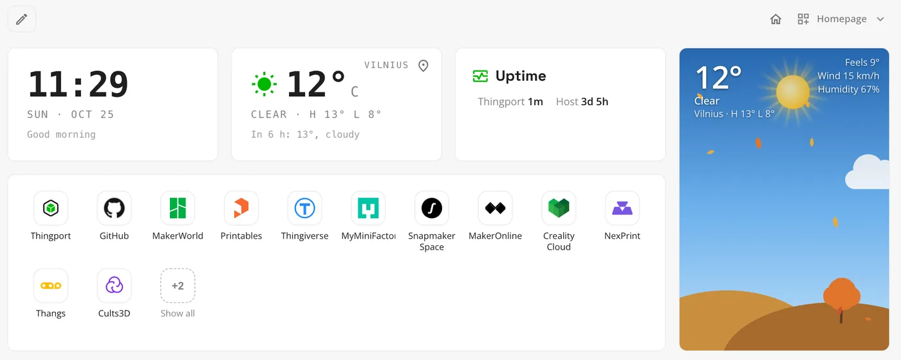

New panels show RSS feeds, whether your printers and servers are up, the server's CPU and memory, a launcher for your
favourite sites, and what's trending on the sites you pick. RSS, Launcher, Weather and Explore trending can be added
more than once, so you can have one feed per source or one launcher per room.

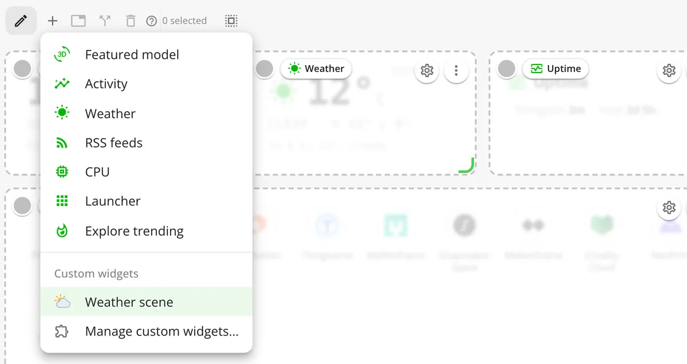

Templates save whole dashboards, so you can switch between a library view and a printer view. The house icon opens
yours on its own page without the menus, which makes it a reasonable browser homepage, and ⌘S searches from there.
More in [Dashboard](/docs/features/dashboard/).

## Ask AI for any panel you can think of

A custom widget is a dashboard panel with its own code, so it can show anything a web page can: your printer's
progress, your filament stock, a chart of your library.

You don't have to write it. Connect your AI assistant to Thingport over MCP, allow its token to use **Save a dashboard
widget**, and describe the panel you want:

```text
Make me a Thingport widget that shows my OctoPrint printer’s progress.
```

The assistant reads Thingport's widget guide, writes the widget and saves it, ready under **Add panel**. **Use AI** in
a new widget walks you through the whole thing.

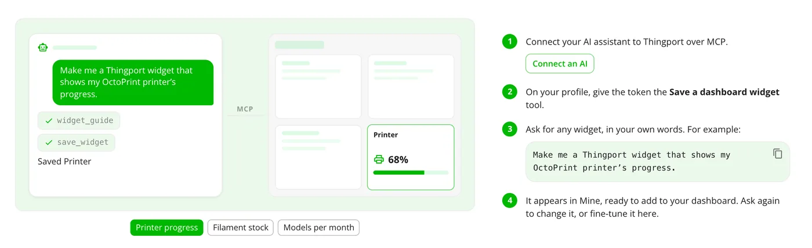

To change a widget, ask again, or open it in the editor, where it runs next to its code as you type.

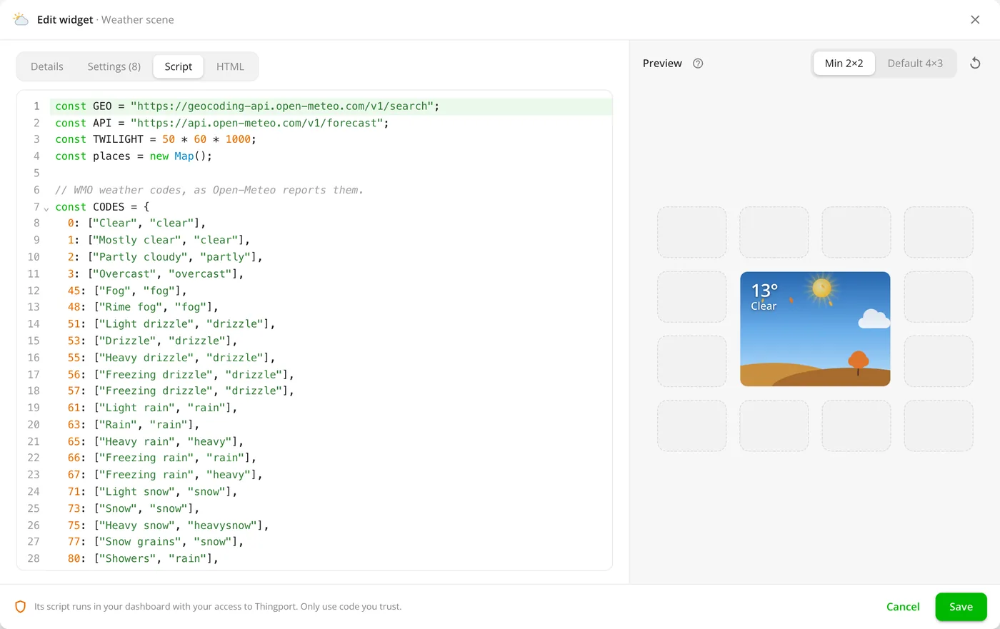

The [custom widgets guide](/docs/guides/custom-widgets/) covers what a widget can reach and how it's sandboxed.

## Widgets the community shares

Widgets other people publish install in one click under **Customize dashboard → Custom widgets → Community**. Before
you install one you see its author, version and description, and which sites it may reach. Updates wait until you
approve them.

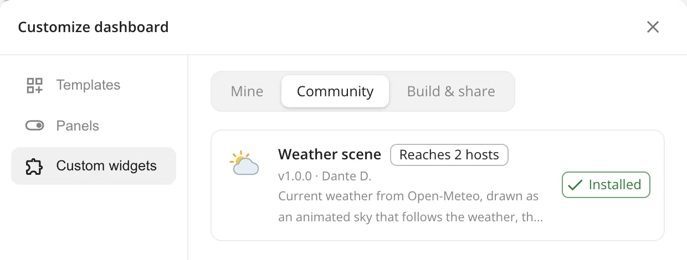

The first one, **Weather scene**, draws the weather as an animated sky. To share a widget you made, download it for
publishing from **Mine** and open a pull request against
[community-widgets](https://github.com/TautvydasDerzinskas/Thingport/tree/main/community-widgets); once it's merged,
every Thingport can install it. Admins can turn users' own and community widgets on or off under **Administration →
Dashboard**, and see who uses which.

## Two new sites: eufyMake and Pinshape

Thingport now imports from twelve sites.

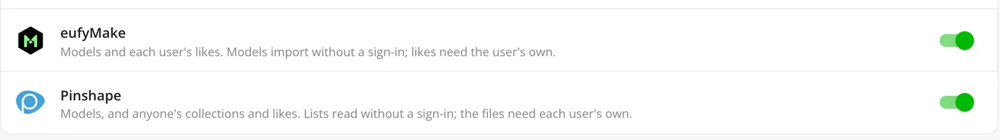

[eufyMake](/docs/providers/eufymake/) models import without a sign-in, your likes sync through Thingport Grab, and its
models open straight in eufyMake Studio. [Pinshape](/docs/providers/pinshape/) reads anyone's models, collections and
likes without a sign-in; downloading its files needs your Pinshape sign-in, which Grab sends from a signed-in tab.
Pinshape doesn't say which category a model is in, so its models arrive uncategorized. Both sites turn up in the
dashboard's Explore trending panel.

## Users importing the same model can share its disk space

When several people on your instance import the same model, each still gets their own copy. On btrfs, XFS and ZFS 2.2
or later, those copies can now share space on disk: a copy-on-write clone takes no extra space until one copy changes,
and editing one never touches another user's. It covers model files, supporting and prepared print files, gallery
pictures and description images, matched by their content.

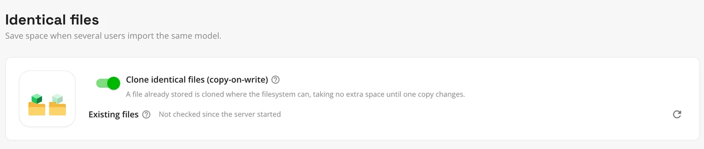

It's off by default. Admins turn it on under **Administration → Storage → Identical files**, and turning it on, or
**Check again**, also goes over the files already stored, in the background. On other filesystems files are stored
exactly as before. See [Storage](/docs/features/storage/).

## 17 new tools for AI assistants

Assistants connected over MCP can do much more with your library than read it. They can upload a model from files,
read its files and look at its pictures, and edit its title, description, tags and category. They can add, rename and
remove a model's files, reorder its pictures and pick the cover, create categories, take models out of collections and
delete models. Widget tools let them write dashboard widgets and find or upload icons for them.

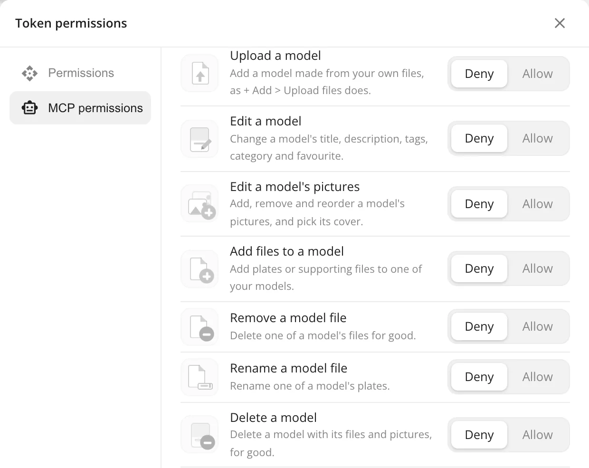

Tools that change your library start off for a token until you allow them under **Token permissions**, and the ones
that remove or overwrite something say so to the assistant. Every tool is listed in the [MCP guide](/docs/guides/mcp/).

## Tags and collections for many models at once

Select some models, then choose **Edit tags** or **Edit collections**. The dialog shows which tags or collections all
the selected models have, which only some do, and how many.

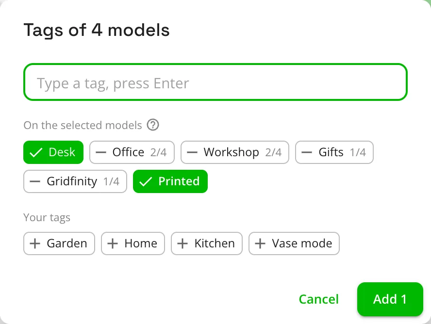

Add a tag to all of them, take one off, or put the whole selection in a collection in one go. Nothing changes until you
click the button, which says what it will do.

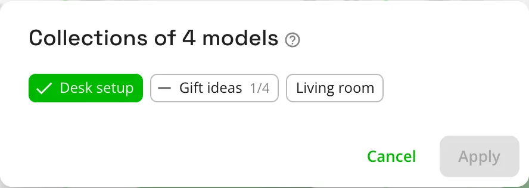

## All your slicers, and eufyMake Studio

**Configuration → Slicer** now takes every slicer on your computer, not just one.

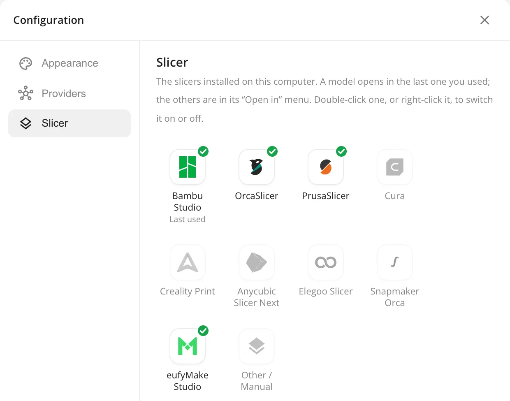

A model's button opens the one you used last. Its arrow lists the others and downloads the file, or all of a model's
files as a zip, which replaces the separate download button. eufyMake Studio joins the list, and opens models straight
from Thingport without Bridge. More in [Slicers](/docs/features/slicers/).

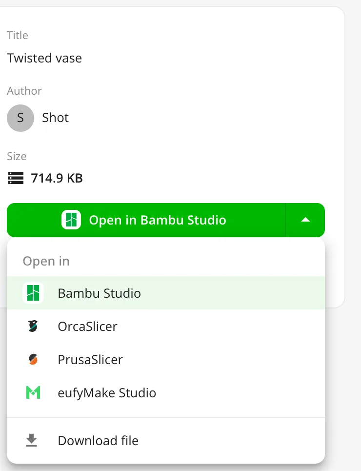

## Thingport Grab: Thingiverse in dark mode, without ads

Thingport Grab, updated through your browser's extension store, adds extras that work even without a Thingport: a dark
theme for Thingiverse that follows your system theme, and hiding Thingiverse's banners, ad cards and video ads. Each
can be switched off in the popup.

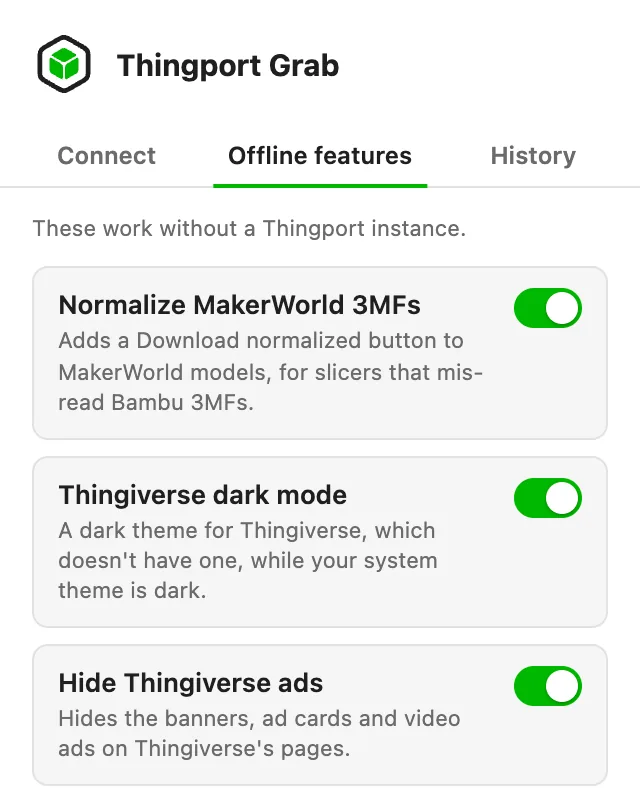

The popup gets a dark theme of its own, and a History tab with your recent imports and the last models you opened.
Disconnect now also removes Grab's connection from your Thingport profile. See [Thingport Grab](/docs/grab/).

## Also new

- **Stay signed in.** A Thingport tab left open, like a dashboard set as your homepage, no longer drops you on the
  sign-in page: your session renews itself, and survives your computer sleeping or the network dropping. Admins choose
  how long an unused browser stays signed in under **Administration → Auth**, a month by default. Changing your
  password signs out your other browsers.
- **Search from anywhere.** The search button in the top bar opens search over whatever page you're on.
- **An icon browser** for launcher links and widgets, with Thingport's icons, popular self-hosted, media and 3D
  printing sites, and your own uploads.
- **Provider chips follow your accent colour.**

## Fixes

- Photos taken sideways import the right way up, and photos imported from other sites no longer keep their location
  data.
- Your MakerWorld sign-in is only ever sent to MakerWorld itself, over HTTPS, never to a look-alike domain.
- OrcaSlicer, Elegoo Slicer and Snapmaker Orca no longer fail with "File name too long" when opening a model.
- Thingport Bridge finds Bambu Studio on Windows, and the Download page's Bridge buttons work again.
- Long file names without spaces no longer stretch the model page's side panel.
- Link imports get the right file name from more servers, and zips whose paths start with `./` import.
- Clearer errors when Snapmaker, Cults3D or MyMiniFactory turn down a sign-in or a download.
- Creality Cloud links show their import status when the model is known by another name, and filling gaps keeps a
  tag's capitalisation.

## Get it

Pull the new images and restart:

```bash
docker compose pull && docker compose up -d
```

Everyone on your instance then gets a notification that opens the release notes in the app. Thingport Grab updates
itself through your browser's extension store.
