A model library gives back what you put in it. You import something, and a year later you get the same STL with the
same hole in the same place — at the size a stranger chose, in one colour, whether or not that is what the shelf
actually needs.

**Thingport 1.4.0 is about changing what comes out.** It runs small apps of its own now: planners, generators and
calculators that read your library and save back into it, nine of them to install, with an editor and an AI route for
writing your own. A model that arrived with the script it was generated from opens the creator's own sliders and
generates again in your browser. Models painted in several filaments keep their colours all the way to the plate.
Thingport Grab pairs with your instance instead of keeping a password, five more sites import — CGTrader and GrabCAD
among them — and a new check finds the models whose files have gone missing.

## Tools: small apps that work with your library

**Tools** in the sidebar opens a shelf of small apps, each in a window of its own. Nine come with this release:
planners for Multiboard, Gridfinity, Skadis and enclosures, generators for QR codes and keyrings, a print cost
estimator, a MakerWorld 3MF normalizer, and a customizer for OpenSCAD scripts.

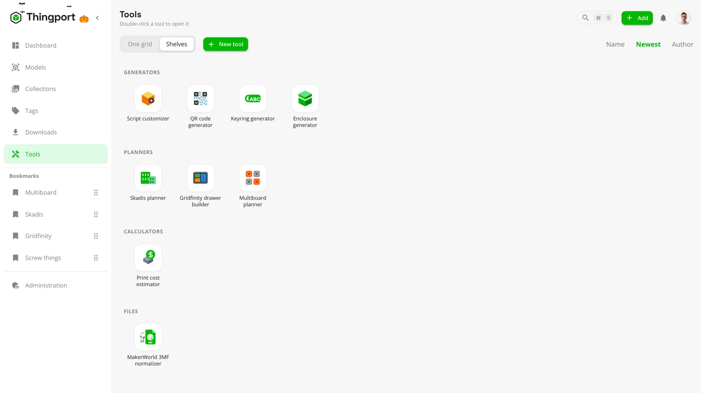

A tool is not a page that happens to be bundled with the app. It works with your library: it can search your models,
read their files, make collections, and save what it builds back as a model of your own with its print files beside
it. A tool that needs models of its own — the Multiboard planner's joints, say — brings them in a collection of their
own, kept once for the whole instance rather than once per person who opens it.

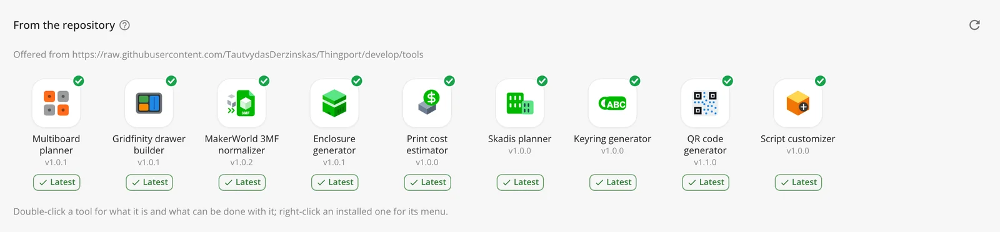

An admin installs the ones they want under **Administration → Tools**, with screenshots to look through first, and
says who sees tools: admins only, everyone, or the users they pick. That one setting covers every installed tool.
Nothing is installed until someone asks for it.

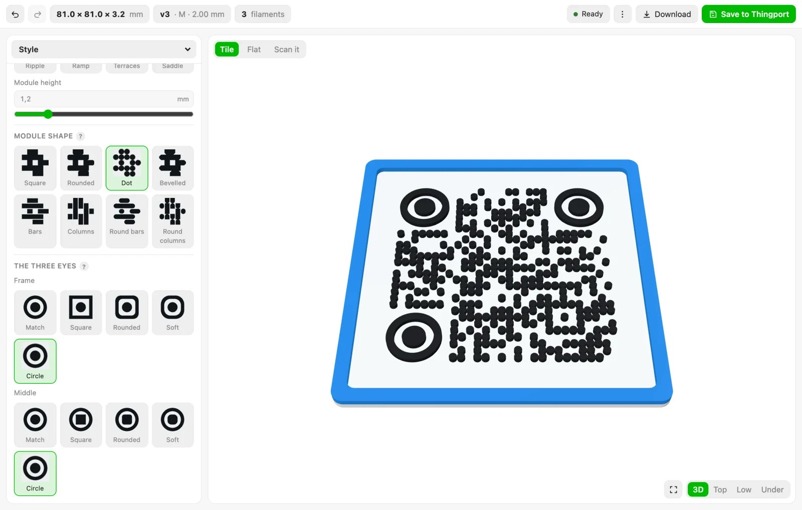

More in [Tools](/docs/guides/tools/).

## Make your own tool, or ask an AI to write it

Turn on **Users' own tools** and **New tool** on the Tools page opens an editor: the tool's details, its script as an
ES module, the words it shows in each language, its HTML and CSS, and a preview running beside them as you type. It
starts from a working tool — Cube maker, which uses most of what a tool can do — and the SDK reference sits beside it
for the rest.

Quicker still, describe one to an AI assistant connected over MCP:

```text
Make me a Thingport tool that turns a few words into a printable label and saves it to my library.
```

A new API token already allows **Save a tool**, the assistant reads Thingport's own tool guide before it writes
anything, and what it saves turns up on your Tools page ready to open. Ask again to change it.

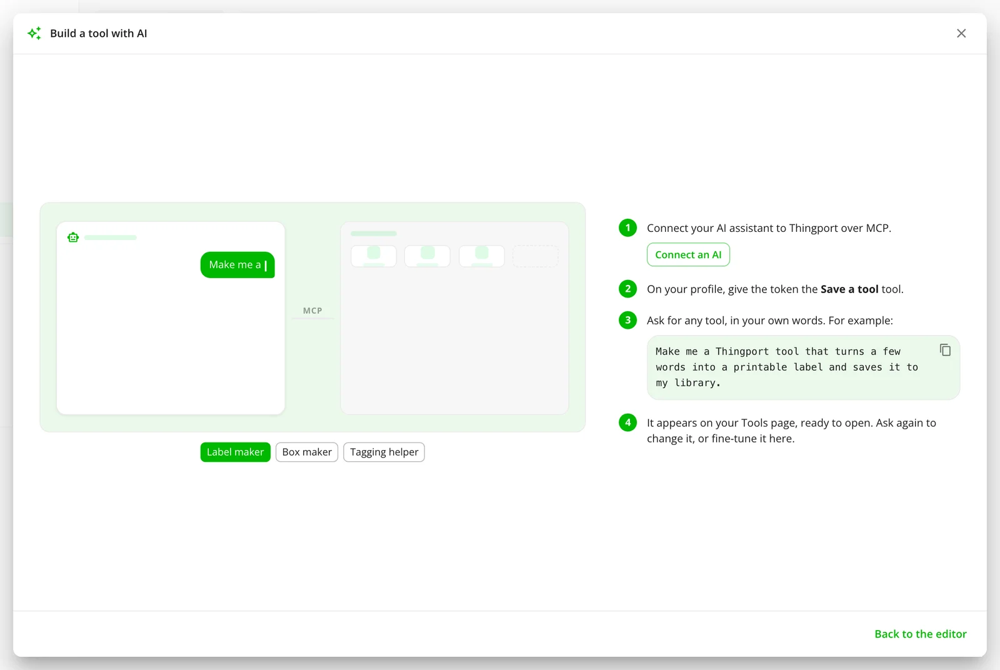

**Use AI** on the Tools page shows the whole thing: the connect command ready to paste, and example prompts to copy.

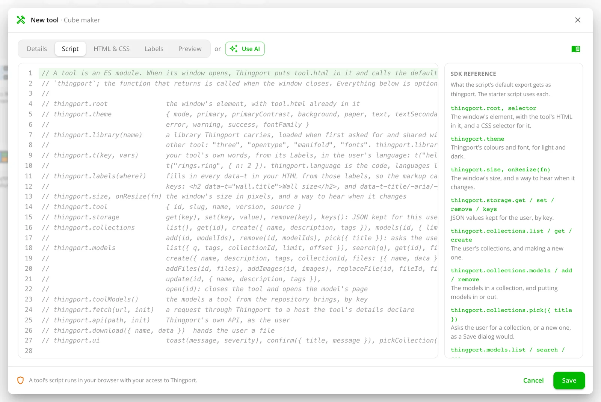

A tool's script runs in your browser with your access to Thingport, like code you paste into the browser console, so
only keep one whose code you trust ([Tools](/docs/guides/tools/)). How a tool is built, and what it may call, is in
[Tool development](/docs/tool-development/).

## Change a model and generate it again

A model that came with the OpenSCAD script it was generated from now leads with **Customize** rather than Open.

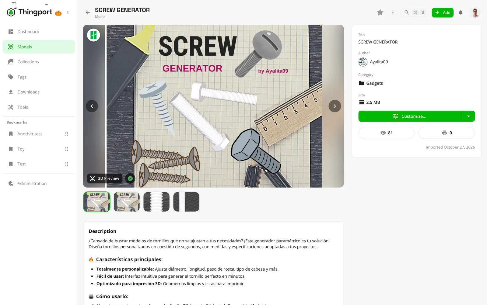

It opens the creator's own sliders, choices and text boxes — read out of the script by OpenSCAD itself, grouped the
way they grouped them — with the model on a stage beside them. Every change can be undone and redone, with the buttons
or Ctrl/Cmd+Z, and the script itself is one button away.

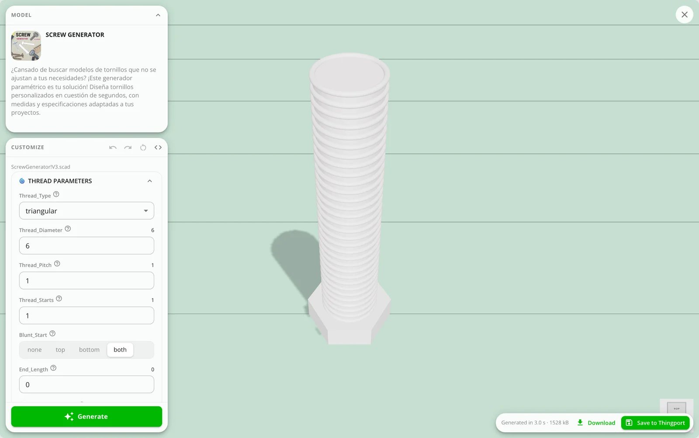

What comes out downloads as a 3MF or an STL, or saves back into your library as a model of its own with a copy of the
script beside it — so it can be changed again in turn. The engine runs in your browser: the script and the values you
pick never leave the tab, and there is nothing to install.

Models now arrive with their script from every site that publishes one, not just MakerWorld, and a creator who kept
theirs back is marked **Script not shared**, so an empty menu isn't left to be misread.

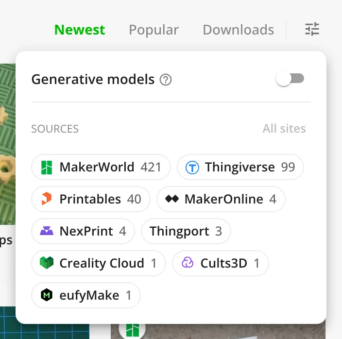

See [Supporting files](/docs/features/supporting-files/).

## Multicolour models, from the import to the plate

A model painted in several filaments — a MakerWorld or Bambu Studio project, or one a script coloured — now shows in
its own colours in the 3D preview and as its first picture, where it used to draw flat in one.

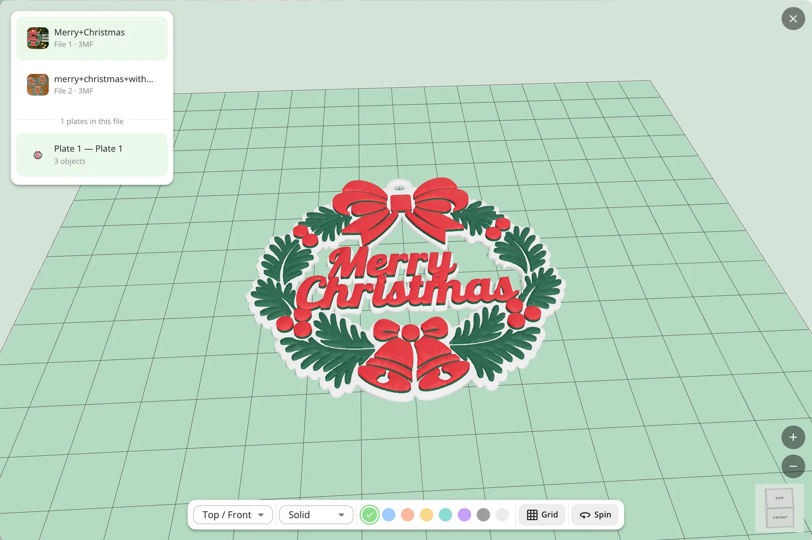

A generated model keeps those colours all the way into the file. A saved 3MF says them twice over: as a colour group
that Bambu Studio and OrcaSlicer offer to put on filaments, and as per-face painting that Bambu Studio, OrcaSlicer and
PrusaSlicer apply to filament slots straight away. The mesh stays in one piece either way, so nothing arrives at the
plate as open shells.

Thumbnails, cards and tag mosaics keep the grey render Thingport tints, so a list of models still reads as one set in
whatever colour you picked — the colour picker steps aside only for the models that brought colours of their own. More
in [3D previews](/docs/features/3d-previews/).

## Pair Thingport Grab instead of typing a password

**Connect** in Grab's popup now leads with **Pair with Thingport**: it opens your instance in a tab to approve this
browser and hands back a connection, so no password is ever saved in the extension. Entering credentials is still
underneath, for instances too old to pair and for anyone who would rather.

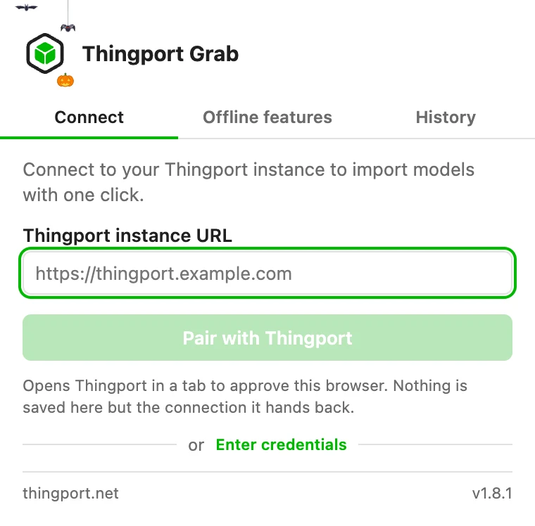

The popup is two columns now, led by a card for the site the tab you're on belongs to — its logo, what that site is,
and a tick or an **Enable** of its own — so the site in front of you takes no searching for. The import panel opens
out of its floating icon and shows what you're importing: the model's picture and name read from the page, and one box
that searches your collections and creates a new one as you type. On MakerWorld it also says, before you commit,
whether the model's generator script comes with it. See [Thingport Grab](/docs/grab/).

## Five new sites: CGTrader, GrabCAD, OwlCAD, Toymakr3D and Makerables

Thingport now imports from seventeen sites, two of them among the largest model libraries there are.

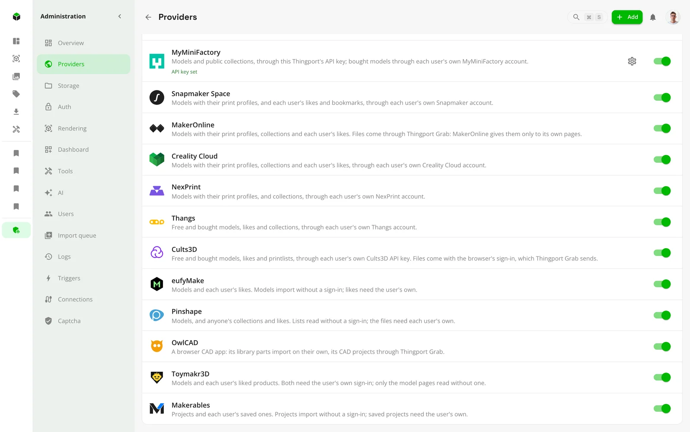

[CGTrader](/docs/providers/cgtrader/) is a marketplace of over three million models, with a large 3D printing
catalogue beside its game and film assets. Its free models import with your sign-in, and so do your liked models and
your wishlist, in one go or synced. A paid model you haven't bought is refused before anything downloads; Thingport
never buys anything. AWS's bot check stands in front of its downloads, and Thingport gets past it
with your browser's token, which Thingport Grab sends along with your sign-in, or with one FlareSolverr gets for it.

[GrabCAD](/docs/providers/grabcad/) is Stratasys's free library of engineers' CAD models, from single parts to whole
machines, shared mostly as STEP files that a slicer opens as they are. Thingport takes the files a slicer opens and
leaves each CAD system's own formats behind. Downloading needs your sign-in, which lasts two days from its last use:
visiting GrabCAD now and then keeps it alive, and Grab sends a new one whenever it changes. Anyone's likes import, or
sync, not just your own.

[OwlCAD](/docs/providers/owlcad/) is a parametric CAD app that runs in the browser and needs no sign-in at all. Its
library parts convert here, and its CAD projects — which have no file anywhere, only a script OwlCAD's own kernel
builds into geometry — are exported by Thingport Grab from an editor tab.
[Toymakr3D](/docs/providers/toymakr3d/) is one designer's articulated robot and mecha models, most of them free, and
asks for your sign-in even for those. [Makerables](/docs/providers/makerables/) is Makera's project site, where
desktop CNC and 3D printing meet; its projects and their files import without a sign-in, and only the ones you saved
need one. All five are on for everyone under **Administration → Providers**.

## Find the models whose files have gone

Thingport keeps a model's files in its storage folder and only the model's details in the database. So an instance
moved without that folder, a backup restored against an empty one, or a folder deleted by accident leaves models with
nothing behind them: no pictures, and nothing to open, print or download.

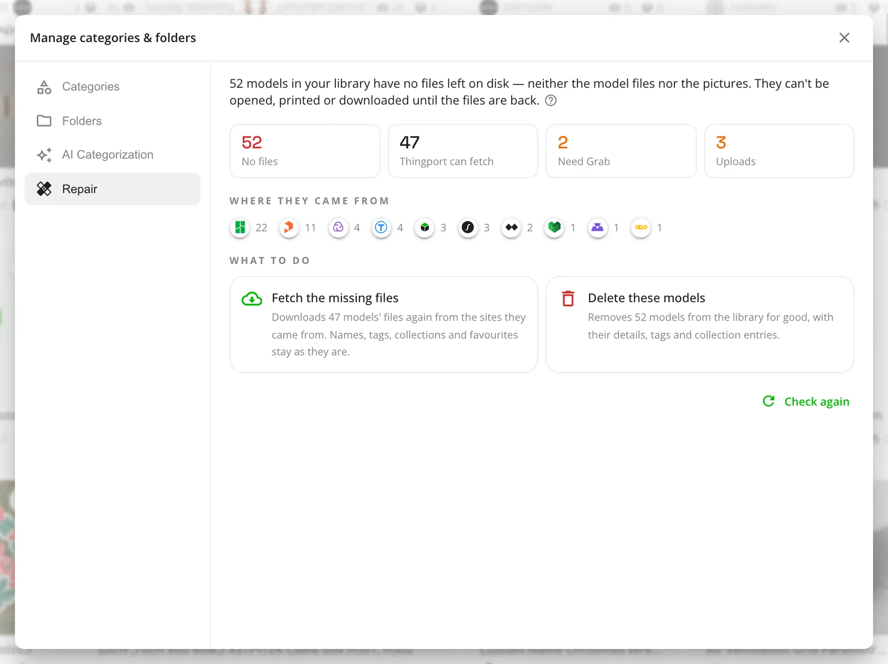

**Repair**, in the models cog, now finds them and offers two ways out: fetch the files again from the sites the models
came from, which keeps their names, tags, collections and favourites exactly as they are, or delete those models for
good. Either way the work runs in the background with a bar at the bottom of the app, can be stopped, and ends in a
notification. Models only Thingport Grab can fetch are left for its next visit to the site. See
[Storage](/docs/features/storage/).

## The Multiboard planner draws its own plates

Installing the planner used to fetch 221 models from Thangs — about twelve gigabytes, as the admin who installed it,
spread over several days of a free account's download limit. It now draws every plate itself, as a wall asks for it,
so the tool carries only the thirteen joints and needs no Thangs account at all.

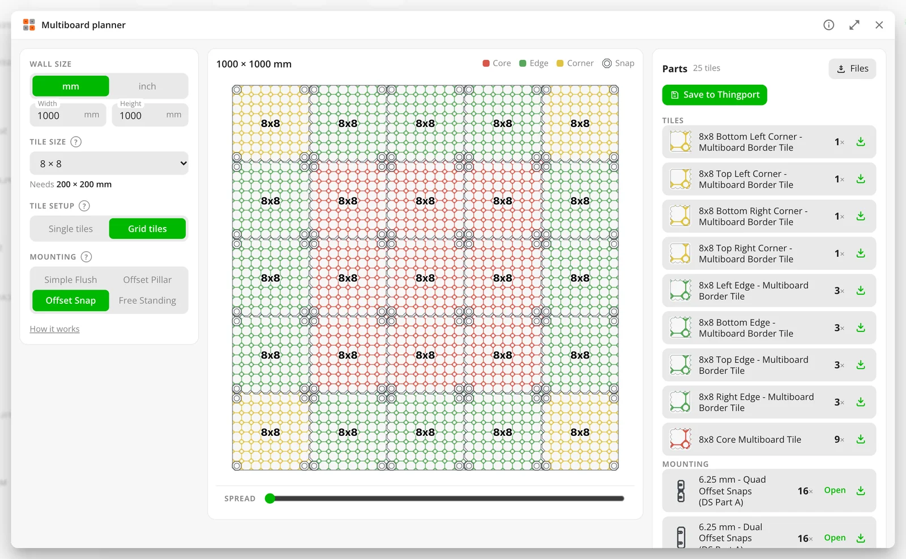

The board preview is the plates themselves, with the fittings sitting over the holes they drop into and a slider that
pulls the wall apart to show which snap bridges what. A finished wall saves into your library as one file per thing to
print, with how many to print in each name, or downloads as a zip.

## Also new

- **Choose the sites the models list shows.** After Downloads comes a filter button with a badge counting the filters
  in force, and behind it a chip for every site your library holds models from, with its logo and a count. The
  Generative switch moves in there too, out of the toolbar where it read as another sort. The address keeps the sites
  hidden rather than the sites shown, so the first model imported from a site new to your library is listed from the
  start instead of arriving already filtered out.
- **Update a tool from its tile.** Each installed tile in Administration → Tools carries a chip: a blue **Update**
  where the repository has a newer version, which takes it in one click, or a green **✓ Latest** where it hasn't. An
  update takes a tool's models only where this instance already has them, rather than handing gigabytes to an instance
  that deliberately installed without them.
- **Thingport on a phone.** The navigation and the model filters fit a narrow screen. The menu drawer stays inside the
  visible viewport rather than running on behind the browser's own bar, and scrolling it no longer drags the page
  underneath along with it. The top bar keeps search, add, notifications and account on one row, and drops a long page
  title to a centred row of its own.
- **OpenSCAD runs off the page's own thread**, so the window keeps answering while a model is generated — and Cancel
  is noticed at once, rather than after the render it was meant to stop.
- **Walls are drawn several plates at a time**, on as many of your machine's threads as it can spare, and a saved wall
  gets its plan as its picture rather than a render of whichever plate happened to be first.
- **Grab's popup says what each site is**, not just its name, and counts how many are switched on.

## Fixes

- eufyMake sign-ins work again, now that the site base64-encodes the cookie they live in.
- Cults3D says plainly when your API key and your browser sign-in belong to different accounts, instead of failing
  with an internal error — and no longer places a free order on the wrong one.
- A download that wraps the designer's own archive inside another zip imports its files, on every site.
- Generator scripts survive the import from Thingiverse, Printables, MyMiniFactory, Pinshape and MakerOnline, which
  all dropped them before.
- A script written on Windows opens with all of its sliders and dropdowns, rather than none of them, and a yes/no
  option sets the value you picked instead of the opposite one.
- Changing the sort, the category or a filter while a page of models is still loading no longer replaces the list with
  the older answer, or leaves scrolling stuck.
- A model a tool or the customizer made is called generated or created, not uploaded.
- Installing a tool no longer drops the sign-in from the request and lands on the sign-in form.

## Get it

Pull the new images and restart, as in [Updating](/docs/install/#updating):

```bash
docker compose pull && docker compose up -d
```

Built from a checkout instead? Pull the code and build the images again:

```bash
git pull && docker compose up -d --build
```

Everyone on your instance then gets a notification that opens the release notes in the app. Thingport Grab updates
itself through your browser's extension store.
