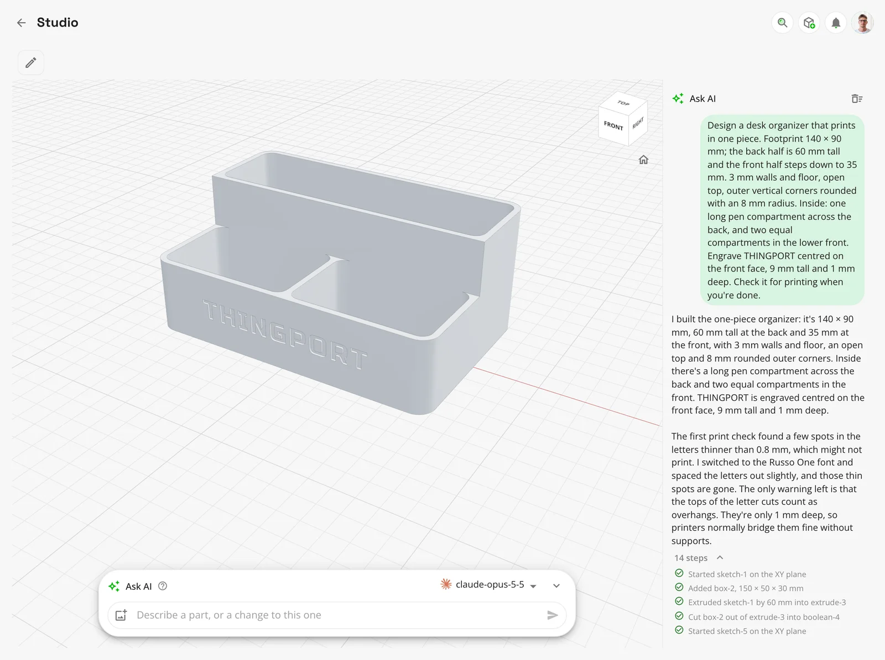
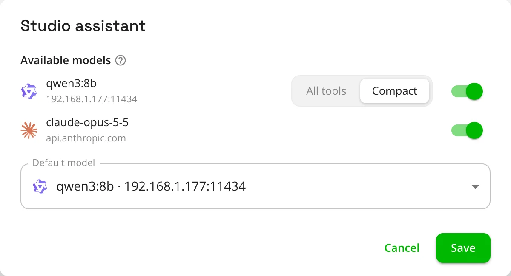
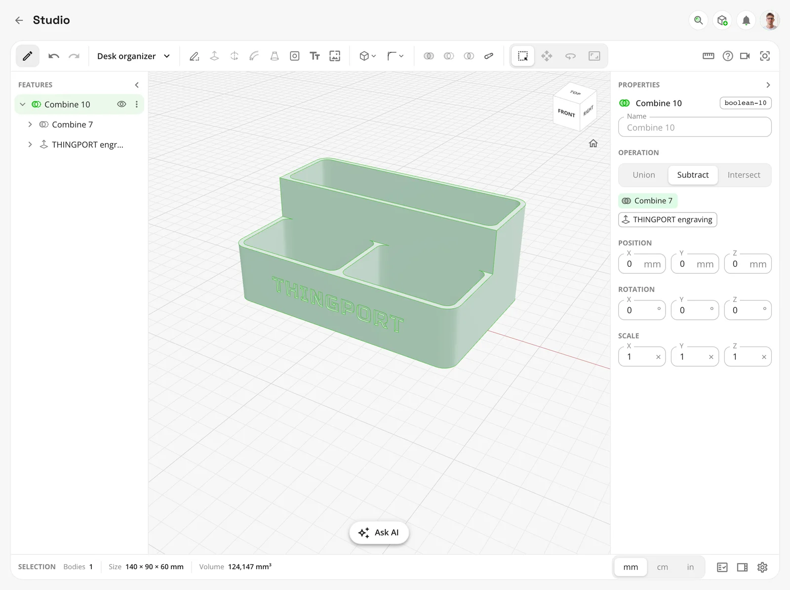
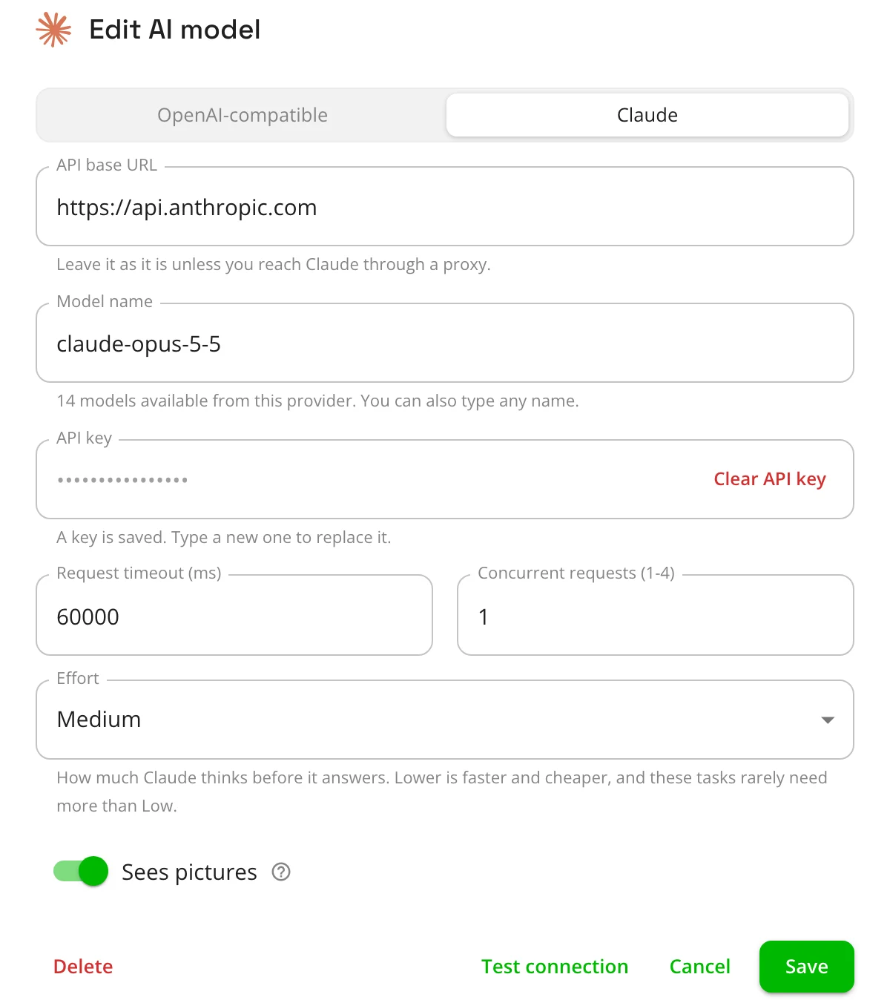
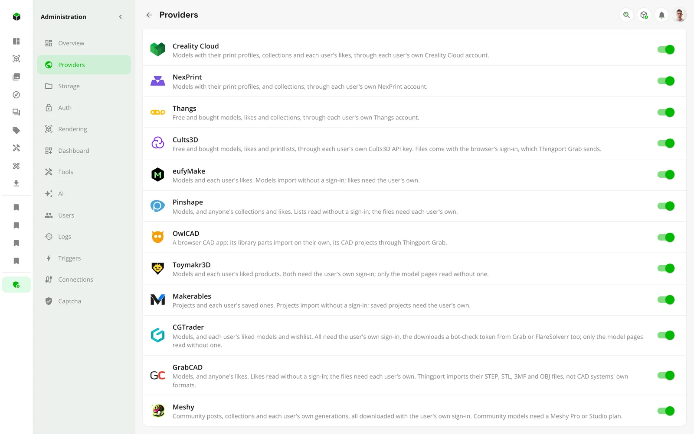
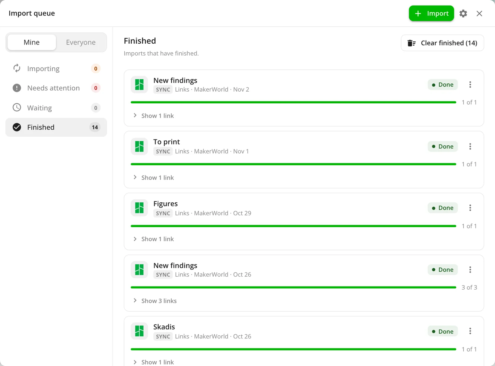
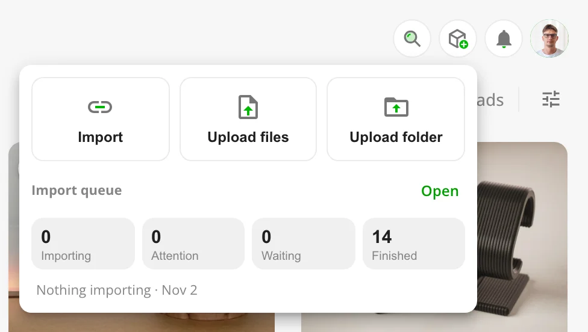
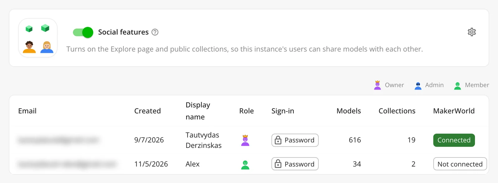
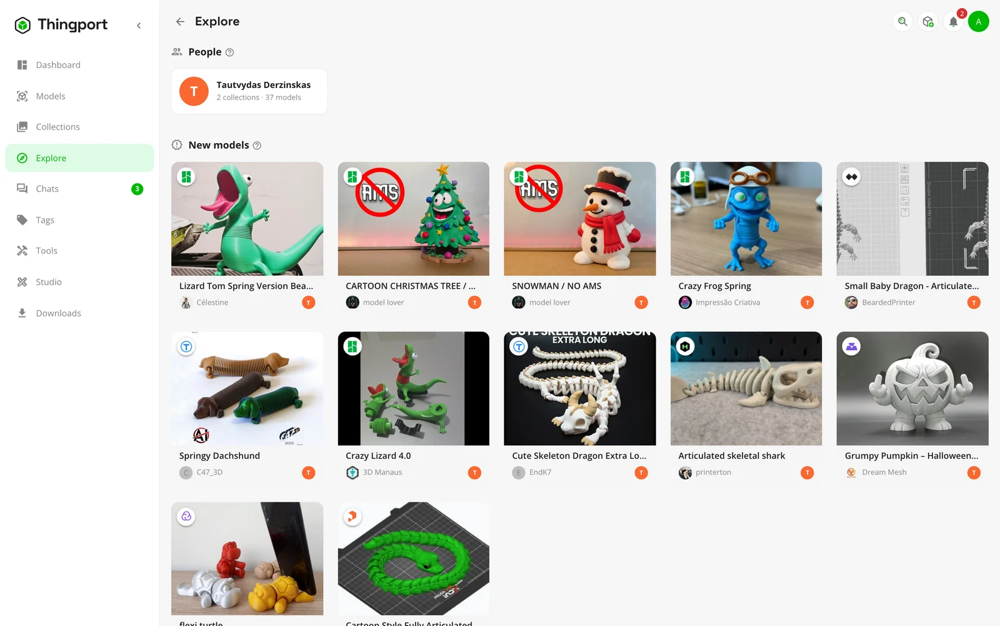
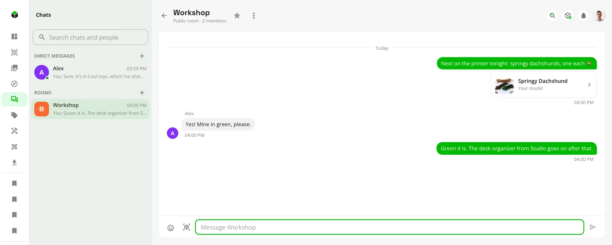

Until now, AI in Thingport was a helper on the side. It suggested a category, tidied a description, and answered
questions about your library over MCP. Useful, but the real work was still yours.

**Thingport 1.5.0 makes AI the engine you drive.** Studio, a new CAD page, is built for an AI to run from start to
finish: describe a part, or a change to a model you already have, and watch it designed step by step. An assistant
connected over MCP already searches your library, imports models and files them into collections; now it designs them
too. Claude joins as an AI of its own, and Meshy, an AI model generator, joins as the eighteenth site to import from.

Around that: an import queue for everyone that survives a restart, collections and chats to share with the people on
your instance, and tighter guards on sign-ins and imports.

## Studio: describe a part, and an AI builds it

Studio sits under **Tools** in everyone's sidebar. It has one rule: every change a person can make to a design is a
command, and every command is also a tool an AI can use. The toolbar, the REST API, the MCP tools and Studio's own
assistant are all made from that one list, so nothing on the page is out of an assistant's reach.

Type what you want into the **Ask AI** box at the bottom of the page, and the assistant builds it while you watch. This
is what we gave Claude Opus 5.5:

```text
Design a desk organizer that prints in one piece: 140 × 90 mm, 60 mm tall at the back stepping down to 35 mm at the
front, 3 mm walls, rounded corners, a pen compartment across the back and two in front. Engrave THINGPORT on the front.
```

Fourteen steps and under two minutes later, it was done. Along the way it ran Studio's print check on its own work,
found that some letters were too thin to print, and fixed them by picking another font and spacing the letters out.



It works the same way on designs you already have. Select something and ask for a change to it: "round the top edges
of this", "make it taller", "add a slot for a phone". **Open in Thingport Studio**, on any model's menu, brings a model
from your library in for the assistant to rework. With an AI that sees pictures, a photo or a drawing with sizes on it
is something to build from, and a logo becomes an outline to emboss.

Each of the assistant's steps lands in the view as it's made, and each undoes like one of yours. Each design keeps its
conversation, so "make it taller" follows on from what came before.

How far it gets depends on the model. Claude and the other frontier models take a paragraph to a finished, printable
part, and they rework the models you bring them. A small model on your own hardware, given the compact tool set,
manages simple parts.



An admin turns the assistant on under **Administration → AI → Features**. They choose which AIs it offers, and which
local ones get the compact tool set. An assistant connected over [MCP](/docs/guides/mcp/), such as Claude Code or Claude
Desktop, gets the same tools once **Studio designs** is ticked on its API token, and you watch its changes appear on
the page as it makes them. More in [Studio](/docs/guides/studio/).

## A CAD toolset that stays editable

Studio is a real CAD page in its own right, not just a window onto the assistant. **Edit** brings in the toolbar and the
side panels. A design is a list of features built in order, so changing a box's width or a sketch's circle changes
everything made from it.



- **Sketch** on a plane or on a body's face with lines, arcs, rectangles, circles, polygons, SVG paths and text. Then
  extrude, revolve, loft or sweep it.
- **Change a body**: press/pull a face, fillet and chamfer edges, drill plain, counterbored, countersunk or tapped holes,
  shell, split, pattern, mirror, hull, align and lay flat. Combine bodies with union, subtract and intersect.
- **Work as in other CAD**: the mouse and the view cube behave as you'd expect, units are the design's own (mm, cm or
  in), and named parameters with formulas drive any size.
- **Check before you print**: Measure reads distances, angles and volumes, and **Check for printing** finds floating
  bodies, overhangs and thin walls.
- **Bring models in, and send them back**: Open in Thingport Studio takes a model's STL, 3MF, STEP, OBJ or GLB, and
  **Separate** makes each loose piece its own body. **Download STL** saves the design for your slicer, and **Save to
  Thingport** puts it in your library as a model with its picture.

## Claude, as an AI of its own

An AI under **Administration → AI** now has a type: OpenAI-compatible, as every AI so far, or **Claude**, through
Anthropic's own API. Pick Claude and paste an API key, and the models the key may use are listed for you.



Claude works everywhere Thingport uses an AI: categorization, improved descriptions, the Studio assistant, the
connection test and System Health. Each feature can use a different AI, so categorization can stay on a small local
model while Studio uses Claude.

- **Answers** come back as structured output, and long descriptions stream as they're written.
- **Effort** sets how much Claude thinks before it answers.
- **Fallback**: Claude Opus 5.5, Sonnet 5.5 and Fable 5.1 ask for Anthropic's fallback, so a harmless request declined
  by mistake is answered by another model.
- **Cost**: in Studio, Claude finds the tools it needs by searching for them rather than being sent all of them, and its
  instructions are cached, which keeps a long design session's cost down.

AIs you already have carry on as they were. See [AI](/docs/guides/ai/#claude).

## Meshy: AI-made models, straight into your library

[Meshy](/docs/providers/meshy/) is an AI 3D model generator: describe something, or give it a picture, and it makes a
model. Its community shares what it makes as posts, and Thingport now imports from it, the eighteenth site to do so.



Posts and collections import, and so do your own generations. Import them by their workspace link, or sync the whole
workspace as **Meshy generations**, so what you make on Meshy lands in your library by itself. Files come as
print-ready 3MF, 75 mm tall and standing on the plate, and a post with several models brings each in as a plate.

Meshy hands files only to a signed-in account. Thingport Grab sends your sign-in, and the backend keeps renewing it
from there. Community models need a Meshy Pro or Studio plan, and Grab tells you so on a post before you try.

## An import queue of your own

Imports now take turns in one line for the whole server, kept in the database, so a restart no longer loses what was
waiting. Everyone has their own queue, opened from **Add** in the top bar. It replaces the import bar along the bottom
and the admin-only queue page.



The queue has four sections: **Importing**, **Needs attention** with why something failed, **Waiting** (split into
**In line** and **On hold**), and **Finished**. **Start** and **Retry** put an import at the back of the line, so
nobody's number ever goes up. Other people's imports show only as private rows that say nothing about them. Admins can
switch from **Mine** to **Everyone** to see every import by person and act on it.



**Add** shows your imports at a glance: a ring while one runs, your place while one waits, a tick when they've finished,
and a badge when one needs you. Synced collections run in a lane of their own, so they never hold the line up. Thingport
Grab's **Add to the queue** now works for everyone; its links stay on hold until you start them, or until you set them
to start by themselves. The idea of a persistent line came from kreativmonkey's work in
[#169](https://github.com/TautvydasDerzinskas/Thingport/pull/169). More in
[The import queue](/docs/features/importing/#the-import-queue).

## Share collections with your household

Thingport has always given everyone in a household a library of their own. Now an admin can let them share.
**Social features**, a switch at the top of **Administration → Users**, stays off until it's turned on.



With it on, a collection's form offers **Private** or **Public**, private by default. **Explore** appears in the sidebar
once there's more than one user. It shows the people who share, the newest shared models, recently updated public
collections and the most collected models.



Someone else's public collection and its models open with whose they are. You can download them, open them in a slicer
or in Studio, and customize them, but you can't change them. Adding one of their models to a collection of yours makes
your own copy, which stays when the original goes private or is deleted. Others see your display name, never your email.

## Chats

With social features on, an admin can also turn on **Chats**, from the cog beside the switch. Chats then appears in
everyone's sidebar with an unread count.



Find someone by any part of their name, or by their whole email, which is never shown, and write to them. Admins make
rooms: public ones anyone can read and join, and private ones for the people they pick. A message can carry emoji and up
to five of your own models, which anyone who can read the chat can open, download and copy until the message is
deleted. Chats can be favourited and muted, and a new message brings a toast and one bell notification per chat.

It all stays on your instance: nothing is fetched from outside it, emoji included. Chats have an API-token scope of
their own, which new tokens leave out.

## Sign-ins and imports, guarded more tightly

- **Sign-ins**: a site's cookies and tokens now go only to the hosts that site declares, over HTTPS, and never follow a
  redirect anywhere else.
- **Imports**: an import link, every redirect it takes and every picture it brings are checked at each hop. One that
  leads to an address on your own network is refused, so a crafted link can't make Thingport reach into it.
- **FlareSolverr** is used only on the routes that need it, and doesn't follow redirects. System Health says when a
  remote solver is reached over plain HTTP, and `FLARESOLVERR_REQUIRE_HTTPS=true` refuses one.
- **Thingport Grab** no longer passes your credentials on through a redirect, other than a reverse proxy moving the
  same host from http to https.

An instance on plain HTTP is still supported, as before. Thanks to kreativmonkey for this work
([#151](https://github.com/TautvydasDerzinskas/Thingport/pull/151)).

## Also new

- **Merge uploads into one model.** A multi-part model often arrives as one upload per part. In the Models page's
  Folders view, select them and choose **Merge**: pick the main one, and the others' files, pictures and descriptions
  move into it. **Assign category** files every selected model under one category in one go.
- **Link an upload to its page on a site.** **Link to a provider** takes the page's pictures, description, tags and
  author, and the site's badge and link, without downloading any files.
- **glTF models.** Upload a .gltf with its files, or drop it in the consume folder, and it's packed into one .glb that
  previews in its own materials.
- **Print profiles for a whole MakerWorld collection**, in Grab's guided collection import: each model's default, all
  the designer's, or the community's too.
- **A model's collections at a glance**, in a bookmark chip on the model page. Any dialog that picks a collection can
  now make a new one on the spot.
- **Landscapes and visitors in the weather widget**: a field, a forest, mountains or a city, following the weather, the
  time and the season, with animals, people and traffic passing through.
- **Unread notifications on the tab's icon**: a red bubble up to 9+, with the exact count in the title.
- **Filters for tags and collections**: tags by how many models they have, and collections by system, user and tool.
- **Community widgets from a checkout**, so a widget can be tried before it's pushed.
- **thingport.net follows your system's theme**, with a three-way toggle.

## Fixes

- MakerWorld imports bring a print profile's 3MF again, rather than a zip of its STLs, now that MakerWorld no longer
  answers the download Thingport used to ask for. Grab's panel offers the profiles again too.
- A Cults3D model you bought imports, and Grab no longer calls it unbought
  ([#232](https://github.com/TautvydasDerzinskas/Thingport/issues/232)).
- A MakerWorld link that names no print profile is filed under the profile the page shows, not the design's default.
- Grab's MakerWorld panel stays open while it picks a print profile, rather than closing mid-import.
- Grab lists a linked zip's files by name.
- Loading more models after some have left the list no longer skips or repeats one.
- The weather widget's shapes no longer turn square in dark themes, and its text shows for anyone who asks for reduced
  motion.

## Get it

Pull the new images and restart, as in [Updating](/docs/install/#updating):

```bash
docker compose pull && docker compose up -d
```

Built from a checkout instead? Pull the code and build the images again:

```bash
git pull && docker compose up -d --build
```

Update the frontend and backend together: an older frontend has no import queue for members to open. Studio is there
for everyone straight away. **Ask AI** waits for an admin to turn on the Studio assistant and pick its AIs, and social
features and chats stay off until an admin turns them on under **Administration → Users**.

Everyone on your instance then gets a notification that opens the release notes in the app. Thingport Grab updates
itself through your browser's extension store.

Happy printing, and happy designing.
