A model in your library used to be its files and its pictures. What it takes to print, and what you're allowed to do
with it, stayed on the site it came from.

**Thingport 1.6.0 brings both along.** Print profiles show on the model page with their print time, filament and plates,
laid out the way each person picks, and every model keeps the licence it was published under. And Thingport instances
can now connect with each other: pair yours with a friend's, a makerspace's or the one at work, and their people's
models, collections and profiles show up on your Explore, with chats across both. An instance at home connects too,
with no port forwarding.

Around that: PIXUP, Fab365 and 3DExport bring the sites Thingport imports from to twenty-one, collections can be shared
with just the people you pick, profiles get covers and avatars, and the app speaks Russian, Ukrainian and Belarusian.

## Print profiles on the model page, shown your way

A model imported with its print profiles, from MakerWorld, Snapmaker Space, Creality Cloud, NexPrint or MakerOnline,
used to show them as a row of 3MF files. Now they're profiles, above **Open**: each one's name, whether the designer or
the community made it, its print time, filament by colour and weight, its plates with their pictures, and the printer,
nozzle, layer height, infill and walls. Thingport reads them from the site and from the profile's own 3MF, and the
[3D preview](/docs/features/3d-previews/) shows the picked profile's plates.

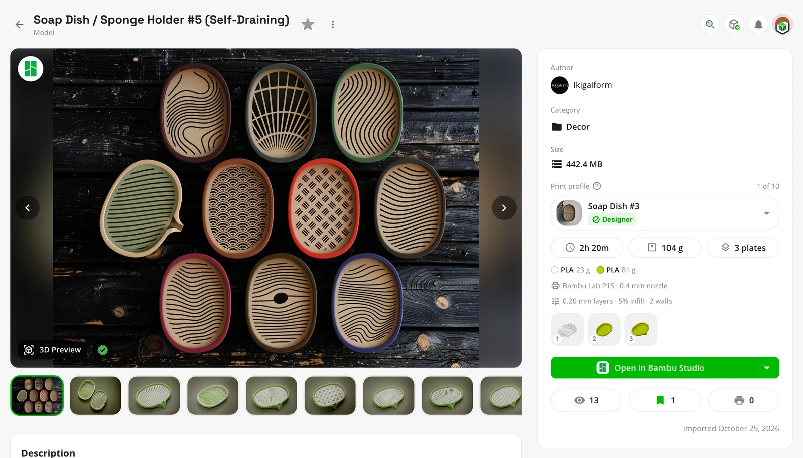

How they look is up to each person, under **Configuration → Appearance → Print profiles**:

- **Picker**, the default: a picker like the file picker, with the picked profile's numbers below it.
- **Tiles**: each profile by its picture.
- **List**: every profile at once.
- **Off**: plain files, as before.

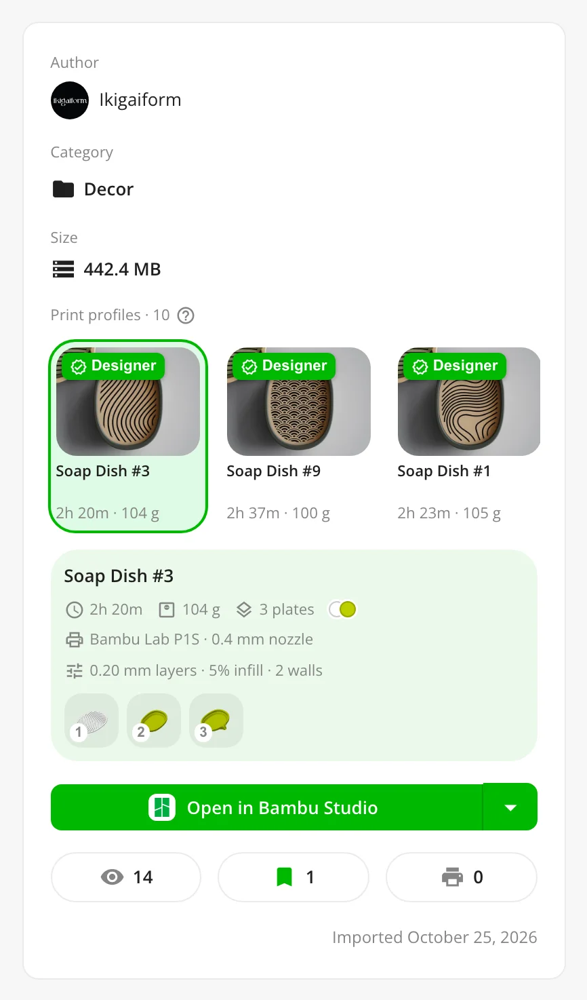

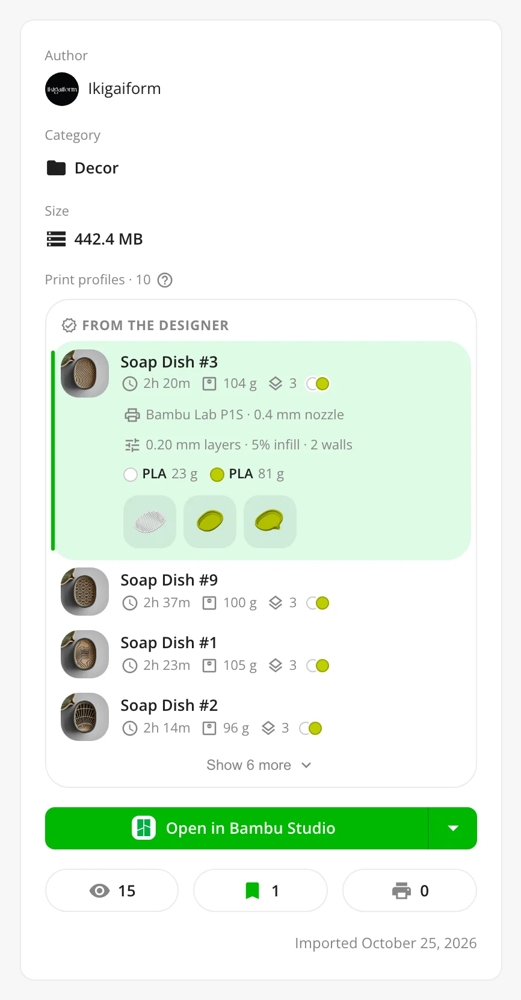

The designer's profiles come first, and the first of them is picked. Models you imported before 1.6.0 read their
profiles the first time you open them, and new imports a few seconds after they arrive. Downloads, likes and ratings
are left out on purpose: what's shown is what helps you print. More in
[What comes with a model](/docs/features/importing/#what-comes-with-a-model).

## Connect your Thingport instance with others

Until now, every Thingport instance stood on its own. In 1.6.0, instances can connect, so the people on them find, open
and copy each other's models and write to each other as if they were all on one instance. Two connected instances are
**partners**.

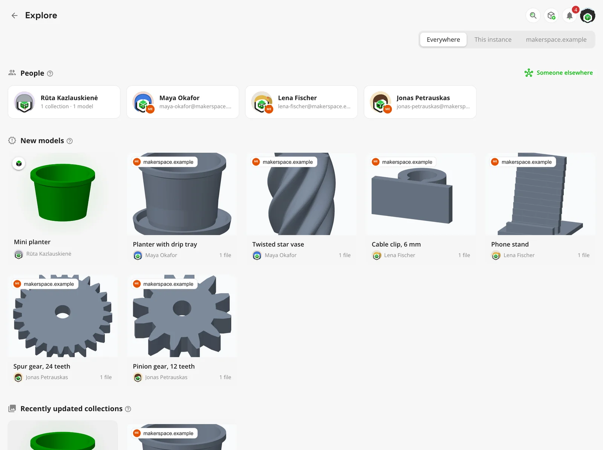

- **One Explore for everyone.** A partner's people, their public collections and their newest models show up on
  Explore beside yours, each marked with the instance it's on. **Everywhere**, **This instance** or one partner
  narrows it down.
- **Their models, as if they were here.** A partner's model opens with its pictures, description, files and
  collections. Download it file by file or as a ZIP, open it straight in your slicer, or **Copy to my library** to keep
  your own copy, with its tags, print profiles, licence and the site it came from. Your copy stays if they change or
  delete theirs.
- **Their people.** A partner's people have profiles like anyone here. Write to them directly, add them to a private
  room, or share a collection with them.
- **Handles.** Everyone gets one, `name@their.instance`, and can ask to reach someone on an instance that isn't a
  partner yet. The request goes to the admins, who can connect the two.

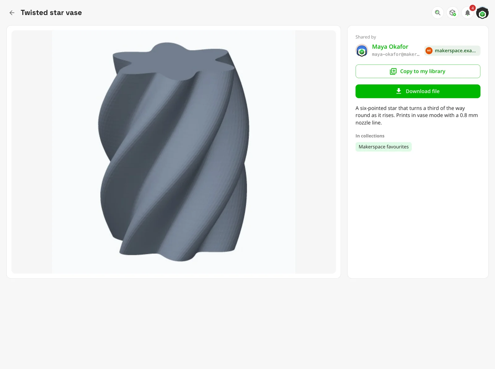

It's off until an admin turns it on under **Administration → Social**, with social features on. Admins on both sides
approve every partner, after comparing a key with each other, and nothing private crosses: libraries, private
collections, settings and emails stay where they are. It runs over ActivityPub, between Thingport instances only, and
it works over plain HTTP too, so two instances on a LAN connect as well as two on the internet.

## An instance at home connects too

Most home instances can't be reached from the internet. The router in front of them turns away whatever nobody inside
asked for, so another instance can't reach yours, and a home instance would be left without partners.

Thingport gets around that with a **link**. Your instance reaches out to its partner on the internet and keeps a
connection open to it. Whatever the partner would send yours, or fetch from it, comes back down that connection.
Your router only ever sees an answer to something your instance asked for, so it lets it through.

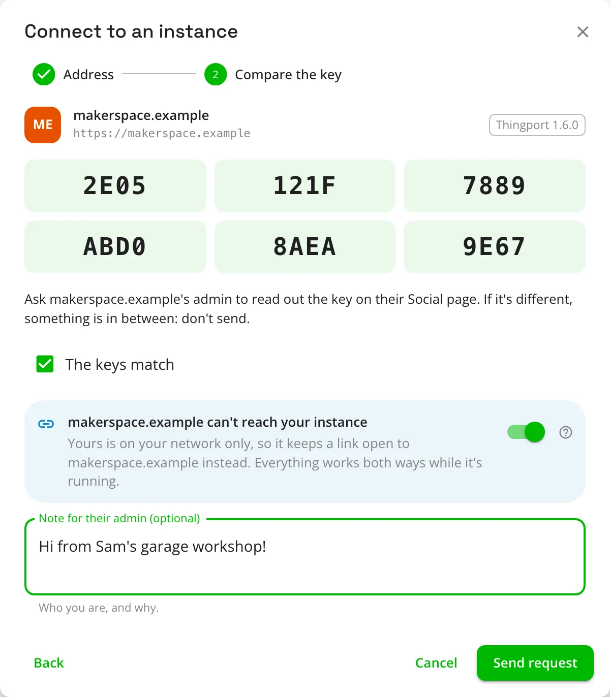

- **No port forwarding, domain or certificate.** A Raspberry Pi, a NAS or an old laptop is enough. Only the instance on
  the internet needs an address others can reach.
- **Everything works both ways.** Explore, pictures, downloads, copies and chats all go through the link: the
  partner's people browse your shared models, download their files and write to your people.
- **One switch.** Connecting from an instance that's on your network only, or that nothing can reach, turns
  **Keep a link open** on by itself, and says why.
- **Off at night, back in the morning.** While the home instance is off, what's said to its people waits on the
  partner's side for up to about three days, and arrives once the link opens again.
- **Its address is never tried.** It means nothing from the other side of the internet, so the partner never sends
  anything to it.

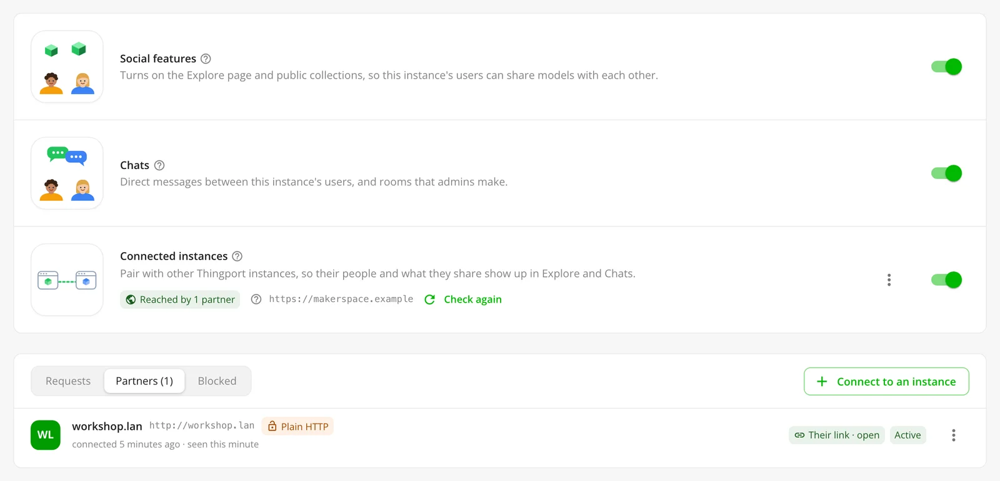

|                     | Both instances reachable  | One at home, one on the internet          |
| ------------------- | ------------------------- | ----------------------------------------- |
| **Who connects**    | Either admin              | The one at home                           |
| **What works**      | Everything, both ways     | Everything, both ways, through the link   |
| **When one is off** | Retried for about 3 days  | Waits on the partner's side, about 3 days |
| **Needs**           | An address each can reach | An address for the one on the internet    |

Two instances on one network, such as a home and a workshop on the same LAN, connect directly. Two that are both at
home, behind different routers, can't reach each other: put them on one VPN, such as Tailscale or WireGuard, and they
connect as two instances on one network.

To set it up, see [Set up connected instances](/docs/guides/connected-instances/). How it all works, and what crosses
and what doesn't, is in [Connected instances](/docs/features/connected-instances/).

## Every model keeps its licence

What you may do with a model, whether you may share its files, remix it or sell prints of it, used to stay on its
site. Now it comes with it. Every site Thingport imports from says what licence a model has, and the import keeps it:
Creative Commons licences, CC0, open-source ones such as GPL and MIT, and each site's own.

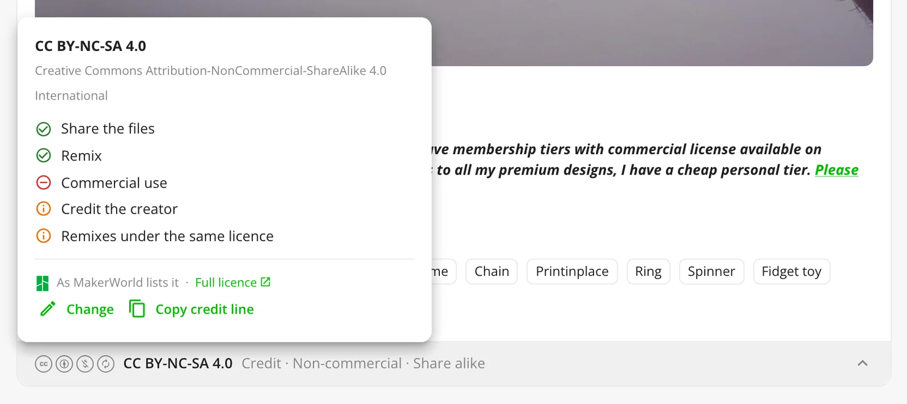

- **On the model page**, a strip at the foot of the description shows the licence's marks and what it comes to, such
  as "Credit · Non-commercial · Share alike". Click it for what it lets you do, the terms the site or the creator
  added, a link to the licence, and **Copy credit line** for when you post a print or a remix.
- **Pick one yourself** under **Edit**, for a model you designed and uploaded, or one you've changed so much it's your
  own. A licence you pick is never read over by the site's.
- **Filter by it**: every list of models gains **Licence allows**, with **Can be shared**, **Commercial use**,
  **Remixing** and **Only with a licence**, which combine.
- **LICENSE.txt** sits beside each licensed model's files, with its credit line, and every ZIP download carries one.
  Admins can turn the files off under **Administration → Storage → Licence files**.

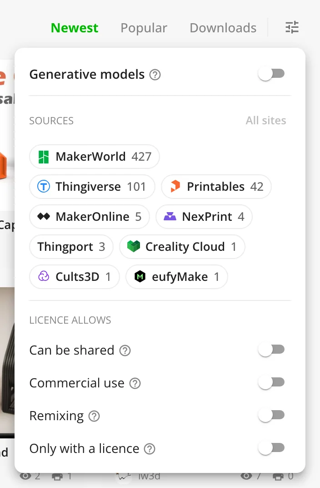

Copies, connected instances and the MCP tools carry the licence too, and models imported earlier read theirs the first
time you open them. A licence only informs: nothing is blocked or warned about because of one. More in
[Licences](/docs/features/licenses/).

## PIXUP, Fab365 and 3DExport: twenty-one sites

Three more sites to import from. Each is signed in to per person, through Thingport Grab or by pasting the sign-in,
and none needs FlareSolverr.

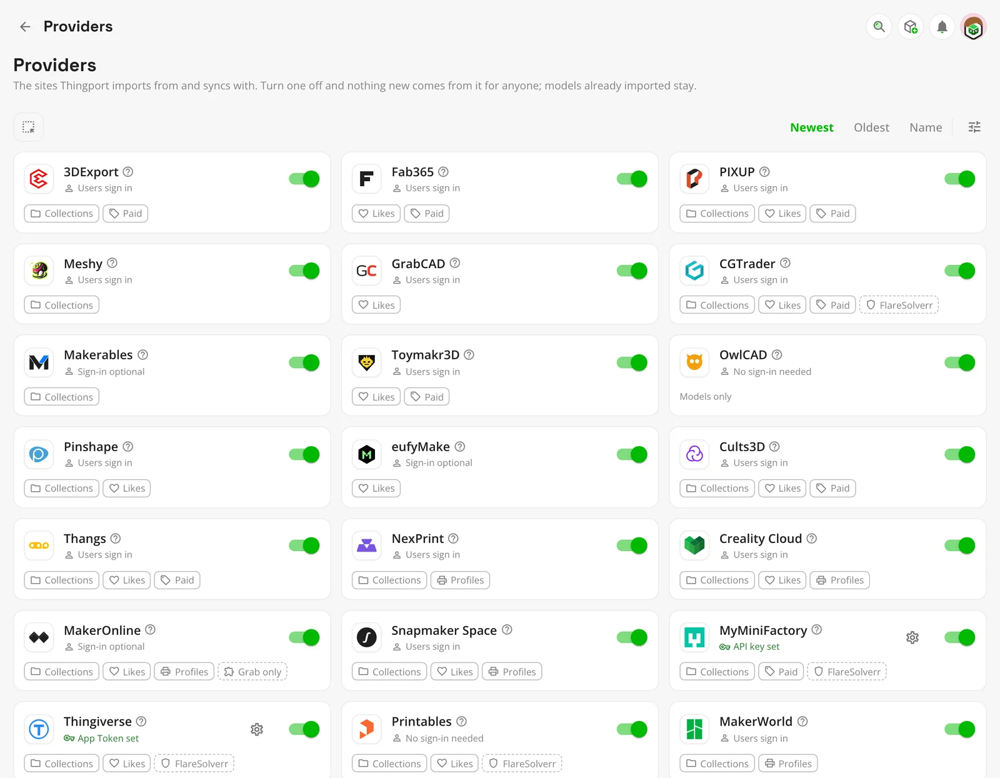

- **[PIXUP](/docs/providers/pixup3d/)**, Phrozen's marketplace: free models and the ones you bought, anyone's
  wishlists and your collections, synced too. PIXUP hands over a free model's files only once it's in your account, so
  Thingport checks it out at $0 through your cart, as long as everything in the cart is free.
- **[Fab365](/docs/providers/fab365/)**: free models and the ones you own, bought or redeemed with a ticket, and your
  favourites, synced too. Thingport never spends money or tickets, and keeps renewing your sign-in itself.
- **[3DExport](/docs/providers/3dexport/)**, one of the oldest marketplaces: free and bought models, with their STL,
  3MF, STEP and LightBurn files, leaving a CG model's scenes and textures behind. Your Default Collection, and your own
  or anyone's public collections, import and sync too.

Each brings its categories, trending models and licence, and all three are on for everyone after the update. Every
site's needs are side by side in [Providers](/docs/providers/).

## Share a collection with just the people you pick

Until now a collection was private or public. Its form now offers a third choice, **Shared**: only the people you pick
see it, by any part of their name or their whole email, or by their handle on a connected instance.

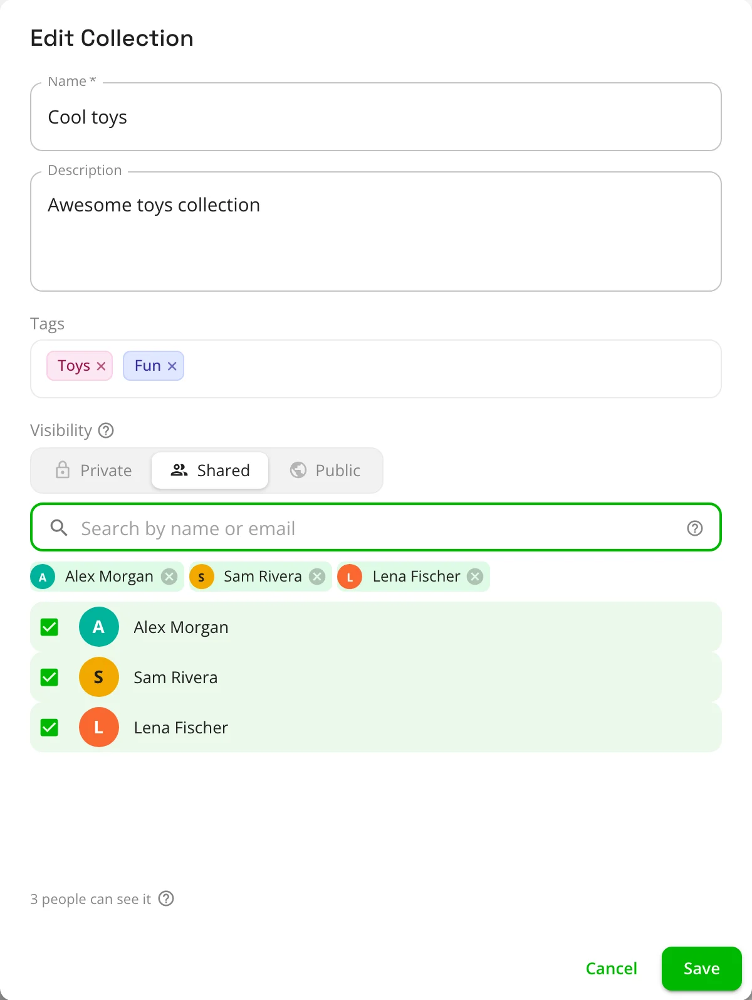

They see it as they would a public one, with its models to open, download, open in a slicer and copy, and nobody else
on your instance sees it. Shared with someone on a connected instance, it's sent to theirs, whose admins could see it
too. They're told, and find it under **Shared with you**, at the top of Explore.

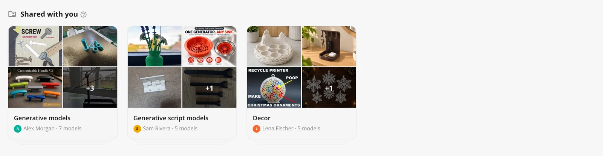

**Share…** on a collection's ⋮ menu opens the form on who sees it. You see who it's shared with on its cover and beside
its name; they don't see who else is on the list. Add or take people off at any time. Making the collection private or
public keeps the list, for the next time you share it. Up to 100 people a collection, with social features on. More in
[Social features](/docs/features/social/#share-what-you-choose).

## Profiles with a cover, an avatar, a bio and links

**Edit profile**, on **My models**, gives everyone a cover, a bio of up to 1,000 characters in Markdown, and up to five
links.

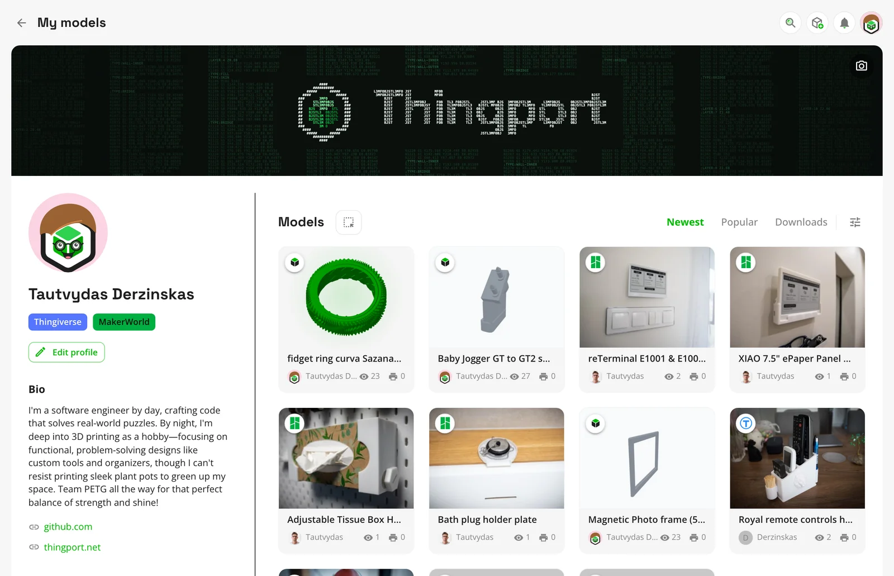

A cover is one of five drawn designs (retro, pixel art, mosaic, ASCII or blueprint), a linked account's cover, or a
picture of your own, cropped to fit. Click your avatar to design one from hair, glasses, expressions and colours, or to
upload a picture. Left alone, it's your Gravatar, fetched by your instance so nobody else learns your email from it, or
one drawn for you.

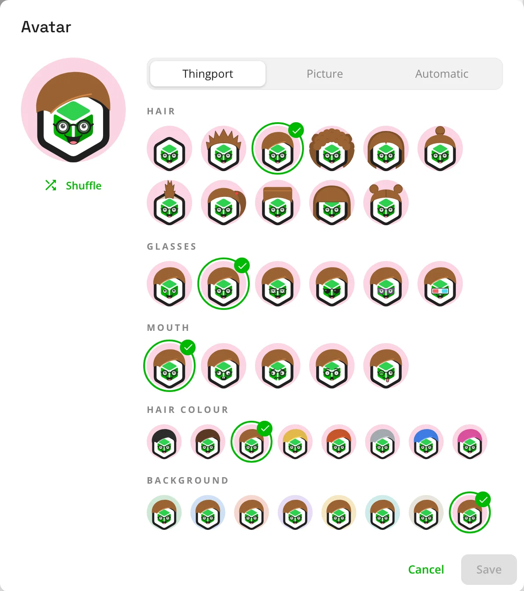

With social features on, the lock beside **Edit profile** puts **My models** on Explore: your uploads and your linked
authors' models, for others to open, download and copy. Someone's profile on Explore opens on their models, with their
collections beside them.

## Русский, Українська and Беларуская

Thingport, its nine built-in tools and the weather widget now speak Russian, Ukrainian and Belarusian, each with its
own plural forms, thanks to krolbot ([#280](https://github.com/TautvydasDerzinskas/Thingport/pull/280)).
**Configuration → Appearance → Language** is now a list to search, with each language's flag, its own name and how
much of the app it covers.

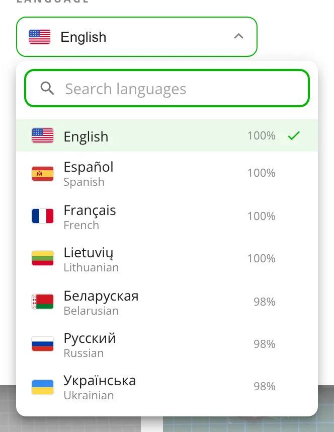

## Also new

- **A copy is the whole model.** Adding someone else's model to a collection of yours, or copying one from a connected
  instance, brings its category (as your own of the same name, or for AI categorization to sort), the site it came
  from, its print profiles and its pictures. If you already have the model from that site, yours opens instead.
- **Pick how Thingport Grab looks.** Grab's popup has an **Appearance** tab: six looks for its button on a model page
  (Bubble, Pill, Mini, Brand, Glass and Edge tab) in any of the four corners. The button now shows on every model page,
  with a tick and a green ring when the model is in your library, and a + when only part of it is, such as some of its
  print profiles. Grab then adds just the missing ones, so a site's daily download limit isn't spent on the ones you
  have.

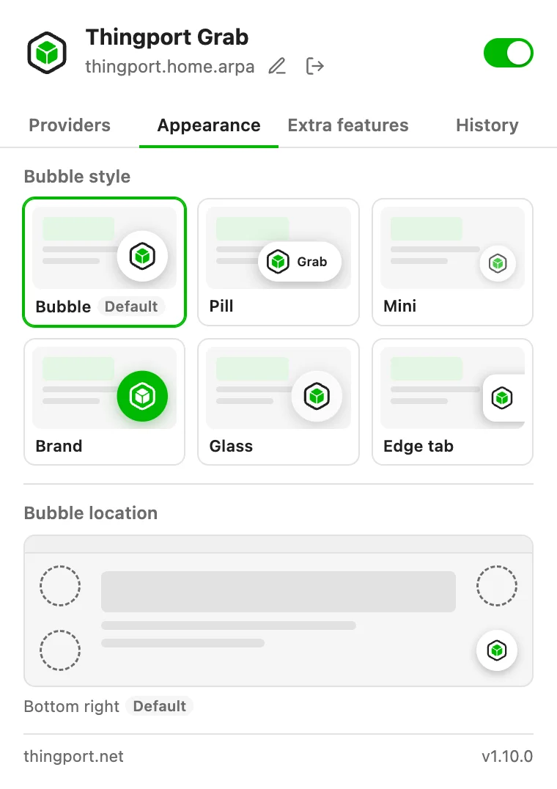

- **Open in a slicer through Thingport Bridge.** For a slicer that can't download from your instance itself, over a
  certificate it doesn't trust for one, right-click it under **Configuration → Slicer** and turn on **Through
  Thingport Bridge**. It works for OrcaSlicer, Creality Print, Elegoo Slicer, Snapmaker Orca and eufyMake Studio. The
  new Bridge fetches only model files, keeps session tokens out of its log and finds those slicers where they're
  installed. Thanks to pike338 ([#287](https://github.com/TautvydasDerzinskas/Thingport/pull/287)).
- **Administration → Social**: social features, chats and connected instances, on a page of their own after Users.
- **Administration → Providers, as cards**, with what each site imports, who signs in and what it needs. Sort them,
  filter them, and turn several on or off at once.
- **Delete all of someone's models** from their ⋮ menu under **Administration → Users**, keeping their account. Any
  admin can do it to a member, only the owner to another admin, and nobody to the owner. **Administration → Triggers**
  is gone.
- **Earlier releases, from What's new**: its history button opens any release's notes.
- **Every page opens at the top**, and going back to a list of models returns to the same models at the same place,
  without loading them again.
- **thingport.net has a new home page**, built around a demo video.

## Fixes

- Loading more models at the foot of a list no longer stalls.
- Grab's note on a part-finished print profile import ends with the last error, so you can see why the rest failed.
  Thanks to truri83 ([#265](https://github.com/TautvydasDerzinskas/Thingport/issues/265)).
- A tool's models and collections can no longer be changed through an address written another way.

## Get it

Pull the new images and restart, as in [Updating](/docs/install/#updating):

```bash
docker compose pull && docker compose up -d
```

Built from a checkout instead? Pull the code and build the images again:

```bash
git pull && docker compose up -d --build
```

Update the frontend and backend together. Print profiles and licences fill in by themselves, as each model is opened.
Connected instances, shared collections and public profiles wait for an admin to turn social features on under
**Administration → Social**, and connected instances for their own switch there.

Everyone on your instance then gets a notification that opens the release notes in the app. Thingport Grab updates
itself through your browser's extension store. Thingport Bridge doesn't: if you use it, download the new one from the
[`bridge-latest` release](https://github.com/TautvydasDerzinskas/Thingport/releases/tag/bridge-latest) and run it once.

Happy printing, and happy connecting.
