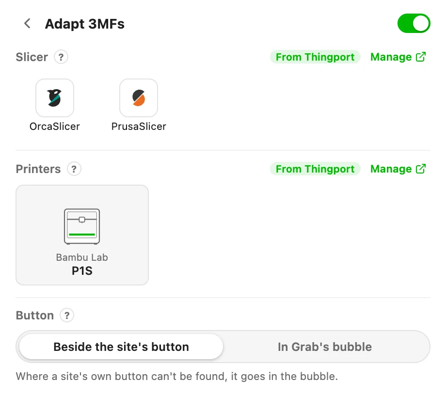
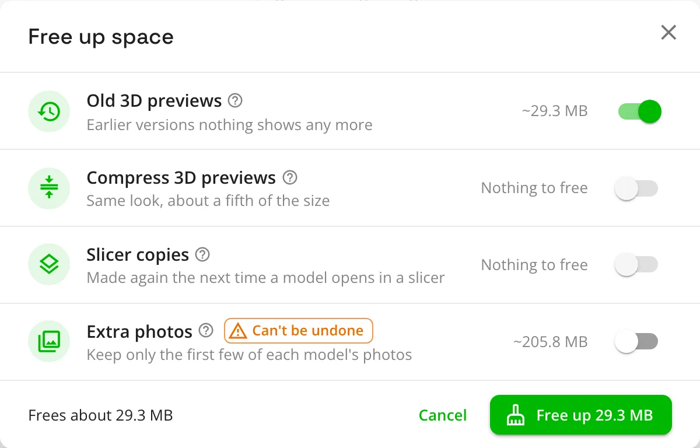
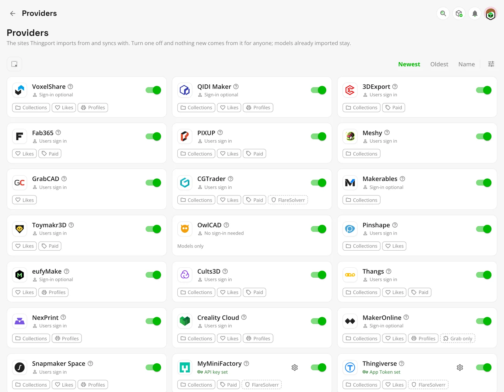
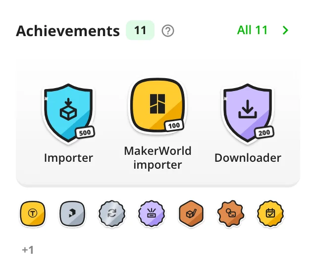

A 3MF is rarely just a model. It's a project of the slicer it was made in, for the printer its designer had: a
MakerWorld model is a Bambu Studio project made on an A1 mini, a Printables one often a PrusaSlicer project. Open it
in another slicer, or for another printer, and its colours, parts, plates or settings go missing, or it opens on a
printer you don't have.

**Thingport 1.7.0 makes the copy your slicer and printer would have made.** Open adapted now works for a 3MF from any
site, in every slicer Thingport opens, and names your slicer's own presets for the printer you print on. Thingport
Grab makes the same copies on nine sites, with or without a Thingport instance. And Administration → Storage now shows
what takes the disk, and frees up what isn't needed.

Around that: QIDI Maker and VoxelShare bring the sites Thingport imports from to twenty-three, Snapmaker Space's and
VoxelShare's China sites import too, Migrate brings people and libraries in from another instance, achievements put
badges on My models, and Thingport and Grab speak Simplified Chinese.

## Open adapted: any 3MF, from any site, in your slicer

Until now, **Open normalized** was offered on MakerWorld models only, with one flat copy for every slicer. It's now
**Open adapted in &lt;your slicer&gt;**: a copy of the file made for the slicer you open it in, so it opens there as
close as it can to a file made there. Thingport reads what kind of 3MF each file is, whichever site it came from, and
makes the copy that kind needs:

- **PrusaSlicer and eufyMake Studio** get a copy that joins your own printer, filament and print settings. The
  designer's layer height, walls, infill and supports are set on each object, and parts, modifiers, negative and
  support volumes and painting are kept.
- **Cura** gets a Cura project (5.7 and later): the designer's layer height, adhesion and supports go onto your
  printer's settings, and every object keeps its extruder.
- **Bambu Studio and the slicers built on it**, OrcaSlicer, Snapmaker Orca, Elegoo Slicer, Anycubic Slicer Next and
  Flash Studio among them, open a Bambu Studio project as their own, without questions about its version. A
  PrusaSlicer or eufyMake Studio project becomes a project of theirs, with its painting kept and each bed a plate.
- **Creality Print and QIDI Studio** keep the parts, painting and the designer's settings, under the names they give
  them.
- **A plain 3MF in several colours**, from a CAD app or one of Thingport's own tools, gets an extruder per colour in
  the slicers that read no 3MF colours.


A file that already opens as well as it can, such as a Bambu Studio project in Bambu Studio, opens as it is. The copy
is made on your Thingport instance, so it works offline, and the stored file never changes. Right-click a slicer under
**Configuration → Slicer** to switch **Open adapted** off for it.

The old copy's faults are gone with it. PrusaSlicer no longer swaps your printer for a 200 × 200 one named after the
file, or drops single-part objects as "size appears to be zero". The slicers built on OrcaSlicer keep a project's
parts and plates. And a 567 MB project that used to run out of memory adapts in about a minute.

Thanks to SeoliteQ ([#67](https://github.com/TautvydasDerzinskas/Thingport/issues/67)), maxbrueckl
([#216](https://github.com/TautvydasDerzinskas/Thingport/issues/216)) and truri83
([#261](https://github.com/TautvydasDerzinskas/Thingport/issues/261),
[#262](https://github.com/TautvydasDerzinskas/Thingport/pull/262)), whose reports and fix this grew from. More in
[Adapted 3MFs](/docs/features/adapted-3mf/).

## Made for the printer you print on

A project names the printer it was made for, and that's often not yours. Add your printers under **Configuration →
Printer**, and the copy is made for your printer instead:

- **Your slicer's own presets.** The copy names the printer as your slicer has it, the process at the height and
  quality the designer started from, and each filament as the same product for your printer, or a generic one of its
  type. The designer's changes stay on top, as the slicer itself keeps them.
- **On your bed.** Each plate's objects, and its wipe tower, move onto your printer's bed.
- **971 printers.** **Add** lists the printers of 190 brands that ten slicers know, with their pictures.
- **Suggested for you.** Printers your library points at are offered beside yours: the ones your prints were sliced
  for and your projects are made for. **Not mine** turns one down.
- **Found in your accounts.** Signed in to a printer maker's site, you're asked whether to find your printers there:
  the ones bound to your Bambu Lab account through MakerWorld, those in your Creality Cloud, Snapmaker and Flashforge
  (VoxelShare) accounts, and the printer your MakerOnline profile names. Thingport reads them only after a yes, and
  keeps only each printer's model and nozzle.


Pick the printer for each slicer from its right-click menu under **Configuration → Slicer**, or let Thingport ask
**Which printer is this for?** the first time you open a model adapted, and remember the answer. The model page's
button then says which printer the copy is for, and its menu downloads the copy too.


| Slicer                                                                                                   | Made for your printer                                         |
| -------------------------------------------------------------------------------------------------------- | ------------------------------------------------------------- |
| Bambu Studio, OrcaSlicer, Snapmaker Orca, Elegoo Slicer, Anycubic Slicer Next, Flash Studio, QIDI Studio | Yes: your slicer's presets, on your bed                       |
| Creality Print                                                                                           | Asks which printer to use itself                              |
| PrusaSlicer, eufyMake Studio, Cura                                                                       | Onto the printer selected in them, so the copy doesn't change |

More in [Made for your printer](/docs/features/adapted-3mf/#made-for-your-printer).

## Download adapted in Thingport Grab, on nine sites

Thingport Grab's **Download adapted** makes the same copies in your browser, and not on MakerWorld alone: on
Printables, Creality Cloud, Snapmaker Space, NexPrint, MakerOnline, eufyMake, QIDI Maker and VoxelShare too.


- **With or without an instance.** **Adapt 3MFs**, in Grab's popup, has settings of its own: your slicers, your
  printers from the list Grab carries, where the button goes and the sites it works on. Connected, Grab makes the
  copies for your Thingport instance's slicers and printers, going by what the instance said last while it can't be
  reached.
- **Where you'd look for it.** The button sits beside the site's own, named after the copy a click makes, with the
  others in its menu. On Printables' Files tab and NexPrint's Files list each 3MF gets one of its own. Where the site's
  button doesn't show, or you'd rather, the copies are in Grab's bubble.
- **The profile you picked.** A copy is made of the print profile or the 3MF picked on the page, and follows it as you
  pick another.



Grab's popup now shows its sites as tiles, five to a row, and a line along a tile's edge marks the ones Download
adapted works on. More in [Thingport Grab](/docs/grab/#download-adapted-no-thingport-needed).

## See what takes the disk, and free up space

Administration → Storage used to say only how much "pictures and previews" took, and on one library that was 16 GB, of
which the photos were under half a gigabyte. The rest was 3D previews, stored unpacked, every older version kept beside
the current one, and left behind when their model was deleted.


Its card now splits the disk by kind in one bar: model files, 3D previews, old 3D previews, photos, thumbnails and
renders, description images, slicer copies and the rest. **Free up space** offers what can go, each with about what it
frees:

- **Old 3D previews** and renders that nothing shows any more.
- **Compress 3D previews**: the ones drawn before this release, packed to about a fifth of their size.
- **Slicer copies**: the adapted copies of 3MFs, made again the next time they're needed.
- **Extra photos**: each model's photos past the first 1, 3, 5 or 10, the cover always kept. This one can't be undone,
  so it's never ticked for you and asks first.



The clean-ups run in the background, one after another with their progress, and a notification says how much was
freed. **Photos kept per model** sets how many photos imports and re-syncs keep from now on.

A model's 3D previews and slicer copies now live in its own Images folder with its pictures, so they move with it and
go when it's deleted. A new 3D preview is packed as it's drawn, and takes the place of the plate's older ones. More in
[Disk space](/docs/features/storage/#disk-space).

## QIDI Maker and VoxelShare: twenty-three sites

Two printer makers' model communities to import from, each with its slicer:

- **[QIDI Maker](/docs/providers/qidimaker/)**, QIDI Tech's: models, their QIDI Studio print profiles and anyone's
  public collections, with no sign-in, and your own collections and likes, synced too, with the sign-in Thingport Grab
  hands over.
- **[VoxelShare](/docs/providers/voxelshare/)**, Flashforge's: models, their print profiles for Flashforge's printers
  and their files in the designer's folders, and anyone's public collections, with no sign-in. Your own collections and
  likes import and sync too, without adding to your download history there, and a model VoxelShare copied from another
  site says where it was first published.



Both bring their categories, trending models and licences, and both are on for everyone after the update. Their
slicers come too: **QIDI Studio** opens models through [Thingport Bridge](/docs/bridge/), as it asks each time whether
to trust a link, and **Flash Studio** downloads them itself or through the Bridge. Both get copies made for your
printer, and Grab's Download adapted works on both sites. Thanks to krolbot for QIDI Studio and QIDI Maker
([#326](https://github.com/TautvydasDerzinskas/Thingport/pull/326),
[#340](https://github.com/TautvydasDerzinskas/Thingport/pull/340)). Every site's needs are side by side in
[Providers](/docs/providers/).

## Move to this instance from another one

**Administration → Migrate** brings another Thingport instance's people and libraries into this one, two ways:

- **Online.** The old instance's admin makes a token there, good for 24 hours, and this instance downloads its
  database and reads its files over the network.
- **From a dump.** From any release since 1.0.0, with nothing to change on the old instance, bring its database dump
  and storage folder. **How do I make these?** gives the commands, filled in for both servers.


The copy is brought up to this release, checked, and merged keeping its ids, so a second run brings nothing twice.
People come with their passwords, profiles, avatars, dashboards and achievements, and someone who already has an
account here, under the same email, is merged into it. Models come with their files, categories, pictures and print
profiles, filed in this instance's folder layout, along with collections, synced collections, provider sign-ins, Studio
designs, widgets and tools. Instance settings and secrets come only if you pick them. Sessions, API tokens, Grab
connections, the audit log, the import history and chats stay behind.

Migrate also brings in a Manyfold library, 0.149 or later, read with an API key made there: each model with its files
in their folders, pictures, tags, licence, creator, notes and source, and its collections, with each owner's models
going to the person you pick. Step by step in [Move to another Thingport instance](/docs/guides/migrate/) and
[Move from Manyfold](/docs/guides/migrate-manyfold/).

## Achievements

Badges at the foot of **My models**, your best three on a shelf and the rest in a strip under them, for:

- downloading and importing models, and importing from each site;
- saving models made with each tool or in Studio;
- keeping collections in sync, from three sites too;
- using Thingport on most days, a badge that goes grey when that lapses;
- and a few secrets to find.



Tiers go bronze, silver, gold, platinum, diamond and holographic, and only ever go up. A new badge comes as a toast and
a notification, and the top two tiers get a moment of their own. Others see your badges on Explore and on connected
instances: the badge and what it's for, not the counts behind it.

Achievements are off until an admin turns them on under **Administration → Social → Achievements**, which works with
social features off. Turning them on gives everyone what they'd already earned, in one notification. More in
[Achievements](/docs/features/profile-and-activity/#achievements).

## 简体中文, and two China sites

Thingport and Thingport Grab now speak Simplified Chinese, every string of both. A browser set to any Chinese picks it
up by itself, and it's 简体中文 under **Configuration → Appearance → Language**.


Two China sites import too, each with its own accounts: space.snapmaker.cn, Snapmaker Space's, and www.voxelshare.cn,
VoxelShare's. Their models, collections and likes import and sync as the main sites' do, their links go back there,
and each is signed in to on its own, from its main site's tile under **Configuration → Providers**. Grab sends their
sign-ins from their own pages, keeps Snapmaker's fresh, and makes adapted copies on Snapmaker Space's China site as
well.

## Also new

- **One collection, several sources.** A Thingport collection can now follow any number of lists, on one site or
  several: a MakerWorld collection of printer parts and a Printables one of upgrades, say. Each source has its own
  settings and **Sync now**, and **Add source** adds another. Thanks to SeoliteQ
  ([#70](https://github.com/TautvydasDerzinskas/Thingport/issues/70)).
- **Files keep their folders.** Where a designer sorted a model's files into folders, on Printables, GrabCAD, PIXUP,
  MyMiniFactory, Makerables or in a ZIP, the model page lists them under a heading per folder, and downloads keep them.
- **Thingport Grab in your language**: English, Spanish, French, Lithuanian, Russian, Ukrainian, Belarusian and
  Simplified Chinese, picked at the top of its Appearance tab or taken from the browser. Thanks to krolbot
  ([#328](https://github.com/TautvydasDerzinskas/Thingport/pull/328)).


- **Grab solves the puzzles with you.** When MakerWorld or MakerOnline wants a puzzle solved before it hands over a
  file, Grab shows the site's own and carries on once it's solved. A MakerWorld import in Thingport that meets its
  CAPTCHA now waits for Grab: **Solve on MakerWorld**, in the import queue, takes you there, and Grab brings them in.
- **eufyMake's print files**, the eufyMake Studio projects their designers made, now import as print profiles.
- **Invite people with a link** when there's no email set up: **Invite users** gives you the link to send yourself.
  Thanks to CandidB ([#310](https://github.com/TautvydasDerzinskas/Thingport/issues/310)).
- **Thingport Bridge says when a newer one is out**, the first time an older one opens a file, and updating it on
  macOS now works: the new Bridge takes the old one's place, and the next link opens it.
- **A tool's toast has an Open button** after it saves a model, going straight to it.
- **A model's page** puts its category and size on one row, and says when the model was imported.
- **Free MyMiniFactory models** whose files are archives import without a MyMiniFactory sign-in.
- **Russian, Ukrainian and Belarusian are complete**, licences included, thanks to krolbot
  ([#327](https://github.com/TautvydasDerzinskas/Thingport/pull/327)).

## Fixes

- Turned parts face the right way in the 3D preview, card renders and colour pictures. The ones drawn before are drawn
  again as they're next viewed.
- Importing several of a MakerWorld model's print profiles with Grab no longer looks stopped after the second, nor
  spends downloads on profiles the model already has. Thanks to slewantoski
  ([#333](https://github.com/TautvydasDerzinskas/Thingport/issues/333)).
- Pairing Grab carries on through the browser's permission prompt, thanks to krolbot
  ([#330](https://github.com/TautvydasDerzinskas/Thingport/pull/330)).
- A Bambu Studio project whose plate holds a wrapper object no longer shows an empty plate when the browser draws its
  preview.
- A deleted or private Snapmaker Space model says it's gone, instead of failing with code 712001.
- NexPrint models whose ids start with C import, with their print profiles.
- Administration → Social has its icon again where an ad blocker's social filter hid it.
- A plain-text description keeps its `<https://…>` links and `<name@example.com>` addresses.
- A model's info box taller than the window, or under a taller top bar, no longer sticks out of reach.

## Get it

Pull the new images and restart, as in [Updating](/docs/install/#updating):

```bash
docker compose pull && docker compose up -d
```

Built from a checkout instead? Pull the code and build the images again:

```bash
git pull && docker compose up -d --build
```

Update the frontend and backend together. Open adapted works as soon as the update is up; copies made for your printer
wait for you to add it under **Configuration → Printer**. Achievements wait for an admin to turn them on under
**Administration → Social**. To move in from another instance with a dump, mount its folder at `/app/migrate`, as
[the guide](/docs/guides/migrate/) says.

Everyone on your instance then gets a notification that opens the release notes in the app. Thingport Grab updates
itself through your browser's extension store. Thingport Bridge doesn't: if you use it, download the new one from the
[`bridge-latest` release](https://github.com/TautvydasDerzinskas/Thingport/releases/tag/bridge-latest) and install it
over the old one. From now on, your instance tells you when there's a newer one.

Happy printing, on the printer you actually have.
