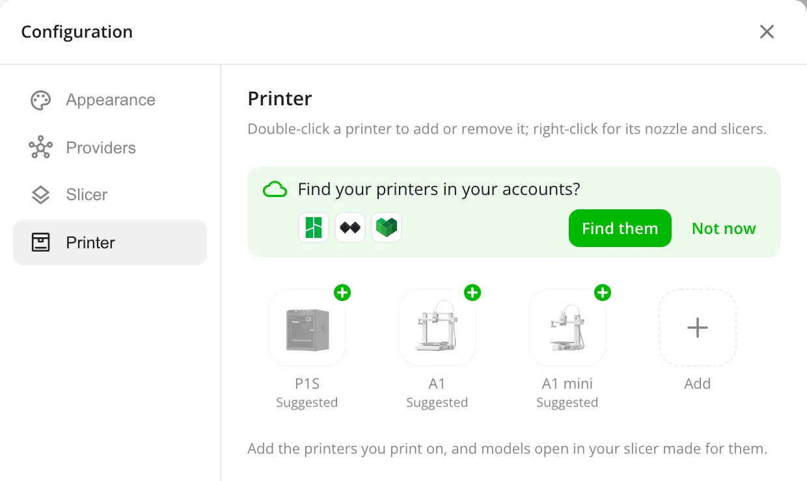
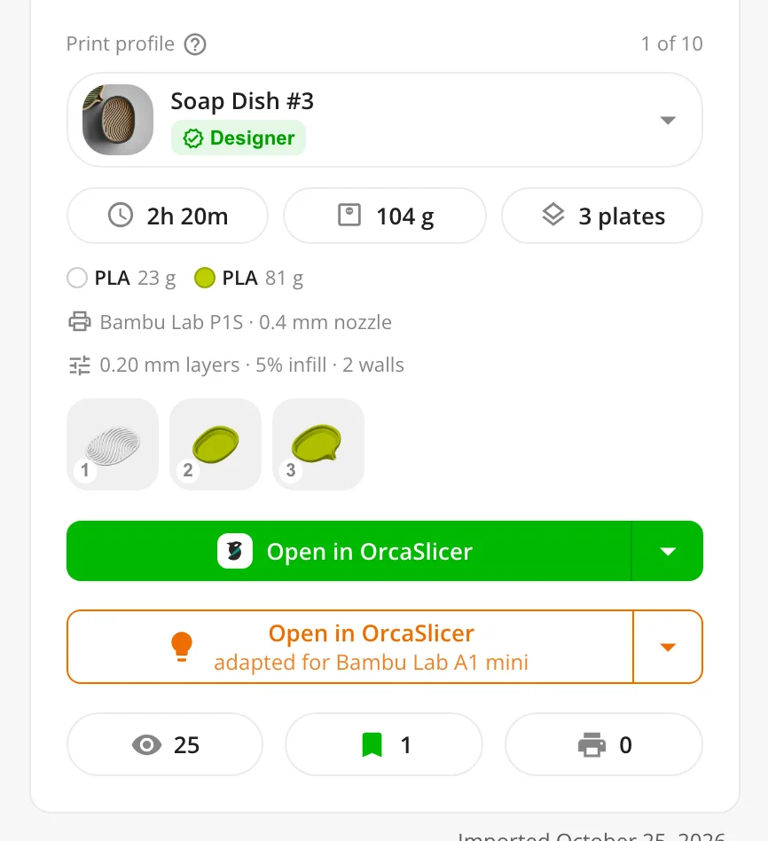
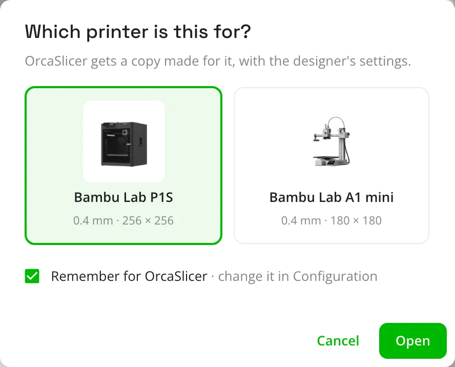
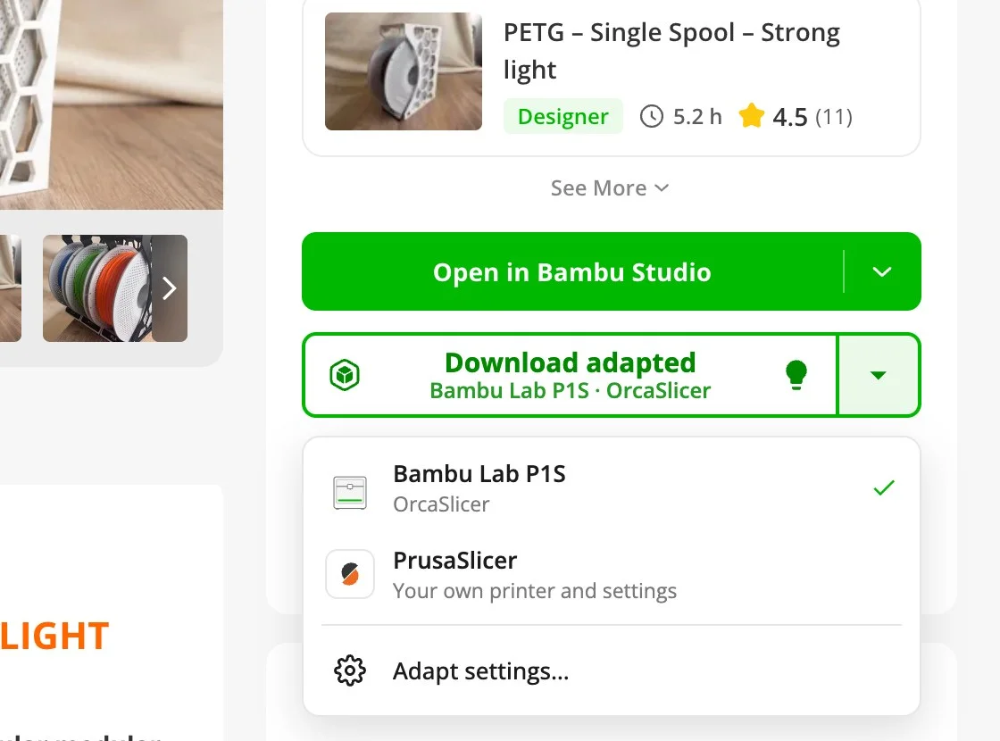
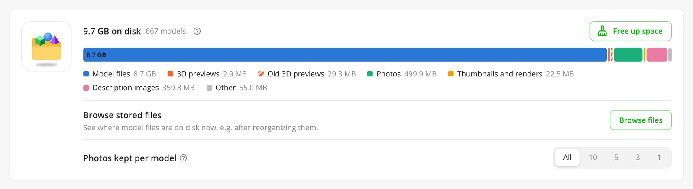
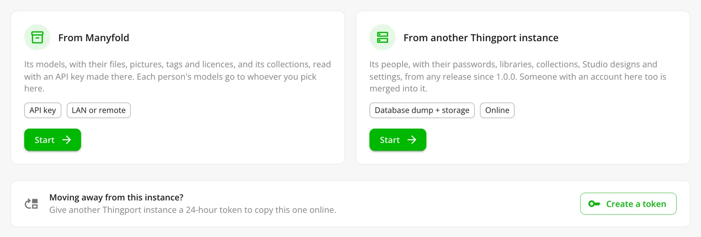
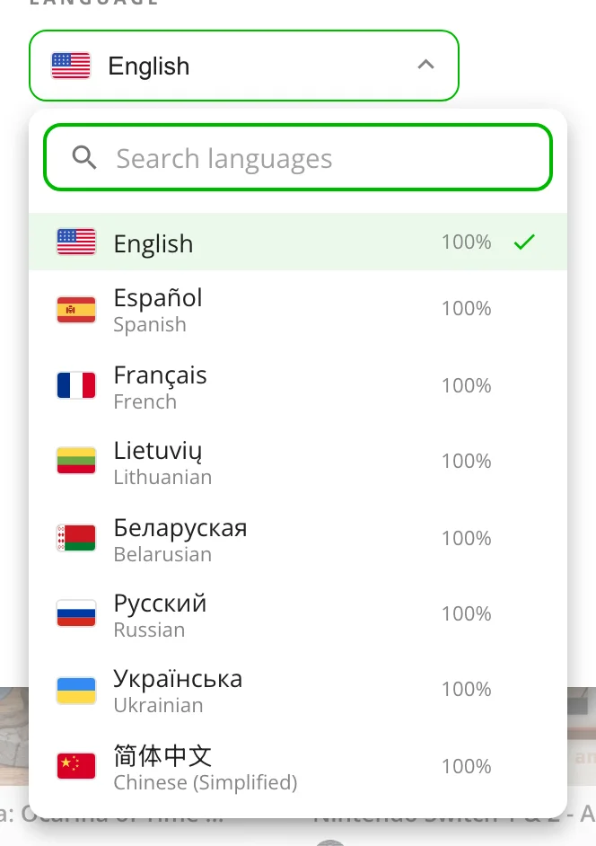
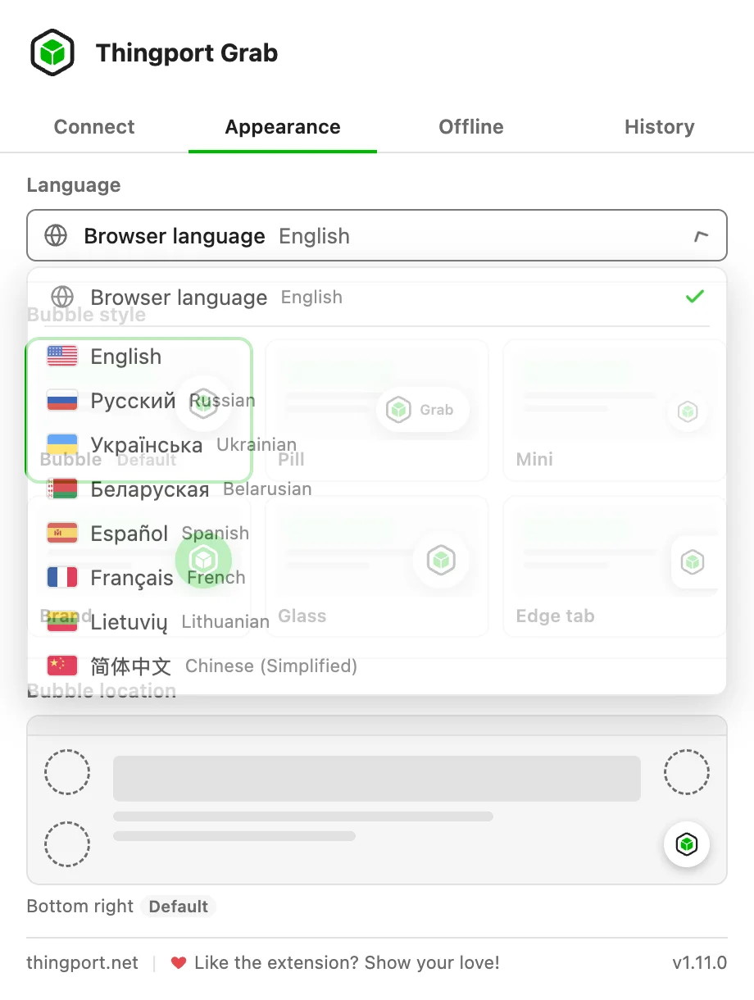

A 3MF is made in one slicer, for one printer. Open it anywhere else and colours, parts or settings go missing, or it
lands on a printer you don't own.

**Not any more.** Thingport 1.7.0 opens any 3MF as if it had been made for your slicer and your printer, wherever it
comes from, and the Thingport Grab extension downloads those copies straight from the model's page. There's more: free
up gigabytes on the Administration → Storage page, import from QIDI Maker and VoxelShare, move in from another
instance, earn achievements, and use Thingport in Simplified Chinese.

## Open any 3MF as if it were made for you

Whatever slicer you use and whatever printer you own, a 3MF from any site now opens as your own: colours, parts,
plates and the designer's settings intact, laid out on your printer's bed. Getting it takes two steps:

1. **Tell Thingport what you print with.** Pick your slicers and add your printers in the Configuration dialog, under
   Slicer and Printer. Thingport suggests printers from your library, and can even find them in your printer makers'
   accounts.
2. **Click Open adapted** on any model page.





Bambu Studio, OrcaSlicer, PrusaSlicer, Cura and the rest each get the copy they read best, and the stored file never
changes. Thingport asks once which printer a slicer's copies are for, and remembers.



Thanks to SeoliteQ ([#67](https://github.com/TautvydasDerzinskas/Thingport/issues/67)), maxbrueckl
([#216](https://github.com/TautvydasDerzinskas/Thingport/issues/216)) and truri83
([#261](https://github.com/TautvydasDerzinskas/Thingport/issues/261),
[#262](https://github.com/TautvydasDerzinskas/Thingport/pull/262)), whose reports and fix this grew from. How it works,
slicer by slicer: [Adapted 3MFs](/docs/features/adapted-3mf/).

## Download adapted, straight from the model's page

The Thingport Grab browser extension puts a **Download adapted** button right beside the download button on nine model
sites, MakerWorld and Printables among them. One click, and the 3MF is already made for your slicer and printer.



It works even without a Thingport instance connected to the extension: just pick your slicer and printers in its
popup. Connected, it uses the ones you picked in your Thingport instance. More in
[Thingport Grab](/docs/grab/#download-adapted-no-thingport-needed).


## Free up gigabytes in a few clicks

The Administration → Storage page now shows what really fills your disk. On one library, 16 GB of "pictures and
previews" turned out to be mostly 3D previews, old copies and leftovers included.



Its **Free up space** button clears what nothing needs: old 3D previews, leftover slicer copies and, if you like, extra
photos. New 3D previews take a fifth of the space they used to. More in [Disk space](/docs/features/storage/#disk-space).


## QIDI Maker and VoxelShare: 23 sites to import from

Two printer makers' model communities join in, [QIDI Maker](/docs/providers/qidimaker/) and
[VoxelShare](/docs/providers/voxelshare/), with their print profiles, collections and likes. Their slicers come along
too: QIDI Studio and Flash Studio open what you import. Thanks to krolbot for QIDI Studio and QIDI Maker
([#326](https://github.com/TautvydasDerzinskas/Thingport/pull/326),
[#340](https://github.com/TautvydasDerzinskas/Thingport/pull/340)).


## Move in from another instance

The new Administration → Migrate page brings another Thingport instance's people and libraries over, online or from a
backup of any release since 1.0.0, and never brings anything twice. It can bring a Manyfold library in too.



Step by step: [Move to another Thingport instance](/docs/guides/migrate/) and
[Move from Manyfold](/docs/guides/migrate-manyfold/).

## Achievements

Earn badges, from bronze to holographic, for importing, downloading, designing in Studio, syncing collections, and a
few secrets. They show on your My models page and on the Explore page. An admin turns them on in the Administration →
Social page.


## 简体中文, and two China sites

Thingport and the Thingport Grab extension now speak Simplified Chinese, and the China sites of Snapmaker Space and
VoxelShare import too.



## Also new

- **One collection, several sources**: a synced collection can follow lists on several sites at once. Thanks to SeoliteQ
  ([#70](https://github.com/TautvydasDerzinskas/Thingport/issues/70)).
- **Files keep their folders**, on the model page and in downloads.
- **The Thingport Grab extension speaks your language**, every one Thingport does. Thanks to krolbot
  ([#328](https://github.com/TautvydasDerzinskas/Thingport/pull/328)).



- **Puzzles solved, imports carried on**: when MakerWorld or MakerOnline wants a puzzle solved, the Thingport Grab
  extension shows it and carries on once it's solved.
- **eufyMake's print files** import as print profiles.
- **Invite links without email**: the Invite users button on the Administration → Auth page gives you a link to send
  yourself. Thanks to CandidB ([#310](https://github.com/TautvydasDerzinskas/Thingport/issues/310)).
- **The Thingport Bridge desktop helper** tells you when a new version is out, and updating it on macOS finally works.
- **Love Thingport?** The What's new dialog, the Administration → Overview page and the Thingport Grab popup now show
  ways to support it.
- After a tool saves a model, an **Open** button takes you straight to it.
- Russian, Ukrainian and Belarusian translations are complete, thanks to krolbot
  ([#327](https://github.com/TautvydasDerzinskas/Thingport/pull/327)).

## Fixes

- Rotated parts face the right way in 3D previews and model pictures.
- Importing several MakerWorld print profiles with the Thingport Grab extension no longer stalls or downloads ones you
  have. Thanks to slewantoski ([#333](https://github.com/TautvydasDerzinskas/Thingport/issues/333)).
- Pairing the Thingport Grab extension survives the browser's permission prompt, thanks to krolbot
  ([#330](https://github.com/TautvydasDerzinskas/Thingport/pull/330)).
- Some Bambu Studio projects no longer show an empty plate in the 3D preview, and more NexPrint models import.

## Get it

Pull the new images and restart, as in [Updating](/docs/install/#updating):

```bash
docker compose pull && docker compose up -d
```

Built from a checkout instead? Pull the code and build the images again:

```bash
git pull && docker compose up -d --build
```

Update the frontend and backend together, then pick your slicers and printers in the Configuration dialog to get the
most out of Open adapted. The Thingport Grab extension updates itself through your browser's extension store. The
Thingport Bridge desktop helper doesn't: if you use it, install the new one from the
[`bridge-latest` release](https://github.com/TautvydasDerzinskas/Thingport/releases/tag/bridge-latest) over the old one.

Happy printing, on the printer you actually have.
