Studio could always design a part from a sentence. What it couldn't do was open the 3MF you already had, keep its
colours, or say how it should be printed.

**Now it does.** Thingport 1.8.0 opens any 3MF in Studio with its plates and colours, and a design carries its own
print settings all the way into your slicer. Most of the rest of this release is yours: it grew out of the issues and
ideas you sent in. A print queue and a filament shelf the household shares, notes on your models, a 3D printing wiki,
a "Send to your printer" feature, the thumbnail you pick, sorting by name, and Thingport in German.

## Studio: open a 3MF, colour it, set how it prints

Open any 3MF from your library in Studio, with **Open in Thingport Studio** on its page, and it comes in whole: every
plate, every part where the designer put it, in its colours. Studio opens at once and gets each plate ready as you
pick it, so even a big multi-plate project is quick to start on.

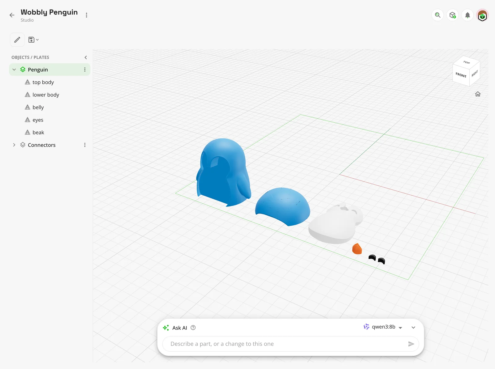

Then make it yours:

- **Colour parts** and see the colours in the view and in the 3MF.
- **Move parts between plates**, add plates, and **arrange a plate** on your printer's bed, with the spacing you like
  and the parts you lock left where they are.
- **Check it for printing** against your own printer: its bed outline in the view, and a click on a warning takes you
  to the part behind it.

Every design can now carry a **print profile**: the slicer settings it's meant to print with. Open the new **Print**
tab, start from a preset such as Standard, Strong, Outdoor, Water contact, Toy or Vase, and change any setting you
like. Studio offers only the settings your slicer reads, shows what your slicer calls each one, and its AI can pick a
preset for you and say why.

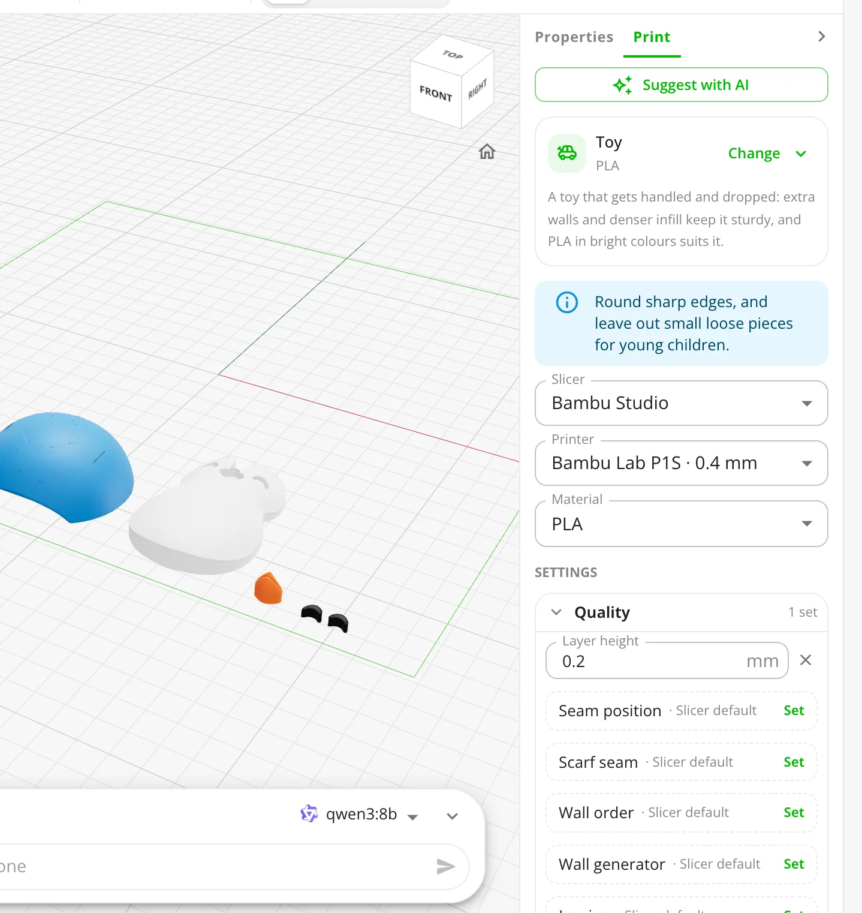

The profile travels in every 3MF Studio makes. **Open with slicer** opens the design straight in your slicer with your
printer and nozzle picked, and on Bambu Studio and the slicers built on it, each colour goes to the filament slot you
choose. **Save to Thingport** saves it as a new model, or adds it to one you have as one more print profile, shown on
the model's page like one imported from a model site.

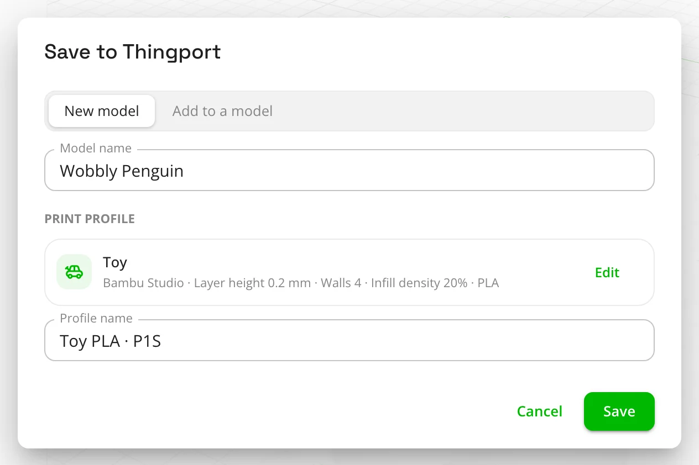

Need it as files? **Export** gives you one 3MF, or a ZIP with an STL for each plate. Plates, colours and print
profiles are Studio commands, so the Ask AI box and any assistant connected over MCP can set them too. More in
[Studio](/docs/guides/studio/#plates-colors-and-export).

## Print together: a shared queue and a filament shelf

Two new tools for a household that prints together, and both were asked for.

**[Print queue](/community/tools/print-queue/)**: add a model from its page, or select a whole grid of them and add
them at once. Everyone sees who has what queued, printing or printed, as chips on the model's page and on one shared
board, where dragging a card moves it along. Each person picks who sees their queue.

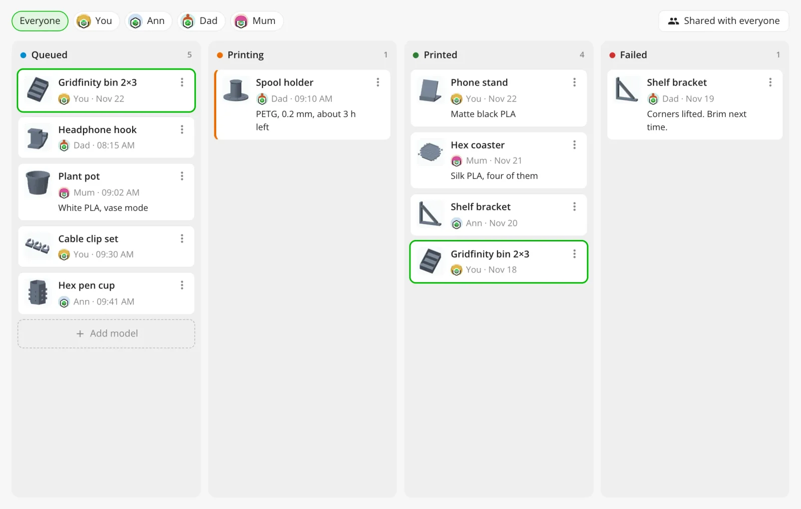

**[Filament shelf](/community/tools/filament-shelf/)**: everyone's spools on one shelf, with how much is left. On each
model's page, a Filaments tab shows the filaments it needs and who has a match, by material and colour, and a ring on
its picture fills as the household's spools cover it. The filaments come from the model's print profile or its 3MF, so
there's nothing to type in.

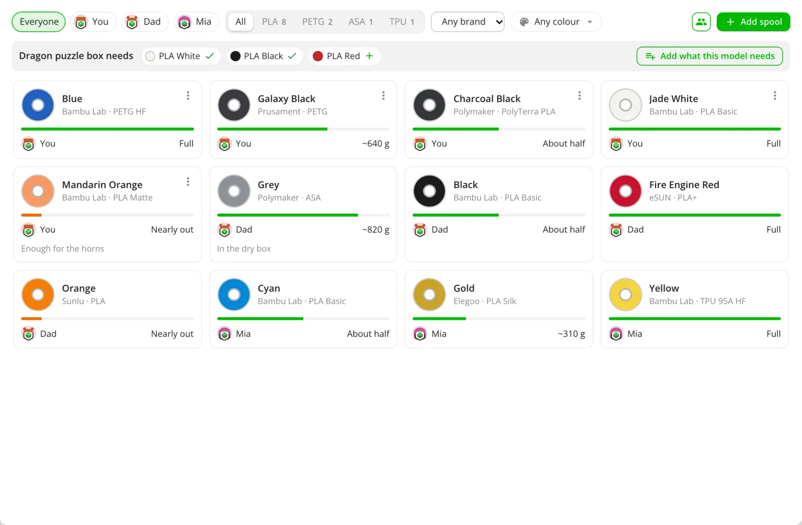

An admin installs both, like any tool, on the Administration → Tools page.

## Notes on your models

"Print this one at 0.12 mm." "The left hinge needs a brim." Pin a note to any model's picture, as a speech bubble or a
sticky note in one of four colours, just for you or for everyone. The **[Notes](/community/tools/notes/)** window
keeps them all together, to search by model or by what they say.

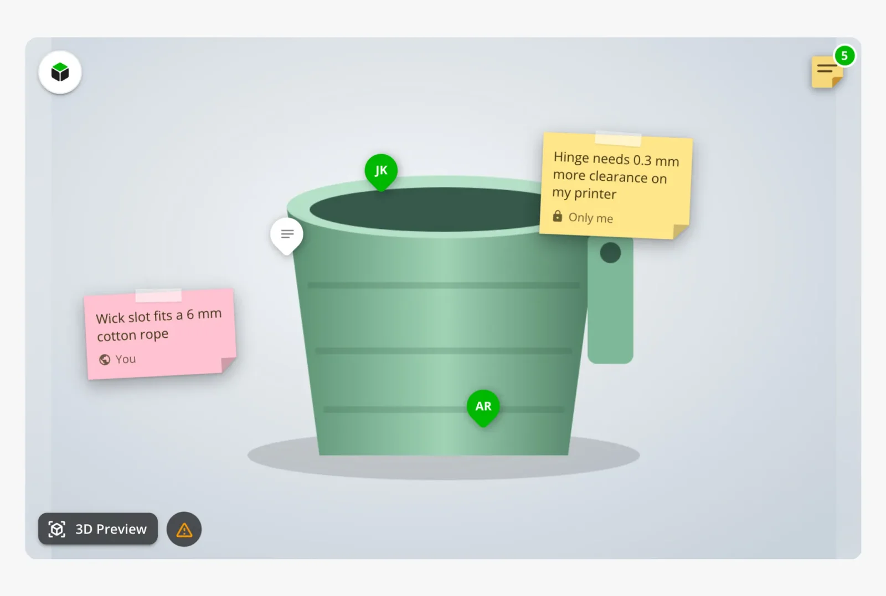

## The 3D Printing Wiki, with a quiz

Print came out wrong? The new **[3D Printing Wiki](/community/tools/3d-printing-wiki/)** walks you through 46 problems,
from stringing to layer shifts, each with a check, the likely causes and the fixes in order. It explains the slicer
settings that matter most and names each one as Bambu Studio, OrcaSlicer, PrusaSlicer and Cura call it, with side by
side slices for layer heights, walls and infill. There are drying times for filaments, printer makers' histories and a
glossary too.

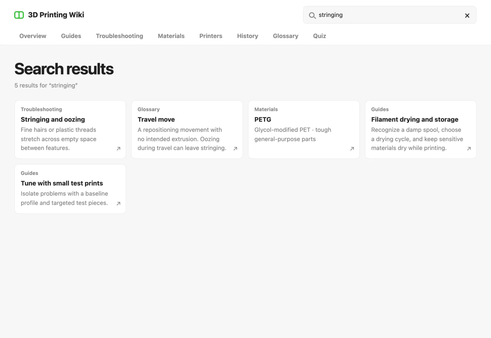

Then try its quiz: 30 questions from a bank of 144, many with a picture of the defect to spot. Practise with each answer explained,
or sit the exam to earn the **FDM Fundamentals** badge.

## Send it to your printer

Send a model's file from its page straight to **OctoPrint**, **Klipper** or **PrusaLink**, to a **Home Assistant**,
**n8n** or **Node-RED** webhook, or to an address of your own. Set your places up in the Configuration dialog under
**Send to**: each gets its own button on the model's page, or waits in its menu, and turns up only for the file types
you give it. Each person has their own, and API keys stay on the server.

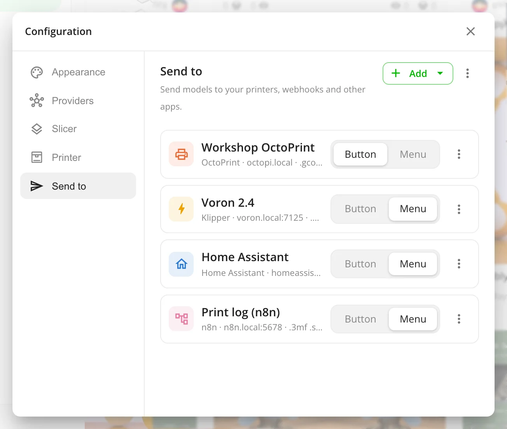

Presets, webhooks and the request you can write yourself: [Send to](/docs/guides/send-to/).

## Instructions and parts lists, open on the model page

A model is more than its STL: assembly instructions, a parts list, a README, the script it was made from. These
supporting files now have a **Supporting files** tab on the model's page, and open right there: a PDF in your
browser's own viewer, pictures, Markdown, text and scripts, and a CSV as a table. **Copy link** shares the page with
that file open, the Download picker lists them, and Send to takes them too.

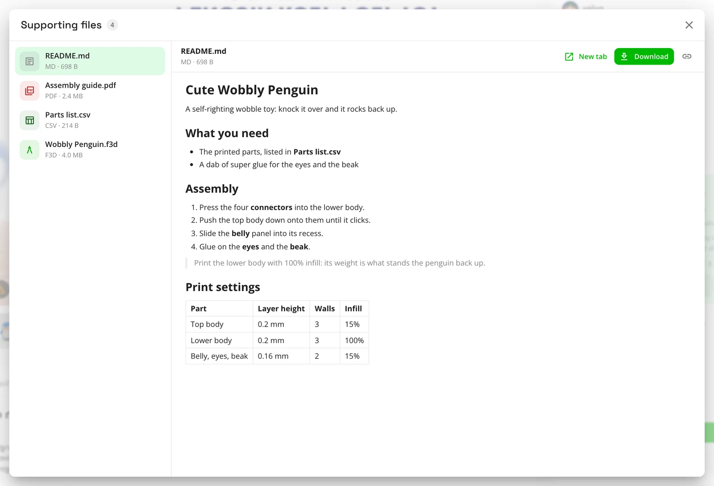

This is the first half of a bigger feature. In the next release, you'll add supporting files to your own models, and
your imports will bring every one of them in. More in [Supporting files](/docs/features/supporting-files/).

## Deutsch, and tools in your language

Thingport and the Thingport Grab extension now speak German. Pick **Deutsch** in the Configuration dialog, or let
Thingport follow your browser. And every tool in the repository but the new wiki now speaks all nine of Thingport's
languages.

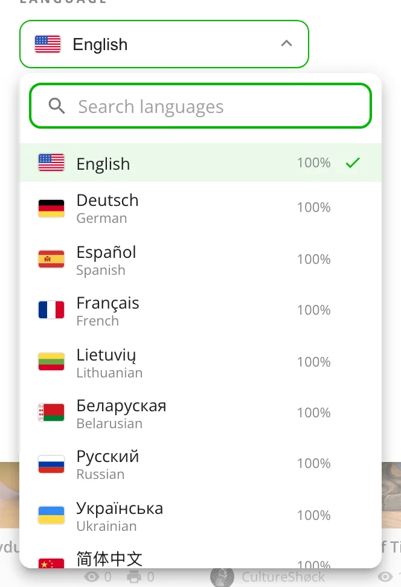

## Also new

- **Pick a model's thumbnail**: click **Use as thumbnail** on any picture in the Edit model dialog, and the card shows
  it.

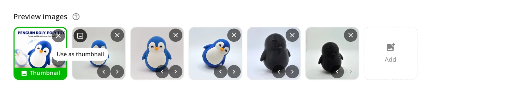

- **Sort by name, and flip any sort**: every list of models sorts by name, Cable 2 before Cable 10, and clicking the
  chosen sort again flips it, so Newest becomes Oldest.
- **A quicker model menu**: on the model page, the **⋯** menu opens with big tiles for Download, Open in your slicer,
  Add to collection and Edit. On cards, the rest waits in submenus.

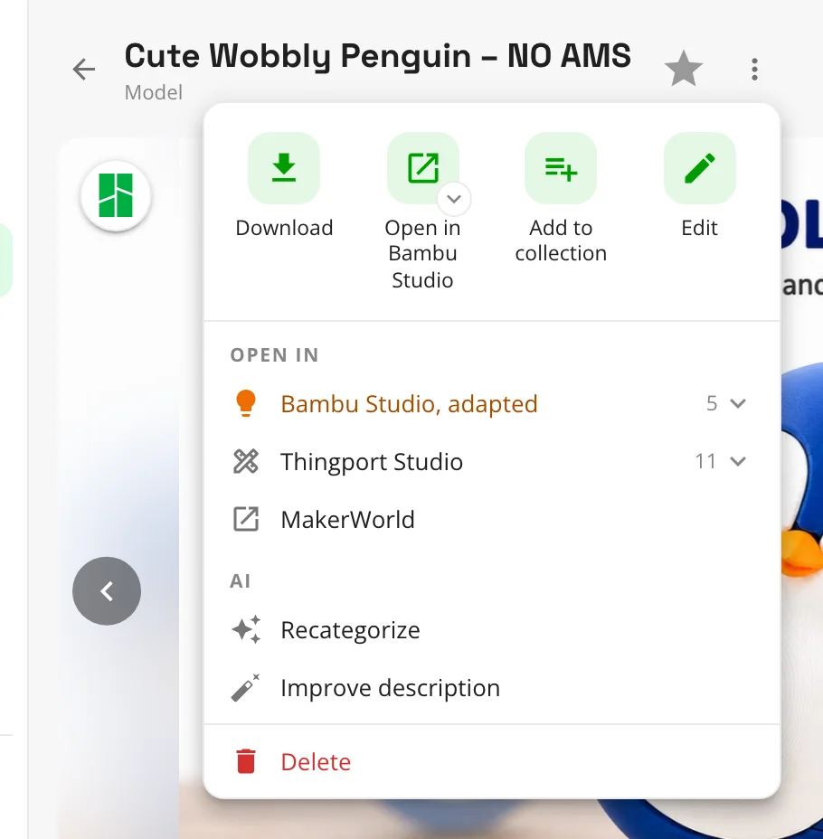

- **Parts that fit back together**: Studio's Split adds pins and sockets, and a fit test prints a strip of them so you
  can apply the clearance that fits your printer.
- **Tools right where you need them**: tools can add their actions to a model's menu and to a grid's selection, and
  their own parts to the model page. The Print cost estimator's **Estimate print cost** is one click from a file. An
  admin can switch a tool off without uninstalling it, and update every tool at once.
- **More for tool makers**: the tools SDK adds data a household shares, commands, parts of the model page and
  Thingport's own model picker. See the [SDK reference](/docs/developers/sdk-reference/) and the new
  [Printed it](/docs/developers/recipes/#printed-it) recipe.
- **The Thingport Bridge desktop helper says what went wrong**: when a model doesn't open, it tells you why and offers
  Try again. On macOS, it takes you to the Local Network setting that was blocking it.
- **Behind a reverse proxy?** A new guide, [Behind a reverse proxy](/docs/guides/reverse-proxy/), says what it has to
  let through, and Thingport and the Thingport Grab extension now say when the proxy, not Thingport, turned a request
  down.
- Studio keeps the Ask AI conversation beside the design while you look, and its design menu lists your recent designs.
- **Download all** counts every file a model has, and its ZIP holds the prepared print too.

## Fixes

- 3MFs from Windows' 3D Builder, and others that name their model differently, get 3D previews, card pictures and
  print checks.
- Downloads keep their names, accents and spaces included, and a ZIP unzips whole on a Mac or Windows.
- A disk that doesn't answer no longer makes a model's files look missing, and a repair keeps the files it didn't lose.
- Deleting a model removes all of it, never half, and a zip's `__MACOSX` folder no longer turns into broken models.
- Zip, F3D and picture files download instead of offering a slicer that can't open them.
- Signing in behind an HTTPS reverse proxy keeps your session cookie secure.

## Thank you

This release is mostly yours: it fixes what you reported, builds what you asked for, and speaks German thanks to a
whole translation. Thanks to [CandidB](https://github.com/CandidB), [gearaddict](https://github.com/gearaddict),
[joriswill](https://github.com/joriswill), who translated Thingport into German,
[pleasantone](https://github.com/pleasantone), [roadkingvrod](https://github.com/roadkingvrod),
[SeoliteQ](https://github.com/SeoliteQ), [slewantoski](https://github.com/slewantoski) and
[tecbeat](https://github.com/tecbeat)! Keep them coming: the
[issues](https://github.com/TautvydasDerzinskas/Thingport/issues) are where the next release starts.

## Get it

Pull the new images and restart, as in [Updating](/docs/install/#updating):

```bash
docker compose pull && docker compose up -d
```

Built from a checkout instead? Pull the code and build the images again:

```bash
git pull && docker compose up -d --build
```

Update the frontend and backend together. The new tools wait on the Administration → Tools page for an admin to
install them, and the tools you have show an **Update** there. The Thingport Grab extension updates itself through your
browser's extension store. The Thingport Bridge desktop helper doesn't: install the new one from the
[`bridge-latest` release](https://github.com/TautvydasDerzinskas/Thingport/releases/tag/bridge-latest) over the old one
to get its new error messages.

Happy printing, and keep the requests coming.
